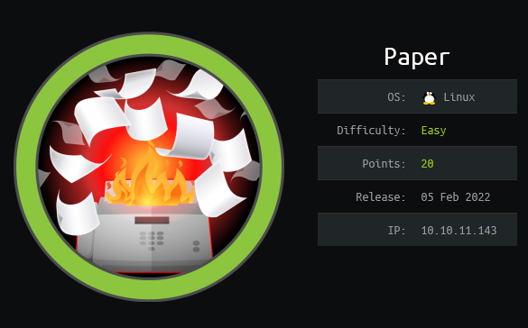
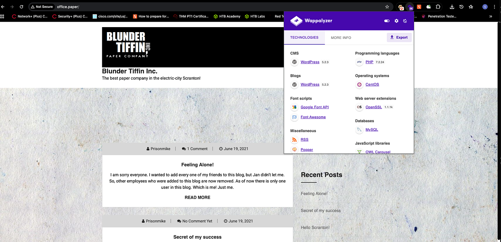
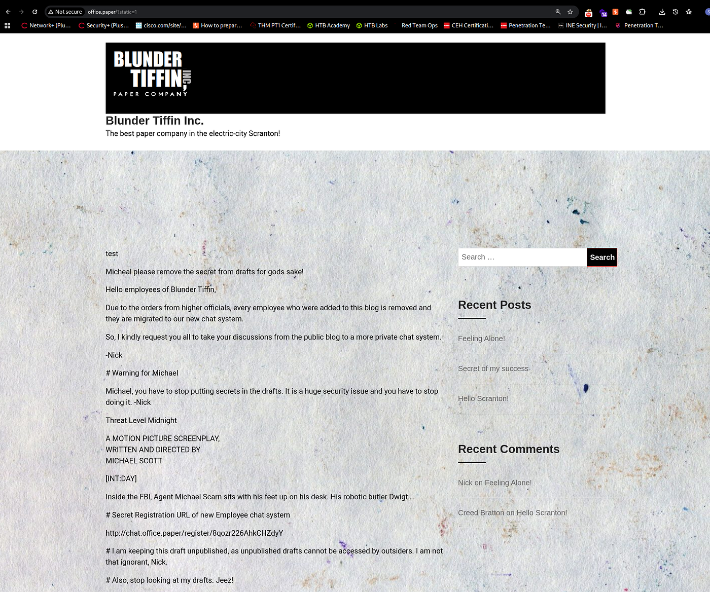
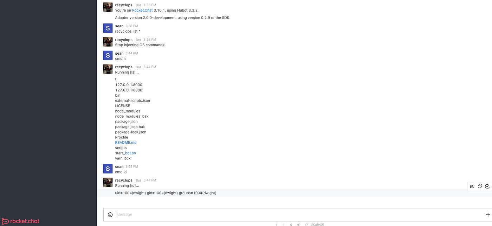

# Hack The Box - Paper



Hello guys, I'll be walking you through the attack vectors and findings for the retired box **Paper**. This machine starts with a WordPress disclosure path that leads to Rocket.Chat credentials, then moves into a chatbot command injection that gives me a foothold as `dwight`. From there, a local Polkit vulnerability is used to escalate to root.

## Reconnaissance

I started with a full Nmap scan to identify open services.

```bash
nmap -A -p- -sC -sV -T5 -Pn --min-rate=10000 -vvv --script=vuln -oN nmapPaper.txt -oX nmapPaper.xml paper.htb
```

The scan showed three open ports:

```text
22/tcp  open  ssh
80/tcp  open  http
443/tcp open  ssl/http
```

The server header and directory enumeration pointed to an Apache installation with a manual site. Checking the headers also revealed `office.paper` on the backend, which was the first useful clue.

## Web Enumeration

The main site looked like a basic landing page, but adding the host entries to `/etc/hosts` revealed more.



```text
10.10.11.143 paper.htb office.paper chat.office.paper
```

Visiting `office.paper` exposed a vulnerable WordPress https://www.exploit-db.com/exploits/47690?source=post_page-----5b8eb84618fd--------------------------------------- installation. The `?static=1` parameter opened a developers’ chat page and led to a private chat room, which turned out to be useful later.



## Initial Access

### Rocket.Chat Bot Abuse



Inside Rocket.Chat, I found a chatbot set up by `dwight`. Looking at the bot files showed that the bot source lived under `/home/dwight/hubot`, and the `.env` file exposed credentials:

```text
ROCKETCHAT_USER=recyclops
ROCKETCHAT_PASSWORD=Queeno...
```

Those credentials could be reused, so I logged in as `dwight` over SSH:

```bash
ssh dwight@paper.htb
```

That gave me a shell as `dwight` and access to `user.txt`.

## Privilege Escalation

### Polkit Vulnerability

Checking sudo rights showed that `dwight` could not run anything with sudo. I ran enumeration tools like linpeas and found the machine was vulnerable to [CVE-2021-3650] https://github.com/tufanturhan/Polkit-Linux-Priv?source=post_page-----5b8eb84618fd--------------------------------------- , a Polkit authentication bypass.

I downloaded and ran the public exploit:

```bash
python3 CVE-2021-3560.py
```

The exploit abused DBus interactions with `accountsservice` to create a privileged user and set its password. Once it completed, I got root-level access.

The exploit output indicated a new user had been created, and from there I was able to move into a root shell and read `/root/root.txt`.

## Attack Path

- **Scan the host** — identify SSH, HTTP, and HTTPS.
- **Find the backend clue** — discover `office.paper` from headers.
- **Enumerate WordPress** — use `?static=1` to find the private chat.
- **Inspect the bot** — locate Rocket.Chat bot files and `.env`.
- **Reuse credentials** — SSH into the box as `dwight`.
- **Check for escalation** — confirm sudo was unavailable.
- **Exploit Polkit** — use [CVE-2021-3650] / [CVE-2021-3560] to gain root.
- **Read the final flag** — complete the machine as root.
